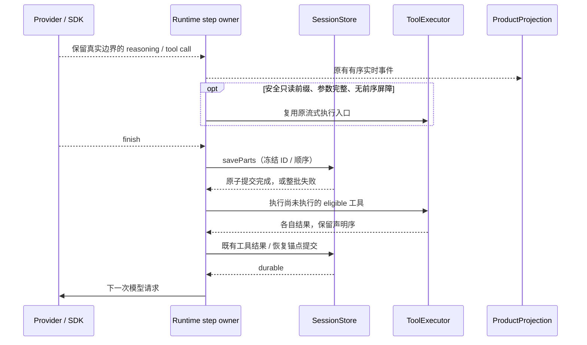

# 模型流、消息持久化与工具执行流水线

状态：P0-A、P0-B 和 P1 已实现并通过回归及本地性能验收。结果见 [验证报告](../docs/benchmarks/model-stream-tool-pipeline-2026-10-19.md)；P2 仍待独立评估。尚未重启用户正在运行的桌面实例或进行三平台安装版验收。

实施拆分与当前源码证据见 [实施方案](../docs/plans/model-stream-tool-pipeline.md)。本文与 [会话思考片段兼容](conversation-reasoning-fragment-compatibility.md) 配套：展示仍由 ProductProjection 合并，真实 provider block、签名和 transcript 不做破坏性合并。

## 1. 产品目标与范围

1. OpenAI-compatible 流中的空 `tool_calls: []` 不代表发生工具调用，不得结束当前思考块。
2. 模型响应完成和取消收尾不得逐块自动提交 SQLite，造成工具启动或停止反馈的秒级阻塞。
3. 流式提前执行与流结束后的执行共用并发约束、顺序边界、权限和结果提交规则。
4. 独立工具完成一个即可补入一个；写操作、交互、终止工具和未知能力仍保留屏障。
5. 提速必须保持工具副作用、完整思考、签名、恢复和跨客户端投影语义。

不在本轮引入新的模型选择策略、全局 shell 会话池、工具结果跨轮缓存、数据库结构迁移、历史 transcript 重写或新的 accepted command 队列。不按工具次数强制结束长任务。

## 2. 修复前已确认的问题

| 环节               | 当前行为                                                       | 后果                                            |
| ------------------ | -------------------------------------------------------------- | ----------------------------------------------- |
| SDK 解析           | `delta.tool_calls != null` 即结束活跃 reasoning，包含空数组    | 连续思考可退化为每个 delta 一个 start/end block |
| Runtime 收尾       | 成功及取消路径对每个 reasoning 分别 `await persistPart`        | 工具执行前出现额外等待                          |
| SQLite part writer | 每次写 part 查询下一 sequence 并更新 session；缺少整批提交入口 | 多次自动提交、重复扫描与写入                    |
| 普通工具调度       | 按并发上限切组，整组 `Promise.all` 后再启动下一组              | 一个慢工具拖住后续独立工具                      |
| 流式工具调度       | 每次完整 tool call 都单独 schedule/execute                     | 单次批处理上限不能限制这些并行入口的总数        |
| 流式顺序           | 只判断当前工具是否适合提前执行                                 | 后置 Read 可越过先前尚未执行的 Write            |

证据区分：空数组触发 SDK 假边界已用本地合成 SSE 复现；本地会话观察到 block/delta 数量相等及收尾延迟，但缺少其原始 SSE，不能断言该历史请求的上游帧必然包含空数组。

## 3. 唯一所有者与接口边界

| 状态 / 事实                          | 唯一所有者                            | 其它层的职责                                     |
| ------------------------------------ | ------------------------------------- | ------------------------------------------------ |
| provider 流的真实块边界              | SDK adapter 的解析器                  | Core 保留解析后的 block 和 metadata              |
| 当前响应文字、推理块与工具声明顺序   | AgentRuntime 的当前 model step        | UI、Host、Main 不重建另一份执行权威              |
| 依赖、屏障、并行阶段                 | 既有 ToolScheduler                    | 输出不可变执行计划，不持有 handler 生命周期      |
| 工具并发许可与实际执行               | 既有 ToolExecutor 实例                | 流式 coordinator 和普通 batch 都通过同一入口     |
| 工具声明去重、流中 handle 与恢复账本 | 既有 StreamingToolCoordinator         | 扩展既有 owner，不另建并列工具队列               |
| part 内容、sequence 和事务           | SessionStorePort / SqliteSessionStore | Runtime 只构造数据，通过公开 port 提交           |
| 工作区操作冲突 lease                 | 已注入的 ToolOperationAdmissionPort   | 执行器不绕过；当前主要在 workflow actor 链路注入 |
| 可见行、停止状态与恢复快照           | CLI ProductProjection / publisher     | Desktop 与手机消费同一 owner 的投影              |

工作区身份沿用 `workspaceIdentity?.trim() || workspacePath`；执行 cwd 和文件路径仍用 workspacePath。既有远程 `remoteSessionId`、Host owner/lease 和 stale run 保护不变。

## 4. SDK 空数组修复

- 在现有 `@ai-sdk/openai-compatible@2.0.60` 受控补丁中修复解析条件；不直接修改 node_modules 作为交付，不再添加第二套 SSE 解析器或按供应商名分支。
- `tool_calls` 缺省、null、空数组均不产生工具边界；非空且符合 schema 的数组仍按原语义结束当前 reasoning 并处理工具参数。
- 不丢弃混合帧中的正文、finish_reason、usage、choice 信息和 provider metadata。非法字段继续经过原 schema 错误路径，不能当作空数组吞掉。
- 真实的 text/tool 边界、合法多块思考、Anthropic thinking/signature、OpenAI reasoning 引用保持原样；不在 Core 按相邻文本或相同 ID 盲目合并签名块。
- 补丁覆盖实际 ESM/CJS 入口和对应源文件；同步锁文件 patch hash 及第三方补丁清单，保留现有 usage、视频等补丁。

## 5. 消息 parts 批量提交契约

`SessionStorePort` 提供必需的、单 message 范围的批量接口：

```ts
saveParts(input: {
  sessionID: SessionId;
  messageID: MessageId;
  parts: readonly MessagePart[];
}): Promise<void>;
```

该 port 由 `SqliteSessionStore` 实现。既有 `savePart(input, copyFrom?)` 继续兼容单条更新及复制，单条序号仍在 INSERT 内计算以避免跨连接竞争；两者复用 adapter 内的编码和 SQL 原语，批量实现不能调用逐条自动提交的公开方法。

### 5.1 事务与顺序

1. Runtime 在事务外构造完整 parts，冻结 ID、时间和顺序；成功、取消快照及其它复用该内容提交的路径采用同一构造规则。
2. adapter 校验 session/message/part 归属和重复 ID。跨 owner、既有 ID 归属不符或不合法输入整批失败；空批次不写数据。
3. adapter 独占 `BEGIN IMMEDIATE → upsert parts → touch session → COMMIT`。事务持有期间不得 `await` 外部操作，不启动 artifact、网络、Hook 或另一个事务。
4. 同一 message 的下一 sequence 在事务内只查询一次；新 part 按输入顺序分配，更新既有 part 保留原 sequence 和 time_created。
5. statement 在批次内复用；session updated 在批次内只写一次。不新增长期内存 sequence 缓存。
6. 任一写入失败整批 rollback；相同批次使用相同 ID 重试不增行、不改序，不自动重发模型请求或重跑工具。
7. 不改变签名、providerOptions、已有 tool declarationIndex、媒体引用、正文和 reasoning 的内容或既有排序口径。
8. 不关闭 WAL/持久性保证，不通过延迟写、fire-and-forget 或后台补写缩短表面延迟。

### 5.2 提交屏障

- 普通/有副作用工具必须在所需 assistant 内容成功持久化后开始。
- 原来允许流中执行的安全只读工具继续提前执行，其既有 pending/running ledger 和未知执行状态保护保持；它们不能因内容批量提交被重复执行。
- 全部工具结果按声明序进入 provider history；完成顺序可以不同。下一次模型请求只能在相关结果 durable、结果账本闭合后发出。
- artifact/媒体/文件 checkpoint 在事务外按既有顺序处理；不把这些 await 包进 SQLite 事务。第一阶段不顺带改写复杂工具结果持久化。
- Stop 立即取消模型/工具并按既有取消事实停止思考动画；内容收尾批量保存后才完成 turn。批次失败不能宣称保存成功或提前开放 idle admission。
- 原始合法碎片历史不迁移。新批量写入的数据仍可由现有 Reader 读取。



## 6. 工具调度规则

### 6.1 单一并发许可

- ToolExecutor 实例管理并发许可；`execute`、`executeBatch`、流式单条执行和普通 schedule 共享限制。默认值保持当前配置的 10，不通过提高上限解决排队。
- 单次调用的 maxConcurrency 覆盖只允许收紧实例上限；不能用分批或流式入口分别创建更大的独立额度。许可释放须幂等，取消排队不泄漏槽位。
- 当前 step 的 toolCallId 是去重键，并与 session、runtime turn、assistant response/attempt 一起确定作用域；同名或同参数的新 ID 不自动去重。
- 许可为 executor 内部资源控制，不成为新的业务 accepted queue；跨窗口、跨 Host 路由仍由原 owner 管理。
- 未获许可或等待前序屏障时保持 queued。权限等待、工作区 admission、handler 执行分别可观测，不把入批次当成已经开始执行。
- 获取顺序统一为：权限通过 → executor 并发许可 → 已注入的 operation admission lease → durable running / started → handler。等待或失败均需清理已获取资源；权限对话不占执行许可，不允许另一入口反向获取这两类资源。
- handler 忽略取消、外层先返回超时的情况下，许可/冲突 lease 的释放必须跟随真实 handler 收尾；不能让仍在运行的副作用与下一笔冲突操作重叠。

### 6.2 逻辑阶段与补位

- ToolScheduler 把安全且独立的工具形成逻辑阶段，并发数量由 executor 在阶段内控制；不再因为凑满 10 个就创建具有全组等待语义的新屏障。
- 任一工具完成后，可以启动同阶段下一个 ready 工具；结果最终按原声明顺序聚合，逐工具实时事实仍按实际完成时间发布。
- 非 concurrentSafe、破坏性、需要审批/alwaysAsk、用户交互、成功终止 turn、未知能力工具形成显式屏障；已有依赖也必须满足。
- 不根据路径不同就自动并行 Edit/Write，不从 shell 文本猜测独立性。保留现有权限、Hook、预检查、read revision 与工作区冲突 admission。
- 保留 `ToolCallScheduled` / `ToolCallStarted` / result / `ToolBatchComplete` 的契约。逻辑阶段分组与实际 handler 开始分开；如需改共享 payload，必须同步严格类型、运行时校验和两类客户端回归。

### 6.3 流式与终态统一

- 完整 tool call 已校验后才考虑提前执行，不执行参数 delta。
- 只允许无前序未完成屏障的安全只读前缀提前执行；`Write → Read` 的 Read 不能越过 Write，`Read → Write → Read` 只提前第一个 Read。
- coordinator 的既有 accepted map/handle 负责记录这种阻塞，不另建相同调用的副本。finish 后仍走原调度器和 executor，复用已执行结果。
- provider-executed 工具不进入本地执行器；未知执行状态不因重试、fallback 或 failover 被重新执行。
- Stop / stopTurnAfterResult 阻止新的 queued 工具启动，已启动工具依原取消与清理契约收口。每个已声明本地工具最终恰有一个 result 或明确的取消/未知状态。

## 7. 降低模型与工具往返次数

优先复用现有 Read/Glob/Grep、结果预算和 artifact 能力：一次模型响应可声明多个已知独立的查询，统一得到结果；同一验证步骤中的明确依赖命令可以由模型构造为一个受审批的 Bash 调用。Runtime 不改写模型命令、不自动拼 shell、不隐式重跑失败命令。

工具说明仅增加可执行的批量使用引导，不新建 MultiTool、不降低审批、不让 Renderer 自动调度。模型策略变化先在合成任务集比较正确率、请求次数、总延迟、输入 token 和错误修复轮次后采用。

暂不引入跨轮结果缓存或常驻 shell 池：现有 Read 已有 revision/mtime 相关缓存；扩大缓存或 shell 生命周期会改变 cwd、环境、文件一致性、进程清理与权限边界，需要单独证据和 spec。

## 8. 客户端、恢复与可观测性

| 边界                   | 要求                                                                    |
| ---------------------- | ----------------------------------------------------------------------- |
| Desktop continuous     | 实时行、工具状态和取消事实按 owner 序列交付，不追加 UI 自建队列         |
| 手机 replayable        | 在 queued/running/提交中任意断线后，snapshot + gap repair 与 owner 一致 |
| 冷恢复 / fork / rewind | part ID、sequence、签名、工具结果配对、历史分支不变                     |
| 会话切换               | 旧 turn/response 迟到事件不能更新当前运行                               |
| 存储失败               | 模型成功和存储成功分开报告；失败不能伪造 tool_result_committed          |

当前增加 `assistant.parts.committed` 的整批耗时/块数，以及工具开始日志中的 executorWaitMs/operationWaitMs；沿用既有权限、handler、结果和模型请求遥测。细分 parts 构造与 SQL、结果 durable 到下一请求的专门 span 留待后续观测扩展。复用 trace/session/turn/response/toolCallId 关联，新增日志不记录正文、命令内容、凭据或真实用户路径。

高频逐帧信息保持 debug；info 只汇总一次 step/batch 的块数、字节量、事务数、阶段耗时、流中已完成数量。区分 provider 时间、运行时处理时间、实际工具时间、用户等待和系统睡眠，不把日志中缺失的 first-token 时间补成零。

## 9. 验收门槛

- 空数组合成流的 10,000 个 reasoning delta 形成一个真实连续块；文本、usage 和最终工具不丢失。合法多块及签名仍逐块保留。
- 对 2,256 / 10,000 个合法原始块，批量保存每个 message 一个事务、一次 next-sequence 查询、一次 session touch；内容与原单条路径逐字段一致。
- 注入任意位置失败后数据库无半批新增；重复提交幂等；错误归属、取消和恢复锚点正确。
- 并发上限为 2 时，A/B 已开始、B 先完成而 A 仍阻塞，C 能立即开始；任意时刻实际并发不超过 2。流式 12 个调用也受同一上限约束。
- `Write → Read`、`Read → Write → Read`、交互、终止工具和未知能力均不越过屏障；无重复副作用或遗漏结果。
- 不以不稳定墙钟值作为单测通过条件。可重复基准单独记录 p50/p95/p99、event-loop delay、SQL 计数和内容校验；目标和放行方式见实施方案。
- 回归 Desktop continuous 与手机 replayable 的开始、取消、完成、重连、旧事件拒绝、分页和冷恢复。实际安装版尚未运行时必须注明。
