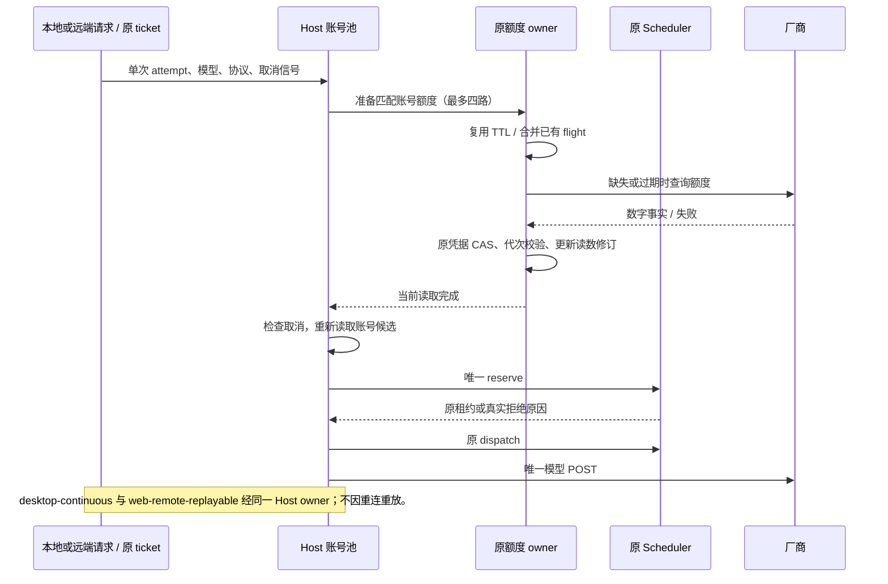

# OAuth 路由请求前刷新额度

## 问题与规则

2026-10-22，承接 `provider-routing-hardening.md`。CommandCode 会话出现首轮成功、下一轮 `reserve-unverifiable`：原额度缓存超过 60 秒后，Scheduler 的 `peek` 只投影 stale；首个请求占用受控探测，后续没有读取新额度来解除探测。当前源码已用合成数据复现。现场未保存失败瞬间额度快照，不能据此断言具体耗尽窗口或厂商余额。

借鉴本地 Magpie `d9c6a60d` 的过期读数主动刷新、读取合并和晚到结果隔离；不复制其继续按陈旧读数放行及 reset 后自动视为恢复的语义。无需修改固定 vendor 或增加厂商请求端点。

- OAuth 请求在原 Host 账号池中、调度预留及账号推理锁之前准备当前模型可用账号的额度。首次没有读数、缓存过期时通过原 `ProviderAccountQuotas.get` 读取；有效缓存复用，不每轮强刷。失败、unsupported、unknown、partial 沿用原 TTL 和投影，不循环强刷。
- 每个账号复用既有读取 flight，准备阶段最多四个并行账号读取。只处理本请求的模型/协议候选，不扫描其它供应商、禁用账号或不支持该模型的账号。
- 等待者取消仅结束自己的等待，不取消其它请求/界面共用的额度读取。共享读取仍归 Host：超时、账号删除/禁用、重授权和 Host 退出由原 owner 取消及拒绝晚到结果。
- 额度读取可触发原凭据 CAS 轮换。读取完成后重新读取账号候选，再以当前凭据/授权代次进行唯一一次调度预留；不沿用准备前的旧账号快照。同一授权 epoch 的 token 轮换后读取失败，仍保留上一份额度事实并标记 stale；重新授权后的新 epoch 不继承旧身份事实。
- 准备失败不伪造余额、读数版本或覆盖水位，不清理探测许可、本地借记或限流/冷却。仍无法验证时保留 `reserve-unverifiable`；真实耗尽保留 `quota-exhausted`。缓存刷新不是已覆盖消费的证明。
- `RoutingScheduler` 保持无 IO。模型 POST 仍只从原 ticket → reserve → dispatch 发送一次；不因额度刷新重放模型请求，不修改 API Key 文件 owner、硬绑定、owner/lease、stale run 或远程身份语义。

## 所有者与顺序

`ProviderAccountQuotas` 唯一持有缓存、TTL、读取 flight、读数修订及取消域；`ProviderAccountScheduler` 唯一持有预留/探测/消费/恢复。账号池仅编排准备、重新读取候选及原始派发。

## 验收

先增加失败回归，覆盖三种 OAuth 协议：种下额度缓存、过期、连续发送两个请求，均成功且只读取一次新额度，每个 attempt 仅一次模型 POST；同 TTL 不重复读取。另覆盖并发读取合并、取消一个等待者后另一个继续、准备最多四路、额度读取轮换 token 后使用新代次、读取期间禁用/删除/关闭不派发、刷新失败不释放既有探测、刷新返回真实耗尽仍拒绝、读数刷新不清未覆盖借记。

实际执行相关额度/账号池/路由、远端 relay、供应商原生与插件回归，以及根 `pnpm typecheck`、`pnpm lint`、changed 架构检查与定向格式检查。环境既有失败单独记录，不修改其它会话的本地改动。纯编排变更不改变 UI 交互，现有桌面/远端公共调用覆盖同一入口。

## 实测记录（2026-10-22）

- 实现前，三种协议的缓存过期后连续请求回归均失败：第二次请求返回 409。接入刷新后，这些场景连同其它路由回归通过。
- `pnpm test:provider-routing`：534 通过，0 失败；包括本次 15 个 Host 额度准备场景，以及同授权 token 轮换失败保留旧事实的新增回归。
- `pnpm test:remote-providers`：16 通过，0 失败；远端 RPC 经原 Host 刷新，连续请求不要求重开账号面板。
- `provider-auth` 目录内所有原生及插件 `.test.ts` / `.test.mjs`：356 通过，0 失败。
- `node scripts/test-model-stream-tool-pipeline.mjs`：159 通过，0 失败，包含 desktop-continuous / web-remote-replayable 工具执行场景。
- `pnpm lint`、`pnpm architecture:check --changed`（新旧违规均 0）、本次八个文件的定向格式检查及 diff 空白检查通过。
- 初次实施时，根 `pnpm typecheck` 因其它本地改动的 `packages/services/src/lcode-agent/projectNativeOwner.ts:1` 引入尚未导出的 `ProjectNativeRequest`、`ProjectNativeResult` 而未通过（TS2724 / TS2305）；当时未修改这些文件。2026-10-22 提交复核时，基于当前完整源码重新执行根 `pnpm typecheck` 与 `pnpm lint`，两项均通过。

回归使用本地合成账号、HTTP/RPC 与固定供应商测试夹具，没有调用真实账号的模型或额度服务。现场错误时刻的余额不可追溯，验证范围是已复现的过期缓存及探测占用路径。当前交付为源码修改，未更新正在运行的已打包客户端。
