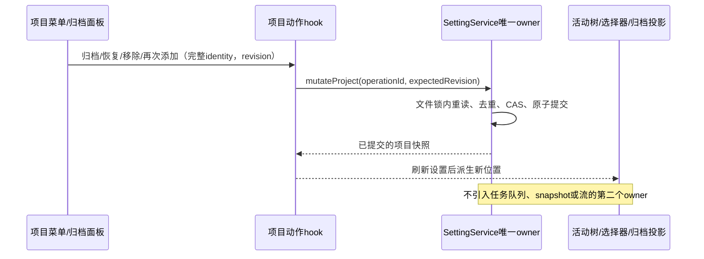
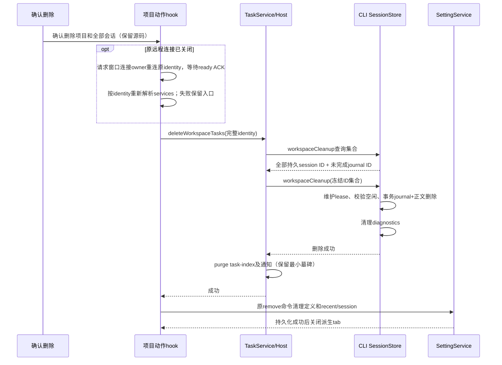

# 项目删除与归档

## 问题证据

侧栏 `resolveSessionConfigurationProjects` 合并 recentProjects、项目定义、远端历史和打开的 tab。
原 `handleRemoveLocalProject` 在没有显式定义时调用 `buildLocalProjectRemovalPatch`；该函数没有匹配定义就返回 null，
导致隐式单文件夹项目的 recent/session 记录没有删除。关闭 tab 后侧栏仍从 recent 投影，重启也会复活。
已有菜单 click 冒泡拦截必须保留；工作树、工作集等依赖门禁与该 no-op 是不同问题。

## 产品规则与状态所有者

- 项目菜单提供“从侧边栏移除”“归档项目”和“删除项目…”。右键和省略号复用动作。
- 从侧边栏移除由设置 owner 持久化 `sidebarHiddenAt`，只过滤活动侧栏及所属会话/工作树/工作集的投影，不删除定义、历史、凭据、分区引用、会话或源码，不关闭连接。已保存项目与旧 recent/session 隐式项目都支持；隐式项目通过同一命令登记，不能仅关闭 tab。
- 移除不受离线、来源读取失败、工作树、独立会话或工作集依赖限制。设置提交失败则保持可见并报错；重读、重载和跨窗口更新不得使其复活。移除项不进入归档区。
- 再次通过打开文件夹、已有项目选择器或远程历史添加相同来源，发送 show 命令并恢复原 ID、成员、会话与分区位置，不重复建项目。新建表单选择已隐藏的同一来源也恢复原记录；新表单内容不覆盖原项目。show 仅清除 sidebarHiddenAt，不能恢复已归档项目。
- 归档是可恢复的导航状态：项目定义、名称、成员、来源身份和会话全部保留，项目及所属内容从活动树、项目选择器隐藏，进入现有归档面板。
- 归档面板展示项目名称和路径，提供恢复与删除。恢复保留原项目 ID、成员和原分区位置，不创建会话或自动连接远端。
- 归档不删除源码、Git 工作树、会话或运行时，不借关闭连接实现归档；离线项目也可归档和恢复。
- `SettingService.mutateProject` 是项目定义及归档状态的唯一写入入口；归档使用 `ProjectDefinition.archivedAt`。
- 隐式项目归档时由同一命令登记为项目，不能通过另一份 UI 持久化列表保存归档事实。
- 删除必须清理应用内项目及恢复索引，涵盖没有定义的旧 recent/session 项目；同路径的其他远端身份不受影响。
- 用户已确认：删除项目记录及其全部会话，保留磁盘源码目录。包括已归档、已置顶、隐藏和曾从列表删除的历史会话。
- 删除须二次确认；运行中或仍有工作树/工作集依赖时给出明确原因，移除和归档不受此门禁限制。先停止运行、处理依赖，再删除。
- 已关闭的远程连接仍可发起删除；确认后由已有窗口连接 owner 沿完整 identity 重连原来源，等待 ready ACK，再重新解析当前 services、验证依赖并永久清理。不能使用旧 remoteSessionId 或本地 service 清理同路径数据；重连失败保留项目并明确报错，不宣称离线远端已删除，不引入后台待删队列。
- 归档区打开时，点击“侧边栏”或在其中选择任一活动视图（包括当前已选项）必须一次点击返回该视图；悬停打开菜单不切换视图。不能只更新被归档面板遮住的 focus。返回工作空间仍保留原 focus。
- 删除走新增的 `session/workspaceCleanup` 维护接口，按完整 workspace identity 匹配。SessionStore 在同一 SQLite 事务中校验完整集合、记录只含 ID 的清理 journal 并删除会话正文、输入历史及关联运行记录；诊断文件清理成功后 Host 才 purge task-index 并删除项目定义。
- 清理 journal 复用现有 local_setting 表，无数据库结构迁移；诊断/ACK 失败后原 ID 仍可重试。不会把旧 `deleteSession` 的关闭语义当成永久删除。
- 各 owner 之间没有跨库原子事务。任一阶段失败保留项目入口并显示错误；已完成的永久删除不可回滚，重试只清理余项。设置写入使用最新 revision CAS，冲突不删除项目定义。

## 接口与时序

- 复用项目 mutation 的 operationId 去重、expectedRevision CAS、跨进程文件锁与写队列。
- archive/restore 与 hide/show 共用项目 mutation；隐藏与归档不经过新建目录存在性校验。旧设置缺少相应时间戳时为活动项目；普通 save 保留 owner 的生命周期字段，不能用旧表单清除隐藏。
- remove 兼容旧内部调用，支持带完整 workspace target 的隐式项目索引清理。业务 UI 文案使用删除。
- 设置提交失败时不关闭 tab、不提前隐藏；重复请求返回原收据；并发修改返回冲突并要求重试。
- UI 通过 hook 发送命令、读取设置快照，不直接访问 Repo；TabStore 和侧栏均为派生投影。

桌面 continuous 和手机 replayable 会话继续使用原 Host attachment、owner/lease 及恢复语义。
归档只更改 profile 导航事实，不发送流重建命令，不为手机另起运行时。

## 验收场景

1. 无显式项目定义、仅 recent/session 的本地项目：删除后活动树和选择器消失，重新读取设置/重载不复活。
2. 显式本地、远端、混合项目：归档后进入归档面板，重载保留；恢复回原位置、原 ID/成员/身份不变。
3. 同一路径本地与两台远端共存：只改变指定身份；离线归档/恢复不连接、不调用本地文件服务冒充远端。
4. 归档项目的会话、置顶、工作树和工作集不再混入活动树；恢复后重新可见。
5. 读写失败、CAS 冲突和重复请求：失败不提前隐藏、不丢定义，重复执行幂等。
6. 菜单在折叠/展开状态、鼠标右键/省略号、键盘、中英文、桌面/390px 触屏均可完成归档、恢复和确认删除。
7. 执行关联单元/集成/E2E，以及 pnpm typecheck、pnpm lint、changed architecture；记录真实结果与限制。
8. 移除旧 recent、显式本地、已断开远端、有工作树/独立会话/工作集的项目：入口一次消失，重载仍隐藏；归档区不出现，重新添加恢复原 ID、会话及分区位置。保存失败、CAS 冲突不提前隐藏；同路径另一 identity 不受影响。
9. 离线远端删除：取消不重连；确认后重连成功才清理；重连失败/依赖阻塞/服务缺失不清理定义；旧 sessionId 与同路径本机/另一远端不能被用作删除服务。
10. 归档区切换至全部/会话/项目/工作树，包括重复点击当前 focus，一次选择立即生效；键盘与窄屏触控均覆盖。

## 实际验证（2026-10-22）

- 关联单元/集成 37 项通过：真实设置 owner 的归档/恢复/重读、CAS/幂等、隐式项目索引清理、SQLite 正文清除、诊断失败重试、task-index 墓碑及同路径身份隔离。
- 浏览器最终按套件结果共 14 项通过：`project-delete-archive` 3 项、`sidebar-source-errors` 4 项、`sidebar-organization` 2 项、`mixed-project-menu` 4 项、`local-project-persistence` 1 项。覆盖中英文、1280/390px、七套主题、键盘/触控、删除取消与失败重试、原位置恢复、旧 recent 项目删除后重载。
- `pnpm typecheck` 通过；CLI contracts/adapters/bootstrap 各自 `typecheck` 通过。
- `pnpm lint`、`pnpm architecture:check --changed`、本次文件格式和 `git diff --check` 通过；架构 total/baseline/new 均为 0。
- 状态所有权：设置服务拥有项目及归档事实，CLI SessionStore 拥有会话正文/清理 ID journal，task-index 拥有派生产品索引；UI 只有 pending 状态和派生过滤。事件顺序见上图，删除失败不跨过下一阶段。
- 模块范围：shared、services/session、ui、lcode-cli，及 Web 测试夹具；未改架构基线。本任务 48 个文件 +1686/-303，净增 1383 行（含测试和规格）；保留其它任务的 provider 改动。
- 验收中修复了归档过滤数组引用不稳定引起的 catalog effect 回环；稳定派生引用后，完整侧栏/主题回归无该错误。旧启动夹具补齐项目命令和 dynamic reconnect event 接口，最终持久化回归通过。

测试使用临时设置目录、SQLite 和生产 React 组件的确定性 IO 夹具；未操作用户真实项目数据。截图在 `.artifacts/project-lifecycle/`。未执行安装版 Electron、实体手机、真实 SSH/WSL/Docker 实机验收。

## 追加验证（2026-10-23）

- 32 项关联单元/集成测试通过：真实设置服务的 hide/show 重读、CAS 和幂等，保存编辑不清除隐藏，旧 recent 与同路径远端隔离，选择器保留原 ID，以及删除重连后的服务换代、失败停止和禁止借用同路径服务。
- 18 项浏览器场景通过：`project-sidebar-removal` 3 项（循环旧 recent、显式项目、工作集、离线远端，含独立会话分区、置顶、工作树、设置保存失败、重载及三个重新添加入口）；`project-delete-archive` 3 项；`sidebar-focus` 3 项；`mixed-project-menu` 4 项；`local-project-persistence` 1 项；`sidebar-source-errors` 4 项。
- 归档切换覆盖当前 focus 重选、项目/会话/工作树视图、侧边栏按钮直接返回、键盘 Enter 与 390px 触控。移除不关闭 tab，确认旧 tab、recent/session 和来源注册事件不会绕过持久化隐藏。
- `pnpm typecheck`、`pnpm lint`、`pnpm architecture:check --changed` 均通过（total/baseline/new 均为 0）；本次文件格式和 diff 检查通过。
- 状态 owner 仍为 SettingService 的项目注册表。新增 hide/show 与 archive/restore 共用命令、CAS、收据、设置通知和投影路径；重连和 ready ACK 仍由既有窗口连接 owner 执行，不另存待删队列或清理事实。
- 远程成功/失败使用生产 Root 重连流程和确定性网络桩验证；未连接真实 SSH/WSL/Docker，未修改用户真实项目或会话。
- 本轮范围为 shared、services/setting、ui 及 Web 测试；34 个文件 +869/-187，净增 682 行（含规格及回归夹具）。其它任务的侧栏和 provider 改动保留在原工作区。
