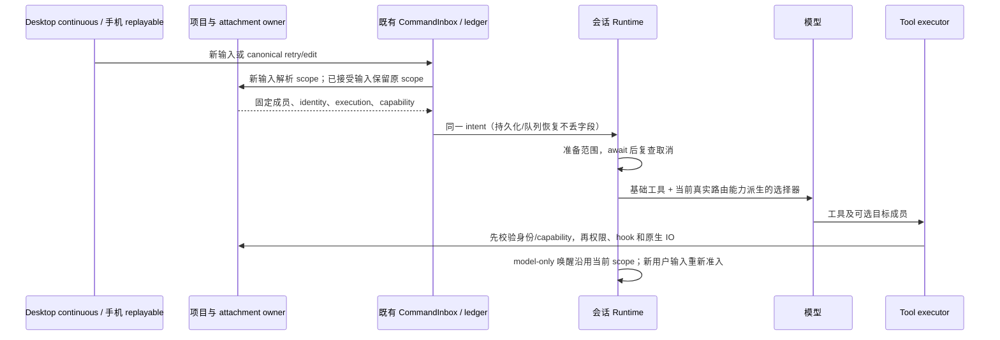

# 项目路由能力声明与恢复边界

## 2026-10-23：目标目录参数误暴露

已确认：registry 为所有原生工具无条件增加 `projectMemberId`；Read 的模型能力投影又重复添加。没有 projectNativeCall 或本轮已接受项目快照时，模型仍看到不可用参数，显式填写后在 executor 路由检查失败。失败发生在文件读取和图片解码之前，不能通过吞掉选择器、绕过权限或换设备修复。

范围传递审查另发现：内部后台/子智能体消息使用 model-only 输入，没有新的用户 intent；`prepareTurnProjectContext` 却无条件移除当前项目范围。目录校验最后一次 await 后也缺取消复查，可能提交迟到范围。

## 产品和接口规则

1. Registry 只提供工具基础 contract。每次 Runtime.getTools 的最终模型投影，由当前 `projectContextForTools` 与 `resolveProjectToolScope` 同时存在派生 `projectRoutingAvailable`；不新增持久化标志或路由缓存。没有快照、没有 resolver、普通单目录/独立 CLI 未提供路由时，不发布选择器。
2. 只有原生 Read/Write/Edit/Glob/Grep/Bash/Git 接收该参数；MCP 的自有 schema 不增删同名字段。Read 的 PDF/图像能力投影和 union schema 保持原规则。有路由时仍是可选参数，不改变既有必填项。
3. Runtime 缓存只存基础 contract，不能缓存某一轮增强后的选择器。项目范围清除、替换、恢复后，每次请求都重新派生。选择器缺省/null 继续使用已接受的主要成员；显式但不可用、未知成员、歧义路径和失效 capability 继续明确拒绝，不降级到本机或另一个成员。
4. 新用户输入在原 CommandInbox/admission 边界固定项目快照，携带到 ledger、队列、retry/edit canonical intent、运行时和派生子 Agent。恢复展示历史不授予执行能力；恢复后的新输入由 Host 重新准入。已接受的队列/重试保留原 scope，不能偷偷读取后来修改的项目定义。
5. 没有新项目 intent 的 model-only 内部续跑沿用该 Runtime 当前已接受的项目范围，与活动循环中吸收通知的语义一致；不从通知文本或历史消息反解析范围。不恢复已结束进程的旧 route token。新用户输入即使缺省项目仍清理旧范围；显式新 intent 优先于当前/继承范围。
6. 每次范围准备在修改前及所有异步校验后检查 AbortSignal，取消结果不得发布项目范围、cwd 和模型提示。原 Host generation/lease/身份校验与 CLI branch fencing 保留。

## 所有者与时序

唯一范围 owner 是 Host 准入事实和 Runtime 的当前执行快照；registry、UI、历史投影不是授权来源。此次不新增协议、数据库字段、鉴权、持久化写入路径或接受队列。

## 验收

- 普通本地/无路由、多目录本地、跨设备：分别验证模型参数可见性及真实 executor 的范围选择；读取图片仍沿原 Read contract，PDF 模型差异保持。
- 缓存预热后无→有→无→不同 scope，基础 schema 不变；原生工具和 MCP 自有字段相互独立。
- 冷恢复只加载历史不发布路由；新输入恢复正确 scope。队列提升、canonical retry/edit、子 runtime 继承保留成员、revision、execution、identity，不按裸路径替换。
- model-only 后台/子智能体唤醒不清除范围；新用户输入不继承上一轮授权；取消发生于最后一次 stat 或 MCP 准备期间时不提交迟到状态。
- 现有路径歧义、跨设备同路径、未知成员、失效 token、shell、权限、后台任务 owner 和连续/可重放链路回归通过。真实远程设备未实测时明确记录。

## 传递审查与验证记录

审查路径：Host project-admission → `v4-bridge-admission-host` ledger → `input-intent` / canonical retry/edit / queue promotion → `prepareTurnProjectContext` → 最终工具投影和 executor；普通子 Agent 使用父 Runtime `inheritedProjectContext` 的结构化副本。冷订阅/恢复不恢复执行 capability，恢复后新输入重新准入；历史 retry/edit 与已接受队列保持原逻辑范围，失效的 route token 仍由原 Host 校验明确拒绝。本轮没有新增把历史内容转换为授权的路径。

- 新增 13 项红灯先复现无范围暴露选择器、model-only 清空范围、最后一次目录探测取消后仍提交；修复后这些用例通过。真实 Runtime 的模型请求（合成模型，无外部调用）验证后台消息和子智能体消息连续两轮使用同一范围，下一条无项目用户输入清除范围。
- 项目路由和恢复共 51 项通过：包含新增队列/序列化/retry/edit 5 项、真实冷恢复、子范围继承、原多设备路由和图片 Read 执行、MCP scope 及恢复事务、原生桥和远程序列化订阅。图片用例验证目标设备二进制经现有 ImageProcessorPort 生成模型图像；无 resolver/无快照仍在 IO 前拒绝，没有静默本机 fallback。
- 根 typecheck/lint、CLI typecheck/lint、目标格式及 changed architecture 通过；架构 baseline=0/new=0。CLI lint 仍有 registry 原有 `no-useless-fallback-in-spread` 警告，不写成零警告。Core 测试单独做类型检查，避免其默认 tsconfig 排除测试导致漏查。
- 验证使用合成目录、身份、路由和内存端口；没有访问用户项目、调用真实供应商或连接真实 SSH/WSL/Docker 设备。没有替换安装版；macOS/Linux 平台未做实机验收。
