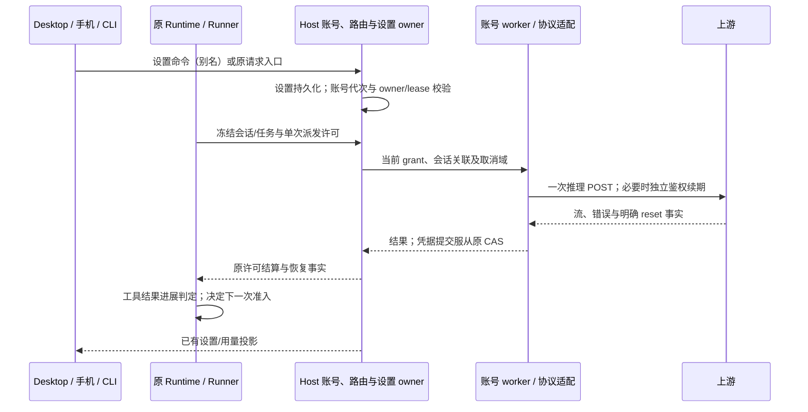

# 2026-10-24 上游供应商修复吸收

## 范围与实现顺序

吸收 Magpie `dd1e8822` 与 plugins `d1b6500` 相对前一检出的兼容性改动。用户要求先实现代码，再补充并执行测试；本规格先于实现。范围为九项：Antigravity disabled 目录、Codex 历史 status、Qoder 任务/CN 设备、Trae 工具与模型档位、月度额度恢复、WorkBuddy/Grok 401 续期、结果感知循环提醒、统计模型别名、Command Code off 档位。ZCode 0.1.24、既有跨进程锁和 IANA 日期统计保持。

## 产品规则与所有者

1. Antigravity 仅接受厂商未 disabled 的模型。合法目录全禁用时返回空目录，不回退为伪可用模型；网络/格式失败仍使用原有降级语义。
2. Codex 回放只投影请求副本，去掉历史 item 的 id/status；保留 call_id、工具配对及原始 transcript。
3. Qoder 一次用户任务的工具循环共用 request_set_id/business.id/begin_at，新的用户输入创建新任务；会话身份来自 Host 的 workspace/remote-session/session 关联，不能按提示词合并不同会话。任务缓存有界、只属于账号 worker；CN 签到使用 CN helper 的设备身份及环境码，缺失行为遵循该站契约。
4. Trae 保留完整 chat/solo 模型目录和每模型推理档位。解析 Qwen/Anthropic 文本工具调用时只接受已声明工具，不执行普通说明文字、代码围栏或未知工具；工具仍经过原 Runtime 的参数校验和权限处理。历史工具结果及空输出保留。
5. 月度额度仅在明确配额耗尽响应且存在可信完整 reset 事实时进入长冷却。解析数字时区而不是猜测 CST；月度上限 35 天，其他未知限流维持原上限，不用任意报错中的日期延长封禁。API/OAuth 复用相同事实解析；Key/共享池作用域不能从错误文案猜测。跨进程 API 共享配额反馈以可选 `quotaResetAt` 传播明确截止事实，省略时仍保持 24 小时延迟上限；不新增持久化结构或 schema 版本。
6. WorkBuddy/Grok 401 最多刷新一次，并通过原 Host 凭据 owner/CAS 提交。增强路由下每次 AuthDriver.fetch 最多一个推理 POST；刷新后返回原结果，由原 Runner 重新准入，插件不能隐藏重发。真正无法续期才报告过期，取消不能产生晚到凭据写入。
7. 重复工具提醒同时比较工具名、规范化参数与有效结果；结果发生变化即视为进展。忽略已知执行耗时/块编号等噪声，不复制固定 8 次硬停止或网关代答；失败/取消与成功结果分开，不增加后台循环 owner。
8. 模型统计别名由已有 Settings owner 持久化；严格限制数量、长度、自映射与循环。别名只在查询聚合和显示中解析，原始请求记录、计费、路由和模型目录不变，不跨供应商/账号合并身份。支持恢复原模型名；桌面和手机、中英文均可编辑，切 Host 不沿用旧异步写入。查询协议显式携带别名投影，旧客户端省略时保持旧行为。
9. Command Code 只为上游支持 off 的模型暴露 off，并按该供应商协议发送，不能把其他模型的 none/off 擅自改成一个值。

desktop-continuous 与 web-remote-replayable 继续共享原 owner 和事件序列；本轮不修改 queue/snapshot/replay，也不创建第二个 Host。workspaceIdentity、remoteSessionId、stale run 和物理请求完成边界均保留。

## 来源、兼容与验收

- 上游 MIT 源保留精确 commit、版本、哈希和许可。原始快照不手工改写，局部差异只在已验证构建副本中应用；上游已包含的旧补丁必须移除或迁移，不能重复注入。
- 先完成实现，随后补：空/全禁用目录、历史回放、跨工具轮任务及新输入、CN/国际设备隔离、XML 分片/未知工具/代码示例、档位映射、月度 reset 的时区与过期/非法边界、401 单次刷新与单次 POST、取消/跨 Host CAS、结果变化与噪声、别名链/循环/删除/分页/统计守恒。
- 交互回归覆盖桌面与手机别名设置、刷新/冷重载、错误和 Host 切换；统计原模型记录与 Token 总额守恒。执行相关 fixtures、真实 SDK/路由检查、根与 CLI typecheck/lint、架构检查、生成 worker 和声明校验，重建桌面内置 Agent。
- 真实厂商验证只使用已明确授权且当前可用的账号；fixture 成功不写成真实账号成功。

## 实施与验证记录

- 固定升级 Command Code 0.1.15、Grok 0.2.1、Qoder 0.2.31、Trae 0.2.20、WorkBuddy 0.1.31；ZCode 保持 0.1.24。每包 revision、原始字节哈希、MIT 来源和 Qoder 附加声明均已登记，迁移补丁只作用于构建副本。
- 沿用 provider-node 协议适配、ProviderAccountScheduler / API 共享配额 owner、原 Runtime 工具执行结果和 Settings owner；没有新增托管模块、跨域实现导入、第二套任务队列或凭据存储。
- 按用户要求完成代码后补测试。`node scripts/test-provider-routing.mjs`：768/768；插件目录完整 Node/tsx 回归：309/309；统计别名、Settings 实际磁盘冷重载、查询/用量服务和结果进展测试：15/15；桌面中文、手机英文及 Host 切换 UI：9/9。月度 API 共享 owner 在两天后冷启动仍不可绕过，OAuth 同样等到明确 reset 后才恢复。
- 使用仓库固定 pnpm 10.34.6 执行根与 CLI `typecheck`、`lint`，最终均成功。CLI lint 保留原有 `tool/registry.ts` 的一条 warning。早期根 typecheck 在并行侧栏工具窗口修改期间失败，最终全量重跑已通过，没有改动或回退那部分工作。
- `architecture:check --changed`：baseline 0、新增 0；本次文件格式检查通过。受控上下文覆盖 provider、provider-node、services、shared、ui 与 CLI，所有者和时序见上图。
- `node scripts/build-auth-plugin-worker.mjs` 与 `node scripts/build-desktop-agent-cli.mjs` 已成功；发行声明已生成并通过新鲜度/哈希校验，内置 Desktop Agent 与构建产物 SHA-256 一致，内置 CLI `--version` 为 0.16.9。应用下次启动使用新的 Agent。
- 使用本机已有 Z.AI 登录，通过正式 `createAuthDriver("zai")` 发送带 system 的流式 GLM-5.3-Flash 请求，HTTP 200，返回 `OK`，没有 unusual activity 拦截。验证未把凭据写入源代码、日志或 fixture。其他供应商本轮采用协议 fixture，未声称完成其真实账号登录验证。
- 三组提交净行数（含固定上游快照、生成文件和测试）：新增 12,344 行、删除 8,644 行，净增 3,700 行；大量差异来自按原始 Git blob 字节更新固定快照。
