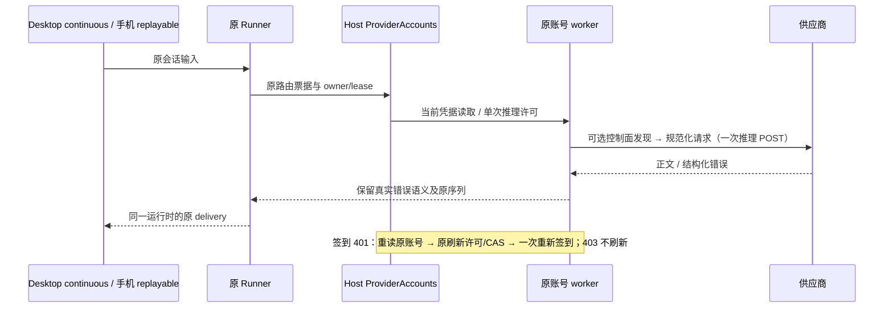

# 供应商剩余更新与跨平台核查

## 边界与所有者

审查 plugins `1b06308fad9386171c25f377d3ff8fcc4d4f3757`、magpie `95be6bb75f6128318619c450f0584696a5ba888e`。沿用不可变 vendor `5d5d86e` 与精确构建补丁；不整体升级、不引入相邻仓库运行时依赖。协议事实由原 worker 投影，账号及刷新 CAS/代次由 Host ProviderAccounts 独占，推理重试由 Runner 独占。签到属于原账号辅助 operation，不占用模型 POST 许可。

不新增会话状态、业务队列、重放日志或身份猜测。workspaceIdentity/remoteSessionId、stale run 和原始 transcript 均保持现有所有者。

普通 API Key 的配置、租约和健康仍由现有 Registry/ApiKeyPool 维护，不迁移到 Host。公共响应归一化不保存状态，其顺序为 `Runner → 原 KeyPool 准入 → 原 Transport → 公共响应投影 → lease.observe → SDK 业务分类 → Runner 终止判断`；OAuth 路径在 worker 与 Host 观察前使用同一投影。两种路径均不得在读取拒绝码之前封禁账号/密钥。

## 已确认的协议缺口与验收

1. Kiro API Key：GetProfile 是可选区域提示，依次查询普通区 us-east-1/eu-central-1；没有 profile 仍在 us-east-1 继续。模型与额度使用 AWS JSON 1.0 控制面接口与分页，不携带 profileArn；OAuth 路径保持。仅精确的控制面端点、方法、target 允许作为辅助请求，不能吞掉推理许可。取消继续由 worker 原作用域中止，不把取消当成成功发现。
2. MiniMax 国内/国际签到：复用原 signed、identity、fresh/renew 和 Host 轮换许可。国内使用账号域 agent.minimaxi.com；请求必须携带 realUserID、web/is_desktop/desktop_version 及完整 yy 签名；缺失 ID 时先读取身份，读不到则不领取。401 重读/刷新并重新读取身份后只再签到一次；403 不刷新；invalid_grant 才报告过期。结果复用安全 ProviderCheckinReply，不泄漏原错误/凭据。状态页先于领取，已领/不可领不 POST。原签到 1 MiB 上限保留在原生账号 JSON 读取边界；超限取消 reader，401/403 在刷新前释放原 body。
3. Trae：只有 extra_credits 时也保留奖励；真零值、非法数值、无奖励分别验证，不伪造基础奖励。
4. Devin：protobuf payload 大于 8192 字节时异步 gzip，Connect 帧 flag=1、长度匹配压缩数据且仅此时带 Connect-Content-Encoding；边界以下保持原帧。保留首个有效事件验证、reader 释放与一次物理推理 POST。
5. Zed Anthropic：内联 system 转为当前位置的用户文本，紧随工具调用的 tool_result 必须仍位于下一个用户块开头；空 system 不制造空轮次。仅投影请求副本，不改源 transcript；保留组织、token 刷新和 is_error 补齐。
6. 内容拒绝：核查 Factory 精确 content_policy_rejected 与 Responses 的结构化 filter code；不凭正文关键词认定拒绝，不误伤其他 403/500。复用公共错误归一化与终止规则，不按组织/账号重复提交同一被拒绝内容，不将内容拒绝标为账号过期。
   同一归一化必须位于 API Key lease.observe 之前，覆盖普通 OpenAI / Anthropic / OpenAI-compatible 的租约与旧轮换 helper；不能只在 SDK 层停止重试，却已将密钥池中的 key 标为鉴权失败。原始非内容 403、配额与真正失效仍按既有规则处理。
   同一公共 Node 归一化也在 worker 协议转换前与 Host observeHeaders 前执行，覆盖固定插件及原生驱动；Factory 的 upstream-error 来源特例只在公共函数中定义，不在多个调用方重复 JSON 分类。
7. 进程生命周期：核查 worker 的 spawn/execFile 子树回收及取消；若确认遗漏，复用公共 Node 进程树能力。Windows 关闭整棵树，POSIX 仅清理明确拥有的进程/组；清理结算后才 ACK，不关闭其他账号/worker 的进程。
8. Qoder 国际版浏览器设备授权与国内版一样不设置 redirect_uri，避免已安装桌面应用抢占结果页；轮询仍归原授权 operation。Trae 空 reasoning_content 不能遮住其他有效推理字段；同一工具调用的名称快照增长时补全，不能拼接或被不同名称覆盖；Global 错误按实际 realm 命名。
9. Trae 新浏览器授权按站点生成设备 ID：CN 16 位，Global 19 位。旧账号的设备绑定不改写，不将其他应用的身份套用到当前账号，也不吸收签到时哈希变换旧 device ID 的迁移方式。

进程清理的实现边界：将已有 MCP Node 进程树实现下沉到 provider-node 公共入口，原 MCP 入口仅转出同一函数。worker 只报告实际 spawn/execFile 的生灭；PluginWorkerTransport 独占对应子进程资源账本并在 dispose/error/exit 清理，避免 worker 先 child.kill 造成 Windows 子树丢失。父端清理不依赖 worker 仍存活；关闭等待包括同一个账本，失败真实上报。消息只含 PID，不含命令、参数或凭据；仅当前 worker 创建的活动进程可进入账本。POSIX 不使用未经明确拥有的进程组。

先运行失败回归，再实现。用合成凭据、loopback 和隔离目录执行生成 worker 的真实协议夹具；断言控制面/推理次数、取消、凭据写入次数及安全输出。Windows 原生执行与 macOS/Linux 的注入分支分别报告。必须运行根 typecheck、lint、changed 架构检查、供应商路由/远程回归及 worker 新鲜度、第三方声明检查。

## 不直接吸收的更新

Raccoon、Kimi、CodeArts 等未接入新渠道不增加隐式供应商；WorkBuddy 改写提示词重发与 Qoder 内部排队重发违反现有重试所有权；宽泛 Qoder 400→502 会误伤 schema 错误。magpie 的原生 Responses compact 与 WebKitGTK 改动不能直接套用到当前压缩与 Electron。不能以未运行的真机/真实账号验证冒充通过。

## 其余供应商与平台核对

| 范围                                                 | 源码结论与处理                                                                                                                                                                                                              |
| ---------------------------------------------------- | --------------------------------------------------------------------------------------------------------------------------------------------------------------------------------------------------------------------------- |
| Qoder / Qoder CN                                     | 保留上一轮 ID 配对、公共 schema、缓存会话身份及三平台发现；本轮只修复国际版浏览器 redirect，国内版已有正确分支。厂商队列重发不移植。                                                                                        |
| Kiro                                                 | API Key、OAuth 和 CLI/IDE 导入仍由原账号路径区分；本轮修复 API Key 控制面，保留上一轮登录方式身份隔离。                                                                                                                     |
| MiniMax 国内 / Global                                | 分站点修复账号签到；聊天域与账号域分离。模型 M3 的上游新上限是目录增强候选，未据此改变用户上下文预算。                                                                                                                      |
| Trae CN / Global                                     | 修复丢推理、工具名快照、realm、额外奖励、新授权设备长度。未给旧账号套用其他应用 device，也未用 hash 静默更换旧设备。新多模态目录/原生历史编码属于后续协议能力升级；当前工具历史文本兼容路径没有确认为本地故障，保持并回归。 |
| Factory / Zed                                        | 精确拒绝分类、内联角色转换已修复；保留原组织选择/CAS、billing 行保留和公共 schema。                                                                                                                                         |
| Zen Free / Grok                                      | 上轮 ID 与 tool_choice 修复继续回归；无密钥单身份、新 X search 是新授权/产品能力，未改变现有方法或默认开启。                                                                                                                |
| Cline                                                | `pinUpstream` 需要插件或 provider options 显式开启；本地 buildPluginProvider 未设置该选项。上游 GLM 的 OpenRouter pin 修复在当前路径不生效，不引入无入口配置。                                                              |
| CommandCode / MiMo / ZCode / ZAI / BigModel / Cursor | 共享拒绝分类与进程清理一并覆盖；未发现本轮新提交对当前固定调用路径所需的专用补丁。仍运行原协议、刷新、额度、单次派发及公共 schema 回归，不宣称真实账号全覆盖。                                                              |
| WorkBuddy 国内 / Global                              | 不吸收改写提示词重发；沿用原额度、鉴权与签到状态分支及统一 Runner 规则。                                                                                                                                                    |
| Raccoon / Kimi / CodeArts                            | 未接入，登记为新增渠道候选；不悄悄扩大账号或协议入口。                                                                                                                                                                      |
| Windows / macOS / Linux                              | 平台适配仍在 Host/Node 层，浏览器不探测本机文件。Windows 实际验证孙进程清理；macOS/Linux 注入 OS 进程命令与信号测试。Qoder 已有安装路径回归继续运行，Trae 厂商客户端标识不按当前 OS 随意改写。                              |
| Desktop / Web / 手机远控                             | 原 owner/lease、workspaceIdentity、remoteSessionId 和双 delivery 均不改；远端 relay 回归验证状态、头与正文保留。                                                                                                            |

## 实施与实际验证

以上确认项已落实；公共能力只有一条实现路径：纯 provider 结构化拒绝分类、Node 响应归一化、现有 Host/KeyPool 状态通道、原 MiniMax 签名/刷新，以及下沉后的公共进程树清理。旧 MiniMax 不完整签到分支和仅 header 签名入口已删除。没有改写 transcript、增加推理 POST 或迁移业务状态所有权。

2026-10-23，Windows / Node 24.21.0 实际执行结果；测试组有重叠，不相加宣称唯一总量：

| 检查                                               | 结果                                                                                                                           |
| -------------------------------------------------- | ------------------------------------------------------------------------------------------------------------------------------ |
| pnpm test:provider-routing                         | 643 通过，0 失败、0 跳过                                                                                                       |
| provider-auth 全目录                               | 425 通过，0 失败、0 跳过                                                                                                       |
| API Key / Host / 生成 worker 拒绝专项              | 34 通过；另有 15 项 KeyPool 和 4 项 Host 的修复前失败记录                                                                      |
| 公共 schema 与 reasoning 历史归一化                | 7 通过；其他 native/schema 场景随 provider-auth 回归                                                                           |
| pnpm test:remote-providers                         | 16 通过，转发状态、头、正文保留                                                                                                |
| worker 新鲜度、声明原子写入和 workspace patch 归因 | 12 通过                                                                                                                        |
| 进程生命周期与 MCP/SDK 专项                        | 21 通过；Windows 孙进程 dispose/crash 实测，三平台 OS 命令/信号注入测试随路由执行                                              |
| 根 pnpm typecheck / pnpm lint                      | 通过                                                                                                                           |
| CLI adapters 独立 tsc --noEmit                     | 通过，覆盖根工程未直接纳入的 CLI 模块                                                                                          |
| changed 架构检查                                   | violations 0、baseline 0、new 0；provider / provider-node / services / lcode-cli 仍为既有 unmanaged 模块，不表示已完成全仓治理 |
| 本轮匹配文件格式与 diff whitespace                 | 通过；CLI 新测试另以 stdin 格式化                                                                                              |

固定 vendor 原文件未修改；构建器验证全部固定 SHA 后重新生成 worker。第三方声明、库存与输入复核结果见 .artifacts/provider-followup-release.json；复核使用独立临时 Git index，不修改真实暂存区。已有发行材料缺口以发行基线为准，没有伪装成已补齐。

源码变更归属 provider、provider-node、services/model-provider 与 lcode-cli/adapters；测试/构建/归因材料另列。其他任务的侧栏、UI、gitignore 等本地改动保留，本轮没有提交或发布它们。代码及文档行变更统计见 .artifacts/provider-followup-line-stats.json，生成 worker/NOTICE/inventory 单列。

真实供应商账号和 macOS/Linux 真机尚未验证；平台注入测试不能替代真机结果。新渠道、模型目录及原生多模态/历史协议升级仍是增强候选，不能据此宣称线上所有供应商都已无故障。验证日志与本轮文件清单均位于 .artifacts/provider-followup-\*。

本轮行变更：**LINE_STATS**。
