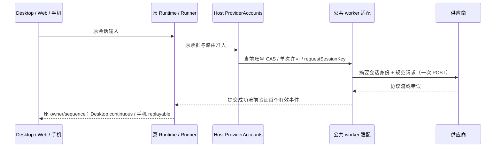

# 供应商跨平台兼容增强

## 规则与范围

基于已审查的 plugins `7ee60f825387455db26157ade2740a0f4ddbf3ee`，沿用固定 vendor `5d5d86e`、精确匹配且失败即阻断的构建补丁和现有公共 schema 编译器。原始 vendor 文件及其 SHA 不变，不引入相邻仓库运行时依赖。

1. Zen Free：后续空、null 或缺省工具 ID 不覆盖已经收到的有效 ID；迟到的有效 ID 可以补齐；不同 choice/index 独立，非法类型不能伪装成合法调用。
2. Devin：只有 usage、空结束或元数据的响应在打开成功流前报告 502；正文、推理或工具调用任一存在才可作为成功开始。取消和失败释放原 reader，物理推理 POST 仍只有一次。
3. Qoder：缺失调用 ID 使用稳定生成值；仅当前工具轮次可配对。明确 ID 优先，缺省结果按未被明确结果占用的声明顺序配对；未知显式 ID 不能抢占已有明确 ID 的调用，重复/越过用户或新 assistant 边界的结果不能冒充正常工具结果。无匹配结果的旧调用以明确历史文本保留，不能留下要求厂商继续配对的悬空调用或伪造执行结果。转换不修改原 transcript。
4. Qoder：沿用厂商缓存标记规则；会话缓存身份来自 Host 原会话事实或调用方显式 cache key，绝不从提示词或用户邮箱推导。增强路由复用现有 `workspaceKey`（身份优先、路径 fallback）、`remoteSessionId`、`sessionId` 构造组合 key，不按单独 session ID 合并不同工作区或远程会话；旧本地接口保留 session fallback。没有身份时使用单请求身份，不跨请求猜测归属。请求 ID 每次更新。现有路由删除内部 header 的边界保持，新增只读 `AuthDriverContext.requestSessionKey` 将 Host 会话事实传入 worker，厂商只能收到其摘要。
5. Qoder：Windows 检索用户级和系统级安装，支持 ProgramFiles / PROGRAMFILES / ProgramW6432；保留显式 override、macOS、Linux、CLI cache 的既有查找顺序。不执行测试夹具，不下载或伪造厂商设备身份。
6. Factory：剥离 billing header 时仅删除 header 所在行，保留后续任务指令及 block 的其他字段。
7. Grok：没有可用 tools 时去掉 tool_choice；声明了有效工具时保持原选择。继续复用公共 schema 根投影。
8. 账号隔离：Kiro 同邮箱不同登录方式、Devin 同邮箱不同组织应由现有 Host admission 区分；旧身份仅在同一凭据的证据下升级，不能按邮箱猜测迁移，保留 connection、代次/CAS、启停与别名。

保留 Qoder schema/参数 400 的终止语义，不吸收宽泛 “Error in upstream response → 502”；排队 busy 仍由现有统一路由/Runner 处理，不引入插件内部重复 POST。Kimi 新渠道、WorkBuddy 自动改写提示重发、WebKitGTK 环境开关不属于本轮实现；跨模型压缩继续使用现有 reasoning 规范化，不凭上游不同 endpoint 的修复推断当前根因。

## 所有者与接口

Host ProviderAccounts 继续独占账号、凭据、代次、路由 lease 和会话票据；`requestSessionKey` 是票据解析后的只读事实，不新增状态或 header 信任入口。Runner 独占推理重试、取消和输出提交边界；worker 只做当前 operation 的协议投影。公共 schema 根投影与工具执行校验保持各自现有接口。

不改变 workspaceIdentity、remoteSessionId、CommandInbox、owner/lease、stale run、防串会话和双 delivery。路径适配在拥有厂商文件访问能力的 Host worker 内；浏览器不探测本机路径或持有凭据。

## 验收

先运行可失败的回归，再实现。覆盖 Zen 多 choice、多 index、迟到/空 ID；Devin usage-only、推理-only、工具-only、错误与取消；Qoder 多结果、缺省/未知/重复 ID、轮次边界、输入不变、缓存身份隔离和所有操作系统路径（含 ARM64、override、CLI fallback）；Factory 字符串/数组及 header-only；Grok tools 缺省/空/被过滤/有效；账号同邮箱不同组织/登录方式及旧凭据升级。

使用合成凭据、隔离目录和 loopback 服务；实际执行生成 worker 的端到端协议夹具，断言一次物理 POST、取消与无额外凭据写入。运行供应商路由、远端供应商、根 typecheck、lint、changed 架构检查，以及 worker 新鲜度、notices 与发行输入验证。Windows 原生执行与 macOS/Linux 注入路径夹具分别记录，不能把后者当真机验证。

## 实施与实际验证

上述七类协议/平台修复及 Kiro 身份隔离已完成，Devin 同邮箱不同 API key 的隔离由现有 Host admission 提供并补充回归。继续使用同一补丁入口、公共 schema 编译器、账号锁/CAS 和单次派发许可；没有新增供应商重试循环、业务队列或凭据所有者。旧 Kiro 身份仅在相同私有凭据的证据下升级，不能恢复此前已被其他登录覆盖的凭据。

新增 32 个可执行回归场景，扩展现有真实 SDK 测试的会话 context/内部 header 断言。先实际复现失败，再修复验证；Qoder 的孤立调用与结果在同一历史投影中结算。Devin 额外验证 pending read 取消、首帧错误及未结束流的 reader 释放。

Windows、Node 24.21.0 下实际结果如下；测试组有重叠，不能相加作为唯一测试总量：

| 检查                                               | 结果                                                                                             |
| -------------------------------------------------- | ------------------------------------------------------------------------------------------------ |
| `pnpm test:provider-routing`                       | 571 通过，0 失败、0 跳过                                                                         |
| provider-auth 全目录                               | 390 通过，0 失败、0 跳过                                                                         |
| `pnpm test:remote-providers`                       | 16 通过，保留 relay 的状态/头/正文                                                               |
| 公共 schema 与 reasoning 历史归一化                | 12 通过，Git 五个 action 分支完整                                                                |
| worker 新鲜度、声明原子替换与 workspace patch 归因 | 12 通过                                                                                          |
| 根 `pnpm typecheck` / `pnpm lint`                  | 最终复跑通过；provider-node 独立类型检查也通过                                                   |
| changed 架构检查                                   | violations 0、baseline 0、new 0；provider-node / services 仍为 unmanaged，不表示已覆盖所有旧边界 |
| 本轮文件 oxfmt 与 diff whitespace                  | 通过                                                                                             |
| 发行输入                                           | 临时 Git index 验证 3,017 个输入通过，沿用已有 20 项材料缺口；未修改用户实际暂存区               |

固定 vendor 原始文件无修改，21 个源文件的 SHA 仍由生成器逐一验证。worker 已重新生成，新旧来源分别归因；第三方声明/库存已更新。模块变更限于 provider-node、services 的现有 model-provider 入口及构建/验证材料；原 Host/Runner/Runtime 的状态所有权、准入和双 delivery 不变。保留工作区并行的项目归档/侧栏/任务删除改动，不将这些源码记为本轮修复。

本轮 21 个源码/测试/文档及归因文件新增 1032 / 删除 33，净增 999 行；另有 3 个生成产物。统计不包含并行项目功能。

验证材料在 `.artifacts/upstream-review-20261022/`。没有真实供应商账号调用或 macOS/Linux 真机执行；三平台安装分支、ARM64、override 与 CLI fallback 使用隔离路径夹具，设备 helper 从未执行。签名策略保持现状。
