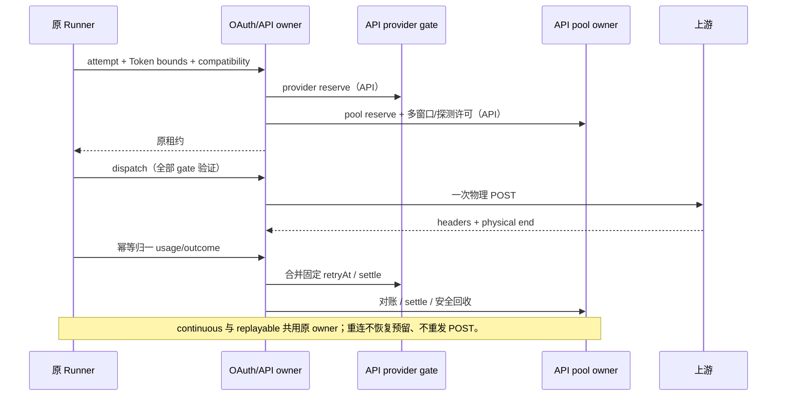
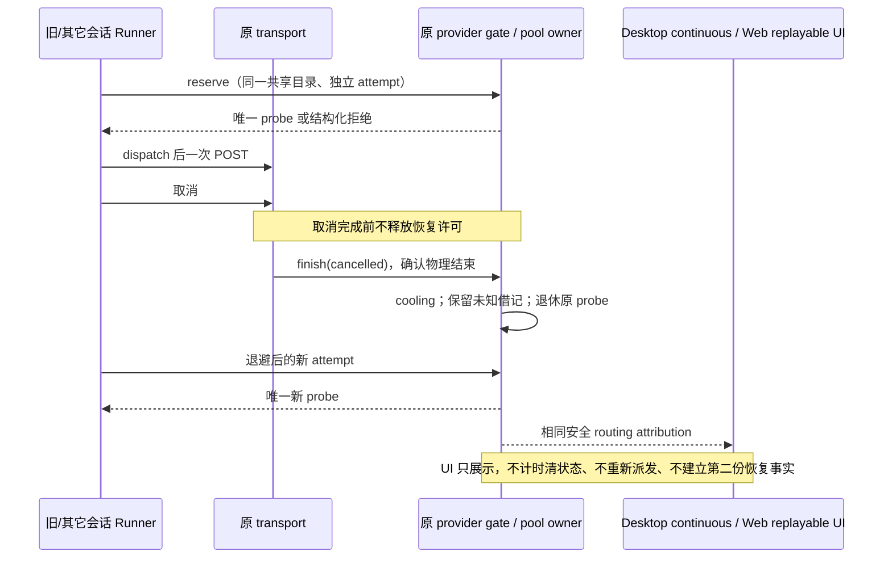
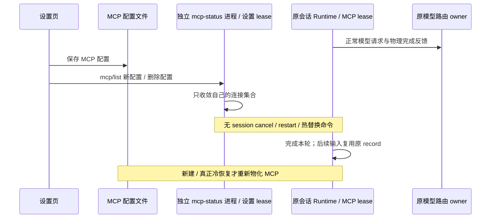
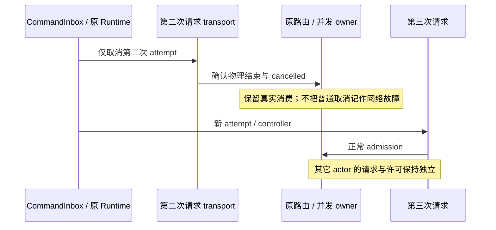
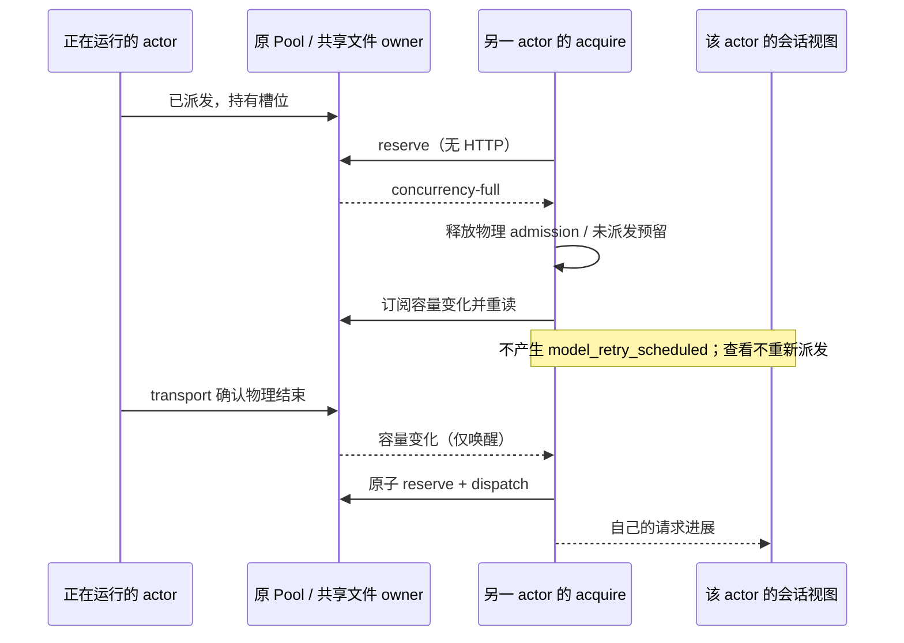

# OAuth 与 API 调度加固

2026-10-16，基线 d8b440dc。承接审计，先 spec、失败测试，再实现和实测。本规格优先于旧规格的 legacy 与隐藏高级配置兼容承诺。

## 产品与迁移

五种策略仍为可靠优选、主备接管、份额轮转、余量均衡、到期优先。设置只提交 version 与 strategy；删除 legacy 选项，缺省/null 使用可靠优选。旧策略保留其合法 strategy，隐藏调度参数不再由设置保存延续。已有额度身份与未确认借记属于事实，不能随策略迁移清空；明确的池身份仍可由受信配置/快照提供，不能按 URL、标签或批量导入猜测。无 single-attempt 能力的 OAuth 驱动明确拒绝，不能退回隐式多次请求。

UI 保持当前紧凑、展开/折叠与问号帮助；不增加手工配置或诊断面板。缓存 TTL、价格、跨 Key 缓存组未知时明确 unknown，不承诺可以自动发现厂商未提供的事实。

## 唯一所有者与协议

- 强绑定账号仍存在且 generation 一致时，临时并发满或冷却必须保留该账号真实的拒绝原因（concurrency-full / route-cooling 等），由原 Runner 预算决定等待与取消；不能误报永久 binding-blocked。绑定缺失或 generation 改变仍拒绝，不切到其它账号。Planner 与 reserve 返回同一原因，不受候选排列或其它账号的 binding-blocked 影响。该规则适用于同轮未知可移植性和 provider-session-bound，不增加队列或放宽并发。
- 原 Runner 创建不可变 attempt、Token 上界与兼容上下文。OAuth RoutingInvocation 增加严格校验的 tokens（input/output/total、quality）与 compatibilityKey，沿原鉴权票据和远程协议传递。无可验证 Token 边界时不能伪造零；未知额度最多一个探索请求。
- 原 ProviderAccountScheduler 持有 OAuth 预留、恢复及反馈句柄；活跃物理流和未确认归一反馈不按五分钟 TTL 删除。只有双终态确认后才进入有界终态缓存。容量满明确拒绝新 admission，不驱逐未知消费。Transport 票据在物理流期间及终态反馈宽限期内有效；过期票据不允许再发模型 POST。
- 原 RoutingRecovery 持有恢复事实。同一健康代次并发失败合并最大 retryAt；新 probe 开始后旧失败不能覆盖。每 permit/资源的失败时间首次冻结，重复反馈不顺延。恢复后的健康记录只有无旧 permit 可引用时才能回收；通过 permit 退休标记与无活跃引用检查防止删除后 revision=0 复活旧回调；文件租约还校验原 sequence/fence。
- 原 FileSharedQuotaCoordinator 持有同机 API 跨进程额度与恢复。provider 限流使用 provider 文件 gate，pool/key/model 使用池文件；锁顺序固定 provider → pool，HTTP 不持锁。provider gate 只持恢复许可与活跃引用，不复制额度账本。调用必须在共享 dispatch 前验证所有 gate，不允许 IO 不确定时重发 POST。

## 决策规则

1. 资格与硬绑定 → 多窗口安全 admission → 策略排名 → 缓存判定 → 最终探索决策。缓存诊断必须描述最终选择，不能显示 keep 却选另一组。
2. 请求、输入、输出、总 Token 窗口分别使用同一次请求对应的上界借记；共享窗口只扣一次。部分实际 usage 只替换已确认分量，不能将未知消费归零。Token bound 同时参与 OAuth 与 API。
3. 429 显式 key/account、model、pool/shared、provider 各自隔离；缺失/不识别作用域为 provider。明确 pool 才允许其它池继续；provider 限流不能靠换 Key/池绕过。5xx 默认 model，显式更广作用域仍有效。route-cooling 返回 scope/phase/retryAt/dispatch 的可验证安全字段。
4. 旧窗口 resetAt 已过只降为过期事实，不自动补满、不重置借记。同资源只允许一个受控探索，未知/陈旧窗口同样受限；探测派发后一直占用到新读数确认，失败/取消按物理确定性处理。硬保留线、真正余额 expiresAt 到期与已确认新窗口耗尽仍拒绝。跨进程 reserve 与 dispatch 使用同一探测许可；其它进程不能同时探索。
5. 记录回收只处理已确认终态：保留活跃/未知租约、未覆盖借记和恢复许可；健康 tombstone 无引用后回收。完成 attempt 缓存设上限，过期原句柄失效，不能作为新 POST 重放。只读诊断有界，不能扫描无限恢复历史。
6. 到期策略必须有本请求可归属的正收益，否则退到余量均衡；无可信 TTL 只有同轮绑定。可信缓存事实由模型/驱动声明及实际反馈传入，不能从旧 UI 元数据臆造。未知成本明确降级。
7. 十万 Key 固定与超过八个 profile 的高分散长跑分别记录冷/热时延、profile 构建/淘汰、事件循环延迟、内存与状态容量；不能仅用短跑均值宣称长期性能。

## 验收与证据

| ID    | 场景                                               | 必须断言                                               |
| ----- | -------------------------------------------------- | ------------------------------------------------------ |
| HD-01 | OAuth requests/input/output/total 共享及私有多窗口 | 并发预留不超额、未知不扣零、实际分量准确对账           |
| HD-02 | OAuth 长流跨五分钟、另一次 reserve、迟到及重复反馈 | 原归因仍有效，物理+归一成功恢复，终态记录有界          |
| HD-03 | 同代并发 Retry-After、重复回放、probe 后旧失败     | 最大截止；重复不延长；旧代不能覆盖新 probe             |
| HD-04 | 两 Key、两池、两个真实进程，各限流 scope           | provider 跨池阻断；key/model/pool 不扩大；安全错误详情 |
| HD-05 | 超过 4096 个恢复循环与长跑已完成请求               | 健康记录/attempt 有界；旧 permit 不能重新修改新事实    |
| HD-06 | 过期零余额、陈旧非空窗口、并发取消与新读数         | 唯一探测、不补满、不误退未知消费；文件 owner 同规则    |
| HD-07 | 缓存事实有/无、探索覆盖软缓存、到期收益为零        | 最终选择和诊断一致；未知事实安全降级                   |
| HD-08 | 十万 Key 固定/分散/多 profile 长跑                 | 给出实际测量与容量断言；高成本冷构建单独报告           |
| HD-09 | 五策略 UI、缺省/null、旧隐藏参数                   | 只有五选项，可靠优选缺省，保存只写策略，无批量配置     |
| HD-10 | SDK generate/stream、三 OAuth 协议、反馈失败重试   | 物理 POST 不重放；反馈有界重试且失败可观察             |

所有测试记录红灯→绿灯与执行命令。真实厂商缓存价格、其它 OS、跨主机与网络文件系统未实际验证时必须列明；合成测试不替代厂商事实。

## 2026-10-23 会话恢复、共享装配与错误提示修复

### 规则与所有者

- `RoutingRecovery` 仍是健康恢复的唯一所有者。已派发探测被取消时，只有 transport 确认物理结束后才回到 cooling，经过原失败退避后允许一次全新的探测。取消不是恢复成功；不能重放原 attempt，不能退款、补满或清空未知消费。
- physical end 未确认的取消、没有归一结果的 unknown、丢失 dispatch 回执继续保持 probing/uncertain。release、超时、进程退出、换会话、重连均不构成物理结束证明。
- 旧版本保存的 `uncertain + physicalEnded + outcome=cancelled` 是可验证的已结束取消。下一次 reserve 可原子退休该 probe 并创建新代次；不删除账本、不重建额度、不放行其它未知记录。读取诊断不得改变代次或存储。
- `ApiKeySharedQuotaClient` 将 transport 的 cancelled/unknown 物理结果沿原 finish 端口交给 provider gate 和 pool owner；成功和失败仍通过原 usage 端口归一，避免物理失败先到而关闭晚到 status/scope 的写权限。consumer 提前结束且没有归一结果时，原租约 release 补 cancelled，仍等待物理结束。取消完成失败不能伪造 physical end。finish 幂等，不因重复回调延长冷却。
- bootstrap → `AiSdkModelAdapter` → `AiSdkModelExecution` 完整传递 `routingQuotaDirectory`。同一数据目录的不同会话/进程共享原文件 owner，独立 Key 的额度身份保持原规则。显式没有目录的 SDK 用法仍允许进程内模式。
- 修复健康恢复不能删除已有 generation、fence、sequence、硬绑定、多窗口借记和 stale 回调保护。特定 model/key/pool 故障不扩大到其它资源；provider 故障仍跨池生效。

### 安全错误契约与展示

- `RoutingFailureInfo` 增加可选 `recoveryState=cooling|probing|uncertain`；状态由原 owner 提供，不能用缺少 retryAt 猜状态。错误归因沿 Core、协议、快照及重连保留严格校验的 routing、安全重试预算事实。
- 本地 route-cooling 的 reason 为独立运行时原因，不能冒充上游 HTTP 429；真实 HTTP 429 保持原分类。明确 unsent 的拒绝不向上一次 API 租约写入失败反馈。
- 本地路由等待的 retry reason 同为 route_cooling；全局 workflow 并发治理仅结束该 admission，不把它当新上游限流或失败，不修改其它会话共用的 cap、epoch 或成功样本。重试投影使用独立运行时原因码，真实 429 仍保留原并发退避。
- 其它本地固定路由拒绝使用 routing_unavailable，沿用原 retryable 决策，不制造供应商限流样本。共享配置接通后可能出现的 concurrency-full、quota-exhausted、dispatch-uncertain 在原横幅分别说明占用、额度事实或派发待确认，避免重新落回英文限流误报。
- 原错误横幅本地化显示冷却截止时间、恢复探测中、结束待确认或一般路由暂不可用；自动重试预算耗尽时明确说明。只展示 owner 提供的时间，不承诺自动恢复。详情保留原因码与安全字段，无密钥、路径或上游正文。
- Desktop 与手机 Web 复用同一错误归因和横幅，不增加按钮、设置面板、状态存储或自动重试链路。旧事件没有新增可选字段时正常显示兼容提示。

### 验收

| ID    | 场景                                              | 断言                                                                       |
| ----- | ------------------------------------------------- | -------------------------------------------------------------------------- |
| SR-01 | 无 429，网络失败后取消恢复探测                    | 物理结束前阻断，结束后 cooling，原会话新 attempt 成功；原 POST 不重放      |
| SR-02 | 相反到达顺序、重复 finish/usage、旧 probe 回调    | 顺序无关；固定截止；新 probe 不被旧回调覆盖                                |
| SR-03 | 旧 uncertain cancelled 数据、unknown/活跃记录     | 只恢复已结束取消；读取无副作用；其它未知记录仍阻断                         |
| SR-04 | 两个真实 adapter/共享 owner，同供应商两池两模型   | 配置真实接通；provider 冷却共享；局部取消不扩散；未知借记保留              |
| SR-05 | Reader 取消在途/拒绝、consumer 提前结束、错误 EOF | 无伪造物理完成；释放和归一反馈完整；不重复 POST                            |
| SR-06 | 错误跨 Core→协议→快照→UI                          | recoveryState/scope/phase/retryAt/dispatch/预算安全保留；非 429 不冒充限流 |
| SR-07 | 中英文、桌面/手机、深浅色、旧事件                 | 横幅/详情/复制一致，恢复/待确认/预算耗尽文案准确，未引入恢复状态副本       |

### 实际验证记录（2026-10-23，Windows）

先执行恢复 owner、错误投影、跨会话并发隔离与浏览器失败用例，确认原实现会失败，再完成实现。新增覆盖包括取消/物理结束的两种顺序、旧 provider/model 文件记录、取消拒绝、相同原会话重试、两真实 bootstrap adapter、本地模拟 HTTP 429、多模型隔离、未知借记保留、旧 probe 迟到回调、安全协议 JSON 往返、live/cold 投影及中英文桌面/手机横幅。

| 验证                                          | 实际结果                                                                                                         |
| --------------------------------------------- | ---------------------------------------------------------------------------------------------------------------- |
| `pnpm test:provider-routing`                  | 662 / 662 通过，最终运行约 63.4 秒                                                                               |
| `pnpm test:provider-routing-ui`               | 6 / 6 浏览器 E2E 通过；覆盖现有策略/授权界面及新增恢复提示、详情、复制和手机可读性                               |
| `pnpm typecheck`                              | 通过，包含 desktop main/host/renderer/preload、共享服务与 Web                                                    |
| `pnpm --dir apps/lcode-cli typecheck`         | 27 个 workspace 任务全部成功                                                                                     |
| `pnpm lint`、`pnpm --dir apps/lcode-cli lint` | 通过；CLI Core 的未改动 `src/tool/registry.ts:163` 存在一条已有 `no-useless-fallback-in-spread` 警告             |
| `pnpm architecture:check --changed`           | 0 violation、0 baseline、0 new；所有者仍是原 Recovery / 文件 owner，UI 无恢复状态副本                            |
| 本轮文件的 root / CLI `oxfmt --check`         | 全部通过；`git diff --check` 通过                                                                                |
| 全仓 `pnpm fmt:check`                         | 未通过，报告 2629 个格式问题文件，包含未改动的 `.agents/skills/agent-browser/SKILL.md`；保留无关内容，未全仓重排 |

十万 Key 分散池用例曾在同时执行类型检查时触发时延门槛（hot p95 108 ms）；没有放宽阈值。独立复测 hot p95 14.5 ms，通过；随后两次不并行类型检查的完整路由测试通过，最终全套该项 hot p95 17.9 ms、共享状态文件 2 个。生产路径不新增定时器、队列或全量热扫描。

改动模块为 provider、shared、lcode-cli、ui、web；源代码通过既有公开契约连接，辅助文件只投影同一 owner 的安全事实。测试使用合成凭据与本地模拟上游；未进行真实厂商调用或 macOS/Linux 实机验证。修复已写入源码及 CLI 构建产物，未生成安装包或替换当前已安装的客户端。

本轮相关文件 41 个（新文件 10 个），含测试与规格净增 1240 行；原有无关本地改动保留。

## 2026-10-23 补充触发条件：运行期间配置 MCP

用户补充：旧会话报错时，正在该会话运行期间配置 MCP。这是需要验证的并发场景，不能据此直接认定 MCP 修改会取消模型请求。

### 已核对的边界

- 本地 MCP 保存经 `SaveMcpToUserDirectory` 写入 CLI MCP 配置；远端经 `IMcpSyncService.saveMcpToUserDirectory` 写入目标 Host 的目录。两者不发送 session stop/restart，也不重建模型适配器。
- 设置页 `mcp/list` 由 `LCodeAgentService` 的独立 `mcp-status` process manager 承载；它不借用聊天进程。慢握手、OAuth、检测失败和状态进程回收不能中止聊天命令。
- MCP 工具配置是 runtime 创建时的输入。已经驻留的 session/resume 返回原 record，不在运行中应用设置页配置；新建或真正冷恢复的会话才重新物化配置。此轮不引入热更新或自动重启语义。
- 同一 MCP pool 内，设置 lease 的配置替换、移除和关闭也只释放该 lease；运行中会话继续持有原连接。显式 workspace isolation 可共享同一完整配置；修改后的配置使用另一连接，不能替换其它 lease 的旧连接。默认 session isolation、workspace identity 和活动调用信号保持原边界。
- 插件安装、更新、配置及普通插件启停使用另一独立 plugin management process manager，不借用 MCP 检测或聊天进程。商店的配置变更通知只退休未提交草稿；首发 admission 已开始或已提升的预热会话由原 promotion owner 保留，不得自动删除。
- Computer Use 插件启停是明确例外：现有 service 会回收目标 workspace runtime 使冻结的 feature/Helper 配置重新生效，UI 在该 workspace 存在运行任务时禁用切换。不能把该操作描述成普通 MCP 的无中断热更新；此轮核对原有 busy selector / service 测试，不改变它的产品规则，也不假定用户执行了该操作。
- 模型路由的恢复仍只由原 recovery owner 和 transport 完成事实驱动，不能因 MCP 保存、检测完成或换会话而清空。

### 回归验收与证据限制

| ID    | 场景                                                           | 断言                                                                                                          |
| ----- | -------------------------------------------------------------- | ------------------------------------------------------------------------------------------------------------- |
| MC-01 | continuous / replayable 聊天命令在途，MCP 检测阻塞或失败       | 状态检测使用另一 process manager；原命令和另一个会话可完成；旧会话后续命令仍复用原 client；无 dispose/restart |
| MC-02 | 真实 stdio MCP 调用在途，设置 lease 修改同名配置、移除全部 MCP | 原调用不被中断；原会话与其它会话继续使用原版本；新会话可使用新版本；默认 session 和显式 workspace 隔离都成立  |
| MC-03 | continuous / replayable 活动旧会话带新 MCP 配置再次 resume     | 同一 record/app、取消 owner 和 deliveryKind 保持不变；无 close/recreate；原 MCP 配置不被替换                  |

MC-04：聊天命令、MCP 检测与插件安装同时在途，安装成功或失败后更新、配置、启停普通插件。断言三个独立 process manager；MCP / 插件等待均不占住聊天请求；普通插件变更不 dispose/restart 聊天；Computer Use 特例沿用独立 busy/失效测试。

这些用例验证并发隔离，不把 mock 的聊天 ACK 或 app 当作真实模型执行证明；MC-02 使用本地真实 MCP 子进程。现有日志没有截图 request 对应的模型请求、HTTP 状态和恢复反馈，尚不能证明 MCP 操作是 `route-cooling` 的根因。SR-01–SR-07 的恢复与错误修复继续适用，但不得声称已复现用户该次故障。

## 2026-10-23 补充：运行中立即中断并提交第三条输入

补充场景：第一条输入已完成；第二条正在请求模型时，用户立即中断并提交第三条；多智能体同时请求时也观察到长时间“重新连接中”。`chat.apiRetryStatus` 显示的是模型 adapter / stream recovery 的重试状态，不能仅凭该标签断定 Desktop / Host attachment 已断连。

- 正常用户取消只终止对应 attempt，不构成 provider 网络故障或限流样本；没有独立失败证据时，不新增模型/供应商冷却，也不降低其它 actor 的并发 cap。
- 第二次请求取消的物理完成仍由同一 transport/body owner 确认；第三次使用新 attempt、独立 controller，不能复用原取消信号、请求身份或重放已取消 POST。未确认的消费与真实上游失败维持原安全边界。
- SR-08：通过真实 AI SDK 与 API Key 路由执行“成功 → 流中断 → 原绑定再次成功”，分别验证进程内/共享目录、单请求、同一 Key 的两个并发 actor 和三个 Key 的三个并发 actor。同 Key 用模拟上游明确提供的额度读数启用原有并发槽，不修改生产并发策略。断言原取消只发送一次 POST、第三次无错误重试、其它 actor 正常完成、所有已结束请求归还槽位。该用例不替代 V4 CommandInbox 的立即交接与客户端投影测试。
- 已复现的缺陷：真实 HTTP 流因 AbortSignal 先进入 errored 时，`reader.cancel()` 会拒绝；旧 observer 因 cancellation 已存在，连正在等待的 `reader.read()` 的底层终态异常也忽略。服务端连接已 close，本地 inFlight 仍为 1，下一请求以 concurrency-full 耗尽重试。修复只接受 reader.read 本身的终态异常作为既有 transport 失败证明；wrapper controller.enqueue/close 的异常不能冒充底层结束。pending read 仅因 cancel 变成 done、cancel 本身未完成或拒绝时仍不提前释放。
- 响应头与取消同拍时也统一安装原 body observer，再抛出取消；不再使用另一路 cancel-only 收尾，否则已经 errored 的 body 在 observer 安装前同样会遗漏完成。仍在 pending 的底层 cancel 不提前释放，普通未路由 helper 的主动取消也必须关闭 body。
- SR-09：现有重试进度组件统一显示“正在重试模型请求 / Retrying model request”，保留次数与已有 HTTP 提示，不再把模型路由等待统称为客户端重连；不增加倒计时、状态副本或额外请求。中英文桌面/手机浏览器验证文字与次数。

### 补充验证记录（2026-10-23，Windows）

- 先用真实 HTTP + SDK 的单 Key 序列复现：第一条完成后 inFlight=0；第二条取消且服务器连接已关闭后仍为 1；第三条无新 POST、以 concurrency-full 耗尽重试。修复后同用例 inFlight 正确回落，第三条只发出一次 POST。响应头同拍取消的独立用例也先失败（1 ≠ 0），修复后通过。
- `pnpm test:provider-routing` 最终 **692 / 692** 通过（约 66.6 秒），包括 6 个真实 HTTP + SDK 取消/并发场景、MCP/插件隔离、活动 resume、V4 队列交接与原有全部路由用例。底层 cancel 未完成或拒绝而没有真实 read 终态时，原保护用例继续阻断。
- `pnpm test:provider-routing-ui` **6 / 6** 通过，包含中英文桌面/手机重试文案与原错误横幅。已查看截图，手机文字无溢出。首轮因冷启动 Vite 编译超过导航 8 秒失败；仅测试导航改为已有浏览器场景采用的 30 秒，交互断言仍为 8 秒，生产没有新增等待。
- `pnpm typecheck`、`pnpm lint` 通过；`pnpm --dir apps/lcode-cli typecheck` 27 / 27 任务、CLI lint 14 / 14 任务成功。最后追加的同 Key 并发用例再通过 adapters 包 typecheck / lint；CLI Core 原有 `registry.ts:163` 警告保持原样。
- UI busy selector 使用 `TSX_TSCONFIG_PATH=packages/ui/tsconfig.json` 独立运行 **2 / 2** 通过；直接从根 tsconfig 执行曾因 `@/` alias 无法解析失败，未修改生产路径或将其作为通过结果。
- 架构检查 0 violation / 0 baseline / 0 new；本轮文件格式与 `git diff --check` 通过。所有者仍为原 transport/body、Recovery、quota 文件 owner、CommandInbox；未增加队列、状态副本、轮询或绕过未确认请求的超时。
- 普通 MCP / 插件路径未复现为直接取消来源；Computer Use 启停保留其现有目标 workspace 重建规则及 UI busy 禁用规则。没有把普通插件隔离测试当作 Computer Use 无中断保证，也没有认定用户执行过该特殊操作。
- 合并此前恢复修复的相关改动共 47 个文件（新增 14 个），净增 2066 行（排除开工前 `.gitignore` 已有的一行）；其它功能的本地改动保留。测试使用合成配置及本地 HTTP/MCP 子进程，没有调用真实供应商或修改用户会话；未验证 macOS/Linux 实机，未生成安装包或替换已安装客户端。

## 2026-10-23 补充：同时运行与切换查看

用户确认：同时运行时，打开同一会话的子智能体详情、切换左侧独立会话，都会看到长时间重试。不能把“查看”当作取消或重新派发的依据。

- 原 `ApiKeyPool` / Scheduler 仍拥有进程内槽位，`SharedQuotaCoordinator` 仍拥有跨进程槽位；并发上限、未知额度探索保护和真实 429 规则不变。没有发出 HTTP 的 `concurrency-full` 应在原 acquire 准入内等待容量，不能消耗模型重试次数或制造网络重连事实。
- 等待沿原 `outsideTicket` 释放 workflow 物理 admission；不持有未派发 Key/Token 预留，不增加 Renderer / Host 业务队列。进程内容量变化通知、共享文件提交通知只唤醒重读，最终仍由原 owner 原子 reserve 判定。先订阅再重读，避免释放发生在订阅前后导致丢唤醒；不以轮询或超时假造释放。
- 同时存在容量占用和硬额度不足/不可验证时，先返回真实硬拒绝。只有纯容量占用才等待，不能让容量等待吞掉额度错误；本地数组/索引规划和共享文件 owner 使用一致的优先级。
- 共享 reserve 明确以 concurrency-full 拒绝后，可取消本地未派发预留，等待原共享 owner 的容量；新预留使用独立 admission 身份，原 invocation 的 scope、createdAt、deadline、模型和取消信号保持不变。未知 IO、dispatch-uncertain、额度不足、冷却及真实 HTTP 错误不进入该路径；已有不提供容量等待端口的 coordinator 保留原结构化拒绝。
- 取消等待只撤销该等待者，不能取消占槽 actor 或释放未确认的流。共享未派发预留可按原 expiresAt 到期；dispatched 不按时间释放。文件监听失败显式报 owner 不可用并清理资源。
- 重试投影只接受该会话、该轮次的会话模型来源；标题/记忆等辅助请求不能设置或清除前台重试。子智能体自己的 subagent 来源仍在它自己的 session 显示。桌面 continuous 和手机 replayable 使用相同投影，切换查看只重新读取对应 topic。

验收 SR-10：真实 HTTP + SDK，单 Key 无额度头（原上限 1）、已知额度（原上限 2），覆盖同执行上下文及不同执行上下文共享目录、独立会话与子智能体来源。先持住全部槽位再运行另一 actor；断言等待期间无额外 POST、无模型重试、物理 admission 已归还；正常结束后一次 POST 成功。取消等待、取消占槽请求、共享容量变化在订阅前发生、未知派发持续占用及真实 429 继续分别验证。

验收 SR-11：两个运行会话/子会话的实时投影和冷恢复只保留各自 retry；辅助请求和另一 session 的 retry/completed 不污染前台。浏览器切换相应会话视图、查看子智能体时按 topic 读取，次数不串用。

### 同时运行修复的实际验证（2026-10-23，Windows）

- 先执行新增失败用例：12 个真实 HTTP + SDK 并发场景均复现错误重试，6 个 live/cold 投影用例均复现归属过滤缺失。前者覆盖未知额度上限 1、已有额度事实上限 2、同一执行上下文和共享目录的独立执行上下文、main_turn/subagent 来源；没有调用真实供应商。
- 修复后 `pnpm test:provider-routing` 最终 **744 / 744** 通过（约 72.5 秒）。其中新增 12 个真实 HTTP + SDK 并发、6 个容量 owner/真实子进程/取消/过期/读取失败、8 个投影及 gateway、2 个数组/索引硬额度优先级用例；原中断接第三条、未确认消费、共享恢复、MCP/插件隔离和十万 Key 用例继续通过。
- 第一轮完整回归有两个旧 SDK 额度用例因容量等待未返回而失败；另补充本地数组/索引和共享文件的先失败用例，确认并修正拒绝优先级。没有修改旧额度测试或放宽生产超时，最终完整回归通过。未派发预留可按原截止到期；已派发即使超过截止 120 秒仍保持占用，等待取消不影响它。
- `pnpm test:provider-routing-ui` **8 / 8** 浏览器用例通过（约 25.1 秒）。新增桌面/手机宽度用例使用真实 SessionDataLayer、projection store 和 ConversationTimeline，合成协议帧驱动父会话、独立会话和子会话的不同重试次数；切换不新增订阅，另一个 topic 更新不串状态。它不替代真实模型测试；两种 delivery profile 的 initial/recovery 隔离由真实 gateway 用例分别验证。
- `pnpm typecheck`、`pnpm lint` 通过；CLI typecheck **27 / 27**、lint **14 / 14** 任务成功。新增 gateway 测试的 recovery 联合类型曾触发类型检查失败，已改用严格 conversation frame schema 校验，最终检查通过。已有 Core lint 警告和 Turbo 的 node-repl-host lockfile 警告保留，不修改无关依赖。
- 架构检查 **0 violation / 0 baseline / 0 new**；相关 root/CLI 文件格式检查和 `git diff --check` 通过。容量状态仍只归原 Scheduler / 文件 owner；新增通知只负责唤醒原 acquire 重读，未增加业务队列或改变实际并发上限。生产代码均符合原有效行数限制，诊断映射移入已有 diagnostics 文件。
- 本轮触及 23 个相关文件（新增 9 个）；合并此前路由修复共 61 个文件（新增 23 个），净增 3281 行（排除开工前 `.gitignore` 已有的一行）。原有不相关工作保留。Windows 本地 HTTP、MCP 与真实子进程验证通过；没有用本地复现替代用户那次请求的完整证据，未验证真实厂商并发和 macOS/Linux 实机，未打包或替换已安装客户端。

## 具体边界与容量

提交前复核（2026-10-23）：明确的 `MODEL_CONFIG_MISSING` 等模型配置缺失错误继续优先显示配置引导；即使兼容数据带有路由归因，也不能被恢复状态文案覆盖。纯展示修复不改变原错误、重试或配置所有者。补充中英文桌面/手机浏览器用例，验证组件实际呈现与已有显示消息解析函数保持一致。

该优先级问题的中英文实际组件断言修复前均失败，修复后完整路由 UI 8/8 通过。共享协议更新后的鉴权 Worker 生成核对也曾失败，已按现行源码重新生成并同步库存；重新生成后路由回归 744/744 通过，生成器再次逐字核对一致。原未确认消费、owner/CAS、MCP 隔离及会话来源边界保持不变。

- 上游缓存事实使用明确契约头 x-lcode-cache-ttl-ms（1–86400000）、x-lcode-cache-group、x-lcode-cache-portability，以及成对的 x-lcode-cache-switch-cost/unit。事实从响应头收到时起计时，记录 upstream-contract 来源；缺失、非法或过期不制造事实。现有厂商未提供这些头时走未知分支。
- Retry-After 最大保留一天；HTTP 日期按接收时钟解析。OAuth 票据只允许一次模型 POST，物理流期间保留反馈能力，物理结束后保留五分钟反馈宽限。票据和归因索引各最多 4096，未确认时达到容量则拒绝新的 admission。
- 原 Scheduler 已确认终态缓存最多 4096，含活跃/未确认记录的总容量为 8192；过期句柄明确失败。已结束借记可折叠保留总额与覆盖水位，不能归零。生产 invocation 带 createdAt，五分钟后拒绝再次 admission。统计投影的 route/model 与 resource 各最多 8192 桶。
- 目录最多八个 profile，且 profile 总成员预算为 200000；十万 Key 最多两个 profile。2026-10-17 已由 [完成规格](provider-completion-2026-10-17.md) 接续分块准备与紧凑替代索引，并明确多窗向量、归一负载、近期工作和等待时间评分；实际测量见验证记录。低层同步接口仍保留确定性，生产 acquire 通过原 adapter 让出执行权。
- API 文件版本为 3，v1/v2 在锁内迁移并保留全部借记、租约及恢复状态；未知版本拒绝。provider gate 独立版本为 1，所有 API Key（包括未声明共享池）均经过同一供应商 gate；独立 Key 不因此被猜成共用额度池。
- 每次诊断最多 100 个 pool，每次最多 4 个并行文件读取。恢复条目有界输出，并报告总数/截断；失败反馈记录带安全 provider/pool 与哈希 lease 身份以便定位。读诊断不改状态。

- provider 反馈事实不能随 pool 写入失败一起回滚；原 gate 在锁内持久化已接收的冷却，再返回待确认反馈。reserve 下游失败时取消未派发 gate 许可；dispatch 的明确未派发拒绝回滚 gate，IO 不确定保留占用。跨文件借记仍各由原 owner 持有，幂等重试不再扩展截止时间。

- 未知数量不登记成零消费；诊断单独显示 exploration=reserved/dispatched，available 保持未知。恢复信息的健康记录回收依赖所有引用退休，不能仅按时间删除。

- 文件 dispatch 必须携带原 provider gate handle，不能删除该字段绕过 provider 限流。迁移记录中的旧 handle 可用于保守对账，不能获得新的派发授权。

- provider 与 pool 两个 handle 以 poolKey/leaseId 哈希绑定，不能拼接两个合法句柄取得另一预留的派发授权；所有新句柄反馈也先验证绑定。
