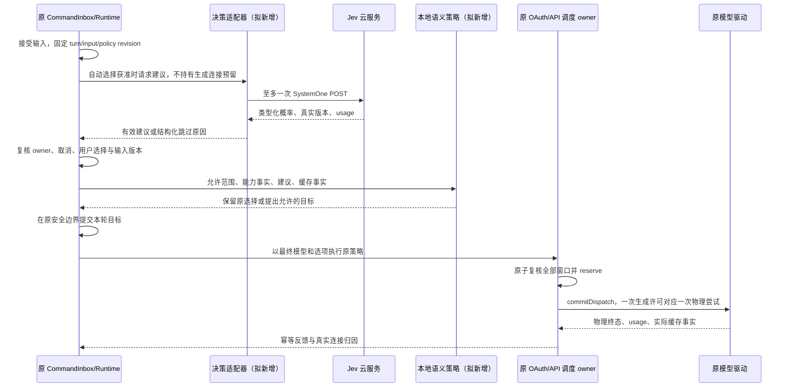

# Jev 语义决策接入评估与分层路由草案

状态：2026-10-17 调研与方案草案，尚未实施，也未获准默认调用外部 Jev 服务。本次只新增文档，不改变代码、配置、模型选择或五种策略。源码调查基线为本地 `b285bfe3` 及当前工作区；其他工作中的变更保持原样。

## 1. 结论与接入条件

建议把 Jev 视为可选的语义决策能力，先做离线评估，不列为 OAuth/API 连接调度的必需依赖。

- 用户已经固定模型和推理档位时，同模型下选择账号或 Key 所需的健康、额度、并发、冷却和缓存事实都来自现有 owner。Jev 不能补出这些事实，增加一次云请求的收益通常较小。
- 用户明确允许自动模型选择或自动推理档位时，Jev 可判断任务意图和复杂度，再由本地确定性规则映射到已验证的模型候选。潜在收益是降低简单任务成本、保留复杂任务能力、减少手动选模型。
- 接入的可行性取决于中文编码任务评测、净成本、端到端延迟、模型切换后的上下文兼容性。尚无本仓真实数据证明这些收益，不承诺具体提升比例。
- 不把 Jev 加成第六种连接调度策略，也不改变原五种策略名称和目标。自动选择模型是另一项产品能力，不能因用户选了“可靠优选”就隐式开启。
- 若用户坚持固定模型、固定档位、也不配置决策服务凭据，建议暂不接入。

## 2. Jev 的运行方式与已核实边界

截至 2026-10-17，官方公开快速接入是 TypeSafe 托管云 API，使用 API Key 调用 `POST /v1/systemone`。请求为 `state + model + questions`，返回类型化答案、概率和用量，不是聊天流或代码生成请求。[官方快速开始](https://docs.typesafe.ai/introduction/quickstart)、[官方编码 Agent 说明](https://docs.typesafe.ai/introduction/coding-agents)。

本次没有找到官方可公开下载并直接运行 Jev 权重的本地部署指南，不能把它描述成已支持的本地模型。企业私有部署是否可用需另向厂商核实；Magpie 支持其他本地 SystemOne 决策端点不等于 Jev 官方权重可本地运行。

已有 OAuth 连接仍只证明用户可使用对应供应商的服务，不自动授予 TypeSafe 访问权。普通 OpenAI/Anthropic API Key 也不能直接充当 TypeSafe Key。网关只有在明确提供 SystemOne 和相应模型权限时，才可能复用该网关的原凭据；具体权限、计费和可用性分别验证，不能从 `/models` 出现名称推断。

官方模型页目前列出 Jev 1.13/1.14，价格为每百万输入 Token 0.042 美元，输出免费；别名会移动。接入评测固定版本和题目版本，运行诊断保留返回的真实模型版本。价格和可用性是查询日事实，不写死成路由保证。[模型、价格、限流与版本](https://docs.typesafe.ai/models)。

厂商报告的置信度来自输出概率的分布，不等同于“本任务正确率”。阈值必须在本仓任务上校准，不能照搬 Magpie 的 0.4 或官方示例的阈值。[官方置信度说明](https://docs.typesafe.ai/confidence)。

## 3. 当前仓库证据与影响范围

| 优先级 | 当前文件/符号                                                                                                           | 已确认边界与方案影响                                                                            |
| ------ | ----------------------------------------------------------------------------------------------------------------------- | ----------------------------------------------------------------------------------------------- |
| 必查   | `packages/shared/src/provider-routing.ts` / `routingStrategySchema`、`RoutingRequest`                                   | 五种稳定策略已经定义；请求包含模型、范围、Token 预留等，没有 Jev 决策协议。保持现有策略语义。   |
| 必查   | `packages/provider/src/routing/planner.ts` / `planRouting`                                                              | 当前规划是可行性与确定性排序；不执行网络 IO，不向这里插入 Jev 调用。                            |
| 必查   | `packages/provider/src/routing/ranking.ts` / `routingScore`                                                             | 可靠性、完成时间、份额、完整额度向量和到期收益已经有本地来源；Jev 不替代这些评分。              |
| 必查   | `packages/provider/src/routing/cache-decision.ts` / `decideRoutingCache`                                                | 现有缓存规则作用于连接；未来增加的模型切换成本需要单独校验，不能冒用连接缓存结论。              |
| 必查   | `packages/services/src/model-provider/providerAccountRouting.ts` / `resolveProviderAccountRoutes`                       | OAuth 模型与协议资格归原 owner；Jev 不得为账号虚构模型权限。                                    |
| 必查   | `packages/services/src/model-provider/providerAccountScheduler.ts` / `ProviderAccountScheduler`                         | OAuth 调度预留、健康、绑定等保留唯一 owner，额度只读原 cache。                                  |
| 必查   | `apps/lcode-cli/packages/adapters/src/model/api-key-pool-owner.ts` / `ApiKeyPool`                                       | API Key 预留、冷却、轮换和共享限流继续归原池；决策层不枚举或操作 Key。                          |
| 必查   | `apps/lcode-cli/packages/adapters/src/model/runner-runtime-headers.ts` / `resolveModelForAttempt`                       | 真实模型/选项构成兼容范围；先确定目标，再为该目标原子预留，不能以旧模型预留发送新模型。         |
| 必查   | `apps/lcode-cli/packages/adapters/src/model/api-key-token-estimate.ts` / `apiKeyTokenBounds`                            | 现有边界来自模型上下文与输出限制。Jev 复杂度不是 Token 上界，不能用于减少硬预留。               |
| 必查   | `apps/lcode-cli/packages/core/src/runtime/methods/turn-model-step.ts` / `runModelBackedTurnStep`                        | Runtime 继续拥有模型步、工具结果、取消与真实使用归因。自动建议只能通过未来明确的准入接口应用。  |
| 必查   | `apps/lcode-cli/packages/core/src/runtime/methods/model-failover-router.ts` / `activateExecutionFailoverAtSafeBoundary` | 复用安全边界与能力约束的语义，不将自动建议伪装成用户切换命令，不覆盖显式故障接管目标。          |
| 应查   | `packages/provider-node/src/provider-auth/driver.ts` / `AuthWireProtocol`                                               | 当前三种 wire protocol 均用于聊天。SystemOne 需要独立决策端口，不能加名字后直接当聊天模型派发。 |
| 应查   | `packages/provider-node/src/provider-auth/model-options.ts`                                                             | 各渠道推理档位映射不同；必须使用模型真实支持值，不跨协议照搬档位字段。                          |
| 证据   | `packages/provider-node/src/provider-auth/vendor/zen-free/models.mjs.source`                                            | 能识别 SystemOne，但因不属于聊天 SDK 而过滤；当前不是 Jev 决策实现。                            |

配套当前规则：[五种连接策略](provider-routing-strategies.md)、[加固](provider-routing-hardening.md)、[当前补齐规格](provider-completion-2026-10-17.md)、[模型故障接管](model-provider-failover.md)。本草案不恢复旧配置行为，不修改这些已生效规则。

## 4. 产品规则：两个正交层次

### 4.1 语义层

仅在有明确自动选择授权的执行范围内，回答“这次任务需要什么能力和推理复杂度”。首期候选类别建议为机械任务、普通编码、复杂分析/设计、未知；中文短请求、指代不明、仅有图片输入时允许返回未知。

Jev 返回类别、概率和置信度，不直接返回任意供应商地址、模型名、账号或 Key。确定性策略根据已验证的模型能力、已启用目录和允许范围，把类别映射到有限候选。模型质量等级必须来自本仓评测或明确元数据，不能仅按模型名字、价格或发布时间推断。

本地硬事实优先：图片、工具协议、上下文容量、会话不可移植性、授权来源、禁止收费规则等不能靠语义判断放宽。是否需要视觉输入由实际消息结构确认，不让文本分类器猜测图片内容。

### 4.2 连接层：五种策略配合

| 现有策略                    | Jev 可提供的输入                                           | 原策略继续决定的事情                                   | 不能改变的规则                                                 |
| --------------------------- | ---------------------------------------------------------- | ------------------------------------------------------ | -------------------------------------------------------------- |
| 可靠优选 `reliable-first`   | 任务复杂度与可选能力档的建议                               | 同目标模型下，按已观测完成可靠性、等待、负载等选择连接 | 不把 Jev 置信度当账号成功率，不把复杂任务一律导向最高价模型    |
| 主备接管 `primary-backup`   | 自动模式内的模型/档位建议                                  | 在选定目标的原连接池按主备顺序接管                     | 不因某 Key“看起来更合适”重排主备，不覆盖用户主模型与接管目标   |
| 份额轮转 `share-rotation`   | 任务类别可进入只读分析；以后经实测校准才可形成软工作量特征 | 沿既有份额与真实结算轮转                               | 首期不把“复杂度”变成 Token 消耗，也不改份额或轮转顺序          |
| 余量均衡 `headroom-balance` | 所选模型/档位带来的明确资源需求                            | 检查全部相关窗口与共享池，原子预留并均衡余量           | 不预测不存在的余额，不把多个 Key 当独立额度，不降低硬预留      |
| 到期优先 `expiry-first`     | 在能力合格的自动候选中提供任务适配建议                     | 根据可信过期时间、预计浪费与已知切换成本消费实际请求   | 不生成刷量请求，不把重置等同过期，不为使用到期额度降低能力要求 |

自动模型选择不等于策略之间自动切换。选了主备就保持主备，选了轮转就保持轮转。每个目标供应商仍执行自己已经保存的连接策略，不建立另一份混合策略配置。

### 4.3 固定优先级

1. 已接受执行、owner/lease、取消与用户显式模型/档位/故障接管选择。
2. 硬绑定、身份隔离、模型与协议能力、完整上下文及工具结果可移植性。
3. 已明确的用户预算、收费边界和自动选择允许范围。
4. 合法且足够可信的语义建议；不确定时保留原选择。
5. 模型切换净收益和稳定性门槛；拒绝因微小收益反复换模型。
6. 对最终目标运行原五种连接策略、相关额度窗口、恢复门禁及原子预留。
7. 发送前重读配置/目录/授权代次；版本变更则重规划或退回原选择，不能沿旧结果发送。

## 5. OAuth 与 API 的实际收益和限制

| 场景                                       | 可能收益                                                             | 限制与收益判断                                                           |
| ------------------------------------------ | -------------------------------------------------------------------- | ------------------------------------------------------------------------ |
| OAuth，多账号、同模型、固定档位            | 很少；原调度已掌握可观察连接事实                                     | Jev 不扩展授权，不解决刷新失败、共享限额或长流反馈                       |
| OAuth，多个真实可用模型、允许自动档位/模型 | 简单任务少占强模型窗口，复杂任务选择经验证的能力档；减少手动调整     | 订阅资源收益不一定等同现金节省；不能假设更低档位一定消耗更少供应商额度   |
| API，多个有已知价格和能力的模型            | 简单任务转到合格的较低成本模型，复杂任务保留足够能力；可能降低总账单 | 需计入 Jev 费、重试、缓存重建和质量回退；只有一款固定模型时收益很低      |
| API，十万 Key、同一目标模型                | 不直接提升 Key 索引或选路速度                                        | 不向 Jev 发送十万 Key，不按 Key 做模型判断，索引性能仍是本地算法问题     |
| OAuth 与 API 混用                          | 在显式允许的候选范围内，可能按任务选择能力来源                       | OAuth 登录不向 API 自动授予权限；不得因 OAuth 暂不可用而静默转到收费 API |

故障恢复、OAuth 授权诊断、并发 Retry-After、共享池对账和首次模型同步属于确定性基础能力，不能算作 Jev 收益。

## 6. 时序、所有者与隔离

| 状态                                               | 唯一 owner                                               | 持久化/派生边界                                                         |
| -------------------------------------------------- | -------------------------------------------------------- | ----------------------------------------------------------------------- |
| 用户模型选择、自动选择授权范围、执行取消、应用建议 | 原 Runtime/模型选择 owner，仍经原 admission              | 不由 Renderer 或 Jev adapter 直接提交模型切换                           |
| 决策供应商地址、模型版本、凭据引用                 | 原 Provider Settings/凭据 owner 的决策用途配置（拟扩展） | 不增加第二份密钥文件，不把秘密放入共享 DTO 或 Renderer                  |
| 单 turn 决策 flight、终态与取消                    | 当前执行 actor 的 Runtime 决策端口（拟新增）             | 同一 accepted turn 合并调用，有界内存；不跨执行或 Host 共享业务 flight  |
| Jev 连接冷却/并发/实际用量                         | 执行地原 API pool/资源 owner，经用途区分                 | 不消耗无关 OAuth 池；若厂商声明同组织共享资源，仍合并到同一物理资源身份 |
| 语义类别到模型档的映射                             | provider 层只读、版本化纯规则（拟新增）                  | 无网络、无凭据，不导入 CLI Runtime 实现                                 |
| OAuth 账号、Key、额度快照、预留、共享池对账        | 当前各原 owner                                           | Jev 不复制或修改这些状态                                                |
| 生成调用和决策调用的使用事实                       | 原用量/诊断路径按调用用途扩展（拟扩展）                  | 区分 `routing` 与正常生成，不把 Jev Token 算到目标模型账上              |
| UI 文案、折叠与说明                                | 原 UI hooks 与本地展示状态                               | 只读展示安全原因；手机不另起 Agent/决策 owner                           |

作用域使用 `workspaceIdentity?.trim() || workspacePath`，携带 `remoteSessionId`、execution、actor、turn 与输入版本。远端执行在实际执行地调用决策端口；Main 和 relay 只做原鉴权、转发与 attachment 调度，不保管业务决策缓存。

## 7. 拟新增接口与模块边界

以下均为拟议契约，并非当前已存在接口。实施前需要架构检查和目标模块受控上下文。

- `SemanticDecisionInput`：稳定 requestId、作用域、turn/input/policy revision、受限任务摘要、语言、可确认的能力需求、questionVersion、deadline。网络请求不包含本机路径、身份原文、凭据、账号列表或 Key 列表。
- `SemanticDecisionResult`：判别联合 `decided | skipped`。成功包含类别、有限概率分布、置信度、真实 decisionModelVersion、questionVersion、elapsedMs、独立 usage；跳过原因包括 disabled/no-credential/fixed-selection/insufficient-context/timeout/rate-limited/auth-failed/schema-invalid/stale/cancelled/budget-exhausted。
- `SemanticDecisionPort.evaluate(input, signal)`：由 CLI contracts 定义执行所需端口，adapter 注入 provider-node 的公开 SystemOne HTTP 能力；core 不接触 Node IO 或服务实现。
- `planSemanticTarget(facts, result)`：provider 层纯函数，返回 keep/propose 和结构化理由。只接受经过本地过滤的有限模型档，不接受自由文本 endpoint/modelId 作为指令。
- `SemanticSelectionCommit`：Runtime 内部独占的受版本保护应用入口（拟新增），检查 user selection revision、input revision、policy revision、catalog revision 和执行状态；复用安全边界的验证与序列，不伪造 `userRequested` 来源。
- 安全诊断 DTO 可位于 shared，经原协议校验和事件投影；具体请求端口留在 CLI contracts。新增协议字段必须同步正式协议入口与运行时校验，不能只声明 TypeScript 类型。

HTTP 适配应复用现有网络/代理/取消设施与独立请求用途，优先直接调用受控端点。官方 SDK 会自动重试限流，若使用 SDK 必须关闭隐藏重试并验证物理次数；首期每个用户 turn 最多一个决策 POST，不在决策服务上再套自动选模型，防止递归。

普通聊天目录保持不展示仅具 decision 能力的 Jev。不能为了同步模型成功而把它冒充 Responses/Chat Completions。现有 UI-TARS 的“决策模型”是视觉动作生成协议，与本文语义分类端口不同，不复用名称推断或动作 codec。

## 8. 并发、缓存、异常恢复与十万 Key

### 8.1 并发与预留

- 同一 accepted turn 的入口并发合并为一个 flight；工具循环与生成重试复用已固定结果，不再次调用 Jev。
- 不同 actor/turn 不合并上下文，不新增后台 accepted 队列。决策并发已满时直接跳过或在既有 deadline 内取消等待，不阻塞正常生成。
- 首期可采用 500 ms 的决策等待上限作为压测候选，实际取值需按部署地区的端到端 P95 调整；这不是厂商延迟保证。超过已有请求 deadline 时更早退出。
- Jev 调用使用独立的物理预算与用途归因。决策期间不占用目标模型的 OAuth/API 生成预留；若决策本身走多 Key/共享池，其 owner 仍需预留并对账。
- 获得建议后才根据最终目标生成真实 Token 边界，进入原连接调度与原子 reserve。语义复杂度只作软提示，不降低输入、输出或共享额度池的硬预留。

### 8.2 两种缓存与切换

**决策结果复用**只限同一执行 actor 的 accepted turn 和同一输入/问题/模型版本。用户新 turn、被接受的 steer、显式模型修改、policy/目录代次变化均使旧结果不可应用；同 turn 已用过物理决策预算时退回原选择，不再追加请求。会话摘要变化不能只靠文本 hash 误认相同语义。首期不做跨用户或跨工作区的语义相似缓存，不持久化任务原文。

**供应商推理缓存**继续以真实协议、模型、选项、账号/Key/共享缓存范围、授权代次、上下文前缀与已确认有效期判断。跨模型、跨供应商不假设可复用；同模型也不能仅因都叫 API Key 就合并缓存。

模型切换需要净收益证据：可比较的生成费用/等待收益，大于 Jev 调用、已知缓存重建和切换成本，再留出稳定性余量。费用不全时只形成建议，首期保留原模型；用户显式更换或原恢复 owner 的必要故障接管仍按原规则执行。OAuth 资源、时间与货币分开衡量，不把不同额度单位相加。

新用户 turn 是首期唯一主动重选机会；同一 turn 的工具链保持模型和档位。部分输出后、已有 provider-session 绑定、不能完整移植工具结果、reasoning items 或历史上下文时，不执行自动跨模型切换。不得重放已完成工具或拼接两家模型的输出。

### 8.3 异常恢复

- Jev 超时、401/403、429、5xx、无效 JSON/概率、未知模型、无可用凭据均退回原选择；不改变目标供应商健康状态，不要求先做 OAuth 登录，不弹出阻断业务的授权流程。
- 429 的 Retry-After 由决策资源原 owner 按真实作用域维护；并发请求共享冷却和探测门禁，不能各自重试。
- `confidence` 与最大选项概率分别校验；所有数值有限且在合法区间，候选集合一致，未知类别不执行。阈值按版本和任务集校准，置信度不能决定权限/收费授权。
- 取消、owner/lease 变化、用户修改模型后到达的结果丢弃；后台物理终态仍完成原资源结算，丢弃业务结果不等于退还已派发消耗。
- 原目标模型也不可用时，继续由现有恢复/故障接管 owner 处理；Jev 跳过本身不允许越界启用模型、恢复禁用 Key 或扩大重试预算。
- 决策回路中断后不重放云请求；重启后如无持久化的已应用目标证据，则使用原恢复/选择规则，不猜测上一进程有没有成功调用。

### 8.4 十万 Key 路由

Jev 输入规模与 Key 数无关：只处理任务与少量能力类别，首期候选模型短名单以不超过 8 个档作为待验证上限。Key ID、凭据、逐 Key 统计均不外发。

决定模型后复用原冻结 catalog、协作式索引准备和有界 profile。不得为每次置信度或任务文本派生新的 Key 索引 profile，也不得复制十万 Key 数组到语义层。新增模型档必须检查 profile 的有界回收与冷热抖动。

性能验收同时比较无 Jev 基线与启用模式，记录冷建耗时、事件循环最大停顿、峰值 RSS/heap、热路由 P95、profile 数、派发吞吐；不能用云分类耗时掩盖本地索引回退为全量扫描。

## 9. 界面与用户授权语义

| 表面             | 本方案约束                                                                                                                   |
| ---------------- | ---------------------------------------------------------------------------------------------------------------------------- |
| 连接调度设置     | 保持原紧凑折叠区域、五种策略与问号说明，不新增阈值、权重、缓存 TTL、共享池或批量 Key 面板                                    |
| 模型选择         | 固定模型/显式档位仍拥有最高选择权。未来“允许自动模型/档位”须成为单独且清晰的选择语义，不能藏在五种连接策略里；本次不新增入口 |
| Jev 凭据         | 若后续实施，复用已有供应商/Key 的凭据管理交互，端点与版本可由决策渠道元数据提供；不会内置共享密钥或要求普通用户先 OAuth      |
| 状态说明         | 可经现有诊断表面只读解释“保留原模型：低置信度/缓存收益不足/固定选择”，不得增加必须填写的手动参数                             |
| Desktop/Web/手机 | 展示同一执行 owner 的投影；桌面实时与手机恢复链路沿现有语义验证                                                              |

配置 API Key 与同意其可用的请求用途必须明确区分。仅导入一把可用 Key，不应自动将工作区内容发送给新增分类服务。影子评估也会消耗费用并外发内容，因此未来真实云评估需要用户提供的适当凭据及明确用途授权；本次调查没有发起实际推理。

## 10. 实施阶段、收益衡量与停止条件

### 阶段 A：离线回放，优先推荐

先整理不含真实用户秘密的中文/英文编码任务集，固定类别和问题模板，与“不用分类器”、简单本地规则和现有可用结构化分类方案比较。测试集与阈值校准集分离，固定 Jev 版本。复杂度标签只是中间指标，最终检验候选模型是否完成任务。

不启用用户生产流量、不增加 UI，不先改五种评分公式。若固定模型场景没有可应用的建议或误降级风险较高，停止接入。

### 阶段 B：受控影子评估

仅在明确授权的小样本执行中观察，不改变实际模型。每 turn 最多一次，记录建议、跳过原因、真实延迟、usage 和估算的切换成本，不记录任务原文。影子结果只能说明建议分布，不能宣称实际账单降低或任务质量保持。

待决策服务可稳定使用、中文与长会话评测达标、成本和端到端耗时可接受，再决定是否进入阶段 C。

### 阶段 C：可选自动档位与同供应商模型选择

先实现用户明确允许的档位建议应用，再考虑同一供应商内经验证的模型短名单。保留显式档位，限定每新用户 turn 一次重选，优先在没有热缓存/硬绑定的新任务验证。跨供应商自动选择留待单独规则，不在首期默认开启。

若界面必须完全保持当前选择语义，且用户不愿引入自动模型/档位授权，则阶段 C 不实施，停留在研究结论即可。

### 衡量方法

API 净节省 = 基线生成实际费用 − 新路径生成实际费用 − Jev 实际费用 − 额外重试/恢复/缓存重建费用。比较相同任务与质量条件，避免重复记入已经包含在实际账单里的缓存费用。

OAuth 单独衡量供应商可观察窗口消耗、任务完成率、任务耗时与手动切换次数；缺少供应商计量时只报告未知，不用本地 Token 冒充订阅额度节省。

建议的发布门槛（待评测后确认，非已有成绩）：

- 复杂编码任务成功率相对基线不劣于 1 个百分点，使用预先规定的非劣检验和足够样本；安全边界、重复副作用与身份隔离错误必须为 0。
- API 在质量相当的任务集上净成本至少降低 10%，计入所有辅助成本；这是产品投入门槛，不是 Jev 官方保证。
- 新路径端到端 P95 不明显恶化；每 turn 新增决策延迟先以不超过 500 ms 作为验证目标，地区链路不同应重新评估。
- 十万 Key 本地索引与热路由相对相同环境基线没有超过 10% 的持续回退，没有随 turn 数线性增长的 RSS/profile；多日真实运行与虚拟时钟回放分开报告。
- 任何一项不满足则维持原默认路径，不通过调低质量阈值包装收益。

## 11. 计划验收场景

以下全部为计划场景，尚未补测试或执行验证。

| ID  | 前置与动作                                                    | 必须断言                                                    | 证据层                  |
| --- | ------------------------------------------------------------- | ----------------------------------------------------------- | ----------------------- |
| J01 | 仅 API Key、无 OAuth，执行自动选择获准的请求                  | 可独立调用与生成，无登录依赖                                | 本地 HTTP 集成/实际渠道 |
| J02 | OAuth 已登录，但未配置 Jev 凭据                               | 跳过 Jev，原 OAuth 正常生成                                 | 服务/Runtime            |
| J03 | 固定模型和显式 high 档位                                      | 不改模型或档位，不发无效决策请求                            | 纯策略/集成             |
| J04 | 对同一目标分别选择五种连接策略                                | 主备、份额、余量、到期、可靠性各自顺序语义一致              | 差分/集成               |
| J05 | 同 turn 多入口并发与多个工具循环                              | 至多一次 SystemOne POST，无重复生成预算                     | HTTP 计数/Runtime       |
| J06 | 不同 turn/actor/远端身份同文本并发                            | 状态不串用，不按相同路径越界复用                            | 隔离/集成               |
| J07 | Jev 等待期间达到目标并发上限                                  | 没有提前占用目标生成槽，后续原子复核                        | owner 时序              |
| J08 | 长上下文、复杂度被误判为简单                                  | Token 硬预留未被降低，全部额度窗口生效                      | OAuth/API/共享池        |
| J09 | Jev 多 Key 共用同组织限流并收到 429                           | 共享作用域冷却、Retry-After 与唯一探测生效，无 SDK 隐藏重试 | 多进程/HTTP             |
| J10 | Jev 超时、401、403、429、5xx 或断网                           | 原模型按原预算可执行，正常业务不被新依赖阻断                | 故障注入                |
| J11 | NaN/越界概率、缺字段、未知类别与旧模型版本结果                | 结构化拒绝，未发生自动目标提交                              | schema/纯策略           |
| J12 | 决策在用户改模型、取消、owner 更新后返回                      | late result 不提交，不再次 dispatch                         | 时序/Runtime            |
| J13 | 低置信度中文短句、指代不明、仅图片                            | 保留原选择，实际图片/工具硬能力不被弱化                     | 评测/集成               |
| J14 | 有效热缓存，预计节省小于已知重建成本                          | 保留原模型，连接层仍按真实缓存范围运行                      | 缓存集成                |
| J15 | 更换模型但协议相同或声称共享缓存                              | 不假设缓存跨模型可用，兼容 key 改变                         | OAuth/API 集成          |
| J16 | 部分输出、provider-session 绑定或不可移植 reasoning/tool 结果 | 不自动切换、不重复工具、不拼接答案                          | Runtime 集成            |
| J17 | 共享池派发后进程退出或用量未知                                | 决策结果丢失不退还已派发额度，原共享 owner 对账             | 跨进程                  |
| J18 | 十万高度分散 Key × 多模型档 × 长期轮转                        | 无逐 Key 决策请求，索引准备协作让步，profile/内存有界       | 基准/持续验证           |
| J19 | 原始任务要求忽略规则、选择任意 URL/Key                        | 输出仅为封闭类别，权限/计费/资格规则不受其修改              | 对抗样本/纯策略         |
| J20 | 真实 Jev 响应包含 usage 与解析后模型版本                      | 单独归因 routing 调用，不写入目标生成账目                   | HTTP/账目               |
| J21 | 新 turn 改变任务目标或 accepted steer 到达                    | 旧结果失效；同 turn 预算已耗尽时回原选择，不追发            | Runtime                 |
| J22 | OAuth 不可用、收费 API 可用但未经允许                         | 不静默转为付费 API，不启用被禁用模型                        | 策略/集成               |
| J23 | 桌面实时、手机断线恢复、远端 attachment                       | 同一 owner 的应用结果一致，无第二个决策/Agent owner         | Desktop/Web E2E         |
| J24 | 只具决策能力的 Jev 出现在上游模型目录                         | 不作为普通聊天模型同步或探测                                | 目录/协议               |
| J25 | 所有后端均不可用且 Jev 也失败                                 | 原恢复 owner 返回真实不可用原因，不无界等待/扩展预算        | 集成                    |
| J26 | Jev 决策本身的多 Key/共享池、取消后物理完成                   | 独立并发预留和结算真实完成，不污染目标 OAuth/API 资源       | owner/多进程            |

裁剪：首期不下载权重、不管理 GPU、不实现图片/Box、不开新工具执行 loop、不做逐工具语义重判、不做跨工作区语义缓存、不做任意嵌套路由组。上述能力无本次产品需求；封闭类别、单次物理预算、原 owner 和显式自动选择范围是边界依据。

## 12. 后续实现与验证交接

本轮只完成 spec。若决定实施，按阶段逐项先补失败测试，再写代码：独立 SystemOne 端口和解析 → 单次派发/取消/预算 → Runtime 版本守卫与只读影子结果 → 缓存/自动目标应用 → OAuth/API/共享池/十万 Key 回归。不能先将 SystemOne 塞进聊天协议，再补例外。

当前已存在的验证入口为 `pnpm test:provider-routing`、`pnpm test:provider-routing-ui`、`pnpm typecheck`、`pnpm lint` 与 `pnpm architecture:check --changed`。provider-node 测试使用当前 `node --import tsx --test` 文件入口。现有路由脚本按文件名筛选，新 semantic 测试必须显式接入或独立执行，不能声称它们已被旧命令覆盖。

已有测试只能作为原路由回归基础，不能证明 Jev 已完成接入。真实云端验证需要适当的决策服务凭据；Ubuntu 等目标环境、真实订阅窗口、真实账单和多日墙钟运行仍需分别取得证据。

图谱核查：`capability.provider-routing-strategies`、`capability.execution-model-failover` 是相关当前节点，尚无本文拟新增语义端口的实现节点，不能提前登记为已提供能力。发现 `execution-model-failover` 的图谱文字仍概括为在途请求完成，其与当前显式用户切换可中断请求的 spec/代码表述存在 `graph-drift-candidate`；本次不修改该行为或夹带更新其他并行图谱改动。

仍需在实现前确定的产品问题：是否提供明确的自动模型/档位选择语义、是否接受分类摘要发往独立云服务、使用何种现有凭据来源与计费边界、评测后的默认启用范围。这里列出决策点，不把它们视为已经得到用户授权。
