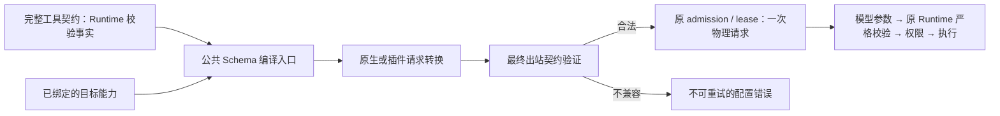

# 工具 Schema 跨供应商兼容性排查与方案

2026-10-22。状态：**已实施公共兼容修复并通过本地验证**。承接 [模型请求失败全链路方案](model-request-failure-lifecycle.md)。基于当前源码、仓库固定 vendor 源码与已有兼容补丁；不调用真实账号，不将本地请求形状验证写成上游已接受。

## 新现场与已确认链路

用户补充 Qoder / dfmodel 的 400：`Invalid schema for function 'Git': schema must be a JSON Schema of 'type: "object"', got 'type: null'`，随后切换供应商恢复。原附加日志不包含此次会话和 trace，无法回放当时原始 HTTP；以下为当前源码的独立复现。文档不保存真实会话、请求与 trace 标识。

真实 `createGitToolEntry().inputSchema` 来自 `z.discriminatedUnion("action", ...)`，导出根只有 `$schema` 和 `oneOf`，三个分支均为 object，根没有 type。分支包含五个有效 action：inspect、bind、fetch、push、ls-remote。

使用真实工具声明、`toAiSdkTools`、真实 AI SDK、`fetchPluginModel` 和固定 Qoder 的 `qoderBody` 逐层捕获，四层均保留这个无 type 的根。这与用户错误完全吻合。错误里的 null 在本复现中表示**根 type 缺失**，不是 Git 调用参数为 null；拒绝发生在模型请求校验阶段，尚未运行 Git 命令。

切换供应商后恢复是合理现象：部分其它链路已有 object 根投影或厂商内部兼容，不能据此判定原工具声明满足所有目标端点。

## 覆盖范围与证据标记

- 覆盖 `plugins.ts` 当前登记的 20 个正式插件渠道，4 个 alias 复用其对应实现；另检查 6 个原生渠道及手动 API 的三种 SDK 协议。
- 对插件公共 worker 运行 20×3=60 个协议组合的本地捕获，确定转换责任；该矩阵不表示每个插件都支持三种协议。
- 对 Qoder、Devin、Grok、WorkBuddy、Trae、Cursor 的固定源码执行实际纯请求构造/工具函数；Factory 检查并执行原有 Messages 包装；Codex/ChatGPT、Copilot 执行真实请求构造；Google 执行真实 schema 与 wire 转换；Claude 执行本地 MCP tools/list；手动 API 通过真实 SDK fetch 捕获。
- **已复现缺陷**：请求形状或合法分支确有丢失；**有防护**：本例 object 根及全部五个 action 得到保留，不代表所有 JSON Schema 均兼容；**风险/待确认**：请求仍有问题形状，但没有对应上游实测；**特殊协议**：不能直接按标准 function 参数根判断结果。

## 全渠道结果

| 渠道或路径                                             | 检查结果                                                                                   | 定性与边界                                                                                                    |
| ------------------------------------------------------ | ------------------------------------------------------------------------------------------ | ------------------------------------------------------------------------------------------------------------- |
| qoder、qoder-cn                                        | Chat worker 与最终 qoderBody 均透传无 type 的 oneOf                                        | Qoder 现场与本地复现吻合；CN 同构造路径具有相同风险                                                           |
| cline                                                  | 公共层只把 oneOf 改为 anyOf，根仍无 type；插件只改鉴权/归因/路由字段                       | 有同类请求形状风险，嵌套组合关键字转换不能代替 object 根处理                                                  |
| mimo-app                                               | Chat schema 原样进入 MiMo/Token Plan 转发                                                  | 有同类风险；是否拒绝由实际模型与端点决定                                                                      |
| trae-cn、trae-global                                   | 最终 nativeTools 将原 schema JSON 序列化为字符串，内部仍无 type、仍为 oneOf                | 有同类风险；字符串封装不会补齐根类型                                                                          |
| zed：Chat 模型                                         | 公共层和 providerRequest 的 chat 分支均未规范化根                                          | 有同类风险；不能因 Zed 的 Responses 路径正常就认定所有 Zed 模型正常                                           |
| opencode-zen-free：Chat 模型                           | 公共层不处理根；插件 normalizeTools 只补缺少的内置工具，不修已有 Git                       | 有同类风险；按目录实际协议验证，Messages/Responses 已经公共投影                                               |
| factory：Chat 模型                                     | worker 不投影，droidBody 只调整已有客户端提示等内容                                        | 有同类风险；Messages 的包装保护不覆盖 Chat                                                                    |
| factory：Messages / Responses                          | Messages 保留原 wrap/unwrap，根 object、原联合放到包装属性中；Responses 走公共 object 投影 | 本例已有防护；必须保留对称的历史包装与结果解包，不能随意全局替换                                              |
| devin                                                  | 插件 objectRoot 合并全部 object 分支                                                       | 本例根 object，全部五个 action 与字段保留                                                                     |
| grok                                                   | Responses 公共投影及插件 objectRoot 处理                                                   | 本例根 object，全部五个 action 与字段保留                                                                     |
| workbuddy、workbuddy-ai                                | 插件 fitTools → objectRoot                                                                 | 本例根 object，全部五个 action 与字段保留                                                                     |
| bigmodel、zai                                          | 目录使用 Messages，公共 prepareToolSchemas 投影                                            | 本例已有防护；不把虚构 Chat 组合当成此渠道正式能力                                                            |
| minimax-code、minimax-code-global                      | 目录使用 Messages，公共 prepareToolSchemas 投影                                            | 本例已有防护                                                                                                  |
| kiro                                                   | Messages 公共投影后进入 Kiro toolSpecification                                             | 本例已有防护                                                                                                  |
| commandcode-plan                                       | Messages / Responses 公共投影                                                              | 这两条正式路径有防护；若目录另暴露 Chat 则需按 Chat 分支验证，不继承其它协议结论                              |
| cursor                                                 | toolsOf 保留原 schema，并用于动态工具目录/schemaText、Cursor 自有协议                      | 特殊协议；源码未规范化根，但不能据此断言会出现标准 function Git 的同一报错                                    |
| codex、chatgpt-api 原生 OAuth                          | prepareResponses 使用 object 根投影                                                        | 本例根 object，全部五个 action 与字段保留；不同于直接 API Key 的 SDK 路径                                     |
| copilot：手选 / Auto                                   | 手选三协议在 fetch 前统一投影；Auto 三协议构造亦投影                                       | 本例已有防护；已执行 Auto 构造及核对手选唯一发送入口                                                          |
| gemini、antigravity                                    | googleToolSchema 对 union 直接选择第一个非 null 分支                                       | **已复现分支丢失**：最终只剩 inspect/cwd/url，bind/fetch/push/ls-remote 消失；虽有 object 根仍不正确          |
| zed：Gemini 模型                                       | 公共 object 投影后再走 geminiRequest / googleToolSchema                                    | **已复现分支丢失**：字段虽合并保留，但 action anyOf 再被压成 enum=[inspect]；完整 worker 出站验证得到同一结果 |
| zed：Messages / Responses 模型                         | 走公共 object 投影                                                                         | 本例已有防护；需与 Gemini、Chat 结果分开记录                                                                  |
| claude 原生 CLI 桥                                     | 实际本地 MCP tools/list 发布原 input_schema，根无 type                                     | MCP 边界的形状缺口已复现；未启动真实 Claude CLI，后续 CLI 是否自行处理尚未验证                                |
| 手动 API：OpenAI Chat / Responses / Anthropic Messages | toAiSdkTools 不做通用 object 根处理；真实 SDK fetch 三协议均捕获原 oneOf、无 type          | 三种手动 API 出站均有同类缺口；上游是否接受需按目标能力判断，不能只修 OAuth worker                            |

同名供应商的不同协议、OAuth/API Key、插件/原生链路有不同处理。上表“有防护”只说明本例 shape 与 action 完整；运行时 Zod 仍是全部参数约束的事实源。

## 第二个已确认缺陷：Google 不是根类型修好就结束

`google-schema.ts` 对任何 anyOf/oneOf 都使用 `branches.find(branch => branch.type !== "null")`。这个规则适用于“一个值类型加 null”的部分情况，却被用于真正的多分支联合：

```text
Git = inspect 分支 | bind 分支 | fetch/push/ls-remote 分支
        ↓ 当前 Google 转换
Git = inspect 分支
```

直接执行 googleToolSchema 与 geminiRequest 均丢掉后两个分支。即使先执行现有 objectToolSchema 合并所有字段，action 的 anyOf 仍被 Google 转成只含 inspect 的 enum。实际 Zed Gemini worker 已复现这一双重转换问题。

因此只给 Qoder 补一个 type，或给所有供应商统一调用一次现有折叠函数，不能构成完整修复。既要保证目标结构合法，也要防止编译后排除原本合法的工具动作。

## 系统性方案与唯一所有者

1. **工具业务契约保持完整。** 原始 Zod/JSON Schema 是 Runtime 参数校验事实；不为兼容某个端点改掉 Git 的动作定义、必填字段、安全校验、权限或执行器。不删除 Git，也不改用 Bash 绕过账户/权限边界。
2. **补齐目标能力契约。** 从解析后的 Provider/Model binding 读取协议、root-object/root-union、nested-union、refs、strict、wrap 等能力。已知 Qoder 的该拒绝明确归入不兼容根；未知 API 不借用同名 OAuth 的能力。不在业务 handler 维护渠道名单，也不复用与此无关的 requiresMfjsToolSchema 标志。
3. **收敛一个编译入口。** 复用并按层级提升现有 prepareToolSchemas / objectToolSchema 能力，通过公开入口供 SDK adapter、native 和插件使用。避免每个供应商复制一份 union 折叠。Factory 的原 wrap/unwrap 属于它的适配策略，选择一次并保持对称，不能叠加出不一致的参数形状。
4. **保留全部合法分支。** 对 object-only union 合并所有属性、保留所有 action 选项，共同 required 才可提升到根；需要时在生成侧有记录地放宽分支条件，最终仍严格执行原 Runtime 校验。Google 的同类型 const 分支应合成完整 enum；复杂混合类型、递归或无法表达的 schema 必须显式说明不支持或采用经验证的表示，不能静默选第一个分支或用空对象代替。
5. **最终出站前验证。** 每份请求经过所有 vendor 转换后，检查根类型、引用、目标支持的组合关键字及结构完整性。失败抛出有工具名/字段路径/协议/安全原因的 InvalidModelRequest，在物理请求前停止；不记录完整用户 schema 或正文。
6. **失败语义贯通。** 真实上游 schema 400 保持不可重试；记录是哪一阶段拒绝及工具 schema 形状摘要，不能由 compact 外层、切 transport 或隐式切供应商重复消耗请求。若采用 magpie 的“拒绝后学习兼容能力”，也必须进入原物理预算/租约与 owner，不直接复制它的额外重发逻辑。



编译过程只产生请求局部投影，不改变会话选择，不产生第二份队列或共享可变 schema；Desktop continuous 与手机 replayable 继续消费同一个 Runtime 的失败/工具事实。身份、owner/lease、stale run 和远程连接边界保持原规则。

## magpie 可复用之处

`internal/gateway/object_root.go` 已识别与现场近似的错误文案，并对 Chat/Responses 做 object 根投影；入口既有预处理，也有拒绝后的单次适配。原生/插件中的 objectRoot 提供分支合并参考。可借鉴“以协议与能力决定转换、保留分支属性、在最终请求处验证”；不直接复制不同调度语义下的额外重发。仓库已经存在相关基础函数，修复重点是统一覆盖与验证语义完整性。

## 必须先补的回归

### 实施决定（2026-10-22）

本轮按用户授权实施：纯编译能力归 `packages/provider/src/tool-schema.ts`，从 provider 公开入口导出；原 native 文件保留兼容 re-export，不复制实现。SDK、所有插件 Chat/Messages/Responses（Factory Messages 保留包装）、Claude MCP 共用 object 根投影。Google 使用同一联合分支合并能力，const/enum 合并完整取值，object union 合并所有分支；无法表达的混合联合显式拒绝，不能选择首分支。模型侧允许投影为原契约的上界，Runtime 原 Zod 负责最终精确约束。编译错误在请求前归为不可重试的 InvalidModelRequest。

- 使用真实 Git schema 和 inspect、bind、fetch、push、ls-remote 五组合法输入，逐目标验证所有动作仍可表达；缺 username / expectedRevision 等非法输入仍在 Runtime 被拒绝。
- 根 anyOf/oneOf/allOf、根 local ref、嵌套 object union、同字段不同 const/enum、nullable、数组元素 union、递归引用分别覆盖；不能只断言 type=object。
- 实际 SDK → 原生/worker → vendor 最终 body 捕获，覆盖所有已登记渠道实际支持的协议、三种手动 API、Claude MCP 与 Cursor 动态工具边界；不把 60 个公共层组合冒充 60 个上游可用组合。
- Factory 包装/解包及历史 round-trip、工具名/参数名不变、重复编译幂等、原 schema 不变；同时覆盖第三方 MCP 的合法根联合。
- 出站失败时网络/工具执行次数为零；上游 schema 400 不自动重试、不执行 Git、不影响其它会话；手机重连不重放。
- 修正 `plugins/tool-schema.test.mjs` 中“Qoder 等所有其它 Chat 渠道原样保留 root union 就是正确”的测试假设；Google 当前测试仅覆盖 nullable union 等情形，必须补真正多分支测试。现有测试全部通过不构成本问题已修复的证据。

## 实施前验证与限制

- 工作区 freshness、根 `pnpm typecheck`、`pnpm lint`、`pnpm architecture:check --changed` 通过；架构新旧违规均 0。读取了 provider-node 与 lcode-cli 受控上下文。
- native Google/schema、公共工具 schema、plugin 工具 schema、vendor compatibility、native transports 五组现有测试：33 通过、0 失败。
- 已执行上述真实 Git 声明、真实 SDK、60 个 worker 组合、原生请求构造、6 类固定 vendor 纯函数、Factory 包装、Zed Gemini 完整 worker、Claude MCP 的本地合成捕获；无真实凭据、无付费请求、无 Git 操作。
- 以上为实施前排查；供应商线上接受情况没有真实账号验证，本地合成结果不能代替用户现场完整请求的版本证明。

## 本轮实现与回归入口

公共编译器从 provider 公开面供 SDK、native 和 worker 使用。原 native 入口只 re-export。20 个插件的公共 Chat/Messages/Responses 路径统一处理，Factory Messages 保留固定的对称包装。Claude MCP 启动前编译；Google 不再选择联合首分支，合并全部动作、对象字段和引用枚举，不可表达的混合联合通过稳定不可重试错误在请求前失败。worker 仅透传本地编译器的固定错误契约。

`node --import tsx --test scripts/provider-schema-compatibility.test.mjs` 使用 CLI 公共构建产物的真实 Git 工具：60 个公共 worker 组合、真实四种 SDK 出站、Codex/ChatGPT/Copilot/Google 构造、本地 Claude MCP 工具目录及参数匹配、Qoder 最终 vendor body、Factory 包装和原 Zod 校验，共 66 项（含 Google 配额经过真实 SDK 解析的边界回归）。运行前用 `pnpm --dir apps/lcode-cli typecheck` 构建公开依赖。该矩阵验证公共入口，不宣称每个渠道均支持三种上游协议。

另有公共编译器、Google mixed union/type-array/ref、worker 错误契约、SDK 本地配置失败和现有 vendor/transport 回归。已重新生成嵌入 worker；迁移的编译器继续保留 Magpie MIT 归属并纳入 copied-component 清单。全部验证使用本地 mock/fixture，不请求真实账号、不执行 Git 网络动作。Root/CLI 类型、Lint、架构和最终测试结果见关联总方案的最终验证条目。
