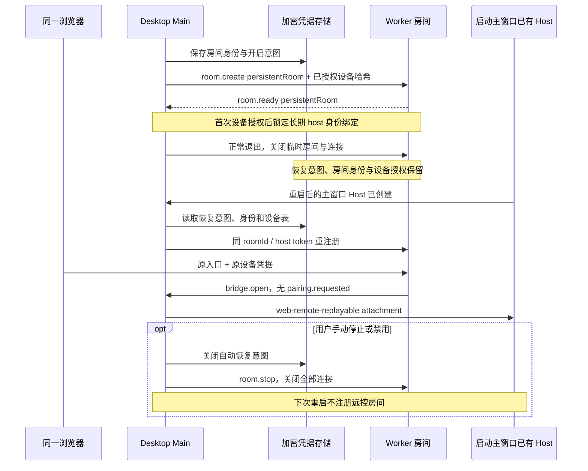

# 远程控制桌面重启恢复

## 产品规则

- 同一浏览器首次扫码并在桌面允许一次。正常退出、升级或重启 LCode 后，打开原 `/p/<roomId>` 或站点根入口，使用原设备凭据恢复，不扫码、不再次裁决。
- 手动停止、空闲自动停止或禁用远控必须立即断开，并持久化关闭自动恢复意图；重启保持停止。以后手动开启可继续复用已授权设备。主动撤销的设备不能恢复。
- Main 是房间身份、恢复意图与 attachment 调度的唯一所有者。房间 ID 和 host token 通过现有加密 CredentialService 保存，不进入配置快照、Renderer、日志或二维码。capability 每次启动/刷新重新生成，不持久化。
- 自动恢复只适用于当前窗口 Host 的 local attachment；在启动主窗口已有 Local Host 创建后调用一次 Main 恢复入口，使用本次可信窗口 ID。旧 remote 三元组入口不自动绑定到其他 Host，继续手动开启并严格验证 identity/session/owner/lease。
- Worker 协商 `persistentRoom:true` 后，已授权房间保留不可变 host-token 哈希绑定；停止、退出或 Host 宽限耗尽只清除临时房间和连接，不让知道旧 roomId 的其他客户端重新认领。未授权孤儿房间、legacy 房间仍按原规则清理。
- 新 Main 仅在 Worker 确认 `persistentRoom:true` 且存在已授权设备时恢复/复用持久房间。旧 Worker 不伪称支持重启恢复，不复用已失去身份绑定的房间。
- 设备表写入在退出屏障中等待已提交操作；停止/禁用和迟到的启动/room.ready 由既有操作 generation 与串行持久化顺序门禁，不能复活手动停止的远控。
- 稳定 roomId 不等于一次连接的身份；每次创建隧道使用独立 session generation，旧隧道的关闭、断桥、授权与二进制回调不能影响同一 roomId 的新连接。已接收 ACK 的持久化按队列提交，不因正常退出而被丢弃。
- 浏览器仍只经 pairingCredentialStore 读写凭据。桌面重启/离线/房间缺失不会删除设备授权或回退已消费 capability；根入口恢复失败保留授权，稍后从同一入口重试。
- 已记住设备的原入口遇到桌面尚未运行或手动停止时，提供“重新开启后重试原入口”的中英文提示和重试按钮，不再引导重新扫码。重试只访问数据通道，不会替桌面开启监听或提交新的配对请求。
- Desktop continuous 和远程 web-remote-replayable 仍共享既有 Host/CLI，不新建 Agent、远程 Host 或业务状态。Worker 只保存鉴权与连接元数据。

## 所有者与事件顺序

## 兼容与验收

- 协议字段为 proto:1 的可选协商扩展；Worker 回显后才允许持久恢复。旧版本已经丢失的房间身份无法凭空重建；升级后首次手动开启建立稳定入口，原设备凭据仍优先复用，无需再次允许。
- 先补失败回归：Main 销毁/重建后 roomId、host token、设备哈希不变，窗口 ID 使用新值，无重复裁决；停止/禁用/空闲停止后恢复不发网络请求。
- 覆盖保存期间停止、重复恢复、多窗口、旧 room.ready、撤销、旧 Worker 未协商、损坏恢复记录，以及退出等待设备表写入。
- Worker 状态机和真实 workerd 覆盖：停止/Host 宽限耗尽后原 token 可重注册，其他 token 不能抢占，未授权孤儿/legacy 清理不变，已撤销设备不在注册表中复活。
- 390px / 1280px 浏览器覆盖：首次授权后桌面离线、恢复，关闭重开原链接/根入口无需再配对；手动停止不触发自动配对且保留凭据。
- 执行远控回归、浏览器 E2E、Worker 测试与类型检查、根 typecheck/lint/架构检查；分别报告未执行的真机、安装包发布与 Worker 部署。未部署不声称线上生效。

## 本地验证（2026-10-21）

- `pnpm test:remote-control`：148/148。新增真实加密文件的三个进程验证，以及重启、手动停止/再次开启、禁用、旧 Worker、损坏记录、退出写入、停止抢先和相同房间的旧隧道事件回归。
- 浏览器与恢复策略：30/30，包含 390px / 1280px 首次授权后从不含 capability 的原入口恢复、离线保留授权、点击重试不发配对申请；既有根入口和撤销场景通过。浏览器执行生产组件/客户端，仅模拟 Worker 网络边界。
- Worker：48/48，含真实 workerd 的停止/重新注册、身份抢占拒绝、原设备免确认和撤销不复活。Worker typecheck 通过。
- 根 `pnpm typecheck`、`pnpm lint`、changed 架构检查通过；架构 total / baseline / new 均为 0。20 个相关源文件/文档格式检查和两仓库 diff 检查通过；功能图 YAML、113 个节点 ID 和 175 条关系端点校验通过。
- production 环境的 `pnpm build:mobile-web`、Desktop `build:no-runtime-assets` 通过；Worker public 已装配新 Web 资源。构建仍有现有的大 chunk/无效动态导入提示。
- 提交前同步内嵌 OAuth worker 中的 shared 协议生成内容；`pnpm verify:pre-push` 通过（发行输入、7 项 Agent 同步测试、Lint、架构检查），同步后根 typecheck 再次通过。
- 变更模块为 desktop / shared / web，以及独立 Worker；Main 加密恢复记录与连接代数是唯一恢复 owner，UI 只派生重试显示。主仓库源码/测试净增 653 行，Worker 源码/测试净增 210 行（不计文档和生成资源）。
- 未替换正在运行的安装版客户端、未发布桌面安装包/标签、未推送或部署 Worker、未执行真机系统杀后台验证。旧版已丢失的房间身份无法逆向恢复，升级后首次开启需建立稳定入口；原设备授权继续优先免确认复用。
