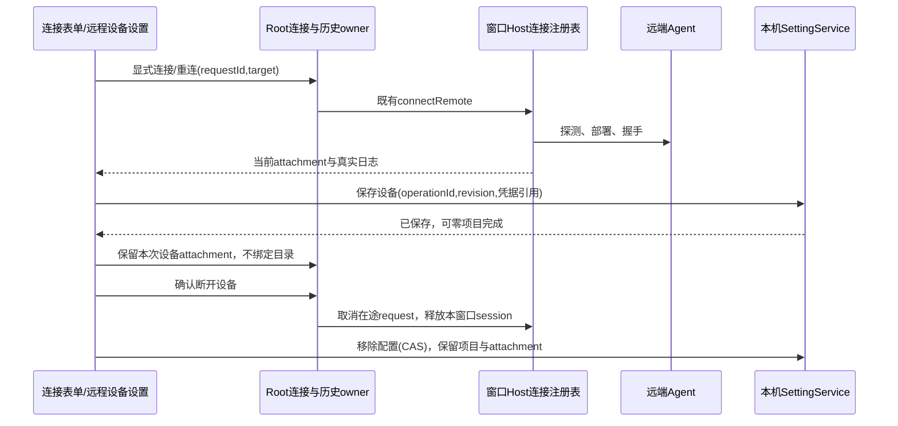

# 远程连接表单与设备管理

## 产品规则

- 新建连接直接显示配置，顶部以可键盘操作的 SSH / WSL / Docker 切换按钮选择方式；WSL 仅 Windows 桌面提供。切换保留各方式草稿，不发起连接。移除四步编号导航和“下一步”；配置页底部为取消与连接。
- SSH 主表单直接显示配置别名、主机、端口、用户名、认证字段、代理配置和资源下载方式；下载按钮简写为“本地上传”“远端下载”，分别保留本地下载后上传、远端服务器下载的原有语义，完整说明通过悬停提示提供。按钮并排显示、窄屏可换行文字，不放入折叠区域，所有原值与提交语义保持不变。
- 配置别名与资源下载方式在表单顶部同排，标签和控件顶边分别对齐；窄屏纵排，下载方式紧跟别名、位于主机之前。此布局仅调整投影，草稿和提交继续由原表单 owner 负责。
- 主机与端口在所有宽度下同排，主机自适应剩余宽度，端口列紧凑且可容纳五位数字；窄屏不为端口另起一行。
- 提交后显示当前连接目标、连接状态与真实日志；允许收起后继续和显式取消。设置内新建/修改在握手和设备保存成功后完成，不选目录、不创建项目。保存失败复用本次 attachment 重试，不能重新部署。原项目入口在替代流程完成前保留原目录浏览行为。
- 同窗口已有连接或目录选择流程时，新建/设备入口恢复当前流程，不替换正在处理的目标。设备管理释放当前 attachment 后，本地目录流程同步结束，不能恢复失效目录页。
- 设置 → 基础设置新增桌面端“远程设备”，与手机远程控制分开。配置按稳定设备 ID 保存，authority 复用现有 workspace identity 构造工具，不按密码、代理或资源方式拆成多台设备；物理连接继续保留 Host 的认证与代理隔离。相同地址/账号不重复建档，修改地址新建另一档案，不重定向既有项目。
- 菜单位置紧随“远程控制”；Root 的无项目设置入口和有项目的 WorkspaceSettingsLayer 均传递同一管理模型，不能因当前有项目而禁用新建。设备持久化、跨设备目录与执行路由的当前规则及验证见 `remote-devices-and-project-sources.md`。
- 列表展示类型、目标、真实在线/连接中/未连接/失败状态、项目数、已有项目路径和最近连接日志。历史 connected 标记不能作为当前在线证明；在线必须来自当前 Renderer attachment 注册。
- 提供新建、连接、断开、修改后连接和移除设备。连接复用 Root 与窗口 Host，保存复用 SettingService 原队列/锁和 CAS/operationId 收据。凭据只经 CredentialService 读取/保存，配置只有引用；收起保留本次流程，结束清理常驻表单明文。重连已有配置不增加其 revision。
- 断开只释放本窗口的 logical sessions，并取消原项目在途重连，不停止远端机器、容器或删除任务文件。移除只删除配置，保留项目历史、文件和当前 attachment；不关闭项目 tabs。原历史回收凭据时保护设备档案仍引用的 key。
- 设备允许零项目持久化。旧历史只迁移一次，稳定 ID 与凭据引用落盘后不因启动重读改变；注册表存在后，移除项不能从历史复活。在线事实、sessionId 和 lease 不持久化。启动继续手动连接。
- 中文/英文、明暗主题、桌面与 390px 窄屏可用，使用 DESIGN.md 的现有组件、字号与语义颜色。

## 所有者与接口

| 数据                 | 唯一所有者                                          | 投影/操作路径                                                                         |
| -------------------- | --------------------------------------------------- | ------------------------------------------------------------------------------------- |
| 设备配置             | 本机 SettingService                                 | mutateRemoteDevice 的 CAS、幂等收据与一次历史迁移                                     |
| 设备列表/在线状态    | 设置投影 + 当前窗口 attachment registry             | useRemoteDeviceManagement 按设备 ID 关联；旧 Host 只保留历史读取兼容                  |
| 连接/重连/取消与凭据 | Root/useRemoteWorkspaceHistory + 窗口 Host registry | 既有 handleConnectRemote / handleReconnectRemoteWorkspace / handleCancelRemoteProject |
| 表单与当前尝试       | RemoteConnectionDialog/useRemoteConnectionForm      | 保留 requestId 取消、迟到成功释放与失败隔离                                           |
| 项目记录与移除       | useRemoteWorkspaceHistory                           | 保留原项目移除路径，与设备配置移除分离                                                |
| 菜单与面板局部状态   | SettingsPage/RemoteDevicesSection                   | 只发 owner 命令，无平台调用与重复业务 store                                           |

Desktop 保持 desktop-continuous；手机保持 web-remote-replayable 并使用桌面既有 owner。管理入口仅桌面可用，扩展 AppSettings 的设备配置与变更收据，不新增设置文件或 Host，不改变 owner/lease 与 CommandInbox。

## 验收

1. 真实连接组件打开即显示 SSH 字段，可直接切换 WSL/Docker，往返切换保留草稿；提交不经过 Next，键盘可操作，非 Windows 不提供 WSL。代理配置和两种资源下载方式直接可见，无需展开；均可切换并按原值提交。
2. 既有取消、后台收起、失败重试、迟到结果、目录选择取消与提交失败回归通过。
3. 同地址/账号不重复建档；同路径不同设备和 WSL user 继续隔离，代理配置不改变设备归属。断连历史不得显示在线。
4. 新建和修改使用同一表单；连接、断开调用 Root/Host，配置通过设置命令保存/移除。移除不删除项目或文件，不从历史复活。
5. 零项目保存、丢失响应后原 operationId 重试、两个设置 owner 的并发 CAS、禁止原始密码入配置、凭据引用保留、地址不可重定向与独立连接关联均有对应场景。
6. 浏览器覆盖设备列表操作、空态、中英文、明暗主题与 390px；实际运行根 typecheck、lint、changed architecture 与关联回归，区分夹具与真实网络验证。

## 早期表单验证（2026-10-22，设备拆分前）

- 先以浏览器回归分别确认折叠下载方式、折叠代理以及旧按钮长文案不满足要求，再实现主表单直接显示与“本地上传 / 远端下载”短文案。下载枚举、默认值、代理模式及原提交路径保留；两种下载值均经实际表单提交断言。
- 关联浏览器回归合计 22 项通过：连接表单 10 项、代理配置 10 项、七主题/中英文/320px 与 390px/大字号选择控件 1 项、设备管理 1 项。覆盖直接切换、草稿保留、设备配置与目录入口、连接取消、收起恢复、迟到结果释放、设备断开、移除和错误重试。窄屏几何断言按实测 CSSOM 整数舍入保留 1px 容差，未改用延时。
- 设备投影与设置导航 5 项单元测试通过；既有 `pnpm test:remote-control` 148 项通过，继续区分 desktop-continuous 与 web-remote-replayable。
- 根 `pnpm typecheck`、`pnpm lint`、两个浏览器夹具的额外 TypeScript 检查、相关文件格式与 diff 检查通过；changed architecture 的 total / baseline / new 均为 0。功能图节点、源码种子及 YAML 检查通过。
- 改动位于既有 UI 模块与 Web 测试，不增加业务状态所有者或持久化 schema；UI 生产源码 17 个文件新增 904 行、删除 450 行，净增 454 行。列表由 history 与当前 attachment 派生，所有连接命令与事件顺序见上图。
- 已检查中文桌面深色、390px 浅色及英文窄屏截图。本轮验证使用隔离浏览器与受控服务夹具，未连接真实 SSH/WSL/Docker 环境，未构建或替换安装包。
