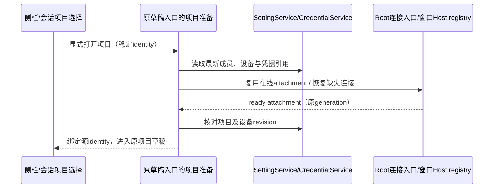
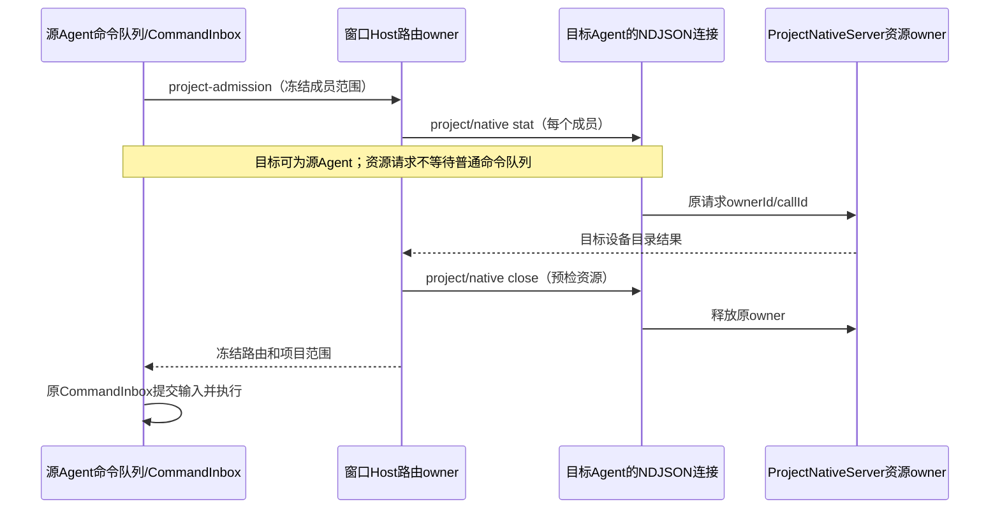
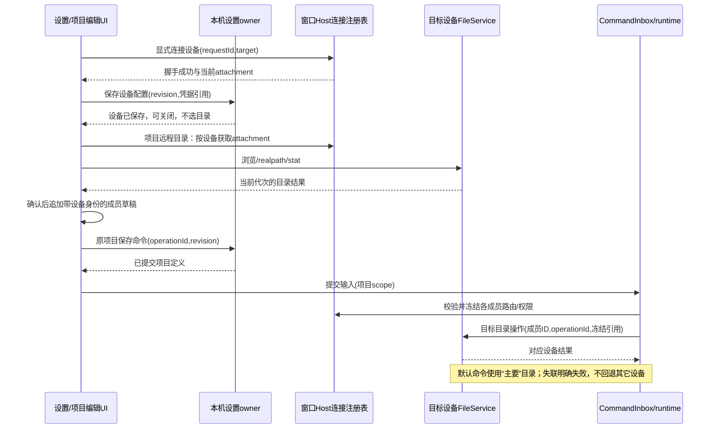
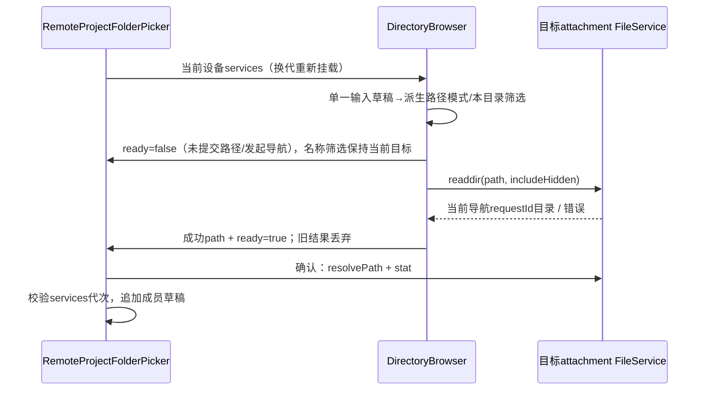
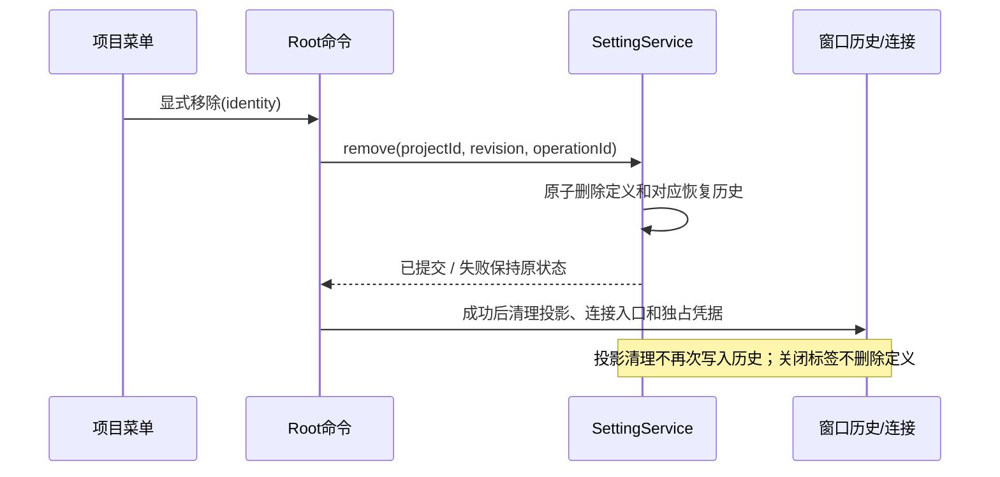

# 远程设备与跨设备项目源目录

## 已确认产品规则（2026-10-22）

- 设置 → 基础设置按“远程控制 → 远程设备 → 供应商管理”相邻显示；其余菜单保留当前语言长度排序。
- 远程设备唯一负责 SSH / WSL / Docker 配置、连接、断开、重试与移除。新建连接在配置、部署、握手和保存成功后完成，不要求选择目录，不自动创建项目或切换当前项目。
- 设备配置独立持久化，允许零项目设备。在线状态只由当前窗口 attachment 提供，不能把持久化“上次成功”当在线证明。重启保留配置，不隐藏发起连接。
- 新建/编辑项目在“添加目录”之前提供“远程目录”：选择设备、连接就绪、浏览目标设备、确认目录后才追加项目草稿。取消选择不改草稿，不释放其它项目 attachment。
- 项目可以混合本地、多个 SSH 主机、WSL 与 Docker 的目录。同路径不同设备是不同成员，不能按 path 单独去重。目录行清楚显示设备、路径、用途及默认参与。
- “主要”标记的目录是默认执行目录，默认命令在其设备执行；明确目标成员的文件、终端与 Git 操作路由到该成员设备。不能解析目标或同路径歧义时明确要求目标，不猜测、不同步回退本地。
- 新建与编辑设置主要成员时，标记同步更新、该成员移到第一行；其它成员支持拖拽排序。历史项目身份锚点与默认执行成员分离，普通编辑不改已有会话身份。
- 目录说明合并到源文件夹数量和操作按钮之间的单行滚动区域，悬停或聚焦可读全部；用途空值明确提示点击填写。目录列表滚动不依赖编辑用途。
- 已保存项目的主目录身份沿现有规则保持稳定；新建草稿可选择主要目录。普通编辑追加其它设备目录不迁移历史会话、原项目身份或正在运行任务。
- 新建项目无目标设备时可跳到设置远程设备建立连接；项目名称、成员、用途及主要目录草稿保留。创建成功/取消后返回原项目编辑入口；取消设备配置不产生半成品目录。
- 新入口完成后移除项目选择菜单的“远程连接”。已有远程项目仍可打开与重连；不删除 SSH/WSL/Docker 能力或用户的代理、资源下载选项。
- 移除设备配置不得删除项目目录、远端文件、任务和历史会话；仍被项目引用的设备保留明确的失联/缺配置状态，不将其成员重新解释成本地路径。

## 重启后显式打开项目（2026-10-23）

- 单击侧栏项目仅展开/收起；双击项目名称、项目的新建会话动作和会话中的项目选择共用草稿准备入口。应用启动仍不自动连接设备，用户显式打开项目后才恢复本次需要的 attachment。
- 准备入口读取本机 SettingService 的最新项目定义，为项目身份锚点和本次默认参与的远程成员解析保存的设备配置及凭据引用；相同设备复用在线连接，缺失连接通过既有 Root 连接入口恢复。无须先去设置页连接，也无须先有远程 workspace 历史或已打开的 tab。
- 只有源 workspace 的 identity 必须绑定对应的具体 attachment；其它成员可以复用同 authority 的在线设备连接。其它成员不自动新增项目/tab，也不创建会话 Runtime；新连接沿现有设备 retain 生命周期保留，业务仍由同一 CommandInbox 执行。
- 本地入口未提供 identity 时保持本地路径 fallback，不从同路径的远程 tab 借用 identity；本地和远程均有相同路径的项目仍独立打开。
- 连接完成前保持当前会话，项目行显示忙碌状态。快速重复打开同一项目共用一次在途准备；后续选择优先，迟到的准备不得把用户导航回旧项目。失败显示可重试错误，不能无反馈或回退另一设备。
- 连接期间项目定义或设备 revision 改变时停止本次打开，并仅释放本次新建的 attachment，不释放其它项目连接。凭据不写入新缓存/日志/项目定义。手机沿原 Desktop reconnect owner 请求既有项目恢复，不在浏览器创建 SSH/WSL/Docker 连接。
- 验收：重载后双击本地/远程为锚点的混合项目，只创建一个草稿；无旧 tab/历史仍可恢复保存的设备；同设备多成员连接去重；缺配置、失败、快速重复、切换目标、修改配置和断线后的重试明确可见。

## 项目来源图标（2026-10-23）

- 侧边栏项目行（含收起、展开和归档）、会话输入区项目入口及其项目菜单使用同一来源判定与图标组件。本地项目显示原文件夹/主目录图标；远程项目显示原远程云图标；混合项目并列显示文件夹与远程云两个图标。
- 按用户要求，来源不用可见的“本地 / 远程 / 本地 + 远程”文字标签；项目名称仍为唯一可见名称。图标组提供本地化的无障碍名称和悬停说明，不依赖颜色或在线状态辨认。
- 来源从既有 SettingService 项目定义的全部成员派生，复用 `projectMemberWorkspaceIdentity` 处理明确 local、remote 与历史继承来源；不根据项目 origin、主要目录、当前 attachment 或默认参与开关推测整个项目来源。设置更新后各入口同步重绘，不新增 store 或持久化字段。
- 断线不改变项目的来源图标；既有连接错误、重连和不可用状态继续分别呈现。仅包含远程成员的项目仍用单个远程图标，同一端多个目录仍用单个本地图标。
- 图标不挤压窄屏名称、不溢出侧栏，不改变项目选择、折叠、拖拽、重命名、取消绑定或远程路由。会话入口悬停显示原取消绑定按钮时隐藏完整图标组，避免叠图。
- 浏览器验收覆盖本地/远程主要目录的混合项目、单端项目、重命名、折叠/展开、断线、归档恢复，以及中英文、浅深主题、390px 和大字号布局。测试验证可见标签中无来源文字，图标数量和无障碍说明正确。

## 同一会话跨设备原生请求调度（2026-10-23）

同一会话必须能在本地及远程成员目录执行文件与命令操作，主要目录位于任一端均成立。不能通过拆分会话、关闭另一端默认参与或延长运行偏好请求超时来实现。

问题依据：`v4/command` 在 `project-admission` 等待窗口 Host 准备跨设备范围，Host 会向各成员所在的既有 Agent 发送 `project/native` 的 `stat` 和 `close`。若目标就是正在等待的源 Agent，普通 NDJSON 串行队列会将这些请求排在当前命令之后，形成等待环；超时后目录检查才开始，返回已无法结算原请求。

调度规则与所有者：

- `LCodeProtocolNdjsonConnection` 只拥有传输请求的调度与在途 Promise 集合。`project/native` 是既有资源端口请求，应独立执行，不等待普通命令完成，也不等待后来排入的普通命令开始；原生请求本身也不阻塞普通队列或其它原生请求的取消/关闭。
- 普通会话命令继续由原串行队列进入 CLI `CommandInbox` admission；不新增输入队列。模型连通性探测仍等待请求到达时的配置屏障，停止/取消仍遵守既有开始屏障。
- 资源归 `ProjectNativeServer` 的原 `ownerId/callId` 持有，窗口 Host 仍校验 origin、成员 identity、attachment/generation 和路由 capability。请求旁路只改变调度，不扩大访问权限、不替换目标、不创建第二个会话 Runtime。
- 独立原生请求纳入既有在途集合，EOF 在原 drain deadline 内等待；abort、IO 失败或 deadline 后禁止迟到响应。原请求错误沿既有协议错误返回，不破坏后续普通命令处理。`close/cancelCall` 保持原 owner 和幂等语义。
- 沿用 `project/native`、`session/requestRuntimePreferences` 的既有 schema 与 15 秒 deadline，不新增 wire 字段、持久化或环境变量。修复需进入成员目标 Agent 的构建，旧 Agent 的队列行为不会由仅更新 UI 改变。

Desktop `desktop-continuous` 与手机 `web-remote-replayable` 都经过相同资源调度和业务 owner；后者继续依赖原 snapshot/cursor/gap 修复与 admission 幂等，资源 RPC 不生成第二份队列或可重放执行。

验收场景：

1. 本地与远程目录同时参与，源/主要目录分别位于本地或远程时，预检通过并固定全部成员；原生检查先于发送命令完成，随后普通命令仍保持原顺序。
2. 源 Agent 等待 Host 期间，先有其它普通命令排队，再收到原生请求，也不会借由“最后一个排队请求开始”形成等待环。
3. 一个会话按成员选择在两端实际读写文件、运行命令，cwd/文件结果和资源 owner 正确；Desktop continuous 与手机 replayable 使用同一个冻结范围。
4. 长原生执行期间仍可取消或关闭该 owner；原生错误不会阻塞后续普通请求，重复关闭不产生新资源。
5. 原生请求半关闭、abort、IO 失败及迟到响应遵守原 drain 语义；跨 origin/过期 generation 继续拒绝，不回退到另一设备。

验证先通过真实 NDJSON 连接的回归用例复现等待环，再验证修复；临时本地目录模拟两台设备的协议测试不等同于真实 SSH 或已安装包验收。

## 2026-10-23 修复验证记录

- `pnpm test:remote-control` 最终 200/200 通过，包含新增原生调度、同会话双端 IO 与项目连接准备回归；新重载浏览器场景已纳入永久测试白名单及侧栏 UI 回归入口。
- 先补 NDJSON 调度测试，修复前 7 项中 3 项失败：原生 stat/close 被等待中的输入挡住、长原生调用阻塞后续命令、原生检查错误地等待配置屏障。修复后 7/7 通过，既有连通性及 shutdown 联合 14/14 通过；普通命令、探测配置屏障及取消顺序保留。
- `scripts/project-native-admission.test.ts` 四种组合通过：Desktop continuous / Web replayable × 本地 / 远程来源，在同一次 admission 返回前经 Host 签名路由、两条真实 NDJSON 资源端口、原生文件读写和真实子进程执行，核对两端 cwd、owner 清理及源请求不增加会话 Runtime。模型和两台设备由隔离夹具替代，不冒充实机 SSH。
- 项目准备单测 8/8 通过：无旧 tab/历史、同设备成员去重、重复打开 single-flight、失败重试、项目/设备 revision 改变只清理新连接、同设备另一目录不能替代来源 identity、同路径本地/远程隔离、缺配置/目标变更、默认未参与成员不建连和手机沿 Desktop owner 恢复。
- 浏览器项目菜单与图标 6/6 通过；重载后混合项目双击打开 1/1 通过，覆盖本地/远程来源、启动不自动连接、等待 ready、快速重复双击、失败后重试、中文/英文、390px、大字号与七主题。既有离线归档、读取失败与重读不重连场景 4/4 通过。目录说明滚动通过；键盘排序联合运行首次等待 DnD announcement 超时，单独复跑通过，保留这个非稳定结果。
- 根 `pnpm typecheck`、`pnpm lint` 最终通过；CLI typecheck 27 tasks、lint 14 tasks 通过。CLI lint 保留 registry 的已有 warning，Turbo 提示已有 lockfile workspace 图不完整。期间并行 Git hook 的 TS4058 与另一文件的超长检查曾失败，后续工作区更新后通过；本任务没有修改那些文件。
- 最终 changed architecture：violations=0 / baseline=0 / new=0；目标格式与 diff 检查通过。生产修改归 CLI 与 UI：传输调度仍归 NDJSON connection，资源仍归原 ProjectNativeServer/Host，连接准备调用既有 Root/Host owner，UI 只保存临时打开意图与忙碌状态。生产净增 330 行，排除任务开始前 App 的 7 行删除及 Root/types 的原有替换；测试、夹具和 spec 单列，不把整个并行工作区计为本任务改动。
- 未构建或替换安装版，也未访问真实 SSH/WSL/Docker 设备。桌面 UI/Host 与成员目标 Agent 都需要包含本次修复的新构建；当前已安装的旧 Agent 仍保留原队列行为。

## 修改前确认的问题

1. `Root` 仅给无 workspace 的 `SettingsPage` 传递 remoteDevices；有 workspace 时经过 `RootWorkspaceContent → WorkspaceSettingsLayer` 的两处分支均缺失管理模型，导致新建按钮 disabled。修复必须贯穿两种设置入口，不能只验证独立 section。
2. 当前 `buildRemoteDevices` 从目录历史和 live registry 派生，零项目连接不持久化。必须将连接配置从 workspace 历史拆出，迁移旧快照时保留凭据引用，不构造虚假的 workspacePath。
3. 当前 `ProjectMember` 只有 path；`sourceFolderPaths` 按 path 去重，`projectContextForDefinition` 为所有成员复用 origin identity，`materializeProjectContext` 又在当前 Host stat 所有成员。仅增加 UI 选择器会在多设备同路径时串读，不能作为完成实现。
4. 项目编辑的远程目录浏览当前只使用项目既有 accessor。跨设备成员需要逐成员 source ref、准入时冻结绑定和后端路由，而不是切换编辑器的全局服务。

## 所有者与边界

本轮实现选择：成员 `source` 显式记录 local，或 remote 的 deviceId/workspaceIdentity；未标来源的旧成员继承项目原环境。兼容 `sourceFolderPaths` 仅投影历史 origin 环境。原生文件、Bash 和 Git 工具增加可选 `projectMemberId`，在原权限与 handler 准入前选择目标；省略目标使用主要成员，相同绝对路径跨设备歧义明确失败。目录行选择和工具选择共用成员 ID，不由路径推测设备。

原生 IO 沿 `runtime → protocol request → 当前窗口 Host router → 目标既有 Agent native adapter`。Host 在准入时冻结 attachment generation 与成员身份，逐次校验 source owner 和路由；原生端口复用既有 filesystem/execution adapter，保留取消、文件 revision、后台命令 wait/read/cancel 与实际退出码。只增加资源租约，不复制 CommandInbox、任务队列或恢复快照。跨平台路径在目标路径语义下解析。断线/换代拒绝新操作，清理只结算原租约，不借用另一连接。

| 数据/动作            | 唯一所有者                             | 不变量                                                                 |
| -------------------- | -------------------------------------- | ---------------------------------------------------------------------- |
| 设备配置与迁移       | 本机 profile SettingService 的串行命令 | ID 稳定，修改按 revision，迁移幂等；secret 由 CredentialService 持有   |
| 当前设备连接         | 窗口 Host 连接注册表                   | 保留物理连接池、logical attachment、owner/lease 和取消语义             |
| 项目定义             | 既有 SettingService 项目命令           | 成员使用 device/authority + canonicalPath 身份；保存前只存在于表单草稿 |
| 目录浏览与探测       | 对应设备 attachment 的 FileService     | services/代次换代时丢弃迟到结果；不读取另一设备同路径                  |
| 已接受输入的项目范围 | 既有 runtime CommandInbox admission    | 冻结成员、执行位置、连接/权限引用；编辑不改已接受轮次                  |
| 跨设备操作           | 受信 Host 路由与目标能力端口           | 仅允许已准入成员；明确目标、权限、代次和取消，不能由 Renderer 伪造授权 |
| 页面和弹窗           | UI 草稿与导航意图                      | 跳转设置保留原草稿，只有确认目录才追加                                 |

持久化需要分别保存设备档案与项目成员来源；连接在线事实、sessionId、lease、密码不得写入配置。旧项目仍可按原 identity/path 恢复；旧调用保留本地 fallback。兼容字段只投影原执行环境的目录，不把其它设备路径传给旧的本机文件工具。

Desktop 保留 desktop-continuous，手机保留 web-remote-replayable；手机复用桌面 attachment 和业务 owner，不新增 Agent、Host、任务队列或恢复快照 owner。Main/relay 不保存项目业务定义。

## 验收场景

1. 无项目、有本地项目、有远程项目三种设置入口都能新建连接；所有桌面平台、中英文均保持菜单相邻顺序。
2. 连接成功可不选目录完成；零项目设备重启后可见、未连接，手动重连可用。保存失败保留表单，取消/迟到成功按 requestId 回收本次 attachment。
3. 同一项目加入本地目录、设备 A `/app`、设备 B `/app`，三个成员身份独立；保存、重载、去重、用途、默认参与均正确。
4. 设备缺失时跳到设置建立连接再返回，新建/编辑草稿保持；取消配置、目录读取失败和旧代次结果不得追加目录。
5. 默认命令使用“主要”目录设备；显式成员的读写、命令、Git 到达正确设备。相同路径无明确成员时拒绝歧义，离线成员不触发本机同名路径调用。
6. 编辑/移除设备期间已接受输入继续遵守冻结 scope 与 owner/lease；新输入重新校验。重连或服务换代后旧操作结果不更新新成员。
7. 既有本地多目录项目、远端项目、会话、工作树、协作执行集和手机恢复不丢失；跨设备不支持的原操作必须扩展对应 contract 或明确报错，不能假装已成功。
8. 替代流程可用后旧项目菜单无“远程连接”；代理与两种资源下载方式完整保留。

此文件记录已确认规则与实现边界；下面只记录实际执行的验证，不将设计场景当作已通过覆盖。

## 远程目录选择体验（2026-10-22）

- 项目源目录的“远程目录 / 添加目录 / Git 仓库”使用统一尺寸的描边按钮，分别配设备、文件夹新增、Git 图标；窄屏允许换行，不挤压目录说明和列表。
- 远程设备使用现有 Select 组件，显示设备名称和连接类型；设备下拉与连接按钮在同一行等高。在线状态以窗口 session attachment 为准；管理设备入口保留草稿。
- 目录选择弹窗扩大有效浏览空间，设备栏和确认栏固定，仅目录列表滚动；特别短的屏幕允许正文兜底滚动。不能再嵌套两个独立目录滚动区。
- 连接后从目标设备 homedir 开始，提供主目录、文件系统根目录、上级目录快捷导航；Windows 保留盘符或 UNC share 根，不按本机平台推断目标路径。支持粘贴绝对路径并回车跳转，`~` / `~/` 以目标设备 homedir 展开。
- 支持当前目录内按名称筛选，提示筛选范围；不冒充远端递归搜索。隐藏目录仍通过已有 `readdir({ includeHidden: true })` 显式读取，不裁剪可见条目，文件不作为可选目录。
- 路径和名称筛选合并为一个 InputGroup 地址栏，只保留一个输入框和一行高度；目录计数、清除和前往图标均在输入组件内，不再单独占行。默认显示当前路径，聚焦路径时全选；占位和 title 说明“输入路径跳转，输入名称筛选当前目录”。
- 输入绝对路径（含盘符与 UNC）、`~` / `~/`、`./` / `../` 时进入路径模式，回车或内嵌箭头跳转；普通名称只筛选当前目录，不请求远端，不在回车时改变目录。清除按钮恢复当前路径和完整列表；进入目录后输入恢复新路径。
- 当前浏览路径始终可见，确认表示添加这个目录。路径模式输入尚未提交、导航读取中或读取失败时禁止确认旧目录；名称筛选不改变当前目录与确认目标。DirectoryBrowser 只保留一个输入草稿，模式和筛选词从草稿派生，不再维护另一份 filter 状态。目录由 attachment FileService 提供，最终确认仍经 resolvePath/stat 和 generation 校验后仅追加一次草稿。
- 所有者不变：设备配置归 SettingService，连接归窗口 Host registry，DirectoryBrowser 仅拥有导航/筛选草稿，RemoteProjectFolderPicker 拥有设备选择与确认状态；不新增持久化、后端接口或远控链路。

验收覆盖：自定义下拉键盘选择；连接栏对齐；大量目录可滚动到末项；主目录/根/上级/粘贴路径；当前目录筛选及隐藏目录；失败/未提交路径禁用确认；设备切换隔离迟到目录；中英文、浅深主题、390px 窄屏与短屏的底栏可达。浏览器使用隔离 FileService 夹具，不将其表述为真实 SSH/WSL/Docker 连接验收。

本轮实际验证：

- 新增目录选择浏览器场景 5/5 通过，既有混合设备新建/保存/编辑/取消场景 2/2 通过。覆盖 62 项目录末项滚动、隐藏目录、筛选、未提交/失败状态、迟到响应与设备隔离、Windows 盘符/UNC 根、七主题、中文 20px 字号、390×640 窄屏与 844×390 横屏。已复查中英文浅深色、中文落晖黄大字号及设备菜单截图。
- 扩展项目表单/远程连接/Git 向导/目录选择联合回归 21 项：20 通过，1 失败。失败位于 `packages/web/test/project-git-integration.test.mjs:48`，仍断言编辑项目的“设为主文件夹”按钮数量为 0；当前 spec 和 HEAD 源码已经允许为非主要成员设置主要目录，实际为 1。本轮未改主要目录逻辑，单独重跑仍复现，未将该旧断言计为通过。
- 根 `pnpm typecheck`、`pnpm lint`、关联格式及 `git diff --check` 通过；项目浏览器夹具独立 TypeScript 检查通过（带 Web 环境声明，关闭夹具声明产物）。changed architecture 的 total/baseline/new 均为 0，开始检查同为 0。
- 代码模块为 UI，浏览器测试复用 Web 夹具；设备/连接/目录事实/项目保存的 owner 与事件顺序未改变。未访问真实远程设备、未构建或替换安装版，保留并行进行的 Git 相关改动。
- 本轮 5 个 UI 生产文件（含两种语言）相对 HEAD 新增 290 行、删除 112 行，净增 178 行；另外更新 spec、Web 夹具和测试忽略白名单，新增目录用例并补纳入原有混合设备浏览器用例。

单行地址栏跟进验证：目录及混合项目浏览器场景 7/7 通过。先通过新增断言复现两个输入框，再合并为一个 InputGroup；验证名称筛选/回车不发送 readdir，清除恢复列表，路径回车/内嵌箭头跳转，筛选不改变确认目标、待提交路径禁用确认，以及七主题、中文大字号、窄屏/横屏和 Windows 路径回归。类型、Lint、changed architecture（total/baseline/new=0）、关联格式与 diff 检查通过，浏览器夹具独立 TypeScript 检查通过。复查中文大字号与手机截图，目录区腾出原筛选行空间。此次跟进（含会话菜单入口精简）的 UI 生产代码相对上一轮净增 51 行，累计相对 HEAD 净增 229 行；owner 和远端事件顺序沿用上文。

## 实现进度与实际验证（2026-10-22）

- 已实现：有/无项目的设置入口 wiring、菜单相邻顺序；设备独立配置与一次历史迁移、零项目完成连接、凭据引用、并发 CAS/幂等收据、保存失败复用 attachment、移除配置保留项目；主要标记与置顶、拖拽/键盘排序、说明栏滚动/悬停全文、未编辑用途时的滚轮滚动。
- 已实现：同一执行环境内的主要目录通过原 admission 快照固定默认 cwd；历史项目 origin 与运行任务快照不变，工作树/工作集仍使用原执行绑定。移除后来选为主要的成员时回到历史身份成员，不保存悬空 ID。
- 本轮补齐：逐成员 local/remote 来源与同路径去重、项目设备/目录选择与设置返回草稿、远程项目直接创建、从已有项目按来源导入、目录导航/校验/连接代次的迟到结果防护；旧项目重连组一次冻结最新设备档案及凭据引用。替代入口已完成，项目菜单移除“远程连接”。
- 本轮补齐：原生 Read/Write/Edit/Glob/Grep/Bash/Git 在权限、hook 与 handler 之前按冻结成员选择设备；默认使用主要目录，显式 projectMemberId 定位目标，跨设备同路径拒绝歧义。目标原生适配器保留 revision、Date、二进制、退出码、取消和后台任务读/等/停；实时 Git 上下文与认证也由目标 Host 提供。已接受 scope 不读取后来的草稿，派生 Agent 继承父轮固定范围。
- 资源与恢复边界：只有跨环境范围使用签名路由；同环境本地/远端旧链路继续复用原适配器。路由 capability 由窗口 Host 签发，绑定 origin、目标 attachment 及 generation，不显示给模型；源 runtime 代次拥有独立原生资源 ID，迟到清理不影响恢复后的新 runtime。资源计数只防止正在调用的物理连接被空闲回收，不复制业务队列。连接换代与失联明确失败，不转移到另一设备。
- 工作树边界：既有工作树和协作执行集继续保留原绑定。跨设备的普通项目直接在各自源目录执行；单台 Host 的工作树/执行集不能把其它设备路径交给本机检查，创建这类跨设备隔离环境会在 IO 前明确拒绝。
- 验证新增：复合身份与旧不透明 identity 兼容、CAS/丢响应重放/来源校验、实际 Bash executor、签名/跨 origin/过期代次、原生文件与真实子进程 IO/退出码/后台取消，以及桌面混合目录与设置返回草稿场景均已实际运行。最终完整回归结果记录于本节末尾。
- 已执行：根 `pnpm typecheck`、`pnpm lint`、`pnpm architecture:check --changed`；架构 total/baseline/new 均为 0。额外远程夹具 TypeScript 检查通过（纳入 Web 的现有 ImportMeta 声明）。`@lcode/core` 的包级 typecheck 通过。
- 已执行：关联浏览器回归 27 项通过，覆盖设备保存丢失响应后重放、配置无明文秘密、零项目保存、重连不改 revision、表单保存失败不重复部署、取消/收起/迟到结果、代理与资源选项、七主题、中英文和窄屏。项目详情另跑 7 项通过；补充主要目录移除后的保存/重载交互后，相关 2 项再次通过。
- 已执行：设置目录的 15 项测试、设备投影/设置导航 6 项、项目范围与真实工作树映射测试、CLI 冻结 cwd/guide 排队 3 项，以及 `pnpm test:remote-control` 的 148 项回归。功能图 118 个节点、180 条关系的解析、唯一 ID、端点、rank 与源码符号检查通过。关联格式检查和 `git diff --check` 通过。
- 视觉复查了桌面深色与 390px 浅色/20px 字号截图，完整说明仅在悬停/聚焦时展开，减少动态效果时停止滚动。以上使用隔离服务与浏览器夹具，未对真实 SSH/WSL/Docker 网络建连，也未构建或替换安装包。

## 本轮最终验收记录

- 根 `pnpm typecheck`、`pnpm lint` 通过；CLI core 构建/类型检查、bootstrap 类型检查与包含新项目夹具的额外 TypeScript 检查通过。
- 关联浏览器场景共 34 项均有通过记录；最后一次受影响的新建/编辑/窄屏/目录数量上限回归 7/7，英文窄屏动画完成后截图再次单独通过。首次高并发运行出现导航超时；降为两路重跑后通过。新增英文用例的按钮名称定位错误已纠正。
- 远控全链路 `pnpm test:remote-control` 最终 149/149，通过 Desktop 连续交付与 Web/手机可恢复交付、同路径多设备隔离、取消、断线及旧代次防护。
- 新项目/路由/冻结范围/派生 Agent/复合身份相关核心测试 18 项均有通过记录；另外执行器与权限时序回归连同路由测试 20/20。设置与项目范围/设备档案/Git 请求边界 7/7，原生桥的 pending/replay/关闭 1/1，真实文件/子进程及关闭失败保留资源重试 2/2。
- changed architecture 最终 total/baseline/new 为 0；功能图与相关格式、diff、非空源文件检查通过。实现涉及 shared、services、desktop Host、UI 与 CLI/bootstrap，未新建任务状态所有者。
- 当前工作区本任务触及源文件相对 HEAD 的累计变化为新增 3596 行、删除 457 行，净增 3139 行（包含本轮开始时已有的未提交改动，不能等同本轮独占变化）。保留其它本地改动。
- 已复查 390px 英文浅色截图。浏览器使用隔离服务夹具，原生 IO 使用真实本机文件和子进程；未对真实 SSH/WSL/Docker 网络做端到端实连，未构建或替换桌面安装包。

## 远程建连事件订阅回归（2026-10-22）

- 已确认：安装版连接日志出现 `onProjectNativeRequest(...) is not a function`。该接口调用后返回 Event，却使用了普通 `onXxx` 名称；RPC 把它当作 Event 本身，第一次调用返回订阅句柄，第二次调用因此失败。
- 契约：返回 Event 的方法统一命名为 `onDynamicProjectNativeRequest()`，与既有运行时偏好请求一致。服务实现、跨 Host 订阅和测试使用同一名称；不更改 RPC 的全局命名规则。
- 所有者与顺序保持不变：远端原生资源桥拥有 pending 请求 → RPC 动态订阅及重放 → 窗口 Host 路由 owner → 原 requestId 响应。取消、断线、代次校验及 Desktop continuous / 手机 replayable 的交付边界不变。
- 回归必须经过实际 ChannelServer / ChannelClient / ProxyChannel 序列化边界，验证连接服务组合成功、原生请求成功/失败响应、取消订阅后 pending 重放，以及新连接不接收旧连接事件。将服务组合回归纳入 `pnpm test:remote-control`，避免仅用本地函数夹具掩盖事件契约错误。
- 实际验证：新增服务组合测试先复现相同 TypeError，修复后通过；远控回归最终 159/159，根类型、Lint、changed architecture 检查通过（架构 total/baseline/new 均为 0）。首次运行中测试夹具使用了 Emitter 不支持的就绪回调而超时，改为现有订阅钩子并修正清理顺序后重跑全部通过。未构建或替换 `D:\LCode` 安装版，也未对真实远程设备实连。

## 混合项目的名称、设备上下文与资源兼容性（2026-10-22）

- 逻辑项目是用户命名的容器，名称来自 `projectDefinitions`，不是主要目录的文件夹名。项目选择器和当前项目标签同时读取本地、远端及混合项目；按 origin identity/path 匹配，不把同路径的其它设备项目合并。重命名立即反映在投影中，不改变会话 identity、运行位置或已接受范围。
- 显式移除已保存的远端/混合项目时，按项目 ID 经过既有 SettingService registry mutation，在同一文件锁/持久化事务内删除定义及匹配 origin identity 的恢复历史；成功后窗口只清理内存历史/入口与独占凭据，不再进行第二次历史保存。关闭标签页本身不删除项目。持久化失败不改变定义及历史，重试幂等，不删除源文件或独立设备档案。缺少 ID 的历史本机请求仅在本机投影中查找，已移除 ID 的重试不退回路径匹配，避免同路径跨设备误删。无项目定义的旧远端历史仍沿原历史 owner 保存路径移除。

- 目录来源展示为“本地”“远程”或“本地 + 远程”；混合项目不因 origin 在远端而只显示为远程项目。默认执行位置继续使用“主要”目录，此规则已经用户再次确认。
- 输入框旁的执行方式使用“源目录 / 独立工作树”，避免将直接在远端源目录执行误标为“本地目录”；该选择只决定隔离方式，设备由成员来源和主要目录决定。
- 用户进一步确认：本地到远端仅为示例；同一会话应支持远端到本地及多台远端之间的双向协作，不能把流程硬编码成单向发布。明确来源和目的成员后，复用各自原生读写/执行端口分步操作，不隐式合并文件系统或自动同步目录。
- 模型收到单一项目名称及每个已接受成员的名称、用途、路径、local/remote 来源、设备身份与 primary 标记。用户要求“本地完成后发布到远程”时，应在同一会话分步选择本地和远端成员；不能让主要目录覆盖显式目标。多台远程设备无明确目标时应澄清，不猜测设备。目录与设备配置文字是数据，不能提升为系统指令；权限和确认仍走现有工具通路。
- 发送失败保留 Host ACK 的底层 message 和 reasonCode，不自动重发或丢失草稿。模型调度回归用真实工具 executor 验证同一 scope 先本地、再远端、最后默认主要目录的顺序；不把隔离测试等同真实模型或真实设备验收。
- 日志已确认发送失败来自远端 `Method not found: executeProjectNative`；相同 `3.20.3` 版本号及 SHA marker 不能证明资源包含新接口。沿既有部署锁、installer、SHA 与下载源检查 server/Agent 所需能力；旧能力触发组件更新，安装后仍不兼容则阻断 ready 和成功 marker，提示构建并发布配套资源。两种资源下载方式、代理和显式内置资源的现有选择规则不变。

### 本次提交的回归记录

- 混合上下文、同路径隔离、项目名称投影、原生端口与实际 Bash executor 等定向测试 22/22；项目 mutation 的 5/5 包含远端定义和恢复历史原子删除、同路径本地/另一远端保留及 operationId 重放。
- `pnpm test:remote-control` 159/159；`pnpm test:remote-assets` 38/38。覆盖真实 RPC channel、动态请求订阅、旧资源能力检测、实际下载/安装夹具，以及 Desktop continuous 和 Web/手机 replayable 的原有语义。
- 工作树、项目选择器、历史移除、失败重试、重载和同路径菜单的最终联合浏览器回归 45/45；侧栏夹具按当前 provider/mode、controller 投影与能力契约更新后，关联 4/4 再次通过。项目表单/主要标记/排序/用途说明的关联浏览器回归另有 7/7 通过记录。扩展回归首次遇到旧“本地目录”标签及已改版的审核/复制菜单定位，按当前 UI 更新测试后完整重跑通过。
- 同一冻结会话 scope 验证默认主要目录、显式本地→远端 A→本地→远端 B 及默认回归；通过对应成员端口验证本地↔远端、远端↔远端双向读写，第三个成员不受影响。使用隔离设备传输和真实工具 executor，不等同真实 SSH 主机或真实模型调度验收。
- 根 `pnpm typecheck`、`pnpm lint` 和 `pnpm verify:pre-push` 通过，架构 total/baseline/new 均为 0。补充项目/远端/侧栏页面夹具的独立 TypeScript 检查通过；扩展检查曾发现旧夹具类型与当前接口不一致，已修正并重跑，不放宽生产契约。
- 首次集成移除测试复现了“定义已删除但历史保存失败”的半删除状态；将定义和恢复历史收口到原 SettingService 文件锁内的一次提交后通过。窗口成功后只回收投影、入口及独占凭据；不删除源文件、设备档案和任务记录。
- 目标 Git 账号/权限、真实 Git 操作退出码、派生运行时端口传递回归 25/25。配套远程运行资源重新构建完成，四平台共 32 个待发布资产；未替换安装版、发布 CDN 或更新真实设备。
- 保留工作区其它账号额度、鉴权生成物及项目记忆改动；提交包含混合目录所需的目标 Git 账号路由依赖。累计文件/行数按本次提交记录计算，不能视为本轮独占新增。
