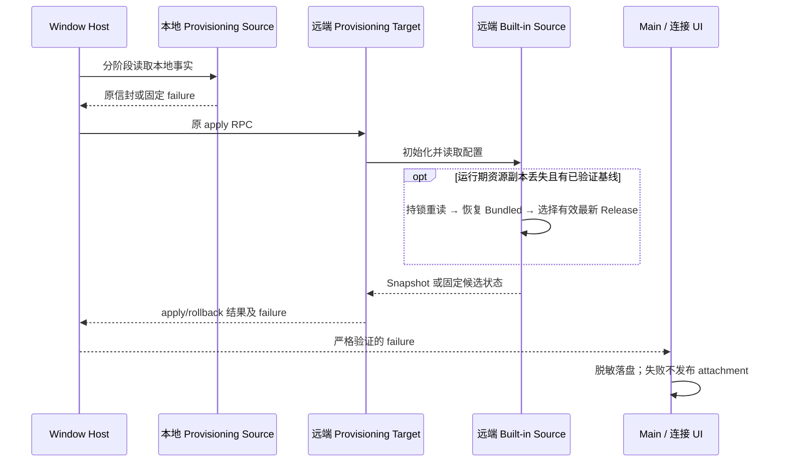

# SSH Provider 初始化恢复与脱敏失败诊断

## 已确认事实与范围

- 2026-10-19 提供的 3.19.4 日志：SSH 握手成功后 48 次首次 Provisioning 失败；数分钟后出现 Built-in Bundled/Active 均不可用及 watch-error；另有一次 manifest fetch failed 和远端 Killed/137。不能将全部失败归因为密钥、PVE、Debian 12 或内存不足。
- 源码缺口：Source 丢失已验证 Bundled 文件后没有基线恢复能力；read 的广泛 catch 只重读 Bundled，忽略可用 Active；缺失候选返回 null，最终错误无法区分文件缺失、格式错误、权限和缓存失败。Main 收到 Provisioning 结果后丢弃错误原因。
- 本次修复 Built-in 运行期恢复、首次同步分阶段诊断与脱敏传递；保留独立 LCode 随机密钥。没有远端主机的执行连接，不擅自修改对方系统、权限或进程；Killed/137 不标记为 OOM，网络下载失败不假报恢复。

## 所有者与产品规则

1. NodeLCodeBuiltinProviderConfigSource 继续唯一选择 Bundled/Active/Remote 的 Release。首次成功读取的有效 Bundled 作为本 Source 的可信基线；这不是账号事实或另一套 Registry。Endpoint 切换仍隔离 Active，不借用上一 Endpoint 的 Active。
2. 运行期 Bundled 缺失或损坏且已有可信基线时，在原文件锁下重读并恢复自己的 Bundled 资源副本；保留更高 revision 的有效 Active。恢复写失败仍可读内存基线，并以固定状态报告；从未验证过基线且两份文件均不可用时明确失败，不制造空 Provider 配置。
3. 读取缓存目录锁、watch 或写入失败时，仍分别检查 Bundled 和 Active。只读取通过现有 codec 验证的候选，不以超时绕过同步。恢复锁顺序 Active → Bundled，同路径时复用已持有锁，写前检查 dispose，watch 关闭或出错后允许重新建立。
4. Built-in 不可用错误提供固定 code 和候选状态（available/missing/invalid/permission-denied/io-error），不携带文件内容、路径、端点或原始 Zod 文本。恢复事件同样仅包含固定状态，不每次读取重复告警。
5. shared 定义 Provisioning 的严格可选 failure 信封：stage、code、受限 systemCode、可选 Built-in 候选状态。新增字段为可选，不更改原同步信封版本，不改变 Agent stdio 业务命令。旧远端无 failure 时提示阶段未知/需更新远端诊断，绝不把 errorMessage 自由文本当成安全文本展示。
6. Source 区分本地 Personal、Settings、Credentials、Envelope；Target 区分远端校验、状态锁、Runtime、前像、Settings、Credentials、Personal 写入、账号刷新、Registry、默认模型、结果持久化、回滚。失败仍按原 CAS 回滚；未写入前失败可报告 rolledBack=true。
7. Host 仅转发严格验证的 failure；Main 在首次失败时记录结构化诊断并向连接 UI 展示固定中文原因与阶段。环境标识使用不可逆短 hash。凭据值、任意 key/账号 ID、主机地址、个人路径、URL、stack、未知错误 message/cause 不进入该诊断链路。
8. owner/lease、workspaceIdentity、remoteSessionId、取消与迟到结果校验、首次同步发布屏障保持原归属。Desktop continuous 和手机 replayable 继续复用原 Host/Runtime，没有新队列或独立 Agent。
9. 远端在首次同步期间关闭时，Main 按 remoteSessionId 结束对应同步等待，保留受限退出码（137 仅表示强制终止，不推断 OOM）；迟到成功结果不能创建或发布已关闭连接的 attachment。
10. Built-in 下载错误保留固定下载阶段（client-config/cdn）、原因和受限 HTTP 状态；网络系统码沿用白名单。HTTP 错误、超时、取消、无效 JSON/schema、空正文与正文过大均可定位，不记录 URL、正文或原始异常。Worker 的 Release 下载转发与 Provider 控制面保持各自现有职责。

## 验收

- 初次成功后删除 Bundled/Active、删除整个 runtime 子目录、损坏 Bundled、Active 更新 revision、并发恢复、dispose 后迟到写入；可信基线可恢复且不降级有效 Active。
- Cold start 无基线时分别识别两份缺失、格式错误和权限失败；缓存目录不可写但有合法候选可读；不覆盖 Personal 或凭据。
- Local 读取失败、Remote Runtime/前像/写入/Registry/默认模型/回滚失败均有准确 stage；未知原始错误不回显；旧远端结果安全降级。
- 使用含假 token、URL、账号、路径、换行的恶意错误验证 Host/Target/Main 结果和日志均不包含原文；IPC schema 拒绝夹带自由字段，取消和桌面 attachment 发布行为保持正确。
- Built-in 下载的控制面和 CDN HTTP 错误保留阶段和状态，畸形正文、网络错误和取消仍安全可辨。
- 执行对应 Node 测试、根 typecheck/lint、architecture check；真实 Debian 12 非 root、PVE 内核 kill 原因和真实 SSH 重连只在具备执行条件时验证，未运行则如实记录。

## 验证记录（2026-10-19）

| 验证                                                                                                                | 结果                                                                                                              |
| ------------------------------------------------------------------------------------------------------------------- | ----------------------------------------------------------------------------------------------------------------- |
| Built-in 恢复、下载脱敏、Provisioning 事务/回滚、Main 首次同步与关闭屏障、密钥迁移、Host 连接与设备 attachment 回归 | 83/83 通过，0 跳过                                                                                                |
| `pnpm --filter @lcode/server build:remote` 与实际 CJS 产物启动                                                      | 构建、stdio 握手、Registry 初始化、删除 Bundled/Active 后恢复通过；stdout 验证为 hello 与二进制 Initialize 协议帧 |
| `pnpm typecheck`、`pnpm lint`                                                                                       | 均通过                                                                                                            |
| `pnpm architecture:check --changed`                                                                                 | violations=0、baseline=0、new=0                                                                                   |
| 本次 23 个文件格式检查与 `git diff --check`                                                                         | 均通过                                                                                                            |

- 变更涉及 shared 诊断契约、provider-node 的唯一 Built-in Source、services 的 Source/Target 和运行时装配、desktop Host/Main 的同步结果传递与发布屏障。生产源码 16 个文件净增 591 行，6 个测试文件净增 960 行；spec 行数另计。
- 本机只读探测确认配置的 Worker Release 下载路由返回 302 到 GitHub，符合当前 Worker 协议；它不能证明 Debian 的 GitHub 出网正常，也不能解释历史 manifest fetch failed。
- 验证环境为 Windows 与隔离测试目录，无 WSL/Docker 可用；未连接实际 PVE/Debian 12 非 root 主机，未更改真实密钥、远端权限、配置或进程。资源副本最初丢失/损坏的发起者及 Killed/137 的内核原因仍需实机证据。
- 修复需由新的 Desktop 与远端 Server 产物一同发布后生效；旧日志丢失的首次同步原因无法补回，新增诊断针对后续失败提供阶段、固定错误码与安全状态。
