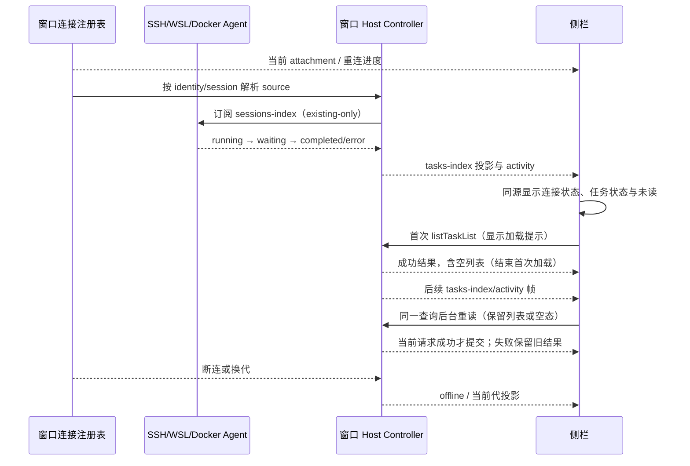

# 远程工作区连接与任务状态可见性

## 产品规则

- SSH、WSL、Docker 项目行持续显示连接方式和文字状态：未连接、连接中、已连接、连接失败。已连接必须由当前 attachment 的 `rpcReady` 证明，不能仅凭 tab 保存的 sessionId。
- 连接中复用已有连接日志展示真实探测、下载、部署和握手进展，不推算百分比。失败保留错误详情、复制及重试；取消和迟到结果规则不变。
- 远程项目下的会话和置顶、时间线中的远程会话复用 Window Host Controller 的任务列表，消费与本地相同的实时 activity。禁止用独立历史缓存替代实时状态。
- 远程会话显示文字状态：准备中、运行中、后台运行、已完成、已中断、失败。待确认优先复用现有交互 badge；后台工作未结束时不能只显示已完成。
- attachment 离线时明确显示离线，不将冻结的 running activity 当作当前执行证明。没有实时 activity 的历史 completed/error 可以显示对应终态；遗留 persisted running 显示状态待同步，不能伪造运行中。
- 项目、置顶和时间线同源，同一路径下的 SSH、WSL、Docker 必须按 `workspaceIdentity?.trim() || workspacePath` 隔离。项目收起时仍保留未读提示。
- 中文、英文、所有主题及窄屏复用现有字号和语义颜色；状态与项目折叠、菜单、重连操作互不覆盖。
- 任务列表的加载提示只表示当前查询尚未取得首个成功结果。成功返回空列表也算已加载；同一查询后续因 activity、Controller 帧或手动刷新而重读时保留已有列表或空态，不反复显示“正在加载远端任务”。查询条件、Controller owner 或远程 session 代际变化后重新判断首次加载。

## 所有者、接口与迁移边界

| 数据                                  | 唯一所有者            | UI 读取接口                                         |
| ------------------------------------- | --------------------- | --------------------------------------------------- |
| 物理连接、logical session、attachment | 窗口 Host 连接注册表  | 既有 workspace resolver 的 rpcReady                 |
| 当前重连请求、错误和部署日志          | 既有 Root 重连流程    | reconnecting keys / error / logs props              |
| 会话 phase、待确认和后台工作          | 远端 Agent/runtime    | Host Controller activity，经 useGlobalTaskList 投影 |
| 任务成员、未读和历史终态              | source 的 tasks-index | Controller listTaskList / task frames               |

Renderer 只派生显示，不新增连接或任务状态 store，不增加轮询、计时器或状态写路径。远程置顶和时间线从独立历史读取切换到已存在的 Controller 聚合接口；既有 mutation 兼容路径不作为状态展示事实源。协议、owner/lease、CommandInbox、runtime admission 与持久化 schema 均不变。

`useGlobalTaskList` 唯一拥有本组件的查询进度，记录最近成功查询的 Controller、queryKey 与 workspaceSourceGenerationSignature。只有当前 requestSerial 的成功结果可以更新该记录；后台失败继续保留最后可信结果，初次失败不标记成功。空 scope 清空本组件记录。沿用共享 Controller registry 的查询去重及失效规则，不增加业务缓存或防闪烁延时。

Desktop 保持 `desktop-continuous`，手机保持 `web-remote-replayable`，均读窗口 Host 的同一 Controller；重连沿用原有水位、snapshot/gap repair 与 stale generation 防护。

## 验收场景

1. SSH、WSL、Docker 分别覆盖连接中、已连接、失败、未连接及有旧 sessionId 的断连；连接状态持续可见，连接中可读部署日志，失败仍可重试。
2. 实际侧栏组件的远程任务依次收到运行、待确认、完成、中断、失败与后台工作投影，不打开会话也能更新；置顶与项目视图均保留 activity。
3. 同路径的本地和三个远程来源具有相同 taskId 时仍互不污染；Controller 查询携带各 scope，远程旧历史缓存不能覆盖它。
4. 断连冻结 running 投影只显示离线，重连后读取当前代；无 activity 的历史 running 不转圈，历史终态可读。
5. 宽屏、390px、明暗主题、中英文，项目折叠、重连和菜单正常；实际执行 E2E 与针对状态派生的测试。
6. 执行根 typecheck、lint 和 changed architecture check，真实 SSH/WSL/Docker 环境未执行时单独说明。
7. 受控延迟首次 Controller 查询，验证初次加载可见；成功后连续派发三种远端的 activity 帧，在请求仍挂起期间确认 timeline/pinned 不出现远端加载提示，已有任务和 SSH 已连接状态保持可见。
8. 首次成功返回空列表，后续刷新期间保持空态；后台失败与重试不重新显示加载提示。首次失败后再试仍显示加载，迟到成功不得结束较新请求的首次加载。
9. 查询条件、Controller owner 或远程 session 代际变化时不得复用旧查询的成功标记；保留既有 requestSerial 迟到结果防护。Desktop continuous 与手机 replayable 继续使用同一 hook，不修改 Host 订阅、重放或路由。

## 验证记录（2026-10-21）

- 新增浏览器回归先复现远程项目缺少连接状态，再验证三种连接的实时任务状态、旧历史缓存隔离、断连、重试、日志以及项目收起后的未读提示。中英文、390px 暗色与宽屏浅色均通过。
- 本次关联的浏览器回归共 11 项通过：新增状态 2 项、侧栏动效 2 项、组织侧栏 2 项、焦点筛选 3 项、工作树侧栏 2 项。组织场景首轮在文件格式化触发热更新时被重载中断，文件稳定后独立重跑通过。
- `pnpm test:remote-control` 137/137 通过，覆盖三种连接的 owner/identity、取消、换代、多设备和手机 replayable 恢复。状态派生与 Controller 投影定向测试 5/5 通过。
- 最终根 `pnpm typecheck`、`pnpm lint`、本次文件格式检查及 `git diff --check` 通过；新 fixture 的独立类型检查通过。首轮类型检查曾包含本次测试写法及其他本地 Git 审核测试的错误，最终复查已无错误。
- 架构检查起点和最终均为 baseline=0 / new=0。实现位于 ui 模块、测试位于 web；沿用上图的既有 owner 与事件顺序，未新增运行状态 store、订阅或轮询。生产实现及本次本地化合计 +184/-178，净增 6 行，不含测试、spec 与其他本地改动。
- 本机 Windows 浏览器验证；未连接真实 SSH 主机、WSL 发行版或 Docker 容器执行作业，未做 macOS/Linux 实机验收。未打包或替换已安装应用。

### 加载提示闪烁修复

- 新增受控异步浏览器场景，先在旧实现复现后台刷新将 loading 从 false 改为 true，再验证修复；不使用定时延迟掩盖刷新。
- 列表状态与重连浏览器回归 4/4 通过。覆盖有任务/空列表、首次失败重试、三种远端后台刷新、后台失败恢复，以及查询条件/session/Controller 换代和迟到结果；中英文、390px 浅色与宽屏暗色均执行。
- `pnpm test:remote-control` 148/148 通过，包含 Desktop continuous 与手机 replayable attachment 的既有路由、owner、取消、换代和重连回归。
- 根 `pnpm typecheck` 通过；`pnpm lint` 通过，执行时其他在途 backup 改动的 backupEngine.ts 存在一条未使用 BackupReference 导入警告。本测试夹具独立类型检查通过；改动文件格式与 diff 空白检查通过。
- 起点与最终 changed architecture 检查均为 baseline=0 / new=0。生产改动仅在 legacy ui 的既有 hook（+27/-2，净增 25 行）；web 测试及夹具 +163/-9。查询进度仍由 hook 唯一拥有，Host 业务状态、协议、订阅及交付语义不变。
- 验证使用 Windows 上的受控 Controller 浏览器夹具，未以真实 SSH/WSL/Docker 重跑网络连接，未打包或替换已安装应用。
