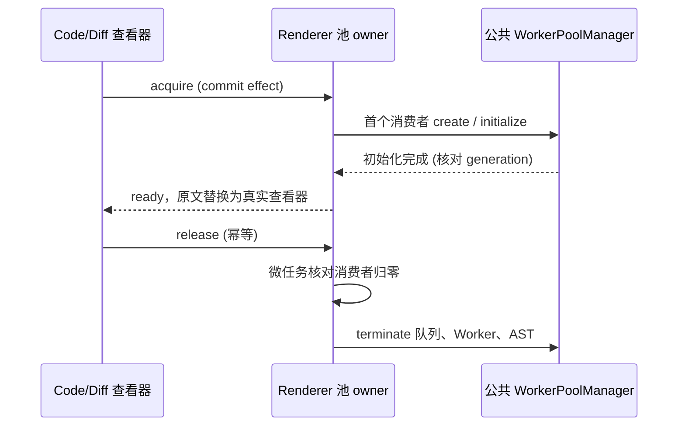
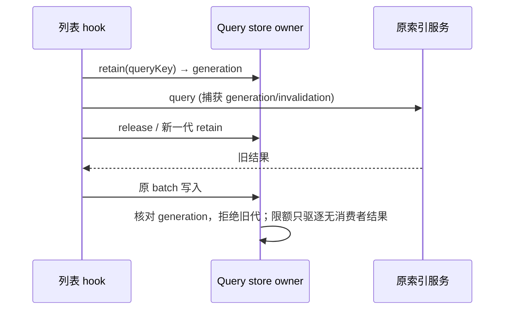

# Renderer 可重建资源生命周期

## 产品规则与边界

保留当前代码预览、Diff、主题、批注和文件操作入口。Diff Worker 由窗口内 DiffsWorkerPoolProvider 的单一 owner 管理，通过现有第三方公共 WorkerPoolContext 向查看器提供；不切换 Root 包装结构、不重挂草稿或任务树。

- 只有 CodeViewer / DiffViewer 实际挂载且启用 Worker 时申请 lease；首个消费者初始化一个 Worker，file/diff AST 各保留最多 20 项。
- 初始化阶段先展示可读原文；成功后挂载真实查看器。失败沿用依赖提供的主线程回退，不能无限重试。大文件继续沿用现有预览门禁。
- 最后一个消费者释放后在微任务边界核对引用并 terminate 当前代。该微任务仅合并同一 React commit/StrictMode 的释放再进入，不充当业务同步超时。terminate 取消旧代队列和缓存；迟到初始化不得发布新代状态。
- 主题更新走既有 setRenderOptions；不为主题重建 Root 或新开一套池。
- Shiki 模块是通用高亮缓存唯一 owner。结果采用完整内容/规范化语言/主题键，LRU 最多 128 项、估算 8 MiB；超过预算的单个结果不驻留。估算包括键和 token 字符/对象成本，不等同 OS 内存。
- 同键请求只 tokenize 一次。高亮引擎按语言/主题最多保留 4 个空闲实例；在飞实例受保护，结束后立即检查预算并 dispose 驱逐实例；失败的初始化不留 poison promise。
- 多文件 Diff 的 before/after AST key 同样覆盖完整内容和文件名/方向；等长且首尾相同的中段修改必须产生不同 key。完整字符串随各 20 项 AST 条数预算保留，不声称第三方提供原生字节上限。
- 高亮订阅在组件卸载时释放；cache hit 仍异步通知，避免 React 嵌套更新。纯文本不创建引擎。
- 观测复用现有 60 秒 registry，只增加数字计数，不记录代码正文。

桌面和手机各自管理显示资源；不改变 Host、CommandInbox、continuous/replayable 语义、账号鉴权或 workspace identity。

## 查询缓存与关闭工作区

taskQueryCacheStore 继续唯一拥有结果和 meta。useWorkspaceTaskLists 在 effect 注册当前 query lease，释放后保留最多 40 个最近写入的非活跃结果；所有活跃结果额外保护。meta 保留所有结果引用、未读 overlay、运行/后台工作/待确认实体，另保留最多 500 个无引用历史实体。预算仅作用于可重建缓存，不删除任务。

每次 query 从无消费者到有消费者分配单调 generation；batch 回包除原 invalidationVersion 外还必须匹配当前 lease generation。最后释放、清空缓存或重新挂载后拒绝旧代回包，不保留无限 tombstone。旧同步单条 API 保持兼容。活跃查询超出预算时保留并单独计数。

按 workspace 硬失效时也旋转该 scope 的活跃 generation，不能因为结果删除后 invalidationVersion 回到 0 而重新接受旧回包。实体范围读取自身 workspaceIdentity/path，不从带分隔符的 entity key 反向解析。

终端保留 PTY 的原所有者和显式关闭语义，隐藏/切换 workspace 仍复用，不按 UI 不可见自动杀命令。side pane registry 同 key、同 entry 重复注册幂等；不同 entry 替换前必须释放旧 xterm/PTY/订阅，避免 async 创建交错后只覆盖 Map 而留下孤儿。最后释放时同步移除空 stash DOM。诊断记录实际 session、detach 与 scrollback 行数，后台 Windows 控制台修复沿用原实现。

关闭 workspace 的 UI 桶只清理可重建的配置、命令和任务列表缓存；草稿 session、模型切换、运行/后台任务、pending 权限/问答、乐观更新或 grouped draft 存在时整桶保护。不得清理 composer/附件 store。恢复时配置状态回到 idle，沿用原加载入口；不改变 workspacePath/identity 或执行生命周期。

## 验收

空 Root 零 Worker；多个查看器共用一个；关闭一个不影响其他；最后一个关闭释放；同 commit 重新进入复用；初始化中关闭、失败、重开拒绝迟到结果。真实 Electron 验证 Root 输入草稿不重挂，代码/Diff 可读，主题切换、取消和反复打开后计数归零。高亮验证完整内容键、去重、LRU/字节预算、取消订阅、纯文本、失败重试和引擎 dispose。

统一回归：`pnpm test:desktop-memory`。生产模式 Electron 夹具独立 userData，GPU 关闭，记录真实 Worker、原文/Shadow DOM、缓存计数及 Electron app metrics；不是已打包完整应用基准。设置 `LCODE_MEMORY_SOAK_MS=1800000` 可运行 30 分钟初始化取消压力（上限 28800000，即 8 小时）；默认模式等待真实查看器出现后关闭。采样间隔只用于测量窗口。

显示层旧/新策略 5 次对照：`node packages/desktop/scripts/benchmark-diff-idle.mjs <baseline-commit-sha>`。输出 `.artifacts/desktop-memory/diff-idle-comparison.json`；仅替换 Provider，其余依赖和夹具保持相同，不代表完整桌面包收益。文件必须脱敏，不写模型连接或用户项目。
