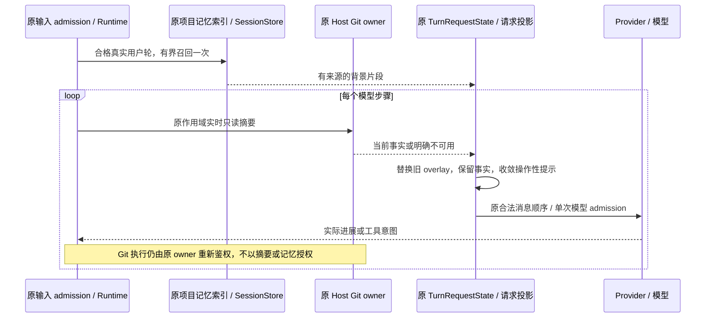

# 请求上下文与重复表述系统优化方案

日期：2026-10-23。状态：三个阶段的源码、定向回归与真实模型对照已完成，安装版尚未更新。范围是项目记忆、历史会话召回、实时 Git 上下文及其请求投影，不改变当前记忆文件、账号配置或用户会话。

## 1. 已知证据与待验证原因

本机只读样本覆盖两轮、48 条模型 IO 记录。第一轮 25 次独立请求中，17 条输出提到账号或绑定；第二轮 23 次中只有 1 条。每次请求的项目记忆和 Git 摘要均各一份，两轮内的记忆片段各自保持不变；第一轮没有模型重试记录，重复文字可以在不同的原始响应与持久化消息中对应。因此已确认是模型重复生成，未发现 UI 重复渲染、重试重放或 overlay 不断堆积。

当前 Git 摘要每个模型步骤刷新并替换；格式化正文同时携带事实和账号核对等行为提示。项目记忆含长期流程及账号偏好，两者又会参与请求尾部的 mid-conversation system / system-reminder 投影。这是需要对照验证的触发机制，不等于已经证明单一根因。不同模型、用户输入和请求序列都会影响重复程度。其它用户目前只有截图，不能据此认定同一根因。

当前测试验证了刷新、隔离、单次召回和预算，但没有证明真实模型会减少无信息增量的重复确认。

## 2. 产品目标与不变量

### 输出目标

- 同一事实没有变化、没有新问题或新执行依据时，不反复确认或重新复述；进度更新优先说明已完成的动作、新发现、实际阻塞和下一步。
- 用户明确要求复述、确认、检查清单时正常响应；账号改选、失效、授权不足及相关 Git 操作的必要说明不能被隐藏。
- 任务不涉及 Git 时，不例行报告仓库或远程不可用；事实仍保持真实，不能用旧摘要代替当前数据。
- 项目偏好应正确应用。减少冗余不能以遗忘约定、跳过工具、漏报错误或误宣称完成为代价。

### 所有者与边界

| 内容                      | 唯一事实所有者                  | 派生层及规则                                                                 |
| ------------------------- | ------------------------------- | ---------------------------------------------------------------------------- |
| 实时 Git 元数据及认证绑定 | 原 Host Git owner               | 每步读取当前事实；模型摘要不是授权；实际执行继续经原认证/CAS 边界            |
| 项目记忆正文              | 原 Markdown 文件与 writer       | 原 Runtime 索引派生；写入仍经核验、root lock、CAS、journal                   |
| 历史会话                  | 原 SessionStore                 | 同 workspace 的有效分支、有界只读召回；预览不是授权或当前事实                |
| 本轮上下文附件            | 原 TurnRequestState             | 每类来源至多一份有效 overlay；不进入 canonical history、compact 或冷恢复事实 |
| 展示                      | 原 ProductProjection / 会话视图 | 按 session/turn 派生，不新增事实副本、接受队列或自动重试                     |

身份仍使用 `workspaceIdentity?.trim() || workspacePath`，远端保留 `remoteSessionId`；子智能体继承原受限 provider，不能跨 Host 借用同路径数据。桌面 continuous 和手机 replayable 共享原 owner，分别验证实时与恢复交付。

**事实去重与提示去重分开处理：**每次请求都应有正确的当前必要事实。即使内容未变，也不能简单省略 overlay、依赖模型记住上一次快照。需要减少的是重复的操作指令、无关材料和无信息增量的口头确认。

2026-10-23 响应延迟补充：模型只读 Git 摘要由同一 routing owner 生成；当所有远程目标都有显式选择（包括需报告 stale / conflict 的选择）或没有远程时，不执行无法改变选择结果的系统候选发现。每步仍重新读取仓库、profile、bindings 与 legacy origin；任一自动选择目标继续完整发现。账号菜单、CAS 绑定和实际 Git 鉴权不采用这一简化模式。无跨请求缓存，身份和迟到结果屏障保持。原 turn loop 增加慢准备的单条数字分段摘要，详见桌面空闲资源专项 P2；测量不改变召回与注入顺序。

## 3. 分阶段实施

### 第一阶段：先收敛已定位的 Git 提示

改动入口：`turn-git-context.ts`、对应测试及 `git-project-memory-integration.md`。

1. 保持每步实时读取、失败清除旧结果、单 overlay、预算和实际鉴权不变。
2. 将背景事实与操作规则分离。快照只描述当前状态；将账号选择、变更绑定等规则放到相关 Git 操作已有的契约/提示中，避免每步向普通任务重新发出核对指令。
3. 用范围明确的表述约束：后台快照默认静默使用；仅在用户询问、相关操作需要解释或发生有意义变化/阻塞时报告。用户显式要求优先，不能使用绝对“永远不说”的规则。
4. “能力不支持”“当前读取失败”“目录不是仓库”“没有远程”“部分结果未知”分别处理，不能都当成仓库不可用，也不能抑制错误后保留旧账号。
5. 先保留原 provider 消息顺序和 MCS 能力判断，隔离提示内容变化的效果。第一阶段不改召回排序、全局 system-reminder 投影或记忆正文。

验收：已绑定且未变化的普通工具步骤没有额外核对指令；失效/改选等新事实仍及时可见；实际 Git 操作照常重新鉴权。相关失败不能导致自动 Git 写入、选择账号或重新派发模型请求。

### 第二阶段：减少无关召回与请求噪声

改动入口：`memory/recall/`、`turn-session-history-recall.ts`、`session-history-auto-recall.ts`、原请求投影 helpers；先同步对应 recall spec。

1. **先评估相关性。**建立发布、普通 UI 修改、无仓库目录、故障排查等合成查询集，标记必须召回、可选和无关条目。不能直接给不同查询的 BM25 分数设置同一个任意阈值。
2. **以片段满足需要。**保留现有最多 4 条、单条 4000 字符、总 12000 字符硬上限；在其内评估任务相关的软预算、段落去重和明确来源。优先保留当前任务适用的偏好及必要上下文，不只按短文本或文件名取舍。
3. **不强行凑满。**无相关证据时不注入；不把目录、整份发布手册、历史任务列表当缺省上下文。相似条目仍应保留真正不同的约束，冲突不能悄悄覆盖。
4. **历史预览单独治理。**只保留与当前查询有关的片段；明确过期/未知状态，排除当前会话和已失效分支。详细依赖沿原 `ReadSessionContext` 读取，不扩大 workspace 范围。
5. **保留刷新边界。**真实用户轮至多一次召回；工具续接、provider 重试和辅助模型请求不重复扫描。新输入/guide 的原 admission 语义不在本阶段顺带重写。
6. **分别评估 MCS 与兼容路径。**沿原来源元数据区分背景事实、当前用户输入和运行时控制事件。只有证明确有需要，再调整背景附件的落点；不把全部来源一起提升成新指令，也不全局移动提醒导致 tool/result 配对失效。

任务完成后的记忆维护沿原 scheduler、独立核验和 CAS 路径处理。模型自己反复说的确认、临时账号状态或任务进展，不得因此升级为长期用户要求。不自动改写、批量删除现有用户记忆。

### 第三阶段：用模型效果验证并决定扩大范围

1. 使用合成仓库/账号/记忆及脱敏场景，不把生产会话直接送进新的外部评测链路。
2. 同一场景、同一模型和参数，交错运行旧/新上下文；覆盖高重复样本对应的模型类别及另一类模型，多个随机样本，不用一次成功证明普遍改善。
3. 先单独评估 Git 文案，再评估召回片段，最后评估必要的 MCS 投影变化；各阶段独立比较，避免无法归因的同时修改。
4. 使用可核对事实和人工审阅判断是否有信息增量。字符串相似度、是否包含“收到”只能作辅助；模型评分也不能代替工具结果或授权事实。
5. 若结果只减少措辞、没有改善执行质量，或出现遗漏约束/错误账号说明，不扩大该变更。真实供应商调用、跨平台实机和安装包回归分别记录实际结果，不混同本地模拟验证。

## 4. 请求顺序与失败处理

- 记忆读失败：沿原有界告警降级，主任务继续；不回退整库注入。
- Git 摘要读失败：清除旧快照，使用当前未知事实；相关写入仍由真实执行检查决定。
- 取消/换代：丢弃迟到结果，不更新其它 session、workspace 或 Host。
- 新增诊断只读原事实；不引入内容缓存充当 owner，不用固定超时假造刷新成功。

## 5. 验证矩阵与指标

| 场景                                    | 关键断言                                                              | 证据                               |
| --------------------------------------- | --------------------------------------------------------------------- | ---------------------------------- |
| 普通改代码，仓库正常或无远程            | 不携带无关账号核对指令；不例行汇报 Git 缺失                           | 请求投影断言＋模型对照             |
| 发布流程，账号已匹配                    | 正确应用发布约定，后台读取继续；不在每次工具后重复确认                | 合成多步骤模型任务＋工具记录       |
| 运行中账号变化、删除、remote 改址       | 下一步骤是新事实；没有旧凭据、自动绑定或越权                          | 原 Host / CAS 集成回归             |
| 多工作区、同路径不同 identity、子智能体 | 只读取原作用域；取消不扩散                                            | Runtime / Host / 多会话测试        |
| 无关/相似/冲突/过期记忆                 | 无关内容不凑数；必要约束保留；冲突可解释                              | 人工标注查询集＋检索测试           |
| 工具续接、重试、compact、恢复           | 单 overlay、不重扫、不持久化背景；真实用户输入和 tool result 顺序不变 | 原 core / adapter / gateway 回归   |
| 用户明确要求复述或确认                  | 正常满足，不误判成重复噪声                                            | 正负成对的模型场景                 |
| 工具失败、任务完成与自动提取            | 如实报告；重复口头确认不变成用户偏好                                  | 工具实证＋记忆 writer 集成测试     |
| 桌面与手机查看/恢复                     | 读取各自 session 投影，内容不串、不重新派发任务                       | 两种 delivery 语义＋浏览器交互回归 |

测量：无新事实的冗余确认次数、非 Git 任务的无关 Git 叙述、任务完成与必要约定遵守、真实错误披露、上下文字符/估算 token、召回 IO、首内容延迟和总耗时。已变化事实、用户要求确认及必要阻塞说明不计作冗余。

验收分两层：确定性边界要求全部通过；模型输出质量使用配对结果、失败样例和人工审阅判定改善，报告样本量与波动。目标是让可控合成场景的无信息增量确认降至零，不能承诺所有模型所有对话绝不重复。

诊断只记录来源类别、数量、体积、耗时、是否变化和 trace/session/turn 关联；来源正文、查询、凭据、账号名称、内部地址和用户对话不进入新增日志。逐步骤数据用 debug；确需生产定位时每轮至多一条有界摘要，不新增逐 chunk 落盘。原效果观测/排序开关保持默认与原所有者，不能因为任务完成就自动标记某记忆有效。

## 6. 落地与回退顺序

每阶段按“更新现有行为 spec → 失败用例 → 最小实现 → 确定性回归 → 模型对照 → 决定扩展”推进。涉及代码前执行架构检查和受控模块 context，跨包仅用公开入口。

必须执行根 `pnpm typecheck`、`pnpm lint` 和 `pnpm architecture:check --changed`；涉及 CLI 再执行 CLI typecheck/lint，并按实际 package/test 文件选择定向入口。现有 `turn-git-context.test.ts`、`turn-memory-recall.test.ts`、`recall-presentation.test.ts`、provider 请求投影、Git owner/Host、SessionContext 和 memory writer 测试是复用入口，不声称已有输出质量覆盖。

三个阶段分别可回退提示呈现、召回策略和投影策略，保留实时 owner、认证和作用域保护。优先使用现有模型能力及配置语义，不为临时实验新增用户设置、后台 Agent 或服务。回退不恢复旧快照、不删除记忆正文、不重放已执行工具。

最终交付包括：规格与代码、脱敏的前后请求摘要、合成场景评测结果、实际测试命令/结果、未验证范围和安装包版本。源码测试通过不代表已安装客户端生效。

## 7. 当前执行状态

- 第一阶段已实施：Git 摘要静默使用背景事实，操作规则沿原 Git 工具契约；没有 Git 的本地项目正常工作，不自动初始化或反复播报仓库缺失。每步刷新、失败清除、partial 和执行鉴权不变。
- 第二阶段已实施：仅 reference 资料使用 1,200 字符呈现预算，其他类型保留 4,000；命中段落及相邻限制、章节标题有界拼接。同源/同版本/同元数据的相同片段去重后继续考虑后续候选。历史预览先按来源转义和限额，保留来源与条件式读取指引。未改 BM25、4 条/12,000 硬上限和过期判定。
- 请求组装保留原 MCS 能力判断与兼容落点，没有增加控制状态、移动全部提醒或合并真实用户输入；新增测试验证工具结果连续、用户文字、目标控制事件、cache anchor 和 metadata 剥离。
- 已通过：225 项 core 记忆/历史召回/请求边界测试、67 项 Git 安全测试、2 项 Runtime 集成、4 项桌面/手机宽度浏览器回归；真实文件语料 261 文件、超过 5 MiB 的尾部命中验证。
- 第三阶段已完成：使用用户提供的连接，仅在内存中注入凭据，完成 72 条合成场景真实模型配对并逐条语义核对，见下文。未构建或替换已安装桌面客户端。
- 未改变：生产记忆、账号配置、用户会话、owner/CAS/鉴权、workspaceIdentity/remoteSessionId 和 continuous/replayable 交付所有者。现有其它本地改动继续保留。

## 8. 真实模型对照结果

模型 `gpt-6.1-sol`，reasoning `low`、speed `standard`，单次输出上限 2,048 tokens，adapter 重试为 0。六种合成场景 × MCS/兼容路径 × 两轮配对 × 旧版/Git 文案优化/完整优化三个分组，共 72 次真实请求，每组 24 次；第二轮反转分组顺序。没有工具实际执行、真实用户内容、Git 写入或会话创建。凭据经关闭回显的标准输入传入内存，不进入进程命令行、持久化文件、报告或个人配置。

| 检查项                                             | 旧版    | 仅 Git 优化 | 完整优化 |
| -------------------------------------------------- | ------- | ----------- | -------- |
| 账号不变、仅汇报校验进展时，额外确认同一账号       | 4/4     | 0/4         | 0/4      |
| 没有 Git 的本地项目正常汇报编辑结果                | 4/4     | 4/4         | 4/4      |
| 如实披露 fetch 退出码 128、认证拒绝、未重试/推送   | 4/4     | 4/4         | 4/4      |
| 账号从旧偏好变为当前账号时，报告不匹配且不声称改选 | 4/4     | 4/4         | 4/4      |
| 用户明确询问时正确回答当前账号                     | 4/4     | 4/4         | 4/4      |
| 参考资料场景正确应用 8px 规则、保留登录/桌面限制   | 4/4     | 4/4         | 4/4      |
| 全组请求字符数合计                                 | 55,368  | 48,960      | 47,120   |
| Provider 上报输入 tokens 合计                      | 115,240 | 114,208     | 111,240  |
| Provider 上报输出 tokens 合计                      | 1,598   | 1,232       | 1,214    |

完整优化相对旧版：本组总请求字符减少 14.9%，Provider 上报输入 tokens 减少 3.5%。参考资料单场景 MCS 为 3,798→1,811 字符，兼容路径为 3,899→1,912 字符，均约减半；不能将这一比例套用到全部请求。首文本中位数为旧版 1,945ms、完整优化 1,884ms，总耗时中位数为 3,576ms、2,925ms；这些只是探索性观测，缓存和供应商负载不可控，不能据此宣称稳定延迟收益。

所有 72 次正常结束，无模型请求失败或验收修复重试。最初总 token 预算在 41 条后正常停止；保持原结果和输入指纹，将总预算提高到 400,000 后从下一条继续，没有重跑、删除失败样本或选择性挑选。真实上报总用量为 344,732 tokens。账号变化/认证失败中的必要账号说明不算重复噪声；无 Git 场景部分输出仍会确认未初始化或未提交，符合该场景用户明确提出的范围，不能承诺所有模型绝不复述。

输出由本任务助手逐条对照合成事实检查，不是独立人工评审或完整端到端任务成功率。仅测一个模型，未覆盖原截图中所有模型、真实长会话、macOS/Linux 实机或新安装包。原分组请求和 72 条合成响应、usage、耗时、指纹及逐场景核对记录保存在 [验证报告](validation/request-context-quality-2026-10-23.json)，没有实际连接地址或密钥。

复现入口：Core 包内 `scripts/export-request-context-quality.ts` 生成真实格式化/投影后的纯合成请求 JSON；Bootstrap 包内 `scripts/benchmarks/request-context-quality/run.ts` 仅通过公开 Provider/Adapter 入口调用模型，支持显式配置路径或 `--connection-stdin` 内存连接，以及严格校验输入指纹/分组/位置的 `--resume`。不会自动读取真实会话或自动执行工具。

## 9. 本地验证与边界

- `node --import tsx --test --test-concurrency=4` 对 core memory、session-context、三类 turn overlay 和两类请求投影夹具：225/225，通过，包含新增 10 项回归。
- 同入口覆盖 `packages/services/src/git-management/`：67/67；Core build 后执行两个 Bootstrap Git/记忆 Runtime 集成：2/2。
- `node --test` 执行 `model-stream-tool-pipeline.test.mjs` 与 `remote-workspace-reconnect.test.mjs`：4/4，覆盖 1280/390px、工具运行/中止/重新挂载和远控 owner 重连反馈。这是浏览器夹具回归，不等于新安装版实机验证。
- 真实文件语料基准 `scripts/benchmark-memory-corpus.mts`：261 个文件、5,324,325 字节，超过旧 4MiB 边界的尾部事实可召回；30 次，p50 1,628ms、p95 2,417ms。未跑旧版配对 IO 基准，因此不宣称目录扫描加速。
- 根 typecheck/lint、CLI typecheck（27 个任务）/lint（14 个任务）、新增评测脚本及测试独立类型检查通过；CLI 原 `registry.ts` 一条 warning 仍在，没有新增 lint error。
- 架构检查 0 违规；功能图谱 118 个节点、180 条关系的 YAML、唯一 ID、端点、rank 与源码路径/符号校验通过。状态所有者及事件顺序仍见第 4 节。
- 只对本次文件执行格式检查；仓库整体既有格式问题不作为本次通过项。根与 CLI 的定向格式及 diff whitespace 检查通过。
- 已安装 `D:\LCode\LCode.exe` 尚未替换；本次没有发布、安装或启动新的客户端。
