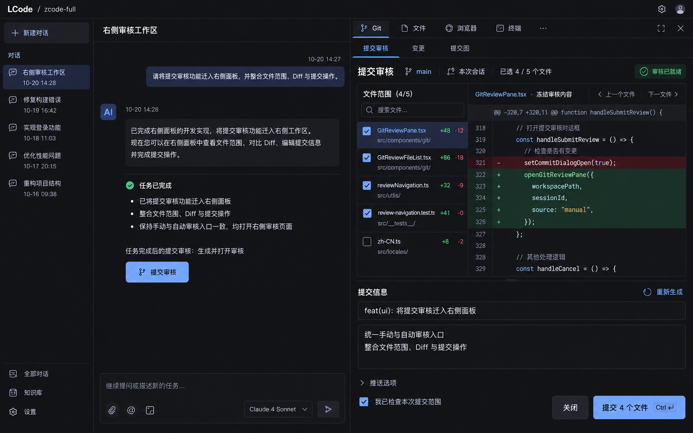
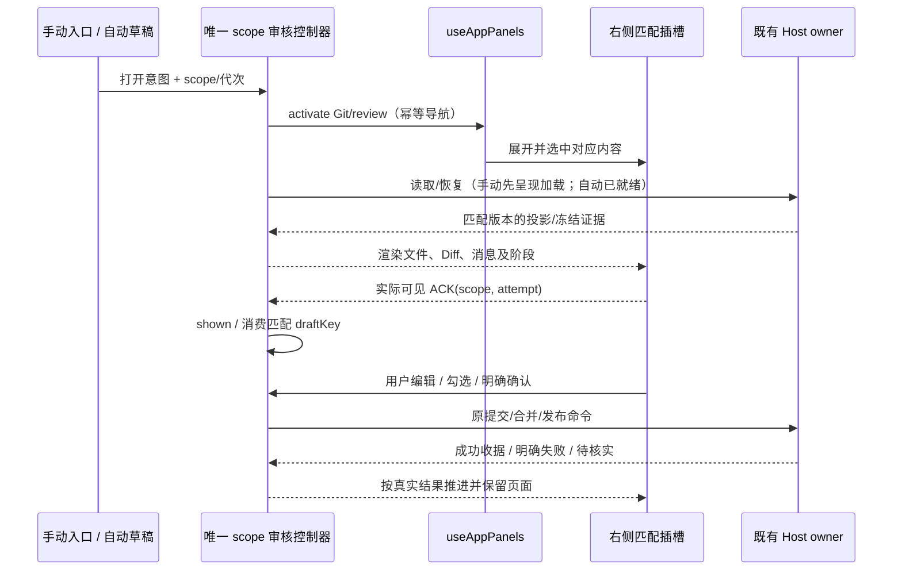

# 右侧 Git 工作区系统规划与详细实施计划

状态：2026-10-20，R0–R5 及 A/B/C 代码实现完成。第 2 版为布局基准，文件区按用户补充的 IDEA 截图改为紧凑目录树。实际验证及分期实施见第 12–14 节；构建版验收待用户构建后进行。

依据：[参考项目系统调研](vs-idea-gittool-system-research.md)、[右侧审核产品 spec](right-side-workbench-and-git-review.md)、[Git 能力增强规划](git-capability-enhancement-plan.md)。三份文档分别回答“参考什么”“产品怎么用”“通用 Git 能力如何演进”；本文件回答“按什么边界、顺序和验收标准实施”。

## 1. 确定目标与范围

第一交付是一个可连续完成范围检查、Diff 阅读、提交信息编辑、提交及后续合并/发布的右侧工作区。点击“提交审核”立即进入；任务完成后的“生成并打开审核”就绪后进入同一页面。移除旧审核主 Dialog、遮罩以及“先点查看变更与管理文件范围”的导航前提。

保留已选布局的主体结构：



上图为设计稿，包含示例会话和示意代码，其中“已完成开发”等文案不是实现状态。最终实现使用实际数据、已有提交/合并门禁和 DESIGN.md 的主题与字号。

| 已确定 | 具体约束                                                                          |
| ------ | --------------------------------------------------------------------------------- |
| 位置   | 复用当前右侧，主会话和输入区继续可用                                              |
| 结构   | 顶部工具导航、Git 子导航；上方文件范围 + Diff；下方共享提交信息；固定底部动作     |
| 入口   | 状态区提交审核、输入区生成并审核、自动生成并打开、既有会话审核导航统一            |
| 语义   | 手动立即呈现加载；自动就绪后打开；仅生成草稿/关闭保持原配置语义                   |
| 业务   | 冻结审核、分组顺序、来源提交、候选合并、验证、来源/目标发布、真实执行收据继续复用 |
| 体验   | 点击重复打开为 activate；切工具/收起保留审核；自动打开不抢 Composer 焦点          |

首轮包含右侧工具分类和现有提交图嵌入，不引入新的通用 Git 写能力。Fetch、Remote 配置、Stash、人工三栏解决器及历史重写按第 11 节独立推进。

## 2. 从参考项目借鉴到本仓库的决定

| 参考点                     | 采用方式                             | 需适配的差别                                                        |
| -------------------------- | ------------------------------------ | ------------------------------------------------------------------- |
| 稳定 Commit 工具窗         | 同一右侧壳和控制器，隐藏保持生命周期 | 不新增左侧容器；不挂第二个 GitActionMenu                            |
| selection / included 分离  | 预览当前文件与提交包含范围分开       | 包含事实仍由 Host 字段版本管理                                      |
| 可调树与消息区             | 内部有边界的滚动和可调消息高度       | 按右侧可用尺寸布局，不能照搬 380px VS Code 工具栏                   |
| 显式 reveal 与 ready       | 导航请求、可显示、实际可见分阶段     | 不能用发送导航成功代替 shown ACK                                    |
| Git Diff 编辑器            | 复用本仓库 Diff 渲染器，嵌入审核主体 | 冻结 patch 与实时 Diff 严格分开                                     |
| 独立动作和状态             | 按当前阶段显示主动作、错误和结果     | 保留现有发布计划和逐项收据，不简化成单一 ok                         |
| 小 UI 状态与 Host 领域分开 | 分类/尺寸/当前文件为 UI 状态         | 不引入工作区级单草稿覆盖多会话                                      |
| 模块化测试                 | 服务、真实 Git、共享组件、壳交互分层 | 使用本仓库现有 Node/tsx/Web fixtures，不复制 Linux VS Code 启动脚本 |

## 3. 信息架构和资源导航

```text
主会话                                  现有右侧
                                        Git | 文件 | 浏览器 | 终端 | 更多   展开/隐藏
                                        提交审核 | 变更 | 提交图
                                        会话 / 来源分支 / 执行目录 / 范围 / 状态
                                        ┌──────────────┬────────────────────┐
                                        │ 文件范围      │ 当前文件 Diff       │
                                        │ 搜索/分组/勾选 │ 路径/版本/前后文件  │
                                        └──────────────┴────────────────────┘
                                        提交信息                   重新生成
                                        标题与正文编辑 / 恢复 / 复制
                                        审核确认 / 折叠发布 / 当前状态
                                        关闭                  当前阶段主动作
```

- 第一层从既有 tabs 派生工具类别：code-viewer/媒体等归文件；browser/browser-use 归浏览器；terminal 归终端；原计划/工作流等归更多。不恢复当前已隐藏的入口。
- 类别按钮激活该类别可见的已有资源；没有资源时提供明确空态/创建入口，点击类别本身不自动新建终端或浏览器。
- 保留原 tab id、资源关闭、重排、最近关闭恢复和 owner 规则。分类栏只是同一资源 registry 的投影，不保存另一个 activeTabId。
- Git 仍复用现有 `id: git`。子页状态归现有面板导航 owner；历史缺省值兼容为“变更”。从审核入口显式选择“提交审核”。
- Git tab 当前是 workspace-global；审核正文是 session-scoped。切会话可继续显示 Git 工具，但必须换到匹配审核或明确待打开状态，禁止展示上一会话表单或沿用人工确认。
- 顶部隐藏折叠面板；资源关闭按现有协议。关闭审核和切子页不取消已接受的 Git/合并/发布操作。
- 提交图复用已有图谱模型/组件和执行服务作用域；嵌入前补 identity/stale 保护，不复制一份 Graph 数据 owner，也不顺带重做图谱功能。

## 4. 第 2 版各区细则

### 4.1 固定摘要

显示审核标题、来源分支、会话范围、唯一文件数、增删量与状态。执行目录可展开查看；工作树明确“来源工作树”和“原项目目标分支”，合并阶段展示目标证据。无用户身份、同步阻塞和 busy 原因直接可见。摘要不长期占用多行说明挤压 Diff。

### 4.2 文件范围

1. 打开后立即显示范围，不再经过管理文件按钮。文件与目录使用已有图标、状态、重命名提示和统计。
   “未版本控制”分组依据 `GitFileChange.isUntracked`；展示模型保留该元数据，不能把合法的 `kind: added` 推断成未跟踪，已暂存新增仍归更改组。
2. 单击行只选择 Diff；checkbox 只发送包含/排除命令。都不执行 git add。当前预览可以是未纳入提交的文件，并明确其状态。
3. 范围候选仍由现有会话文件来源决定；没有匹配文件时显示空态，明确的空集合不能回退全仓。
4. `includeUnstaged` 保留；关闭时未暂存项不能伪装成可提交，已暂存与未暂存同一路径按真实版本区分，最终文件计数按路径去重。需要补同路径 staged/unstaged 不同内容测试后再定展示细节。
5. 采用 IDEA / VS Code 的紧凑树形文件区：更改与未版本控制分组、目录折叠、目录与组的三态勾选；文件行平铺无卡片边框，预览选择与包含选择独立。新增持久 changelist 不进入本轮。搜索是当前范围过滤，不改变 Host 集合。
6. 保留现有 50 项分页边界或等价有界渲染。批量动作分别标“当前页”“当前搜索结果”“全部恢复”，列出数量；取消筛选不会偷偷扩大命令范围。
7. 当前可编辑组修改范围时使旧审核/确认失效，保留人工消息并标“需要重新生成”；历史组、已提交组、锁定来源及合并候选只读。
   “调整文件范围（实时）”仅属于当前执行组及当前 review id。新审核生成后自动返回新的冻结文件；切到历史/未来组不能沿用实时管理视图，也不展示可编辑范围入口。
8. 同步中的 pending overlay 与已接受值区分；发生字段冲突，沿原重试/解决流程阻止提交，不让 checkbox 显示成功掩盖拒绝。

### 4.3 Diff

2026-10-20 视觉修订：遵循用户补充的 IDEA 提交区截图。工具导航与 Git 子导航各保持一行；分支、范围统计置于紧凑摘要，执行目录与说明通过详情展开。文件树 28px 行高，目录显示当前页子项数量，工具栏支持展开/折叠全部。目录 checkbox 只修改当前页/筛选结果中的该目录文件，路径去重后复用现有范围命令；同路径的 index/working 版本保持不同叶节点。默认目录展开，用户可折叠；搜索直接展示匹配项。折叠状态和当前预览属于组件局部 UI 状态，不同步至 Host。提交信息采用全宽平面编辑区，辅助类型按钮弱化，主动作固定底部。不得以隐藏错误或提交门禁换取紧凑。验收补充目录三态、组分类、分页范围边界、手机直接刷新和浅/深主题截图。

| 内容                      | 来源与行为                                                                 |
| ------------------------- | -------------------------------------------------------------------------- |
| 当前冻结审核组            | 直接使用对应 `review.groups[browsePosition].files.patch`；标签注明冻结内容 |
| 未冻结范围                | 通过现有服务/hook 读取指定 staged/working 版本，并注明“实时内容”           |
| 合并候选                  | 使用对应 integration/candidate 证据，不拿来源 working tree 代替            |
| 历史/已提交组             | 只读原冻结补丁，不因外部修改刷新成实时文件                                 |
| 新增/删除/重命名          | 原类型和版本路径保留，不能用空文件统一遮蔽区别                             |
| 二进制/超限/缺失/读取失败 | 各自显示现有 availability 原因；不假装“无差异”                             |

文件路径可复制；支持前后文件，搜索或翻页后以可见集合选择下一项，不把已离开当前页的文件当默认焦点。Diff 沿用独立代码字号/主题，不把全 UI 字号强加到代码。可选独立预览只做导航，返回激活原审核，不重生成或执行命令。

### 4.4 提交信息

- 位于文件/Diff 下方共享全宽区，默认可见，可调整高度。标题和正文沿用现有 message 的规范化语义；若拆为两个输入，必须保证与现有一个 message 的转换无损。
- 生成/重新生成、恢复、复制、类型辅助与标题长度提示保留。AI 结果不能覆盖人工编辑或其他 scope 的文本。
- 有多个审核组时，编辑当前执行组；浏览历史显示该组消息及只读说明，不用历史组消息覆盖当前编辑草稿。
- 移除 mount 自动聚焦。手动入口把焦点交给审核导航/文件范围；自动入口保持 Composer activeElement。
- 提交信息变化使原人工确认失效；生成失败保留文本、显示错误及可用重试，不静默切为无审核提交。

### 4.5 动作、发布与结果

| 阶段            | 主动作                                  | 必须门禁                                                                         |
| --------------- | --------------------------------------- | -------------------------------------------------------------------------------- |
| 本地提交        | 提交当前范围/组                         | 身份、非空消息、非空范围、审核确认、同步就绪、非历史浏览、非 stale、无执行中操作 |
| 工作树来源      | 复用现有提交/准备合并动作及真实可用条件 | 不把脏来源隐式忽略；当前来源、目标与选择明确                                     |
| 候选审核        | 验证/确认合并等已有阶段主动作           | 候选版本与验证事实匹配，既有 WorktreeService 守卫继续有效                        |
| 发布计划        | 明确确认所预览的发布计划                | 不用提交快捷键升级推送/Tag/合并                                                  |
| 执行中/部分失败 | 显示当前步骤、逐项结果与允许重试        | 重试仅作用于允许失败项；成功收据不重复执行                                       |
| 已完成/无需合并 | 保留事实与后续动作                      | 不能把“未执行推送”写成推送成功；历史操作不锁死新来源提交                         |

人工确认初始未勾选，不跨会话/设备恢复为授权。发布选项默认折叠，展开后可以滚动但固定操作栏始终可达。Ctrl/Cmd+Enter 仅在活动审核区域处理当前允许提交；菜单、Select 和编辑器先处理自身快捷键。桌面 Escape 优先关闭内部弹层，手机遵守既有 Drawer 关闭语义。

## 5. 状态所有者、scope 与接口边界

| 状态                                                    | 唯一 owner                                         | 展示/调用方                               |
| ------------------------------------------------------- | -------------------------------------------------- | ----------------------------------------- |
| 右侧显隐、资源、activeTab、Git 子页                     | useAppPanels + WorkspaceSidePaneState/现有窗口记忆 | 右侧壳与入口发导航意图                    |
| 审核 draft、excludedFiles、browsePosition、来源审核引用 | Host GitReviewWorkspaceState                       | useReviewWorkspaceState 读写版本化投影    |
| 冻结内容、分组与成功收据                                | 既有 Git 审核/提交服务                             | 当前审核控制器读取，按收据推进            |
| integration/验证/目标发布                               | WorktreeService                                    | 原工作树 hooks/控件通过公共合同调用       |
| 本端确认、attempt、pending、publishPlan/run             | 同 scope 的原审核控制器                            | 右侧只渲染/发用户动作                     |
| 当前预览路径、搜索、分页、尺寸                          | 同 scope 面板 UI                                   | 不广播为 Host 事实                        |
| 导航与插槽注册                                          | 现有 commitReviewNavigationStore 的窗口内扩展      | 只存 scope、回调、DOM 位置；无 Git 执行权 |

scope 必须分开：

```text
原项目 identity/path + 会话          → 面板导航/项目设置归属
实际执行 identity/path + remoteSessionId → Git、文件、终端读取与命令路由
会话 + reviewEpoch                  → 草稿/加载代次与 stale 过滤
binding/integrationId + 实际版本     → 合并候选及执行事实
```

身份 key 沿用 `workspaceIdentity?.trim() || workspacePath` 和现有构造工具。不能用执行 worktree identity 替换原项目导航 key，也不能仅靠相同路径关联远端响应。

拟接口（设计草案，不是已存在 API）：

```ts
type ReviewPaneIntent = {
  origin: { workspacePath: string; workspaceIdentity?: string };
  sessionId?: string;
  reviewEpoch?: string;
  source: "toolbar" | "composer" | "automatic" | "navigation";
  draftKey?: string;
  token: string;
};
// 导航只表达激活；执行 scope 和审核事实由原控制器拥有。
// register / remove 使用 token，旧 effect cleanup 不可撤销新注册。
// visible ACK 必须对应 scope + attempt + 当前活动页。
```

优先验证普通 React portal：稳定控制器保留真实服务上下文，壳登记匹配的 DOM 插槽。portal 继承来源 React context，不继承插槽 DOM 所在组件的 ServiceProvider；fixtures 也必须反映这一点。插槽不可用时保留有界等待/显式重试，不能降级弹回原 Dialog。若该方式无法满足生命周期，先修订 R1 设计再推进，不并存两控制器。

现有 ui 模块为 legacy/managed=false；“继续同模块内部拆分”不等于新增 managed 合同。若后续建立独立 Git managed module，才注册 architecture-policy 和所需合同。

## 6. 入口、异步顺序与关闭规则



| 事件              | 规则                                                                            |
| ----------------- | ------------------------------------------------------------------------------- |
| 手动点击          | 立即激活右侧；读取慢/失败也有完整壳、加载与重试；重复点不关侧栏、不重复 AI 请求 |
| composer 生成     | 复用原 manual request、pending 和 settled；消息/文件范围就绪后投影同页          |
| draft-and-review  | 当前会话的新合格 draftKey 就绪后激活同页；StrictMode 不重复导航/生成            |
| draft / off       | 维持原生成策略；draft 有数据也不自动展开；手动入口仍可用                        |
| 用户生成中隐藏    | 记录该次打开意图已被隐藏；结果可保存，迟到结果不强制重开                        |
| 切工具            | 仅改显示，本端正在执行的计划继续，不产生取消/确认/重新执行                      |
| 切项目/会话/epoch | 解绑旧 slot/attempt，拒绝旧响应；恢复 Host 草稿不恢复人工授权                   |
| 后台会话完成      | 不切当前任务、不把后台草稿投影到当前正文                                        |
| Desktop/手机重连  | 恢复同一 Host 投影；不重放自动打开、人工确认、提交或发布                        |

desktop-continuous 继续依赖连续事件；web-remote-replayable 继续按 snapshot/序列恢复。面板展示不是新的业务恢复链路，不增加 Agent、Local Host 或远端会话。

## 7. 尺寸、焦点与无障碍

- 保留现有窗口宽度偏好和默认展开比例，不因每次自动审核重置尺寸。布局判断用右侧容器实际宽度。
- 第一候选阈值为 640px：达到时显示双列，文件区约 200–240px，Diff 占余下；更窄时同页“文件/Diff”切换，消息和底栏仍可达。阈值需 R3 截图和字号验证后确定。
- 普通消息区约 160–220px 可调；可折叠辅助说明，保持主动作和当前阻塞原因可见。短屏可在同页进入消息编辑视图，不能新弹提交框。
- 手机上复用 WorkspacePanelDrawer，触控安全区与软键盘避免遮挡操作；真机验证是独立证据，桌面 390px 不冒充真机通过。
- 切工具和自动打开不抢焦点。手动入口提供可聚焦区域和明确焦点顺序：导航→范围搜索→文件/勾选→Diff→消息→确认→动作。
- checkbox 有文件路径标签；目录 mixed 可访问；选中行、纳入范围、冻结/只读状态有文本/图标，不能只靠颜色。
- 界面全部使用 text-ui-\* 和语义 token，Diff 使用原代码字号；覆盖中英文、长路径、当前主题和大 UI 字号。

## 8. 分片实施与文件落点

每片顺序：先更新对应 spec/合同→增加失败测试→最小实现→实际验证→记录结果。不是一次性重写 Shell。

| 切片                  | 实际/拟落点                                                                                                                       | 交付与完成门槛                                                                                           |
| --------------------- | --------------------------------------------------------------------------------------------------------------------------------- | -------------------------------------------------------------------------------------------------------- |
| R0 规则与回归底座     | 本 spec、原 settings/cross-platform/redesign specs、现有 Web fixture                                                              | 两入口直接右侧/无主 Dialog 的失败测试；对照旧门禁与测试映射清单                                          |
| R1 导航和唯一控制器   | GitActionMenu、useCommitReviewNavigation、commitReviewNavigationStore、useAppPanels、workspaceSidePane、AnimatedSidePanePanel     | 原项目/会话/token 隔离；正常与 mini 仅一控制器；portal 上下文、visible ACK、重复 activate 和迟到关闭回归 |
| R2 右侧壳和 Git 子页  | 同一 Shell 与 tab owner；拟新增普通 Git 工作区壳组件                                                                              | 工具类别从资源派生；原 tab 恢复/关闭/重排有效；图谱嵌入按 identity 读取；不新增无用资源                  |
| R3 文件 + Diff + 消息 | ReviewFileWorkspace、ReviewFilePagination、GitCommitFileScope、GitCommitReviewPanel、GitCommitMessageEditor；拟拆普通审核内容组件 | 第 2 版真实布局；直接范围/checkbox；冻结/实时/历史版本正确；旧返回弹框链退出来源主流程                   |
| R4 阶段与平台细节     | 原 worktree/发布控件、动作插槽、WorkspacePanelDrawer、locale                                                                      | 提交/候选/冲突/验证/发布/结果均页内可用；底栏可达；自动焦点、软键盘、scope 恢复符合规则                  |
| R5 清理和验收         | 旧 GitCommitDialog/Props、Dialog 专用辅助及引用、fixtures、技能种子图                                                             | 删除主审核 Dialog 与无用途引用；保留合并等仍用的独立预览；所有必要回归/检查有真实结果                    |

拟新增组件名和 registry 方法实施时确定；不能在说明中将其描述为当前功能。保留旧服务命令/数据库/设置值，不为 UI 迁移增加 Agent 协议字段。确需协议变化时先补严格 schema 与兼容测试。

建议交付边界：R0+R1 验证最难生命周期；R2+R3 形成完整可用页面；R4+R5 完成验收。中间切片不是可宣称已完成的用户功能，不用临时 fallback 弹框作为最终交付。

## 9. 必查依赖和风险处置

| 等级           | 依赖/风险                                        | 处理与证据                                                          |
| -------------- | ------------------------------------------------ | ------------------------------------------------------------------- |
| must-inspect   | GitActionMenu 长控制器、状态区 mini 保活         | 先拆展示不复制命令；生产状态区 E2E，统计 controller/模型调用次数    |
| must-inspect   | Git tab workspace-global 与审核 session-scoped   | 明确正文 key 和 ACK scope；相同路径不同远端、跨会话往返测试         |
| must-inspect   | 原项目设置/导航和执行工作树服务不同              | portal 来源 context 正确；Git/file 请求记录执行 identity+attachment |
| must-inspect   | 源码现有 staged/unstaged 同路径多个版本          | 逐版本 Diff 和最终提交范围测试；不以 Map 覆盖顺序猜版本             |
| must-inspect   | 除提交外的合并/发布门禁                          | 原阶段回归全部保留；测试确认不从 UI 布局外推授权                    |
| should-inspect | Graph/Preview 重渲染开销                         | 隐藏保留 owner，重内容按现有可见策略裁剪；避免每次输入重建 Diff     |
| should-inspect | 浏览器 residency/CDP、terminal PTY、workflow     | 分类不触发 release/重建；运行现有 lifecycle 相关回归                |
| conditional    | 老 Host/手机连接恢复                             | 不改协议则沿旧能力；如新增字段需兼容验证，不能静默落入本地路径      |
| evidence-only  | vs-idea-gittool 的默认勾选/commit --only/同步 IO | 借鉴语义分离，不移植实现或改变本仓库命令合同                        |

设计缺陷先修订对应决策，不叠加第二个 store、超时重试或隐藏的写命令兜底。静态引用工具结果必须与 import/JSX 核实；此前 GitActionMenu 的 dep:refs 结果不足以证明可删除。

## 10. 验收、测试改造与证据要求

复用产品 spec 的 R01–R22，并优先固定以下高风险组：

| 场景                       | 具体断言                                                                                       | 证据层                              |
| -------------------------- | ---------------------------------------------------------------------------------------------- | ----------------------------------- |
| 手动/自动/输入区三入口     | 同一右侧内容、无 git-commit Dialog/遮罩、范围无需二次点击、无隐式提交                          | 生产入口 + shared component Web E2E |
| StrictMode/mini/重复 draft | 单实例、生成次数正确、实际可见才 shown、隐藏后不重开                                           | lifecycle 单测 + 状态区 E2E         |
| 切工具/关闭/重开           | 人工消息、范围、阶段及 run 保留；无 Git 副作用                                                 | 壳 fixture + 命令记录               |
| 跨 scope                   | 本地 path fallback、远端同路径不同 identity、原项目与执行目录分离，旧 token cleanup 不删新注册 | owner/store 单测 + Host 注入 E2E    |
| 范围/搜索/分页             | 单击不勾选、勾选不 stage、批量只操作明示集合、空范围不变全仓                                   | 组件 + 临时 Git                     |
| staged 与 working 同路径   | 展示明确版本，冻结 patch 不被实时修改替换，范围与实际提交一致                                  | 真实 Git + Diff E2E                 |
| 分组与历史                 | 只读浏览不能提交，按收据推进，不跳组、不覆盖当前消息                                           | 原 commitReviewModel + UI           |
| 合并与发布                 | 脏来源选择、候选验证、无需合并、历史终态、新提交、部分推送失败与重试全部保留                   | 原服务/发布/导航回归                |
| 错误与时序                 | 读取失败不是零文件、缺身份/busy/冲突/stale 禁止提交；关闭后迟到结果不夺焦点                    | barrier 故障注入 + activeElement    |
| 布局与平台                 | 390/1280/1440/1920、拖窄/短屏、大字号、中英、主题，头/底栏在可见区域                           | DOM 几何 + 截图；真机补充           |
| 恢复                       | Desktop continuous 和手机 replayable 均不重放确认/Git 写操作                                   | 双客户端恢复回归                    |

当前存在的验证入口：

- `pnpm exec tsx --tsconfig packages/ui/tsconfig.json --test` 后指定实际测试文件。已有 gitCommitDialogLifecycle、workspaceSidePaneOwnership、workspaceSidePaneRecovery、WorkspacePanelDrawer.focus、reviewWorkspaceState 等。
- Web 使用 `node --test test/git-commit-dialog.test.mjs`（cwd packages/web），及其 git-review-navigation/cross-platform/redesign、publish case 模块；沿现有启动共享组件和生产面板 fixture。
- 服务使用 `node --import tsx --test` 后指定当前实际 Git/worktree 测试文件；新增用例若改变模块别名则按目标包已有运行方式处理。
- 必须执行 `pnpm typecheck`、`pnpm lint`、`pnpm architecture:check --changed`，格式检查针对实际变更。

现有浏览器回归中有旧行为预期：“点文件范围后隐藏 Dialog”“返回再恢复 Dialog”“Escape 关闭 modal”。实施时逐项换成同页范围/Diff、固定底栏和 Drawer/菜单的真实行为；不能简单批量替换 testid 后把测试叫通过。保留原范围、分组、合并、发布、跨端事实断言。新增用例/文件名尚未存在，不作为已覆盖计数。

## 11. 通用 Git 增强的整体路线

右侧审核完成后，按 [能力增强规划](git-capability-enhancement-plan.md) 继续。避免把参考项目的全部功能作为本次移除弹框的前置条件。

| 阶段                 | 内容                                                                   | 前置/完成判据                                                                        |
| -------------------- | ---------------------------------------------------------------------- | ------------------------------------------------------------------------------------ |
| A 当前优先           | R0–R5 右侧审核重构                                                     | 两入口统一、第 2 版布局、原门禁与跨端语义通过                                        |
| B 写入边界与基本操作 | coordinator 接入差异、identity 贯通、真实 stage/unstage/discard        | 已暂存无关文件、并发 Host、跨 worktree、来源只读守卫验证                             |
| C 分支和远端同步     | tracking、Remote 管理、Fetch、仅快进更新                               | common-dir/checkout 协调清晰，配置/OID 重验，部分失败对账，Git refresh 与 Fetch 分开 |
| D 导入与 Stash       | init/clone；Stash 保存/预览/应用并保留/删除                            | Host 路径与目录所有权；stash OID/列表变化、冲突和重连不重复执行                      |
| E 人工冲突及整合     | 三栏文本、二进制等分流；通用 merge/rebase/继续/中止                    | 保存版本校验、冲突 owner、操作恢复合同；不破坏现有候选工作树流程                     |
| F 历史和后续扩展     | 更完整历史筛选/详情、blame、按需历史操作；Shelf/Local History 单独立项 | 各自领域/存储/恢复/保留期先定 spec，不将其等同现有备份                               |

不承诺尚无数据的工期；先用 R1 验证状态和生命周期、R3 验证真实布局，再按实际变更量评估后续。B–F 每阶段独立审核范围、接口与验收，绝不一次性照搬参考仓库。

## 12. 首轮落地与实际验证（2026-10-20）

### 实现

- `GitCommitReviewPane` 替代并移除 `GitCommitDialog` / `GitCommitDialogProps`。手动提交审核、Composer 生成并审核、任务完成后的 `draft-and-review` 共用 `GitActionMenu` 控制器与右侧插槽。
- `useAppPanels` 仍是侧栏、资源和 Git 子页的唯一 owner；导航 store 只登记临时 scope/token、命令与 DOM 插槽，`ReviewPanePortal` 保留来源服务上下文。Host 的草稿、范围、版本及审核引用没有迁移或新增第二套事实。
- 顶部工具分类与 Git 的审核/变更/图谱子页复用原资源；图谱通过工作区服务 hook 读取执行目录和 identity，旧异步响应按请求代次丢弃。
- `ReviewFileTree` / `reviewFileTreeModel` 提供更改与未版本控制分组、目录折叠、三态勾选、预览选择和有界批量路径。每页仍为 50 项；同路径 working/index 版本分开显示，包含范围按路径去重。未跟踪事实来自 `isUntracked`。
- 文件/Diff 与消息区域可调整高度，底栏固定。目录上下文移入详情；无文件卡片及重复长摘要。中文/英文、浅深主题与 390px Drawer 保留原业务门禁。
- 实时范围管理绑定具体 review id 和当前执行组；生成新审核回到冻结内容，历史/未来组不能进入可编辑实时范围。该修正已有失败用例及修复后通过证据。

### 验证结果

Node 使用 `mise.toml` 对应的 24.21.0；开工前 workspace freshness 检查通过。以下均从仓库根目录运行：

| 验证                                                                           | 实际结果                                                                                                                                        |
| ------------------------------------------------------------------------------ | ----------------------------------------------------------------------------------------------------------------------------------------------- |
| `pnpm typecheck`                                                               | 通过                                                                                                                                            |
| `pnpm lint`                                                                    | 通过                                                                                                                                            |
| `pnpm architecture:check --changed`                                            | 通过，violations / baseline / new 均为 0                                                                                                        |
| 变更文件 `oxfmt --check`、`git diff --check`                                   | 通过                                                                                                                                            |
| UI / owner / lifecycle / drawer / 文件模型单测（8 个测试文件）                 | 21 / 21 通过                                                                                                                                    |
| `node --test --test-reporter=tap packages/web/test/git-commit-dialog.test.mjs` | 58 / 58 通过，包含 57 个浏览器场景和 1 个总套件；最终主页面 error 断言为空。记录：[validation.tap](../artifacts/git-review-pane/validation.tap) |
| Git 服务 / 冻结提交 / 索引 / Host 状态补充回归（4 个测试文件）                 | 最终整组 25 / 25 通过；首轮存在下述不稳定失败。记录：[git-service-validation.txt](../artifacts/git-review-pane/git-service-validation.txt)      |
| 视觉核对                                                                       | [design-qa.md](../design-qa.md)；浅/深色、目录局部和手机证据已保存，内置浏览器已实际查看 Diff                                                   |

单测文件：`commitReviewPane.test.ts`、`commitReviewFiles.test.ts`、`reviewFileTree.test.ts`、`mobileGitDialog.test.tsx`、`gitCommitDialogLifecycle.test.ts`、`workspaceSidePaneOwnership.test.ts`、`workspaceSidePaneRecovery.test.tsx`、`WorkspacePanelDrawer.focus.test.tsx`。运行入口为 `pnpm exec tsx --tsconfig packages/ui/tsconfig.json --test` 加上述实际路径。

补充服务测试入口为 `node --import tsx --test`，文件为 `packages/services/src/git/` 下的 `gitRefresh.integration.test.ts`、`gitCommitReview.integration.test.ts`、`repo/commitReviewRepo.test.ts`、`gitReviewWorkspaceState.test.ts`。均在临时仓库或测试 Host 中运行，没有提交本工作区的用户改动。

首轮服务回归为 24 / 25：`gitRefresh.integration.test.ts` 中“只读 Git 刷新和差异读取不会刷新 index 的 stat cache”发现 index 字节变化。服务层与该测试均未改动；同环境单独重跑 1 / 1、整组复跑 25 / 25 通过。已确认是一次未稳定复现的测试失败，具体时序原因尚未确认，不能表述为本次修复了 Git 服务问题。早期浏览器开发轮次也出现过源码热更新导致的 context 错误；最终验证期间停止源码编辑，58 / 58 为重新完整执行的结果。

架构范围为现有 legacy UI 内部拆分及 Web 测试夹具，没有变更 Service/Agent 协议或持久化 owner。源码与测试统计（`packages/ui/src`、`packages/web/test`，含迁移与格式化）：跟踪文件 +1219 / −1158，新文件 14 个 / 1404 行，净 +1465 行。

验证边界：浏览器场景使用生产组件、服务桩及实际共享 Host 状态类；真实 Git 回归覆盖临时仓库的冻结、部分提交、索引保留、CRLF 与幂等。未执行打包 Electron 客户端、macOS/Linux 原生窗口或手机真机软键盘验证。Fetch、Remote 配置、Stash 等仍属于后续路线。

## 13. A 代码收尾与 B 文件操作（2026-10-20）

用户已明确：先完成代码与自动化测试，用户构建后再进行客户端验收。因此 A 的安装包与原生/手机真机验收单独保留，不计作本轮已通过。

A 的 index 变化已确定性复现：同内容文件使用固定旧 mtime 后，普通工作树 `git diff` 在 `GIT_OPTIONAL_LOCKS=0` 下仍会更新 stat cache。只读统计及单文件 Diff 显式关闭 `diff.autoRefreshIndex`，新增独立读取回归。扩展 Hook 回归发现本机 Git 2.56.0.windows.2 的原生 `update-ref` 会先通知 `preparing`；隔离原生命令探针验证后，仅调整测试兼容可选前置通知，保留 `prepared → committed`、原生拒绝和提交事实断言。

双端共享 Host 的扩大回归还复现了一项初始化竞争：两端同以 includeUnstaged 字段版本 0 写入已有的 true 默认值，一条 accepted、另一条 conflict，使后续手机草稿仅留在本地 overlay。HTTP 命令轨迹及同步屏障已确定原因；初始化只在值确实需要改变时写入，保留同字段人工修改的 CAS 与冲突处理。屏障保留为浏览器回归，不通过延长等待掩盖问题。

B 的合同、所有者、事件顺序与验收依据见 [Git 文件操作 spec](git-basic-file-operations.md)。已落地：

- 右侧「变更」页的单文件/当前来源全部暂存、取消暂存、丢弃，沿工作区服务 hook 路由，保留精确 identity 和 attachment 隔离。审核勾选不承担暂存操作。
- 丢弃确认展示具体路径和实际影响，确认后校验冻结状态；未暂存恢复 index，已暂存恢复 HEAD，新暂存文件保留为未跟踪，未跟踪仅 unlink 具体文件。目录、ignored、越界、符号链接父目录、冲突与子模块按当前合同拒绝。
- 所有路径在首个写入前整批预检；literal pathspec 与现有按字节分批兼顾 Windows 长命令。600 个长文件名的真实 Git 场景覆盖暂存、取消暂存与精确丢弃。
- coordinator 补齐删除分支及组合命令，许可字段由 Host 生成并强制 exclusive，不接受 RPC 外带的 mode/ownerId/waitMs。Agent 占用即时 busy；异常释放、同 checkout 排他和独立 worktree 并行保留。
- 提交再切分支改为单个 Host 命令与一次许可，只提交已预览阻塞文件，保留无关暂存；预览冻结 expectedState，提交成功后切换失败仍返回 commitHash 并关闭旧提交表单。

自动化证据统一存放于 `artifacts/git-file-operations/`；最终结果与实际限制记入 [B spec 的实施记录](git-basic-file-operations.md)。C–F 保持后续阶段范围，没有在本轮加入 Fetch、Remote、Stash 或通用冲突解决器。

## 14. C 分支跟踪、远端、Fetch 与仅快进更新（2026-10-20）

用户已授权继续 C；构建版验收仍待用户构建。合同、写入资源、幂等收据和场景见 [C spec](git-network-operations.md)。右侧 Git 工作台新增「远端」页，使用紧凑行、行内编辑与行内确认。手动与自动审核入口继续进入原右侧「提交审核」页，不恢复审核弹框。

本阶段实现范围：当前本地分支设置/取消已 Fetch 的远端上游；查看本地分支跟踪关系；分别显示及编辑 Fetch/Push URL；新增、重命名、删除本地远端配置；选择远端显式 Fetch；预览后只向固定 OID 快进。刷新不访问网络。Fetch 忽略配置 refmap/prune/tags 自动行为，不写 FETCH_HEAD；逐远端原子更新跟踪 refs，逐远端持久收据，不对已成功项做回滚或自动重试。

Git 写入继续通过 `coordinateGitCheckoutWrites` 与现有 `CheckoutCoordinator`。Host 解析 common-dir 并按 common → checkout 顺序拿许可；配置/Fetch 不占 checkout，快进同时占两者；文件操作与既有 worktree writer 使用 common 共享许可，独立 checkout 可并行。Agent shared admission 允许 Fetch，同 checkout 文件更新仍 busy。原生 Git 未确认退出时当前 Host 保留许可。外部终端 Git 不属于应用锁的原子事务。

Host 的 `GitNetworkJournal` 只保存参数摘要及请求结算，重启/重连查询原 requestId，不重放不确定结果。新发布快照增加远端配置指纹，修改 URL 会使旧确认失效。未增加通用 Pull、隐式 Fetch、rebase、autostash、prune、凭据管理 UI 或任意 Git 命令入口。

最终扩大 Git 回归 225 通过/1 平台跳过，完整浏览器 70/70；末轮 C、锁恢复、写入边界与 UI 专项及 typecheck/lint/architecture/格式均通过，具体套件及证据见 C spec 的最终记录。构建版验收继续等待用户构建，不计入已通过结果。

## 15. D 仓库导入与 Stash（2026-10-20）

用户授权按顺序实施 D，先更新 [D 阶段 spec](git-import-and-stash.md) 再实现。新建项目可展开初始化/克隆表单，确认真实目标后执行，成功把目录交回既有项目流程；未初始化工作区在右侧「远端」页也能进入导入。右侧新增紧凑「Stash」页，列表与 Diff 只读，保存整个 checkout、可选未跟踪文件，应用可选恢复暂存且保留原条目，删除另行确认。

继续复用 GitNetworkJournal 与 CheckoutCoordinator。冲突或未知结果保留跨重启 checkout reservation，Agent spawn/admission 与后续文件写入同时受限；原 scope 的显式检查完成入口重读实际冲突与文件结果后解除，不提供隐式 reset/clean/重放。D 的真实 Git、锁与 Agent、浏览器和最终门禁证据集中记录在 D spec。人工三栏冲突编辑仍属于 E；构建版和真机验收等待用户构建。

## 16. E 的三方 Diff 与人工解决批次（2026-10-20）

用户指定先补齐三方 Diff 和人工冲突解决，先写 [E spec](git-manual-conflict-resolution.md) 再实现。右侧「冲突」页与 Stash 恢复入口统一进入同一处理区：真实 stage 1/2/3，宽屏三栏、窄屏版本页签，独立结果编辑、保存、删除与标记；原生合并/变基状态保留，不将文件保存当作继续或提交。

沿用原 journal/coordinator，普通外部冲突需显式接管，D 冲突沿原 requestId；持久 reservation 直到原完成入口核对后解除。原生 index.lock、临时 index 和文件版本重验保护精确写入，unknown/orphan 保留 writer；特殊类型分流，未提交草稿由窗口内 Zustand 唯一所有，过期文本保留并禁止直接覆盖。实际场景与最终证据见 E spec。

本批交付人工解决；原路线中「分阶段增加」的通用 merge/rebase 发起、native continue/abort 仍属后续 E 整合批次。构建版和手机真机验收继续按用户安排等待构建。

## 17. E2 通用整合批次（2026-10-20）

上述第 16 节的后续整合已按 [E2 spec](git-integration-operations.md) 实施：右侧「整合」页提供 Merge/线性 Rebase 预览、发起、继续、显式中止，与「冲突」页双向导航。固定目标 OID，整合期间仍由原 journal / reservation 所有；每轮继续有独立收据，完成以实际 Git 事实为准。外部整合与受管候选整合不借此入口接管，中止不自动清理文件，未知结果只读恢复。

E2 的专项、扩大回归、门禁和构建后验收边界以对应 spec 的实施证据为准。E1 历史证据保留，构建版验收继续等待用户构建。

## 18. F 高级历史（2026-10-21）

按 [F spec](git-advanced-history.md) 先明确规则，再补齐右侧 Git 图谱的历史筛选、完整提交详情和明确 parent 的文件 Diff。最初窄面板采用紧凑列表；随后按第 19 节统一为所有宽度保留图谱。二进制等特殊类型沿用 E1 只读分类。

Cherry-pick/Revert 复用 E2 原 owner/receipt/reservation、E1 人工解决和显式继续/中止；单次普通提交，不暗选 merge mainline。附注/签名 Tag 独立预览与执行，使用 common-dir writer，不覆盖、不自动推送，签名只使用目标 Host 配置。真实临时 SSH 密钥签名已由 Git 验证，构建版和实际用户凭据环境仍待用户构建后验收。最终自动化证据与限制集中记录在 F spec。

## 19. Git 图谱布局改造（2026-10-21）

按 [图谱工作区 spec](git-history-layout.md) 先明确规则再实施。常规右侧/手机不再隐藏泳道，统一 SVG 与提交行；历史区随可用高度伸缩。默认一行消息搜索/高级筛选/刷新，Ref、作者、UTC 日期在高级区展开，草稿与已应用条件区分。

历史/详情、文件/Diff 均使用现有 Panel Group 调整，固定表头和动作栏；尺寸只属于当前 UI，关闭和调整不调用 Git 写入。原 IGitService、journal、coordinator、reservation 以及 Host/attachment 恢复路径均沿用，构建验收仍后置。实际专项、入口和整合回归、门禁与实拍证据见对应 spec 的实施记录。
