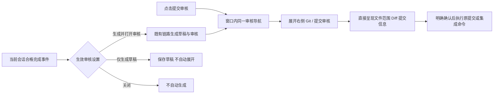
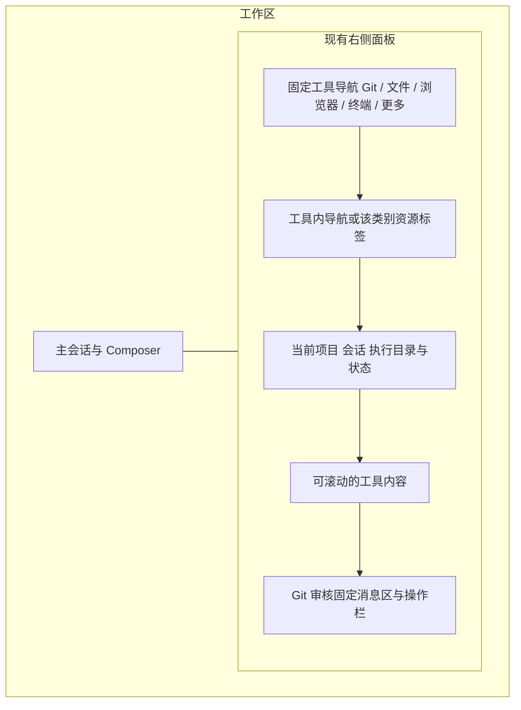
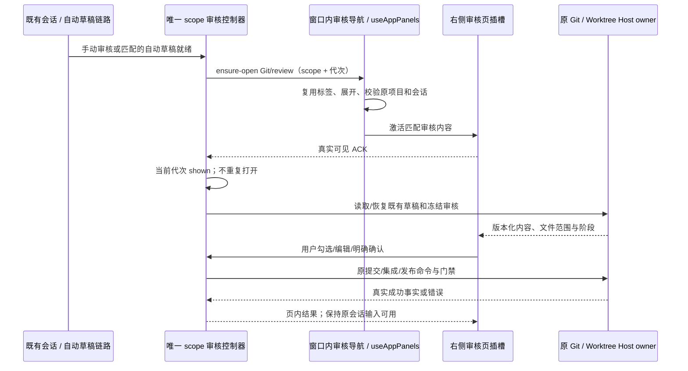

# 右侧面板重构与提交审核侧边化

状态：2026-10-20 已按第 2 版实现右侧审核，并根据用户补充的 IDEA 提交截图改为紧凑目录树。审核主体采用上方文件树与 Diff 双列、下方共享提交信息和固定操作栏；窄面板在同一页切换文件与 Diff。手动与自动入口直接激活现有右侧，旧审核主 Dialog/Props 已移除。最终验收记录见详细实施计划末尾。

2026-10-24 后续规则见 [工具独立窗口](side-pane-tool-windows.md)：仅显示有内容的工具分类，Git 标签按项目与会话隔离；独立窗口固定原会话并保留唯一审核控制器。

系统调研见 [vs-idea-gittool 源码报告](vs-idea-gittool-system-research.md)；已选第 2 版、区域细则、接口、R0–R5 文件落点及整体 Git 路线见 [详细实施计划](right-side-git-review-implementation-plan.md)。本文第 11 节记录本轮实际验证范围。

实现边界：useAppPanels 继续唯一持有侧栏展开、Git 子页与资源；commitReviewNavigationStore 仅登记按原项目 identity + 会话隔离的导航回调和 DOM 插槽，不保存审核事实。GitActionMenu 保留唯一控制器，通过 ReviewPanePortal 将 GitCommitReviewPane 放入 GitReviewSidePane 的匹配插槽，沿用执行工作树的服务上下文。切工具保留插槽与控制器；可见 ACK 以侧栏、Git 子页及实际 DOM 可见共同判定。原审核返回桥不再参与来源审核主流程，仍服务于合并候选等独立预览。

## 1. 用户已确认的目标与优先级

本任务先于 [Git 通用能力增强](git-capability-enhancement-plan.md) 实施：先重构当前右侧面板，完成提交审核侧边化，再推进 Fetch、Remote、Stash 等新能力。

已确认规则：

1. 使用 zcode-full 现有右侧面板，保持主会话区；参考用户截图及 vs-idea-gittool 的工具窗组织方式。
2. 右侧面板需要整体重新设计，提交审核是此次重构的首要落点。
3. 点击“提交审核”，直接展开右侧并显示审核页。不再先打开审核弹框，也不再要求点击“查看变更与管理文件范围”才能进入右侧。
4. “任务完成后的提交审核”设为“生成并打开审核”时，草稿/审核生成完成后自动打开同一右侧审核页，移除原弹框。
5. 手动和自动入口使用同一审核控制器、同一会话范围及同一执行路径，不保留两份审核表单。
6. “仅生成草稿”仍只生成，不自动打开；“关闭”不自动生成。三档设置与项目继承的配置值不因界面迁移改变。

目标流程：

“查看变更与管理文件范围”不再是进入右侧的前置步骤。其文件浏览、范围勾选和 Diff 能力直接进入新审核页，不能只删除按钮而丢失功能。

## 2. 当前源码与参考项目调研

| 当前证据                                                    | 已确认事实                                                                     | 重构影响                                                                |
| ----------------------------------------------------------- | ------------------------------------------------------------------------------ | ----------------------------------------------------------------------- |
| `GitActionMenu.tsx`、`git-action-menu/GitCommitDialog.tsx`  | 手动/自动审核由同一控制器渲染 Dialog；包含来源提交、工作树合并、可选发布与结果 | 拆出普通面板内容，移除审核主 Dialog 与遮罩                              |
| `v4/ConversationStatusPanel.tsx` / GitStatusSection         | 真实 JSX 调用 GitActionMenu；mini 状态仍保留控制器挂载，以消费自动草稿         | 控制器不能随状态区折叠、右侧切工具或 mini 切换而重建                    |
| `hooks/useReviewDiffNavigation.ts`                          | 原路径隐藏 Dialog，登记 return token，再打开右侧 CodeViewer，返回时恢复 Dialog | 新审核页直接联动文件和 Diff，不再经过“隐藏弹框→打开文件页→返回弹框”     |
| `App.tsx` / handleOpenGitReview                             | 当前“查看变更”的回调直接打开 GitPane，和提交审核 Dialog 是不同路径             | 区分“提交审核”与只读“变更”；不得仅把旧变更页显示出来就算迁移完成        |
| `hooks/useAppPanels.ts`、`lib/workspaceSidePane.ts`         | 现有窗口内面板 owner，管理展开、资源标签、归属与切换；Git 使用既有 type/id     | 在同一 owner 下扩展 Git 子视图，不添加第二个 sidebar store              |
| `app-shell/AnimatedSidePanePanel.tsx`                       | 已承载 Git、代码/媒体预览、浏览器、终端、计划、工作流等内容                    | 重构导航和展示壳；各资源生命周期继续由已有 owner 管理                   |
| `lib/taskSidePaneMemory.ts`                                 | 面板资源集合按 workspace key 复用，同时有 owner 过滤及会话展开偏好             | 不能误改成“全体内容都归当前会话”或移除过滤来显示工作树审核              |
| `hooks/useReviewWorkspaceState.ts`、GitReviewWorkspaceState | 审核编辑事实由 Host 按字段版本管理，客户端只是投影及未接受 overlay             | 面板只订阅并发送原命令，不保存第二份已接受消息/排除集合                 |
| `git-action-menu/GitCommitMessageEditor.tsx`                | 原编辑器 mount 时会自动 focus                                                  | 面板常驻后须改成明确的可见/用户动作焦点策略，防止后台抢走 Composer 输入 |
| `app-shell/WorkspacePanelDrawer.tsx`                        | 手机使用常驻壳，已有焦点与嵌套 overlay 策略                                    | 手机继续使用同一审核内容与既有抽屉，不另建一份审核 Dialog               |

vs-idea-gittool 的当前实现：`src/webview/commit/main.tsx` 提供工具内导航；commitTab.tsx 将文件树与 CommitPanel 垂直分区；commitPanel.tsx 提供消息编辑与固定提交动作；`src/features/commit/index.ts` 注册保留隐藏上下文的工具窗。它的 Diff 通过 VS Code 编辑器打开，不能直接照搬为本应用已有的中央编辑区。

用户截图是 Branches 页，作为侧边工具窗、紧凑密度和区域分工的参考。采用 zcode-full 的主题与 DESIGN.md，不复制截图中的项目数据、颜色、左侧位置或新增其 Shelf/Stash 功能。

导出追踪备注：本轮 dep:refs 对 GitActionMenu 返回 0 引用，但源码确实存在 ConversationStatusPanel 的 import 和 JSX 调用。以实际调用为准，不能据此删除；该工具结果不作为“无人使用”的证据。

## 3. 右侧面板整体信息架构（建议）

将右侧作为统一辅助工作区，导航区固定，工具内容在内部切换。第一层工具分类与第二层资源导航分开：

| 层级 / 分区      | 内容与职责                                         | 点击后的行为                                                             |
| ---------------- | -------------------------------------------------- | ------------------------------------------------------------------------ |
| 顶部工具导航     | Git、文件、浏览器、终端、更多；展开/还原与隐藏侧栏 | 激活该类别上次可见资源；不会创建无用终端或空浏览器实例                   |
| Git 内部导航     | 提交审核、变更、提交图                             | 提交审核直接显示完整审核页；变更保留现有来源选择；提交图复用已有图谱能力 |
| 文件类别资源栏   | 当前已有代码、Diff、媒体和文档预览标签             | 保留文件来源与资源身份；不在本轮新建文件管理器                           |
| 浏览器类别资源栏 | 现有网页、浏览器自动化等资源标签                   | 保留页面、residency 与控制上下文，分类切换不销毁页面                     |
| 终端类别资源栏   | 现有侧边终端和输出资源                             | 新建/关闭仍走既有终端生命周期；不移动底部终端或另起重复会话              |
| 更多             | 已有计划、工作流、子任务、白板、模型轨迹等可用资源 | 继续按原类型与 owner 展示；被隐藏功能不因重构重新出现                    |

Git 子导航是同一个 Git 工具页内部的视图，不为每次完成事件新增一个“审核”顶层标签。不平铺多个同名审核页，也不把“审查”同时作为只读变更页和提交动作的模糊名称。

工具分组是现有资源列表的展示分类。原 type/id、ownerTaskId、workspaceKey、浏览器控制上下文和远端身份保留；新增 UI 选择继续归 useAppPanels 的同一状态，不维护互相同步的两套 activeTab。

用户选中第 2 版后，工具导航、Git 子导航、双列文件/Diff、底部共享消息区与操作栏成为实施基准；实际尺寸和窄屏阈值仍需运行验证。第一验收门槛始终是两个审核入口直接打开同一右侧审核页。

## 4. 提交审核页布局（建议）

### 4.1 固定摘要区

展示当前会话、来源分支、实际执行目录/工作树、文件数与增删统计。原项目用于导航归属，实际执行目录用于 Git 读写；远端身份不靠路径字符串猜测。长路径可换行，刷新入口不会发起网络 Fetch。

本地提交显示“提交审核”；工作树显示明确的来源/合并阶段与目标分支。当前阶段与已完成历史分别显示，不能因旧合并记录存在而阻止下一次来源提交。

### 4.2 文件范围区直接呈现

- 进入审核页即显示目录/文件列表、搜索、选中/排除数量及每个文件的状态、增删量，不再先点击“查看变更与管理文件范围”。
- 行单击只选中预览文件；checkbox 只改变审核包含范围；两者视觉和行为分开。选中 Diff 不等于勾选提交，也不等于执行 git add。
- 批量全选/排除说明作用于当前组、当前筛选或当前页；保留现有大列表的虚拟化/分页，禁止搜索后默默扩大提交范围。
- 范围沿用现有 excludedFiles/owner；当前可编辑组修改范围使旧审核失效，保留人工提交信息并明确要求重新生成。冻结补丁本身不被改写；历史组、已提交组及锁定来源只读，不能在 UI 偷改冻结对象。
- 已提交组、历史组、未提交组、冲突与不可读文件有明确状态。读取失败不能变成“0 文件”，空范围不能回退全仓范围。

### 4.3 Diff 与文件列表同属审核页

- 推荐在审核页内查看 Diff，不再隐藏审核再打开另一个返回弹框的页面。
- 冻结组使用 review.files 的冻结 patch；合并结果使用匹配候选/结果证据。不能拿当前 working tree Diff 代替已经审核的内容。
- 宽面板的主体可并排展示文件列表与选中文件 Diff；普通宽度在同一审核页的“文件 / Diff”内容视图间切换，消息和操作上下文保留。
- Diff 显示路径、前后版本、当前组/历史组身份、上一文件/下一文件；二进制、删除、重命名、超限及不可用采用已有类型对应展示。
- “在文件预览中打开”可继续沿原资源导航；返回时激活原审核页，不重生成、不丢消息、不重放任何 Git 命令。旧 return token 仅在过渡兼容路径存在，不能继续作为主流程前置条件。

### 4.4 消息区和固定操作栏

- 文件区与消息区之间可调整高度。消息编辑保留 AI 生成/重新生成、恢复上次文本、复制、长度提示和既有规范化辅助。
- 普通布局消息区在底部可见；长正文在编辑区内部滚动，不能把主提交按钮顶出面板。短屏或软键盘展开时可进入同一面板内的消息编辑视图，返回仍保留文件选择。
- 底部只保留一个当前阶段主动作：本地为“提交”；工作树根据原状态为“提交并准备合并”或已有来源的“准备合并”；后续“确认合并”仍依原门禁出现。
- 发布选项默认折叠，选项、执行摘要、人工确认与逐项结果在审核页内展开。Cmd/Ctrl+Enter 仅执行当前允许的提交，不升级为推送或合并。
- 人工审核确认、忙碌、同步冲突、陈旧版本、身份缺失及只读原因必须直接可见。切为侧栏不能删除现有执行门禁。
- 提交成功后保留成功事实与后续可用动作，不自动清空整个右侧或切回浏览器。新草稿不得覆盖人工编辑，也不得覆盖仍在执行的发布计划。

## 5. 两类入口与自动打开规则

| 场景                            | 必须行为                                                                   | 不得产生的副作用                                                      |
| ------------------------------- | -------------------------------------------------------------------------- | --------------------------------------------------------------------- |
| 点击“提交审核”                  | 立即确保右侧展开，激活 Git/提交审核；同页呈现文件范围、消息与加载/错误状态 | 不能先弹审核 Dialog；不能仅打开只读 GitPane；不能要求再点文件范围按钮 |
| 输入区手动生成并审核            | 进入同一右侧审核页，展示这次请求的加载/结果                                | 不另挂一个生成弹窗或第二个控制器                                      |
| 生成并打开审核                  | 合格完成事件生成就绪后，展开并激活同一审核页；已在该页则复用               | 不重复创建标签、不重复生成、不自动提交                                |
| 仅生成草稿                      | 更新既有草稿；用户手动审核时直接在侧边预填                                 | 不因订阅到草稿字段而自动展开                                          |
| 关闭模式                        | 不自动生成，原手动提交入口继续按可用性存在                                 | 不修改其他执行偏好                                                    |
| 面板折叠/浏览其他工具时点击审核 | 显式 activate 而不是 toggle，恢复该 scope 的审核页                         | 重复点击不能把刚打开的面板关掉                                        |
| 草稿生成时用户关闭面板          | 接受用户隐藏意图，结果仍可手动查看；同一 draftKey 不再次强制展开           | 迟到结果不能重开或夺取焦点                                            |
| 后台/其他会话完成               | 保存其原有草稿；建议仅提示待审核状态                                       | 不擅自切换当前会话或把别人的草稿打开在当前页                          |
| 用户切换项目/会话/日志代次      | 只激活匹配 owner 的审核；草稿、旧结果按原边界恢复或标记陈旧                | 不跨 identity 显示或执行；恢复快照不重放“自动打开”事件                |

“生成并打开审核”的设置名保持可用，可补充说明“任务完成后，在右侧面板打开提交审核”；值仍是 draft-and-review，不做配置迁移。自动打开建议不改变当前 Composer 的键盘焦点；手动点击才将焦点交给审核导航/文件列表。

自动草稿的 attempted、shown、consumed 继续区分：发送导航不等于已显示，只有匹配 scope 的审核页成为右侧活动页且实际可见才算 shown；用户明确关闭按原消费规则处理。StrictMode 重跑、刷新、重连、打开设置和切工具不重新消费或反复打开同一草稿。

## 6. 右侧导航、关闭与多端恢复

| UI 动作                  | 推荐规则                                                                                                                |
| ------------------------ | ----------------------------------------------------------------------------------------------------------------------- |
| 切工具/切资源            | 保留审核控制器、消息、文件范围、冻结审核、本端确认与执行结果；不因隐藏创建/取消 Git 操作                                |
| 顶部隐藏按钮             | 折叠整个右侧；不等于取消合并/提交/推送，不清空草稿                                                                      |
| 关闭文件/浏览器/终端资源 | 沿原资源关闭协议处理；不能把面板分类切换误当显式关闭                                                                    |
| 再次点击提交审核         | 激活原 scope 的审核，恢复草稿与阶段；不从历史确认自动执行                                                               |
| 自动展开                 | 当前会话就绪时可切到 Git/提交审核，原文件/网页/终端资源仍保留；不抢键盘输入                                             |
| Escape                   | 先交给菜单/搜索/Select；桌面不通过原 Dialog 行为清除审核；手机继续遵守 Drawer 的单次关闭策略                            |
| Cmd/Ctrl+W               | 按既有活动资源关闭语义审计；Git 工具被隐藏时保留审核事实，不意外关闭整个窗口                                            |
| 新进程/应用重启          | Host 草稿及已持久操作按原合同恢复；本端确认和导航不冒充已恢复执行授权；当前面板记忆是进程内记录，不宣称已有跨重启持久化 |
| 其他设备编辑             | 仍通过 Host 字段版本检测冲突；另一端的浏览状态或确认不替本端授权                                                        |

浏览器/browser-use 的 DOM 连接和 residency、终端进程、后台输出与工作流资源有既有生命周期。新分类只决定显示；不能靠卸载整个工具树实现切换，不能扩大自动清理或重新打开当前被隐藏的模块。

## 7. 布局尺寸、窄屏与视觉语言（建议值）

- 首次展开沿用现有默认 45% 及已保存的当前窗口宽度偏好；不因每次自动审核重复重置宽度。
- 以面板实际可用宽度判断布局。第 2 版详细计划将候选分界收敛为约 640px 以上文件列表 + Diff 双列；更窄在同页使用文件/Diff 内容切换。最终以 1280/1440/1920 工作区及用户缩放验证，不仅按整窗宽度判断。
- 双列文件区建议 200–260px 可调整，其余给 Diff；普通模式消息区建议 160–220px 可调整。短屏和大字号优先保证主动作、同步错误和范围说明可访问，不固定死高度。
- 390px 手机使用现有 WorkspacePanelDrawer，工具导航可紧凑显示或进入更多；审核是同一页面，不额外套 GitCommitDialog。软键盘、安全区和滚动区域必须真实验证。
- 不新增面板外悬浮提交框。固定导航/摘要、可滚动内容、消息区和底部动作有明确边界；不允许多层无界滚动挤掉操作。
- 使用现有 text-ui-\*、语义颜色、Diff 字号设置、组件和全部已提供主题；不复制参考项目的固定 13px 字体与 VS Code 私有 CSS。

## 8. 控制器与状态所有者

补充确认：`workspaceSidePane.ts` 将 Git tab 作为 workspace-global 资源，不能把它误写成现有 session 私有 tab。新审核正文、插槽及可见 ACK 必须另按原项目 + 会话 + 审核代次校验；原资源 registry 的工作区共享语义保留。详情见实施计划第 3、5、6 节。

| 状态/职责                               | 唯一所有者                                           | 本次处理                                                             |
| --------------------------------------- | ---------------------------------------------------- | -------------------------------------------------------------------- |
| 侧栏展开、资源集合、当前工具/子页与导航 | useAppPanels + WorkspaceSidePaneState / 现有窗口记忆 | 扩展当前 UI 状态，类型分类由既有 tabs 派生；不另建平行 sidebar store |
| 面板展示归属                            | 原项目 workspaceKey + ownerTaskId/sidePaneOwnerId    | 保留原过滤；原项目 identity 不替换为执行 worktree identity           |
| 审核草稿、排除、分组与阶段编辑          | Host GitReviewWorkspaceState                         | 沿原 hooks/投影；不新增 Host 模型或把右侧开关写入审核事实            |
| 已冻结 review/group 与提交收据          | 原 Git 服务与审核 owner                              | 继续使用冻结 patch、顺序游标与幂等事实                               |
| 工作树候选、验证、来源/目标发布         | 原 WorktreeService                                   | 面板只是展示与原命令入口，不重新实现合并                             |
| 本端人工确认、加载代次、计划与 run      | 由 GitActionMenu 拆出的同一 scope 审核控制器         | 控制器挂载不依赖工具页是否可见，不能在右侧再挂一个 GitActionMenu     |
| 当前预览文件、搜索、列表滚动            | 同 scope 的面板 UI 投影                              | 与“提交包含范围”分离；不写第二份 checkedFiles 业务集合               |
| 打开意图与一次性导航                    | 现有 commitReviewNavigationStore / hook 的扩展       | 只指向 scope/目标子页；不接受提交命令、不保存另一份 draft            |

建议将 GitActionMenu 拆成入口按钮、稳定的审核控制器、可嵌入的 GitReviewPane。控制器继续处在当前会话的执行服务上下文，展示内容通过有 scope 校验的面板插槽进入右侧；可使用普通 React portal 保留现有 ServiceProvider 上下文，不创建 Dialog portal/overlay。具体挂载技术需在实现前验证 scope、隐藏、切页和手机 Drawer 的 DOM 稳定性。

推荐新的 UI 打开意图至少包含：原项目导航 scope、实际执行 scope、会话/草稿 owner、目标 Git 子页、来源 manual/automatic/navigation、可选 draftKey、打开代次及焦点意图。字段复用既有身份构造与 remoteSessionId 路由；它不是新增 Agent 命令，也不具备写仓库授权。

Desktop desktop-continuous 与手机 web-remote-replayable 继续消费同一 Host 事实；连接恢复不触发新的自动生成、确认或写命令。本次目标是 UI 导航与展示迁移，默认无数据库或 Agent 协议迁移；如实现确需新增跨边界字段，另补对应严格 schema 和合同。

## 9. 实施拆分与需要清理的旧路径

| 切片 | 拟变更范围                                                                | 完成门槛                                                                   |
| ---- | ------------------------------------------------------------------------- | -------------------------------------------------------------------------- |
| R0   | 更新 spec、入口行为、scope/生命周期与现有测试预期                         | 先以失败场景证明手动/自动直接激活右侧，不产生原审核 Dialog                 |
| R1   | 拆分 GitActionMenu 控制器/入口/内容，接入 useAppPanels 的匹配审核插槽     | 不新增第二控制器；状态区 mini/折叠不丢自动草稿；所有入口可达               |
| R2   | 右侧公共导航、工具分类、Git 子导航及旧 tabs 兼容                          | 原浏览器/文件/终端/工作流资源身份和生命周期不变；隐藏功能不复活            |
| R3   | 文件列表、范围管理、冻结 Diff、消息区、固定动作与合并/发布阶段布局        | 无“先打开文件范围才能进入右侧”的绕路；审核范围与原提交门禁一致             |
| R4   | 焦点、宽窄布局、手机 Drawer、可见 ACK 与恢复                              | 自动打开不抢 Composer；手动可键盘操作；同 scope 恢复、跨 scope 拒绝        |
| R5   | 清理原审核主 Dialog、遮罩与主流程 return-to-dialog 桥，更新文案/测试/引用 | 旧入口均指向侧边；没有残留自动弹框和第二份表单；不删除仍有其他用途的对话框 |

源码落点：`GitActionMenu.tsx`、`git-action-menu/`、`hooks/useCommitReviewNavigation.ts`、`hooks/useAppPanels.ts`、`lib/workspaceSidePane.ts`、`app-shell/AnimatedSidePanePanel.tsx`、WorkspaceShellLayout.tsx、`v4/ConversationStatusPanel.tsx`、两种 locale 与现有 Web fixtures。新组件名为方案示意，实施时先验证公开入口和实际调用，再拆分；不为改名顺手重构整个 Shell。

优先切片以 R1+R3 保证“直接审核”可评审；右侧壳与分类随后在同一设计下落地。提交图嵌入可跟随 R2/R3 交付；不将 Fetch、Stash 等新后端能力作为移除审核弹框的前置条件。

## 10. 代表性验收场景

以下均为计划验收，不代表侧边化已实现。

| ID / 分类    | Setup / Action                                                      | Assertions                                                   | 证据要求                           |
| ------------ | ------------------------------------------------------------------- | ------------------------------------------------------------ | ---------------------------------- |
| R01 accepted | 右侧关闭，点击“提交审核”                                            | 立即展开 Git/提交审核，文件范围与消息可见；无原审核主 Dialog | 生产入口 + owner + 浏览器 DOM/截图 |
| R02 accepted | 右侧浏览器/文件/终端活动时点击审核                                  | 激活同一审核页；原资源仍在，浏览器/终端不重建                | UI + 资源生命周期                  |
| R03 accepted | draft-and-review，当前会话合格完成且生成就绪                        | 自动激活同一审核页，无弹框，无再次点范围按钮                 | 真实完成链路/fixture 分层报告      |
| R04 accepted | off / draft 与项目 inherit/显式覆盖                                 | 原三档生成语义一致；draft 不自动开，手动打开可预填           | 策略单测 + 服务/组件               |
| R05 accepted | 同一 draftKey StrictMode、重连、切工具重复投影                      | 不重复生成/标签/自动打开；真实可见后才 ACK                   | 生命周期单测 + 实际面板            |
| R06 accepted | mini 状态区、隐藏详情、状态区重排                                   | 自动审核控制器仍单实例且可接通侧边                           | 生产状态区组件                     |
| R07 accepted | 同会话编辑消息/排除文件，切工具、隐藏、重开                         | 草稿、范围、审核组及本端执行计划按规则保留                   | Host 投影 + UI                     |
| R08 accepted | 生成在途主动隐藏，迟到结果/旧scope完成                              | 不强制重开、不抢输入、不覆盖新scope                          | 确定性 barrier + 焦点断言          |
| R09 accepted | 搜索文件、行选择、勾选/批量排除                                     | 预览与提交范围独立；明确分页/筛选范围；不执行隐式 stage      | Git 调用记录 + 组件                |
| R10 accepted | 冻结审核后 working tree 外部改写                                    | 展示冻结补丁，旧确认失效规则保留；不以实时 Diff 替换审核证据 | 临时 Git 仓库 + UI                 |
| R11 accepted | 浏览历史组、已提交组，尝试快捷键提交                                | 只读且不能越过提交游标；范围变化要求重新生成                 | 原审核回归                         |
| R12 accepted | 来源提交→合并准备/冲突/验证→结果→发布                               | 页内阶段与来源/目标明确；不重放已完成步骤                    | WorktreeService + 浏览器           |
| R13 accepted | 推送多远端部分失败，切工具、回来重试                                | 保留已成功事实，仅重试失败项；不重复提交/建Tag               | 原发布回归 + 新侧边入口            |
| R14 accepted | 本地路径 fallback、远端同路径不同identity、原项目与worktree身份不同 | 导航归属正确，文件请求使用实际执行scope，旧响应不串          | 实际 services 注入/owner 过滤      |
| R15 accepted | 切项目/会话后返回；无session草稿态                                  | 原资源可恢复，私有审核按owner隔离；不为显示侧栏创建会话      | memory/归属单测 + UI               |
| R16 accepted | 加载失败、缺Git、同步冲突、目录busy                                 | 页内展示原因与重试；不假空、不自动调用模型、不打开后备弹框   | provider/Host + UI                 |
| R17 accepted | 390/1280/1920、面板拖窄、软键盘、中英文及当前主题                   | 主动作可访问、Diff可读、长路径不挤掉操作                     | 实际浏览器截图 + 真机补充          |
| R18 accepted | Composer 输入时自动打开审核；手动键盘进入                           | 自动不偷焦点；手动可达；快捷键只对当前可执行审核生效         | activeElement + 按键回归           |
| R19 accepted | 多类别切换、Browser residency/CDP、终端和工作流历史                 | 沿既有保留/关闭规则，无导航引发的资源销毁                    | 现有生命周期套件 + owner           |
| R20 accepted | Desktop continuous / 手机 replayable 恢复                           | 只恢复投影，不重放自动确认和Git写操作                        | 两类客户端恢复回归                 |
| R21 pruned   | 新建左侧Git工具区、独立底部Git历史面板                              | 已确认复用右侧；不增加额外工作区布局                         | 用户位置选择                       |
| R22 pruned   | 借本次布局引入Shelf/Stash、账号中心、通用Rebase                     | 属于后续Git能力方案，不是审核侧边化前置                      | 范围规则                           |

不做全量 OS×主题×资源×Git状态笛卡尔积；对身份、控制器生命周期、可见 ACK、冻结证据及真实 Git 副作用保留高风险组合，纯布局使用代表性宽度/语言/主题验证。

## 11. 本轮验证与证据限制

- freshness、`pnpm typecheck`、`pnpm lint`、`pnpm architecture:check --changed` 通过；架构 violations / baseline / new 均为 0；变更文件格式与 whitespace 检查通过。
- 当前 UI / owner / lifecycle / drawer / 文件模型单测 21 / 21 通过；新侧边流程的完整浏览器套件 58 / 58 通过（57 场景 + 1 总套件），包括手动/自动入口、跨端恢复、主题/宽度、目录三态及冻结内容边界。
- 真实 Git / Host 补充回归最终 25 / 25 通过；首轮索引 stat cache 用例失败，单独及整组重跑通过。具体时序原因尚未确认，未修改服务层或将其写成本轮修复。完整命令、测试文件与过程记录见 [实施计划第 12 节](right-side-git-review-implementation-plan.md#12-首轮落地与实际验证2026-10-20)。
- [视觉 QA](../design-qa.md) 已比较用户 IDEA 截图与当前实装，保存全图、目录局部、浅深色和手机证据；内置浏览器实际验证了文件选择与 Diff。截图来自生产组件和 fixture，不是真实用户仓库。
- 现有种子图已改用实际的 GitCommitReviewPane、GitReviewSidePane；业务 owner、Host/Agent 协议和 Git 命令未迁移。尚未运行打包客户端、macOS/Linux 原生窗口或实体手机软键盘验证。

## 12. 后续边界

2026-10-21：Windows 安装版已完成隔离仓库首轮验收；发现最终提交后的旧范围残留，及远端/Tag 发布的归属调整。发布选项、预览与结果改由“远端”页展示，原控制器和写入门禁保留；本轮修复后源码回归与等待用户重新构建的复验分开记录，详见 [构建版验收 spec](git-built-acceptance-and-publication-navigation.md)。本节后续阶段说明为首轮侧栏落地时的范围记录，当前 Git 能力以各阶段 spec 和源码为准。

第 2 版右侧审核及 IDEA 风格文件树已落地。后续通用 Git 能力按详细计划第 11 节逐项推进；不将 Fetch、Remote 配置、Stash 或历史重写视为本轮已提供的能力。
