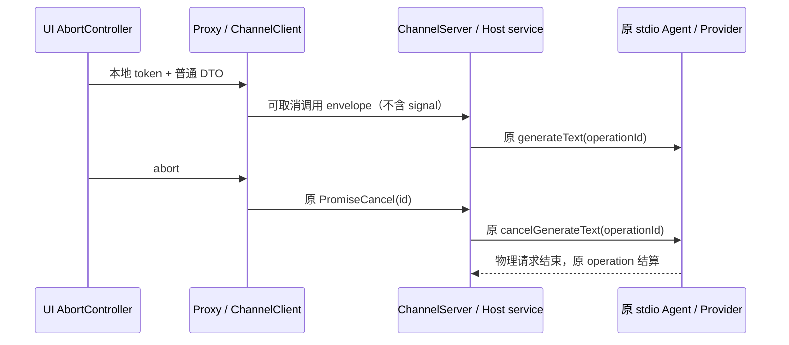

# 服务代理的跨进程取消

实际 Electron 验证确认：把 AbortSignal 嵌入普通方法参数会被序列化成普通对象，Host 调用 addEventListener 失败。取消属于已有 ChannelClient/ChannelServer 的控制面，不能作为 DTO 字段发送，也不能新增一套 Host 业务请求队列。

- ProxyChannel 支持最后一个参数为 CancellationToken。客户端从参数中取出 token，使用独立的有标记调用 envelope 保存普通参数，并把 token 交给已有 channel.call 的取消入口；普通方法仍发送原数组格式。
- 服务端仅对该 envelope 把 ChannelServer 提供的本地 token 追加为最后一个方法参数。普通调用不增加参数；转发到另一层代理时继续沿同一取消通道传播，不序列化事件函数。
- CancellationTokenSource 在 cancel 前后创建 token 都必须正确暴露 isCancellationRequested。取消幂等，正常完成后解除监听；连接关闭使用原在途请求清理。
- RPC 公共入口提供 AbortSignal ↔ CancellationToken 的本地桥接。AbortSignal 不跨进程。generateWorkspaceText 增加可选末尾 CancellationToken；原 params.signal 仅保留同进程兼容，UI 不再把它放入 DTO。
- Host 在建立请求前监听 token，在客户端/鉴权准备的 await 后检查取消；模型取消继续使用原 operationId 与 workspace/cancelGenerateText，保持原在途计数。提前取消不得请求模型；完成后不得留下 token 监听。预测超时不升级为 Runtime 故障。
- 旧 Host 不支持 envelope 时明确失败、零预测，不回落到无取消的付费请求。Desktop MessagePort 与 Web Socket 使用同一序列化协议和取消消息，不增加 task/session 事实。

验收使用真实序列化的 ChannelClient/ChannelServer：成功结果、普通参数不变、嵌套转发、在途取消、初始化前取消、提前取消、完成后监听释放、取消幂等。实际 Electron 需再次从真实 Composer 生成建议，并在慢响应期间输入，确认 provider 连接取消且迟到结果不展示。
