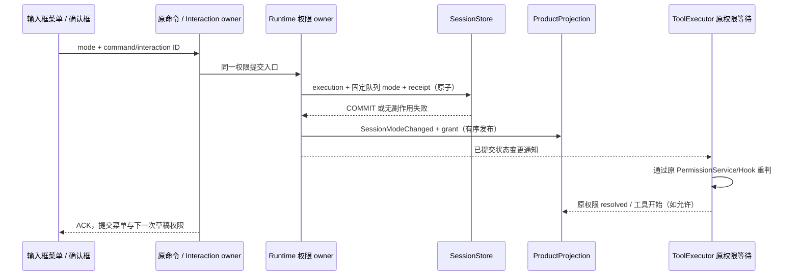

# 当前任务权限切换

状态：已实现并通过回归验证（2026-10-19）。替代输入框权限菜单“只编辑下一次 Submission”的旧语义；模型、推理、速度和 Plan 仍使用各自原有语义。

## 规则与所有者

- 有真实 session 时，变更前确认 / 自动编辑 / 完全访问是当前任务的权限设置。输入框菜单与权限确认框必须通过同一个 Runtime 权限事务入口生效。没有 session 的新任务只保存草稿，首发按所选权限提交。
- Runtime 是执行权限唯一事实源，SessionStore 原子提交执行状态、当前已接受队列的权限和幂等 receipt；延用既有授权事务、owner/lease、CommandInbox 与 stale 防护，不新增 Host 队列。
- 复用 switchCollaborationMode 命令表达显式权限切换；plan/auto 等旧调用兼容原语义。命令 ID 或确认请求 ID 是幂等身份。相同 ID 不重复授权，提交后发布失败按冻结 receipt 恢复，不能重抓后来的队列扩大作用范围。
- 显式切换更新本任务已有 pending 输入的 mode，保留正文、模型、附件、Plan 等其它冻结字段。新提交依提交瞬间的草稿权限；普通 Submission 消费不得隐式改写其它已接受输入。
- 当前正在执行的 handler 不被重新执行；尚在权限等待的工具在新状态持久并发布后重新判定。只在现有 PermissionService、Hook 与强制用户确认规则均允许时放行，并由原 broker/事件收口交互，UI 不自动点击或代答。
- alwaysAsk、approvalSource=user、用户问答、Plan 写入限制、Hook ask/deny 和现有硬拒绝保持。保留后台进程、运行/保存工作流等明确确认不可被普通完全访问切换绕过。
- 已有会话的 UI 依据 ACK accepted/noop/duplicate 或已提交的 Runtime 投影更新草稿与菜单；没有提交证据时保留原值，ACK 返回前阻止发送与重复选择，失败展示错误。切换会话/Host 后旧请求不更新新 scope。
- 同步会话权限事实到 Composer 时按 grant ID 消费一次；同一 receipt 的重放不覆盖后续显式选择。支持 build/edit/yolo，同时兼容旧快照缺少 mode 的 yolo 授权。
- 发送在同一次用户动作中冻结权限与 Plan；切换异步未成功时不能发出旧权限的输入。新任务首发创建、已有会话发送、busy queue/guide 与重挂载均验证，不凭菜单勾选推断 Runtime 已切换。

## 提交与事件顺序

Desktop continuous 消费同一 owner 的实时事件；手机 replayable 从 snapshot + gap repair 恢复相同权限、队列和交互终态。Main/relay 不持有权限副本。

## 验收

- 执行资源排队期间降权时，取得执行槽与操作锁后再次检查当前权限；重新等待审批前释放资源，不重复运行 PreToolUse Hook 或 handler。
- 已有任务恢复时，旧版草稿里保存的权限必须与当前 Runtime 投影收敛；之后仅在新的权限事实到达时同步，不能用重复旧快照覆盖刚收到 ACK 的改选。模型和下一次 Plan 草稿仍独立保留。
- `SessionConfigState.permissionModeVersion` 为最近 `SessionModeChanged` 的 event ID，随既有实时 delta / 恢复快照传递。它只标识事实更新，避免 React 合并渲染时漏掉 mode 先变后恢复原值的最新事实；旧 Host 缺字段时兼容按 mode 变化判断。
- 普通 Submission 后来改变了执行权限时，旧授权 receipt 不能在冷恢复或快照重放时把菜单刷回旧权限；已发布 receipt 的重试不重放 Runtime 状态。
- 发送附件等异步准备期间发生权限改选，过期 Submission 不得在权限切换完成后重新写回旧权限；保留草稿供重新发送。

1. 新任务发送前选 yolo，首发命令、持久输入、Runtime、普通 Bash 放行保持一致；build/edit 仍按原规则。
2. 已有会话运行/空闲/待审批时切权限立即影响当前任务，菜单 ACK 前不假成功；发送不能跨过未完成切换。
3. 已排队输入权限随显式切换更新，后续 drain 不回滚；模型/Plan/正文不变；重复命令、冷恢复与发布失败不扩大授权范围。
4. 同时多个普通审批等待，只放行新模式允许的请求；强制确认、Hook ask/deny、Plan 和用户问答继续等待/拒绝；无 broker/hook 重复应答或重复 handler。
5. 确认框 fullAccess 与菜单 yolo 使用同一事务；批准/拒绝与切换竞态只有一个结果，取消后无迟到执行。
6. 保存失败、网络错误、stale/duplicate、快速点击与 session/Host 切换保持 scope；桌面/手机快照与实时状态一致。
7. 真实 UI 浏览器覆盖 1280px / 390px、新/旧会话、首发前切换、发送与权限切换竞态；另以 Runtime 事务方法、真实 Executor 和 SQLite adapter 的分层回归验证副作用和持久性，不将合成 UI fixture 当成真实账号全链路。

## 调查证据与限制

修复前本地只读记录显示最近一段会话的两次提交均冻结为 build，16 次普通 Bash 确认仍在 build；直到确认框 fullAccess receipt 才切为 yolo。旧日志没有菜单点击时刻，不能据此断言每一次“发送前已选好”都在同一环节丢失。本轮必须以实际 UI 提交链路补齐复现及回归，不扩大采集正文、命令或凭据。

已确认并覆盖的缺陷：菜单原先只写草稿，当前任务仍按旧权限执行；既有排队输入会在消费时重新应用原 mode；历史授权标记和旧版草稿能使菜单显示 yolo 而 Runtime 已是 build；PreToolUse 或执行资源等待期间的旧权限判断、异步发送准备后的冻结旧值会继续生效。纯新任务首发选择 yolo 的正常链路在真实 Composer 回归中保持正确，不能把全部弹窗归咎于首次选择丢失。强制确认仍按原规则发生。

## 验证记录

- `node scripts/test-session-permission-mode-switch.mjs --browser`：47 项 CLI/Runtime/SQLite/Executor 回归、1 项草稿纯函数回归、39 项浏览器计数全部通过。浏览器使用真实 Draft owner、Composer 和权限请求 hook，覆盖 1280px/390px、新旧任务、Enter/按钮、本地/worktree、多窗口、ACK 等待/失败、会话/Host 切换、重复授权、旧草稿恢复、合并渲染和异步发送准备。
- `node scripts/test-model-stream-tool-pipeline.mjs --browser`：既有流水线 164 项通过，保留空 tool_calls 分片、批量落库、执行并发、工具屏障和恢复语义。
- `pnpm typecheck`、`pnpm lint` 通过；CLI contracts/core/adapters/bootstrap 各包类型检查与 Lint 通过；core 构建通过。
- `pnpm architecture:check --changed`：baseline 0 / new 0 / violations 0。涉及既有 lcode-cli、ui、shared 模块，未改变 owner/lease、CommandInbox 或 Main/relay 所有权。
- 对应源码/测试的 45 条路径相对 HEAD 为 +1,455/-164，净 +1,291 行，含这些路径上的既有改动，不能视为本轮独立补丁大小。权限代码路径的 diff whitespace 检查通过；全仓库检查仍报告前序 SDK patch 文件中的补丁上下文空格，未改写该有效补丁。
- 第三方 notices 已按当前共享协议源码重新生成并通过哈希校验。
- 当前真实 executor 的受控慢快混合工具基准（每组预热 5 次、采样 20 次、并发 2）中，固定波次对照 P95 **127.9 毫秒**，补位调度 P95 **94.9 毫秒**。这是同一当前 executor 的调度对照，证明原补位收益仍在，不能解释为本轮权限修复前后的完整端到端对比；不包含外部网络工具耗时。原始数据：[session-permission-tool-scheduling-2026-10-19.json](../docs/benchmarks/session-permission-tool-scheduling-2026-10-19.json)。

验证通过源码测试与浏览器夹具完成，未替换正在运行的安装版客户端、修改真实会话数据或提交代码；新行为需由包含此修改的 UI 和 Agent 构建共同加载。
