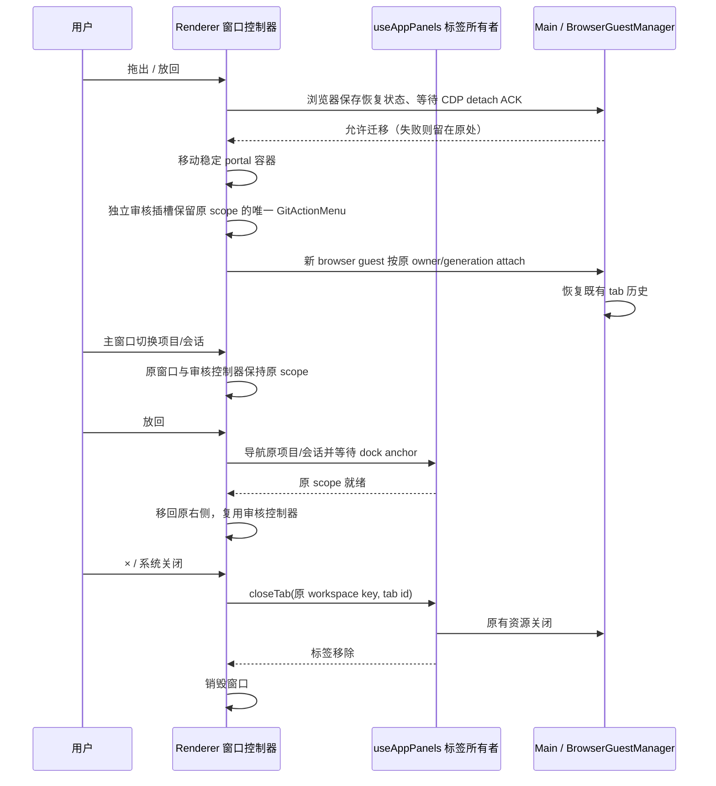

# 右侧工具独立窗口与可用工具导航

## 产品规则

- Desktop 的 Git、文件预览、浏览器、终端及其他侧栏标签可逐个拖出为独立系统窗口，可移动到其他显示器。
- 工具按钮或标签拖离右侧面板后创建窗口；另提供“在独立窗口中打开”按钮。窗口内的拖回手柄可拖入原窗口右侧，或点击“放回右侧”。
- 独立窗口中的 × 和系统关闭按钮均关闭对应标签，复用已有标签关闭和资源释放流程；放回只改变呈现位置。
- 导航只显示有可用标签的工具。仅提交审核时只显示 Git；不展示不可点击的灰色类别。新工具通过既有 + 菜单打开。
- 独立窗口固定绑定打开时的 workspaceIdentity / workspacePath / remoteSessionId / task / execution checkout；主窗口切换同项目或其他项目的会话，不改变独立窗口的内容、服务连接与操作目标。
- Git 改为按会话复用，每个会话可各自打开 Git；同项目 A 的 Git 拆出后，B 会话再次打开 Git 创建 B 自己的标签，不能重用或修改 A 的标签。
- 标题栏与窗口内归属栏持续显示“项目名 · 会话名”，另显示工具标题；会话无标题时使用本地化的未命名会话文案，草稿使用“新会话”。提供“定位到原会话”动作。
- 放回时先导航到原项目与会话，等原标签的 dock anchor 就绪后移动内容。不能把 A 的工具放入 B 的会话。工作区关闭、原会话删除、标签关闭或主窗口关闭时回收对应窗口。
- 拖回期间在原主窗口右侧显示带来源项目/会话的投放区，覆盖浏览器 guest 并兼容面板收起状态；放下、取消和结束拖拽后清除，避免拖进网页而被 guest 截获。
- Web 和手机保持现有面板/抽屉，不展示未实现的系统窗口操作。

## 所有者与接口

- `useAppPanels` 保持标签、顺序、关闭历史及业务资源的唯一所有者；窗口控制器只管理本 Renderer 的 DOM 呈现位置和 native handle，不创建 Agent、Local Host、session 或 service connection。
- 新 Git 标签使用 opaque id 并固定 ownerTaskId；旧 `git` 标签保留 id，缺少 owner 的旧标签在当前 scope 明确归属后沿同一打开路径复用。可见性、toggle、关闭、批量关闭按 owner 过滤，不硬编码单例 id。后台关闭还须比对当前会话，不能收起或重选同项目另一个会话的面板；最近关闭记录以 workspace key + tab id 区分。
- 后台标签命令显式携带 workspace key 和标签 id，经过同一 `useAppPanels` 写入口修改原工作区记忆；不依赖调用到达时主窗口的 active workspace。后台关闭不会切换或修改当前项目的同名标签。
- 导航回调保留原能力契约：必填的 `onOpenSubagentSession` 在两个子代理面板中始终提供；可选的 `onOpenWorkflowRun` 只有存在时才创建 owner 包装函数，缺席时继续传递缺席状态。禁止以非空断言、空函数或可选调用的假回调掩盖能力缺失；已提供的回调仍经原 `inOwner` 路径作用于原会话。
- 独立窗口使用冻结的展示上下文和 ServiceProvider；UI 呈现注册表保留 portal，不复制业务标签 registry。活跃工作区只投影未拆出的标签。
- 独立 Git 的仓库读取和文件监听继续通过原 scope 的现有 hooks 运行；自动刷新只刷新该窗口的派生数据，不导航主窗口，也不复用主窗口当前项目的 Git 结果。
- 未启用独立刷新时，空的平台读取状态必须保持为未就绪；不能因两侧 service 都缺省而把 null 状态当作有效平台结果。既有 Web/手机审核入口仍可独立运行。
- 提交审核控制器沿原 scope 保持唯一实例。应用层的呈现 host 在来源入口卸载而审核插槽仍位于独立 document 时保留原控制器、服务和未接受草稿；回到原会话复用该实例，窗口关闭且来源缺席才释放。该 host 只保存呈现节点，不复制 Host 已接受的审核事实。
- 独立 Git 子页命令显式更新原 workspace/tab 的 view；冻结服务上下文的呈现函数读取该标签的最新 view，不依赖主窗口当前会话的导航注册。审核 portal 的弹层使用实际插槽所属 document。
- 独立窗口存续期间为原 workspace 的现有内存记忆登记 retain lease，LRU 只淘汰无 lease 的条目；关闭/放回释放 lease。
- `IPlatformService.openToolWindow` 由 Desktop adapter 提供同步打开能力。仅允许专用名称和 about:blank，同源子窗口由原 Renderer 的 React portal 渲染；Main 只创建/回收窗口及复用 webview 安全策略。
- React portal 使用稳定容器；移动容器不卸载文件、Git 和终端组件。弹层跟随所属 document，主题/字体从主窗口同步。
- 浏览器跨 document 时 Electron 会重建 webview guest。迁移前必须经过现有 Main CDP teardown ACK，并保存已有 recovery page-state；新 guest 沿既有 tab owner、generation 和恢复流程接管。浏览器允许重载网页以恢复历史，不保证网页内存中的脚本状态。
- 迁移沿用已有 restore bootstrap 协议，在新 guest 首次导航提交前 attach、停止 provisional request、恢复 page-state；浏览器操作、录制或下载进行中时拒绝迁移，原操作继续执行。
- Electron 的真实 guest attachment 由 Main `did-attach-webview` 转发到 owner Renderer（`onBrowserViewGuestAttached`）；Renderer 比对当前 webview id 后沿既有 attach 接口上报 scope。不依赖本版本未实际派发的 webview DOM `did-attach` 来完成握手。
- 独立浏览器直接按原 workspace/session/remoteSessionId/tab/guest 响应截图 surface prepare/release，不依赖主窗口当前 workspace 的 tab 列表；ready 观察所属 document 的帧和可见性。scope、guest、request 和 generation 防护保持不变，手机恢复链路不改变。
- 截图/录制 coordinator 的 prepare 输入、去重 key、ready 校验及 release 贯穿 remoteSessionId；本地调用保持字段缺省兼容，旧 attachment 的 ready 不得完成新 attachment 的请求。
- 每次迁移串行执行；失败保留原位置；窗口创建失败给出可见提示。跨窗口拖回用本 Renderer 随机 token 验证，禁止其他窗口/工作区接管。
- 不持久化 Window/DOM/native handle；重启沿用已有标签恢复到右侧。

## 验收

1. 只有 Git 标签时导航仅有 Git，无 disabled 工具；打开文件/终端后相应入口出现，关闭最后一个后消失。
2. 拖出、按钮打开均得到单独系统窗口；文件输入、Git 草稿、终端 session 身份在放回后保留。
3. 拖回手柄和放回按钮恢复原右侧；多次往返不重复挂载组件、不创建重复窗口。
4. × 和系统关闭走同一标签关闭路径；其他标签不受影响。
5. 浏览器迁移前 ACK、历史恢复、owner/guest 校验失败、迟到迁移和关闭期间的并发由测试覆盖；保持 desktop-continuous / web-remote-replayable 协议及 owner/lease 路由不变。
6. E2E 实际验证多窗口、拖出/拖回、关闭、主题、弹层与组件状态保留；执行 typecheck、lint、changed architecture check。
7. A 项目会话拆出后切换 A 的其他会话、B 项目会话；原内容、PTY、浏览器 owner 均不变，归属标签持续可见。后台关闭仅影响 A；从 B 放回时定位回 A 原会话。
8. 回调类型修复验证：根 `pnpm typecheck`、`pnpm lint` 成功；changed 架构检查 baseline 0、新增 0；侧栏归属/恢复回归 4/4、1280px 中文与 390px 英文浏览器 E2E 9/9。此轮补齐可选导航包装并更新规格，净增 7 行（+9/-2），不计入并行独立窗口功能的其他改动。

## 本轮实现验证（2026-10-24）

- `pnpm test:side-pane-windows`：27/27 通过。真实 Windows Electron 验证拖出、拖回、按钮放回、系统 ×、菜单归属、主题同步、PTY 单次创建/释放、同项目不同会话的 Git 与审核草稿、跨项目后台截图、浏览器历史恢复和删除原会话后的窗口回收；1280px 与 390px 的既有恢复场景通过。
- `LCODE_GIT_REVIEW_TEST_CASES=navigation node --test packages/web/test/git-commit-dialog.test.mjs`：15/15 通过，覆盖中英文、全部主题、桌面/手机宽度、审核关闭重开、冻结差异、工作树归属及新会话独立 Git 入口。测试使用确定性服务，不执行用户仓库的提交或发布。
- 根 `pnpm typecheck`、`pnpm lint` 通过；`pnpm architecture:check --changed` 为 baseline 0、新增 0、总计 0；71 个实现与测试相关文件格式检查通过。中文翻译的编码复核通过。
- 变更模块为 UI、Desktop、Shared、Client 及 Web 测试适配。业务标签仍由 `useAppPanels` 写入；审核事实仍由既有 Host owner 管理；呈现 host 只保留 DOM、控制器实例与原服务上下文。Main 不新增会话状态；Desktop continuous 与手机 replayable 的投递/恢复边界保持原样。
- 提交准备时运行 `node scripts/licenses.mjs notices`，同步测试命令和共享 UI 组件的材料输入指纹；未新增依赖，许可正文未改变。
- 本功能相关 73 个文件相对 HEAD 的工作区差异为 +3787/-500，净增 3287 行；保留无关改动，同文件的并行回调修复计入当前差异。浏览器拆出/放回允许页面重载；仅切换主会话不会迁移 guest。
