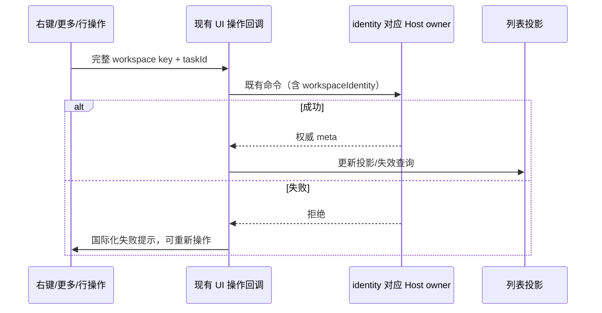

# 侧边栏右键菜单系统复查（2026-10-22）

## 范围与产品规则

复查项目、真实工作树、项目/工作树子会话、独立会话及置顶会话。右键与行内更多入口使用相同目标和能力；分区移动仅调整导航引用。沿用项目归档/删除、工作树管理、会话分叉/重命名/置顶/归档/未读、文件与复制操作的现有契约。

| 对象   | 必须验证的能力                                                     | 失败与隔离边界                                                                  |
| ------ | ------------------------------------------------------------------ | ------------------------------------------------------------------------------- |
| 项目   | 新建、文件、路径、管理、编辑、分区、归档、删除、远端重连           | 离线可归档；删除重新检查工作树/工作集并确认；同路径远端不得调用本机服务         |
| 工作树 | 同树新会话、两种分叉、文件、路径、管理、分区                       | 生命周期/能力门禁；会话归档不能归档工作树；右键与更多一致                       |
| 会话   | 打开、分叉、置顶、重命名、未读、归档、分区、复制、文件、轨迹、反馈 | 始终针对被点击会话；失败保留事实、明确提示并可重试；不可产生未处理 Promise 拒绝 |

同路径本地与远端项目并存时，已知本地 tab 必须优先匹配本地文件操作目标。显式 identity/session 继续精确匹配；没有本地匹配的旧路径调用只在远端匹配唯一时解析其目标，多个远端保持不可打开，不能借用另一 Host。SSH/Docker 不通过本机文件管理器打开远端路径；WSL 沿用现有平台能力。

## 所有者与接口

- 项目定义：SettingService；工作树与执行目录：WorktreeService/会话 owner；会话持久事实：所属 Host 的 LCodeTaskService。
- 侧栏组织：SidebarOrganizationService；客户端列表与乐观层只投影已有事实。
- Timeline/Pinned 菜单复用现有按完整 item key 解析最新任务/services 的行操作回调，消除重复的菜单写入路径。
- 归档及未读 RPC 拒绝时使用现有国际化失败提示。归档失败不移除会话、未读失败不修改未读事实；置顶继续使用现有回滚；重命名失败保留编辑草稿。



此改动不更改协议、owner/lease、持久化或 stream/replay 语义。Desktop continuous 与手机 replayable 共用现有命令及结果；本轮不新增连接或会话运行时。

## 新增验收

1. 同路径本地与 SSH/WSL 项目并存，桌面本地会话文件菜单可用，打开的确为本地目录；SSH 文件管理器入口禁用，WSL 通过既有平台入口携带准确 identity、远端目标及 directory 参数。显式远端身份不借用本地目标。
2. 桌面和 390px 触屏：项目会话、工作树会话、置顶会话逐项注入归档/未读失败。显示对应失败文案，无 pageerror，任务和工作树保留；取消失败后重试成功。
3. 置顶失败回滚；重命名失败保留草稿，重试可保存。菜单操作和行操作共用现有 owner 路径。
4. 重跑项目编辑/生命周期、组织移动、来源故障、专注、工作树菜单与删除回归；记录真实验证结果。
5. 项目编辑回归按 `project-create-edit-details.md` 的现行规则验证主要目录保持首行：第二个附加目录不能上移越过主要目录，保存保留原 identity 与主要成员，不沿用旧“附加目录移到主要目录之前”的断言。附加成员之间的排序继续由项目目录专用回归覆盖。
6. 按 `remote-devices-and-project-sources.md` 验证目录来源：编辑远端项目的「添加目录」仍添加本地目录，不因原项目断连禁用；「远程目录」才通过设备选择器添加远端成员。前者使用 Base FileService 并持久化 `source.kind=local`，不能沿用旧“添加目录隐式浏览原远端”的场景。真实远端成员追加由 mixed-project-devices 专用回归覆盖。

## 已确认原因与修复

| 故障                                  | 复现与原因                                                                                             | 修复                                                                                       |
| ------------------------------------- | ------------------------------------------------------------------------------------------------------ | ------------------------------------------------------------------------------------------ |
| 本地会话文件菜单误禁用                | 同路径的本地和 SSH tab 同时进入候选，`hasRemoteMatch` 将本地调用判为远端；新增浏览器断言修复前实际失败 | 无显式远端 identity/session 且存在本地 tab 时优先使用本地候选，显式远端仍准确匹配          |
| 归档/未读失败无提示                   | 项目 TaskList、Timeline 和 Pinned 的异步事件未捕获服务拒绝，新增桌面/触屏失败提示断言修复前实际超时    | 交互层捕获失败，使用现有国际化提示，仅成功回执更新事实；Timeline/Pinned 菜单复用已有行回调 |
| 项目会话置顶/重命名失败抛出未处理拒绝 | 置顶上层虽回滚但 TaskList 不捕获拒绝；重命名 catch 记录后再次 throw                                    | 置顶保留原回滚并提示，重命名保留草稿并提示，不再抛至浏览器事件层                           |

新增永久浏览器场景位于 `packages/web/test/sidebar-context-menu-review.test.mjs`，已加入 `.gitignore` 的测试白名单和 `test:sidebar-collaboration --ui`。测试使用真实共享侧栏与菜单组件，仅隔离 Host/平台副作用；覆盖本地项目、远程项目、工作树子会话和置顶会话的失败注入、重命名重试、未读重试、归档重试及完整 identity 参数。项目/工作树生命周期等既有场景继续由原测试覆盖。

## 实际验证结果（2026-10-23）

提交前重新执行完整 `pnpm test:sidebar-collaboration --ui`：底层 **77/77**、浏览器 **35/35** 全部通过；这次完整运行已经包含现行项目目录规则与新增菜单错误处理。此前首轮失败及后续定向验证仍保留为历史记录，不用修改历史数字来冒充此前命令一次通过。

- 开工 freshness 通过；Node 24.21.0、pnpm 10.34.6 与 mise.toml 一致。
- `pnpm test:sidebar-collaboration --ui`：底层 **68/68**；浏览器首轮 **31/32**。唯一失败是项目编辑的旧目录规则断言，独立重跑确认后按现行 spec 更新测试；随后项目编辑与跨设备目录联合回归 **3/3**。未将首轮失败写成整条命令通过。
- 补跑 `worktree-sidebar.test.mjs` 与 `mixed-project-menu.test.mjs` **6/6**，覆盖精确工作树删除/失败重试、设置及混合项目来源。
- 新增 `sidebar-context-menu-review.test.mjs` 最终完整运行 **4/4**；截图修正为关闭动画后，390px 场景另跑 **1/1**。综合上述执行，**40 个不同浏览器场景最终均获得通过结果**，重复执行不重复计数。
- 最终 `pnpm typecheck`、`pnpm lint`、`pnpm architecture:check --changed` 均通过；架构 violations / baseline / new 为 **0 / 0 / 0**。过程中其它并行提供商改动曾导致两处类型错误，保留其改动，未在本任务修补；最终全量检查已恢复通过。
- 本任务变更文件格式检查与 `git diff --check` 通过。全仓 `pnpm fmt:check` 曾报告 **2642** 个文件的格式问题，未扩大修改范围批量格式化。
- 生产变更仅 UI 模块四个文件，新增 72 行、删除 338 行，净减 266 行；其余为 spec、回归夹具、测试及测试入口。不统计其它并行任务的文件改动。不新增业务状态 owner、协议、跨层依赖、计时器或数据迁移。

```powershell
pnpm test:sidebar-collaboration --ui
node --test --test-concurrency=1 packages/web/test/worktree-sidebar.test.mjs packages/web/test/mixed-project-menu.test.mjs
node --test packages/web/test/sidebar-project-editing.test.mjs packages/web/test/mixed-project-devices.test.mjs
node --test --test-concurrency=1 packages/web/test/sidebar-context-menu-review.test.mjs
pnpm typecheck
pnpm lint
pnpm architecture:check --changed
```

截图位于 `.artifacts/sidebar-context-menu-review/`，包含 SSH/WSL 文件菜单及桌面/触屏失败提示；390px 提示图已实际打开检查。浏览器使用真实共享组件和隔离服务，未重建安装包、启动真实 SSH/WSL 设备或操作真实项目数据；原生文件管理器调用在平台边界记录参数验证。
