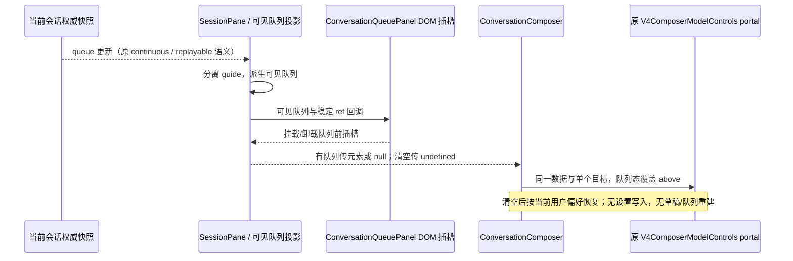

# 用量状态栏

## 产品规则

- 位置支持「输入框内部底部」「输入框下方」「输入框上方」，默认内部底部、模型/发送工具行下方且圆角边框以内。按用户最终更正，`above` 表示整个输入卡片边框外的上方，位于工作区/分支标题下方，不插入文字编辑区和模型工具栏之间；原有 `above` 设置直接采用该布局。三种位置共享同一组件、明细与数据，以设置页下拉选项选择并持久化。随 pane 布局，禁止窗口级 fixed 注入、DOM 扫描和数据库直读。已有累计、输出速度迁入状态栏。
- 有可见队列时临时将同一用量状态栏放到整个队列上方，顺序为「用量状态栏 → 队列 → 输入框」，不再夹在队列和输入框之间。适用于原设置 inside/above/below、单项/多项及暂停队列；队列清空后恢复用户当前设置的位置。临时位置不写 SettingService，不增加开关或第二份状态栏；状态栏关闭或无会话用量时，上方插槽为空且不占空间。只计算 `projectPendingGuideQueue` 的可见消息，等待注入的 guide 不应触发队列布局。
- 新建、尚未发送消息的会话不展示 Token 状态栏，空插槽不占空间、不留分隔线。以 Composer 的 `draftMode` 和权威快照 `control.phase === draft` 判定，缺少快照时同样隐藏；已接收首条输入进入 prewarming/running 后可展示等待用量，不能用累计 Token 为 0 或分页 window 为空反推新会话。旧会话切到新草稿时立即隐藏旧读数，仍遵守原有 projection 的迟到事件隔离。
- 模型/思考/快速模式与发送/停止控件保持同一行垂直居中。非主动作局部横向滚动不能以系统滚动条高度把发送/停止按钮挤向下方；鼠标、触摸和键盘仍可访问溢出控件。
- 默认展示：输出速度、上下文、会话合计、缓存读取、最近请求、直属子代理。没有数据的项隐藏；已有会话尚未结算时显示等待结算提示。累计未知不能显示准确的 0，子代理缺数据时明确表示部分已知。
- 累计、实时可见速度、请求均速、子代理去重与未知值完全遵循 `conversation-session-token-statistics.md`；缓存读/写属于输入分类，不再次加到总量。最近请求只展示同轮次的已知输出量与请求耗时，不冒充整轮消耗或首字延迟。
- 上下文入口复用现有 `ChatContextUsage` 的额度、趋势及压缩相关行为，状态栏模式仅改变紧凑摘要。关闭状态栏时保留原位置的纯上下文入口，移出的累计和速度不重复出现。
- 速度、会话、缓存、最近请求和子代理项在鼠标移入时展开明细；移入明细后保持显示，离开触发器和明细 120ms 后关闭，跨越浮层间隙不会闪退。点击将悬停明细固定，再次点击或 Escape/外部点击关闭；触屏仍点击展开。支持键盘 Enter/Space、Escape 关闭和焦点返回，纯悬停打开/关闭不得抢走输入框焦点或选区。上下文继续复用原有 hover/focus/触摸行为。只读子会话沿用原有统计条，不从父会话借数。
- 设置页入口与总开关中文名为「用量状态栏」（英文 `Usage status bar`），不显示 “Token” 前缀；所有设置只在「设置 → 基础设置 → 用量状态栏」：总开关、三种位置、速度、上下文、会话合计、缓存、最近请求、子代理及动画开关。会话上不出现齿轮或配置开关。设置通过已有 SettingService 持久化及同步，旧配置默认开启，不新建 localStorage。
- 沿用应用字号、主题语义色和中英文。七种主题、桌面窄窗口、分屏和手机共享组件；不足一行时换行，不挤占发送控件或造成页面横向滚动。
- 输入框内部模式采用与输入卡片连续的紧凑底栏：不显示顶部横向分隔线、独立底色或额外阴影，沿用输入框同一表面与 Spark 底光，靠较小的垂直留白和指标间距区分内容。桌面单行高度不超过 28px（默认 14px 界面字号），底栏距输入卡片内底边不超过 9px。触摸设备保留较大的点击高度；窄屏仍自然换行，不缩小字号挤成一行。上方/下方位置及明细浮层内的分类边线保持原语义。
- 指标采用固定的分类色：速度使用图表色 2、上下文使用 1、会话使用 3、缓存使用 6、最近请求使用 5、子代理使用 4，复用 `--color-usage-chart-*`，不将颜色解释成速度好坏或请求成败。图标、打开态和展开明细的标题/顶边沿用同一分类色，禁止所有指标都用同一种主题前景色。
- 明细内部用彩色标记及分组区分合计、主会话、子代理、输入/输出、缓存读/写及耗时；文字与数值保留清晰层级，不依赖颜色单独传意。小字号彩色标签由分类色与前景色混合以保证七主题下的对比度，数值使用主前景色。
- 活动状态用主题色轻微呼吸，速度以等高条波动反馈，上下文进度平滑过渡。动画不驱动业务数值、不通过计时器伪造速度；关闭动画及 `prefers-reduced-motion` 时全部静止，保持状态可辨。

## 所有者、接口、时序和迁移边界

```text
CLI ProductProjection.usage/rows
    ├─ desktop-continuous: live delta ─────────┐
    └─ web-remote-replayable: snapshot + repair ┤
                                              v
window/Host SessionDataLayer（原有唯一投影与瞬时速度采样）
    -> V4ComposerModelControls（原有子会话租约、读数派生）
    -> TokenUsageStatusBar（只读 props）
        └─ ChatContextUsage（原有上下文/额度弹层 owner）

SettingsPage -> useSettings.update -> SettingService（唯一偏好 owner）
    -> 原有设置通知/同步 -> Composer 状态栏呈现

鼠标移入 -> TokenUsageStatusBar.openMetric(id, hover) -> 明细
点击/键盘 -> 同一 openMetric(id, pinned) -> 固定明细
移出两区域 120ms / Escape / 外部点击 -> 仅清除对应 id
    └─ UsageMetric 的进入事件取消移出延迟，卸载清理句柄
```

- 新增 `AppSettings.tokenUsageStatusBar` 为可选的完整展示偏好对象；schema 为旧值补默认。该 UI 偏好由客户端的 base SettingService 持有，远程 pane 同样读取 base 偏好，不能切到远端主机的设置文件。更新发送完整对象，已有设置保存、广播、防回环路径保持不变。
- ChatPromptEditor 提供卡片内部底部以及卡片上方/下方 DOM 插槽，工具条通过 React portal 迁移展示；插槽仅是布局引用，不拥有会话事实。每个 Composer 独立引用，不按全局焦点/路径猜测当前会话。
- SessionPane 根据当前可见队列决定临时停靠；ConversationQueuePanel 只提供队列前的 DOM 插槽回调，SessionPane 拥有该元素引用。ConversationComposer 通过可选 `queueStatusBarContainer` 选择同一 portal 的目标：undefined 使用原设置与内部插槽，null 表示队列插槽尚待挂载，元素表示停靠其上；null 不能退回旧插槽导致短暂重复或错位。V4ComposerModelControls 的位置覆盖仅为呈现，不改变持久化偏好、指标事实或草稿。队列、编辑器与队列命令仍由原 owner 持有，输入框不重新挂载。
- 不改协议、队列、owner/lease、工作区身份、stream/snapshot/replay 或持久化统计。统计来源不新增缓存/订阅；迟到事件仍由现有 projection 和速度采样器隔离。
- 紧凑布局和分类色仅是 UI props、CSS 与原浮层的呈现，不新增偏好状态、计时器或数据写入路径；原有单指标浮层 owner、选区/焦点规则与三位置切换保持一致。
- `TokenUsageStatusBar` 是指标打开项及打开方式（悬停/固定）的唯一所有者；`UsageMetric` 仅保留移出延迟句柄和焦点归还标记。`mouse enter -> 悬停打开 -> 点击固定 / 离开两区域后关闭`；进入新指标替换旧指标，旧项的迟到关闭不得清除新项，卸载清理延迟。计时器仅缓冲指针跨越浮层间隙，不参与业务同步。
- 借鉴参考项目的信息分项与轻量动画，重新实现适用于本仓库的 React UI，不引入其注入器、SQLite 读取器或速度阈值着色。未有权威数据的整轮 Token、全会话工具数、今日跨会话合计不从分页 rows 或当前会话反推。

## 验收

- 设置在 basics 分组的专属页面，所有显示开关和动画开关可保存；重载后保留；总开关关闭时子开关禁用但保留选择，恢复后立即生效。会话无设置入口。
- 模型工具行不重复显示累计/速度；状态栏关闭后上下文入口仍可用。上下文隐藏开关仅影响状态栏内上下文项。仅内部底部模式在卡片边框内，上方/下方模式分别位于整个输入卡片外的上/下方；发送/停止与快速模式控件中心差不超过 1px（含窄屏溢出场景）。
- 带工作区/分支标题时验证三位置几何；输入框上方在七主题、1280/390/320 宽度、重载保存后均保持正确位置。新建草稿（含迟到的旧快照）、空 draft 快照不显示状态栏，首次请求无累计数据时可显示。
- 验证活动无可见输出、实时估算、请求完成均速、同轮新请求等待、会话切换、旧快照、未知子用量及缓存不重复计数。
- 展开明细包含主会话输入/输出、缓存分类和子代理累计/估算/速度；最近请求严格按当前 turnId 校验。
- 浏览器验证鼠标不点击即可展开、移入面板保持、移出后关闭且编辑焦点不变、跨指标切换、点击固定和再次关闭；原有键盘焦点返回、触屏点击继续通过。
- 自动化 E2E 覆盖中文/英文、七主题、1280/390/320 宽度、键盘与触摸、关闭动画与减少动态效果、设置开关即时响应及重载保存。执行相关单测、`pnpm typecheck`、`pnpm lint` 和 changed 架构检查。
- E2E 同时验证内部底栏高度/底部留白、无顶部边线/独立底色/阴影；七主题下各项图标与对应明细顶边使用一致且可区分的分类色，主会话输入、输出和合计至少三种标签色，且明细标签文字对比度达到 4.5:1。
- 队列布局 E2E 覆盖三种原位置的出现/增加/删除/立即发送/编辑撤回/暂停/清空与恢复，guide-only 不触发停靠；单个状态栏、编辑器节点和未提交草稿保持稳定，临时迁移不写设置。桌面/手机、深浅主题下用量栏位于队列之前，队列与输入框保持原有连续布局，开关及明细交互正常。



## 内部表面连续性修订（2026-10-19）

- 用户指出内部底部的横线割裂输入框；确认来源为 `tokenUsageStatusBar.css` 默认 1px 顶边，改为无顶边。保留原有紧凑留白、三位置、指标分类色、明细顶边和交互所有者。
- 真实 UI E2E 1/1 通过，覆盖原有三位置/设置保存/七主题/活动速度/发送停止对齐和明细交互，并新增内部底栏顶边 0px、背景透明、无阴影断言。手动检查截图 `.lcode/composer-feedback/token-footer.png`，状态栏与输入卡片共享连续表面。

## 队列上方临时停靠验证（2026-10-20）

- 真实队列 E2E 4/4、原队列立即发送/跨会话隔离回归 7/7、原用量栏完整回归 1/1 通过。覆盖 1280/390/320px、七主题、inside/above/below 原位置、单项/多项/暂停、删除/立即发送/撤回编辑、guide-only、队列期间改位置、明细打开和总开关关闭。
- 断言实际几何为用量栏在队列上方，队列与输入壳保持相接；每次仅有一份状态栏。队列增减后编辑器仍为同一 DOM 节点，未提交草稿保留；临时迁移前后设置存储不变，清空后使用最新位置偏好。
- 夹具使用原 ComposerRestoreRequest 恢复撤回项，并像生产草稿 owner 一样保持更新回调身份稳定，避免夹具每次渲染触发 scope 恢复。旧用量套件仅为 Vite 冷启动导航设置独立 60 秒预算，业务交互仍为 10 秒；未引入生产延时或额外同步路径。
- 视觉证据位于 `.lcode/queue-statusbar/queued.png`、`restored.png` 以及桌面/手机深浅主题截图。排队项、速度及用量为服务夹具数据，不产生真实模型请求。
- 最终 `pnpm typecheck`、`pnpm lint`、定向格式、diff 与变更架构检查通过，架构 0 violations / 0 baseline / 0 new。变更仅涉及 ui 布局、web 回归与规格；唯一投影/草稿/设置 owner 和上图事件顺序保持不变。Windows / Node 24.21.0 / Chromium；手机为触摸模拟，未验证真实手机远控或模型网络执行。本轮共 10 个 Git 可见文件净增 355 行，包含 UI 插槽、夹具与回归。
