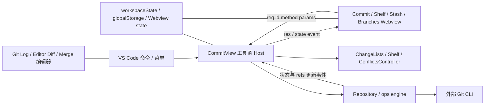

# vs-idea-gittool 系统调研与 zcode-full 适配结论

调研日期：2026-10-20。参考源码：`E:/Biancheng/Ai/vs-idea-gittool`，HEAD `540de74`，package.json 版本 `0.4.0`。目标源码：zcode-full 当前检出 `e96dd63f`。本文件记录源码事实与适配判断；实施见 [整体与详细计划](right-side-git-review-implementation-plan.md)，产品规则见 [右侧审核 spec](right-side-workbench-and-git-review.md)。

## 1. 结论与调研边界

值得借鉴的是稳定工具窗、按任务分区、文件选择与提交包含范围分离、可调整的提交区、明确的操作状态、按阶段提供后续动作。zcode-full 保留自身的会话审核、冻结分组、Host 状态与工作树集成，不替换 Git 执行引擎。

用户已选择第 2 版：右侧上方文件列表与 Diff 并排，下方共享提交信息和固定操作栏。手动“提交审核”及任务完成后“生成并打开审核”直接进入此页，移除旧审核主弹框。

本次逐项追踪参考项目的入口、Webview、Host、Git 执行、持久化和测试源码，没有仅按 README 的功能名称推断接通程度。参考项目工作区干净，但没有 node_modules 和 dist/webview/commit.js；未安装依赖、未运行参考项目或其测试。用户截图为 Branches 页，并非 Commit 页。以下交互事实来自源码；布局稿不是运行截图，也不证明性能或正确性。

## 2. 系统结构与职责

| 层次         | 当前源码                                                                            | 已确认职责                                                                         |
| ------------ | ----------------------------------------------------------------------------------- | ---------------------------------------------------------------------------------- |
| 扩展注册     | `src/features/index.ts`、`src/features/commit/index.ts`、package.json contributes   | Activity Bar Commit 工具窗、底部 Git Log、Worktrees、命令与快捷键                  |
| 工具窗 Host  | `src/features/commit/view.ts` / CommitView                                          | 组合状态、注册消息处理、导航显示、提交/文件操作与结果反馈                          |
| Webview 页面 | `src/webview/commit/main.tsx`                                                       | Commit/Shelf/Stash/Branches 导航，ready 握手，state 事件订阅                       |
| 文件与消息   | `commitTab.tsx`、`changesTree.tsx`、`commitPanel.tsx`                               | 树、选中、勾选、提交信息、分隔条和动作                                             |
| 传输         | `src/host/webviewHost.ts`、`src/webview/lib/rpc.ts`                                 | 请求 ID 关联响应、事件广播、主题投影；大量处理参数使用 any，不是本仓库严格协议模板 |
| Git 模型     | `src/git/repository.ts`、`manager.ts`                                               | 仓库发现、HEAD/status/refs/remotes/stash 缓存、watcher 与刷新                      |
| Git 执行     | `src/git/exec.ts`                                                                   | spawn 外部 git，argv、cwd、环境、stderr 进度与取消                                 |
| 操作模型     | `src/features/ops/engine.ts`                                                        | 将 Git 结果分类为 success/conflicts/localChanges/stopped/error                     |
| 专用功能     | `features/log/`、`features/localHistory/`、`commit/shelf.ts`、`commit/conflicts.ts` | 日志、内容快照、Shelf 与冲突解决各自拥有业务状态                                   |

参考项目依赖 VS Code 提供窗口、编辑器、文件监听、主题、工作区存储和通知。zcode-full 的 Electron/Web、服务注入与远程 Host 不具备同一平台前提，必须逐层适配。

## 3. 工具窗导航与保活

源码依据：`src/features/commit/index.ts:23`、`view.ts:103`、`src/webview/commit/main.tsx`。

- Webview 注册 `retainContextWhenHidden: true`，工具窗隐藏时保留上下文。
- Commit、Branches 的主体用 display 隐藏，保持组件挂载；Shelf、Stash 使用条件挂载。这不是所有页面统一永久保活。
- tab 通过 Webview getState/setState 保存；Stash 仅在存在记录时显示，旧 Stash tab 无内容时回退 Commit。
- 命令 `reveal(tab)` 先登记 pendingTab，再执行工具窗 focus；已连接则发 selectTab，未就绪由 ready 返回 tab。
- Commit File 会精确设置包含文件后打开 Commit，并请求聚焦提交信息。

适配：zcode-full 继续由 useAppPanels 管理现有右侧，只发 activate/ensure-open 意图；不能用 toggle 实现“打开审核”。工具分类不等于销毁资源。审核控制器不能跟随页面隐藏而重新挂载。

## 4. 文件列表与范围语义

源码依据：`src/webview/commit/commitTab.tsx:34`、`changesTree.tsx`、`src/features/commit/changelists.ts`、`src/shared/commitProtocol.ts`。

| 项目       | 参考实现事实                                                                    | zcode-full 适配规则                                                                                     |
| ---------- | ------------------------------------------------------------------------------- | ------------------------------------------------------------------------------------------------------- |
| 选中与勾选 | selection 与 included 是不同集合；右键操作使用 selectedFiles，提交使用 included | 单击预览与 checkbox 提交范围分离，不以预览选择触发 git add                                              |
| 文件身份   | changeKey 是 root + NUL + path                                                  | 业务隔离继续用 workspaceIdentity + 会话；文件 key 在执行 scope 内使用相对路径，不能只按 path 跨仓库去重 |
| 分组       | changelist、unversioned、ignored、conflicts，可按目录/仓库嵌套                  | 本轮使用既有审核组、会话范围、未暂存/已暂存，不引入持久 changelist 领域                                 |
| 三态勾选   | makeCheckState 根据后代文件计算 on/off/mixed                                    | 目录/当前筛选的批量动作需明确范围；不得因搜索扩大最终提交集合                                           |
| 默认勾选   | 默认空；配置 includeActiveChangelist 可纳入新变更                               | 保留当前会话范围和既有审核策略，不照搬默认空或自动纳入新文件                                            |
| 目录与文件 | 文件名、目录提示、状态色、重命名前路径；组计数                                  | 使用本仓库文件图标与语义主题，长路径可读，rename 保留来源信息                                           |
| 刷新       | sync 清理消失文件的 included/assignment，seen 识别新增文件                      | 不修改冻结证据；刷新后新文件不得被旧人工确认自动授权                                                    |
| 范围 owner | Host ChangeLists 管理包含集合，Webview 维护交互投影                             | 继续使用 Host GitReviewWorkspaceState.excludedFiles 等字段版本；不新增第二份已接受 checkedFiles         |

参考 changelist 元信息/assignment 有持久化；included 是该 Host 对象内的 Set，不能据其 UI 恢复功能声称所有勾选都跨重启持久化。

## 5. Diff 的真实位置与版本

源码依据：`src/features/commit/view.ts:345`、`src/host/gitContent.ts`、`commitTab.tsx` onOpen。

- Commit 页不内嵌同布局 Diff。双击按设置打开 Diff 或 Source；工具栏和快捷键也可打开 Diff。
- 单文件走 VS Code diff；多文件走 vscode.changes。版本取 HEAD/WORKTREE，新增、删除、空仓库与冲突有分支处理。
- GitContentProvider 为指定 revision/blob 提供内容；源文件侧可为真实文件 URI。

zcode-full 已确认第 2 版要在右侧内同时放文件与 Diff，因此需要自己的嵌入组合。复用现有 Diff 渲染器与文件读取 hook，明确：冻结审核显示 review/group.files.patch，实时范围显示注明版本的 working/index Diff，合并候选显示对应 integration 证据。读取失败不能替换为空补丁或成功状态。

## 6. 提交信息、按钮与提交命令

源码依据：`commitTab.tsx:394`、`commitPanel.tsx:20`、`src/features/commit/view.ts:373`、`gitOps.ts` / commitChanges。

1. Split 垂直分隔文件树与消息面板，保存 splitter；参考初始第二区 290px、最小 120px，仅说明其设计，不作为本仓库固定值。
2. 消息编辑器占剩余高度，底部按钮单独一行。支持历史、Amend、作者、sign-off 等选项。
3. 消息先投影至 Webview state，再延时发 saveDraft 到 workspaceState。历史最多保留 25 条。zcode-full 已有 Host 字段版本，不复制这里的全工作区单草稿或计时写入路径。
4. doCommit 发 message/amend/push/keys，busy 防同端重复点击；Host 再检查非空消息/范围和冲突。
5. 普通提交使用 git commit --only 选定路径；新文件先 add；merge/cherry-pick/revert 中改为暂存选中路径并提交 index。参考实现不是 zcode-full 冻结审核的同义提交模型。
6. 提交成功清消息和 Amend；Commit and Push 后打开现有 Push 命令。zcode-full 的分组游标、来源/目标发布及多远端部分成功必须按原收据推进，不能用一个 ok 布尔值抹掉分项事实。
7. Ctrl/Cmd+Enter 提交，另有 Commit and Push 快捷键。zcode-full 保留快捷键仅触发当前允许的提交，推送继续独立预览和人工确认。

本轮直接采用“消息编辑区可调整、主动作固定、错误靠近动作”；Amend、改作者、额外 rename commit 不进入此次审核侧边化。

## 7. 刷新、持久化与错误边界

| 参考事实                                                                                   | 适配结论                                                                       |
| ------------------------------------------------------------------------------------------ | ------------------------------------------------------------------------------ |
| Repository 同时知道 gitDir/commonDir；监听工作目录、Git 目录及共享 refs                    | common directory 是共享资源边界的参考，不替代本仓库 writer permit 与 Host 路由 |
| scheduleRefresh 合并 status/refs 标记；runRefresh 合并读请求；batch 暂停自动刷新后统一读取 | batch 的源码职责是刷新协调，不能据此认定它是跨进程写锁或多步事务               |
| CommitView 订阅仓库与领域事件，合并推送 state；ready 可重新取完整状态                      | 借鉴明确握手和重取投影；本仓库仍按 owner/revision/replay 规则恢复              |
| Webview 小状态、workspaceState 配置/草稿、globalStorage 内容分别保存                       | 展示偏好、审核事实、Git 操作收据必须分开；不能合并到一个 sidebar store         |
| GitError 含 args/exit/stdout/stderr，Host 通知可跳到 Git Console                           | 使用现有结构化错误、日志与转交 AI；日志需脱敏，原始命令不直接暴露凭据          |
| ops engine 返回多类结果，冲突有专用控制器                                                  | 本仓库应维持明确状态机与恢复入口，不仅在 catch 中显示 toast                    |
| 部分实现使用同步 fs IO 与宽松 any 参数                                                     | 本仓库按 AGENTS 采用异步 IO、严格类型与运行时 schema，不机械迁入               |

## 8. 全量能力对照与取舍

下表用于总体路线；本轮优先范围依然是右侧审核。zcode-full “未见通用入口”仅限当前已检查产品服务和 UI，不评价终端命令能力。

| 能力                                 | 参考实现落点                                                 | zcode-full 现状与处理                                                      |
| ------------------------------------ | ------------------------------------------------------------ | -------------------------------------------------------------------------- |
| 提交工具窗                           | commit/main、commitTab、commitPanel                          | 采用已选布局，迁移当前审核，第一阶段交付                                   |
| 分支搜索/树/操作                     | commit/branchesTab、ops/branchesTab、branches、branchActions | 当前分支读取/创建/切换/删除复用；远端跟踪和搜索后续增强                    |
| Log 与提交详情                       | features/log、webview/log                                    | 先把已有提交图接入 Git 子页；更完整筛选、详情另做                          |
| Remote/Fetch/Update                  | ops/remote、update、engine                                   | 现有发布目标读取复用；配置维护、网络 Fetch 与仅快进更新分阶段增加          |
| Shelf                                | commit/shelf、webview/commit/shelfTab                        | 独立应用补丁库，不能等同 Git Stash；本轮不新增                             |
| Stash                                | commit/view 的 stash handlers、git/repository、stashTab      | 后续需 common-dir 协调、OID 校验、apply 冲突恢复；不只增加标签             |
| 人工冲突解决                         | conflicts、conflictEditor、mergeTool、shared/mergeModel      | 当前工作树候选流程保留；未来补文本三栏及二进制等分流                       |
| 通用 merge/rebase/cherry-pick/revert | ops/engine 与 ops/index                                      | 不替换当前受控集成；每类操作需独立状态、确认、继续/中止与恢复              |
| Worktrees                            | ops/worktrees                                                | 继续用本仓库已有绑定、归档和集成 owner，参考项目新窗口习惯不复制           |
| Local History                        | localHistory/recorder、store、view                           | 与已有备份、Git 历史是三个领域；成本含快照体积/隐私/保留期，独立评估       |
| blame/选区历史                       | log/inlineBlame、annotate、history                           | 面向编辑器的功能，非审核侧边化前置条件                                     |
| 主题/平台                            | webview/lib/base、vscode.css、图标资源                       | 采用本仓库 DESIGN.md、text-ui-\*、服务注入和现有图标，代码迁用前另审许可证 |

## 9. 测试资产与证据分级

参考项目有 `test/commit.test.ts`（选定文件提交、Amend、rollback、patch、stash、冲突等）、commitGaps、branchActions、log、merge、localHistory 等测试。`scripts/test.mjs` 通过 esbuild + vscode stub 运行 node:test。`test/e2e-commit.mjs` 等由 `scripts/e2e.mjs` 启动 VS Code；脚本当前默认 Linux 下载路径，不能直接宣称 Windows 已可运行。`scripts/layout-check.mjs` 比较主题切换前后的元素位置，说明布局可回归检查，不证明任何主题都已通过。

可借鉴的验证策略：真实临时 Git 验证文件范围；服务桩隔离模型/网络；生产共享组件验证交互；运行壳验证焦点和资源生命周期；代表性尺寸截图测几何边界。zcode-full 继续用当前 package.json 和现有测试入口，不能照搬参考项目的测试命令。

## 10. 适配时最需要避免的五件事

1. 把参考项目 `commit --only` 模型替换进现有冻结审核，导致看过的补丁与实际提交不同。
2. 把 workspace 级单草稿迁入多会话/远端环境，导致另一个会话或相同路径的其他 Host 覆盖文本。
3. 用保活页面、busy 或延迟刷新冒充提交幂等和跨进程互斥。
4. 将参考的 Shelf、Stash、Changelist、Log、Local History 全塞进此次布局重构，改变既定优先级。
5. 只将 Dialog 内容粘贴到右侧，却保留先点文件范围、隐藏审核看 Diff、返回再审核的旧交互。

调研结论支持“重组右侧审核工作区并复用现有业务链路”。新增通用 Git 能力仍按 [原能力增强规划](git-capability-enhancement-plan.md) 的服务、协调和恢复门槛推进。
