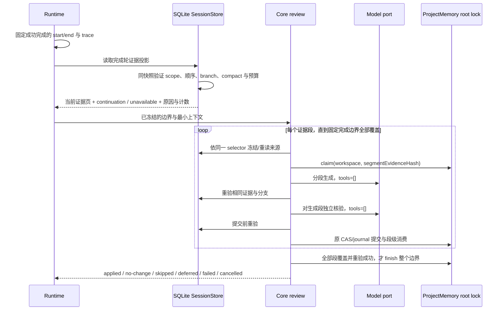

# 完成轮次自动记忆：代码调查与修改方案

日期：2026-10-19。调查源码基线：`e34ea186`。状态：P0-A、P0-B、P1 已实施；最终验证见 [实施报告](workspace-memory-completed-turn-implementation.md)。

实施契约：SQLite 提供 `readMemoryReviewEvidence`，以固定 start/end、选择版本、part 游标和文本偏移读取投影页；单页限制只控制工作集。Core 按 Model 能力决定页粒度，逐页生成、独立核验、重验与提交。每页 source revision 对应原 learning owner 的消费键，重试重放已消费页而不重复调用模型；只有遍历到 end 才允许整轮 cursor 前进。没有证据返回 deferred，不生成空成功。旧 adapter 保留原有有界窗口与 fail-closed 行为。

长正文实现约束：ProjectMemory 提供带完整文件 revision 的字节页读取。审核候选可携带可信 core 赋值的 `range`，仅替换已冻结页；writer 以原完整文件 hash 做 CAS，通过流式拼接保留未见正文，并流式保存完整前像与计算 afterHash。模型不能声明任意 range 或降低完整文件 CAS。Markdown 仍是普通文本文件，长文件、前像与 journal 数量不再使用原业务容量作为总上限。单次模型响应仍按模型上下文能力校验。

取消契约覆盖前像复制：journal 必须把同一 AbortSignal 传到 MemoryStore 的 reserveChange、流式读取和原子发布检查；取消后不发布新前像或 prepare 记录，已有 Markdown 与 journal 保持原样。

读取性能：采用 message → part 两层 keyset，文本页续读直接定位原 part，不能为用户长文本的每页排序扫描全部工具分片。SessionStore 同一连接最多保留一条不含正文的控制证明派生缓存，键为选择摘要，失效代为 SQLite `data_version + total_changes()`；任意本连接写入或外部连接提交均重验。正文与执行事实仍每次从原行重读，不用缓存掩盖来源变化。

轻量消息以 16 条为批处理，大量 part 的消息单独读取；可见性检查只针对当前正文批，不提前扫描未来消息的全部 part。同一连接最多保留 32 个已编译的查询语句以复用 SQL 编译；它不保存参数、查询结果或正文，不影响来源重读与写入失效规则。

显式恢复入口：Core `AgentRuntime.retryMemoryExtraction({startMessageId, boundaryMessageId, turnId})` 只接纳调用方明确提供的完成边界，经原 memory root 初始化、同一 scheduler、来源证明与段级 learning claim 恢复。它不发送新的用户轮次，不覆盖当前前台指针，也不在 `resumeFromStore` 中调用。自动恢复历史付费生成仍被禁止；不增加 Main/Renderer 队列或新的 UI 状态所有者。

历史读取采用原 ProjectMemory owner 的 `listHistoryPage`，按 createdAt 降序、id 升序续读，游标绑定 root。`MemoryReview list` 与 `MemoryHistory list` 返回 `nextCursor`，继续读取不受原 100 条总数限制。提案列表只读取不可变摘要；大提案的页索引保存可验证 owner 和摘要，不为了列出历史而把全部正文拼接进内存。旧全量 port 保留兼容，新的工具调用优先使用分页能力。

用户要求在原日志丢失后，依据当前项目确定代码问题并给出系统性修改方案。本次使用合成会话、临时 SQLite、fake model 和测试提交端口；没有调用计费模型，没有写入个人记忆。旧会话每次失败的具体原因已经无法逐一还原，以下确认结论来自当前源码与可重复复现。

## 用户补充：记忆内容不设固定字数上限

本节记录 2026-10-19 的用户补充要求，取代上一版方案中继续保留 6000/4000 字符等内容总上限的建议。下文调查表描述实施前的代码缺陷，不代表新的产品限制。

- 记忆正文、一个完成轮的有效证据、提案内容与记忆库总量，不因固定字数、字节、消息或分片数量被截断、跳过或永久停止处理。
- 单次数据库读取、传输、模型请求和文件操作仍需控制工作集。采用分页、分段生成与核验、流式读写；每批大小只决定处理粒度，不决定记忆的总长度或覆盖范围。
- 模型的实际上下文窗口和最大输出能力是请求边界。每批按当前 Model 的公开能力、实际编码开销和输出预留确定可用空间，超过一批继续处理，模型请求总次数随段数变化。
- 分段进度与完成轮消费状态分开。只有全部计划证据段处理完成且来源仍有效，才能将整个完成边界记为已处理；取消、失败或资源不足保留未完成状态与原因。
- 召回时按相关性选择适合当前模型的一批内容，保留继续读取能力；完整正文仍可访问。分页大小、检索批量或当前上下文注入量不能变成记忆库容量上限。
- 正文仍按稳定、可复用和有来源支持的事实提炼。来源校验、权限、路径、身份、CAS、租约和取消规则继续生效。

## 结论与依据

主要缺陷在证据读取、结果分类和测试覆盖。当前提取器先取得包含工具完整输入输出、reasoning、step 和各种元数据的原始窗口，再抽取少量可见文本。与记忆无关的数据先消耗硬预算，使仍有真实用户输入的完成轮次无法进入生成阶段。此前分片保存和工具调度优化没有改变这个读取契约。

| 编号 | 已确认行为                                                                                                                               | 当前代码位置                                                                                                                            | 影响                                                                                                   |
| ---- | ---------------------------------------------------------------------------------------------------------------------------------------- | --------------------------------------------------------------------------------------------------------------------------------------- | ------------------------------------------------------------------------------------------------------ |
| D1   | 从尾部按完整 message + parts 准入；原始字节 256 KiB、消息 256、parts 1024 任一超限都会停止向前读取                                       | `adapters/src/storage/session-store/repositories/transcript-window.ts:134`；`contracts/src/interfaces/session-store/transcript.ts:20`   | 大工具结果、累计工具数据、reasoning 数量或长轮次将真实用户消息排除在窗口之外                           |
| D2   | 后台准入、生成、核验、应用重读共用相同原始窗口能力                                                                                       | `core/src/runtime/helpers/project-memory-extraction.ts:71`；`core/src/memory/review-session-evidence.ts:129`                            | 只修改最外层调度不能修好完整链路                                                                       |
| D3   | 已准入之后，生成前重读无有效材料会生成空 draft，再被当成普通 no-change；Runtime 记录 completed 并推进 cursor                             | `core/src/memory/automatic-review-learning.ts:18`；`review-generation.ts:78`；`automatic-review.ts:73`；`extraction.ts:183`             | 证据暂时不可用与模型确实判断无需记忆混在一起；本地 cursor 误推进，但该路径没有消费持久 learning ledger |
| D4   | 窗口读取、作用域、分支、缺少用户等异常统一记录 `memory.extraction.window_unavailable`，不含稳定原因和计数；部分准入/调度跳过没有业务结果 | `core/src/runtime/helpers/project-memory-extraction.ts:118`；`core/src/memory/extraction.ts:167`                                        | 日志存在也难以确定失败层次                                                                             |
| D5   | 6000 字符文本预算按时间正序取前缀；长用户文字可让最终助手结论完全缺席                                                                    | `core/src/memory/review-session-evidence.ts:220`；`core/src/session-context/session-history-search.ts:62`                               | 能进入模型，但关键完成事实缺席；不能据此断言真实模型一定会错记                                         |
| D6   | 工具证据先取最后 12 个工具，再筛选 execution；末尾 12 个无结构化状态的工具可挤掉之前有效的退出状态                                       | `core/src/memory/review-tool-evidence.ts:12`                                                                                            | 有界执行证据覆盖不足                                                                                   |
| D7   | 提取快照复用旧 Memory agent context，额外保留 providerEntries、readFileState、tools；窗口读取在 scheduler 队列准入之前已经开始           | `core/src/runtime/helpers/project-memory-agent.ts:66`；`project-memory-extraction.ts:58`；`extraction.ts:224`                           | 无用浅拷贝与对象保留；队列容量不能避免已发生的读取开销。尚未将其量化为真实会话内存故障                 |
| D8   | 既有预算测试将巨大结果放在更早轮次，当前短轮仍完整；通用验证脚本没有枚举 runtime helpers 的提取测试和 `turn-complete-memory.test.ts`     | `adapters/src/storage/session-store/transcript-window-budget.test.ts:27`；`scripts/verify-agent-memory-and-composer-predictions.mjs:28` | 缺少“巨大数据位于同一完成轮内”及完整触发链的回归覆盖                                                   |

表中缩写目录均位于 `apps/lcode-cli/packages/`。它们是当前源码位置，不表示已经完成修复。

## 本次隔离复现

本地调查脚本和结果保存在 `.artifacts/memory-evidence-analysis-20261019/`，属于不提交的调查产物。前七项连接真实 SQLite 与真实提取 helper，模型和记忆提交端口为 fake；其余项使用现有测试 harness 或纯函数。临时数据库执行后清理。

| 场景                                       | 实测结果                                                                   |
| ------------------------------------------ | -------------------------------------------------------------------------- |
| 短用户输入与最终回复                       | 窗口 3 条消息；2 次 fake 请求、1 次 fake apply                             |
| 本轮单个 270000 字符 Read 输出             | 窗口仅剩最后 1 条助手消息；0 次模型请求；window_unavailable                |
| 本轮 50 个、每个 10000 字符的工具输出      | 窗口只剩 25 条消息、254029 原始字节；没有真实用户；0 次模型请求            |
| 本轮一个助手消息含 1100 个 reasoning parts | 仅剩最后 1 条助手消息；0 次模型请求                                        |
| 用户之后 300 条中间助手消息                | 读到 256 条消息，用户缺席；即使原始字节仅 93178 仍跳过                     |
| 用户文本超过 6000 字符                     | 2 次 fake 请求，但生成证据不含最终助手事实                                 |
| 同一轮用户之后发生 compact                 | 原始窗口完整，活动证据却只剩最后助手；0 次模型请求。此为当前明确的保守规则 |
| 准入成功，生成前重读丢失锚点               | 0 次模型请求，outcome 为 completed，cursor 已推进；复现 D3                 |
| 有效 Bash execution 后跟 12 个未知状态工具 | execution 投影为空，partial 为 true                                        |
| 一次提取执行返回 error，随后不再 schedule  | 调用仅 1 次、cursor 未推进、pending 为空；没有隐式重试，符合当前规则       |

既有相关回归实际执行 88 项，全部通过，包括两项真实冷 Runtime / SQLite / CAS 集成。复现新增缺口与现有测试通过同时成立。本次没有新版本实际性能对照；单次探针耗时不作为 P95。

## 当前规则与保留边界

- 成功的普通主会话轮次触发自动提取；取消、失败、受限 automation/off-peak、单轮明确 skip、远程 workspace 和缺能力等仍按现有边界处理。
- `MemoryReview create/read/list`、受控 apply、undo 会隔离整个前台复盘轮，避免未采用提案再次进入记忆。当前测试明确要求如此，本轮不把这些保护统称为 bug。
- 没有可学习用户语义、系统通知和已受控完成的直接记忆写入仍可合法跳过。现有三汉字/三分词门槛按用户补充要求纳入移除范围；有事实或记忆意图的短输入不以字数拒绝，适格性由真实来源与受控审核决定。
- compact 摘要不属于原始证据。方案只在原始用户与助手证据仍可证明时恢复覆盖；只有摘要时仍跳过。
- 已失败、busy、容量不足的提取不会后台无限重试。重新打开历史会话也不会自动进行付费补提取。重试策略的扩展须另行明确计费与取消规则。
- 工作区身份继续使用 `workspaceIdentity?.trim() || workspacePath`；路径用于 IO 和展示。所有模型仍经现有 Model port，适用于符合自动提取边界的 OAuth 与 API，不增加供应商特判。

## 所有者与事件顺序

| 事实/状态                                             | 唯一所有者                         | 修改原则                                                             |
| ----------------------------------------------------- | ---------------------------------- | -------------------------------------------------------------------- |
| 完成轮的 start/end、执行调度与取消                    | Runtime                            | 使用已收口的完成边界，避免临时读取 latest 指针决定目标               |
| 会话顺序、真实用户身份、rewind、compact 与来源读取    | SQLite SessionStore                | 同一读取事务完成证明与投影；沿用原连接、顺序与身份规则               |
| 证据哈希、生成、核验和结果分类                        | Core memory review                 | 共用同一版本化证据选择器，不建立第二份内容库                         |
| learning claim/finish/release、CAS、journal、Markdown | 原 ProjectMemory adapter/root lock | 保留 fencing token、独立核验、来源重验与原子提交                     |
| Desktop/手机呈现                                      | 现有 Host/projection/UI            | Desktop continuous 与手机 replayable 分别投递，消费同一 Runtime 事实 |

## P0-A：为自动记忆提供正确的有界证据接口

1. 在 `SessionStorePort` 增加可选的完成轮记忆证据读取能力（拟名 `readMemoryReviewEvidence`），提供严格类型和运行时 schema。保留 `readTranscriptWindow` 的完整消息契约，其历史搜索、其他会话消费者和旧 adapter 行为不因本次修改而改变。
2. 输入包含 session、已收口的开始用户与结束助手边界、可信 turn 关联、当前页 cursor 和单批工作集参数。Runtime 优先复用现有 stable completion boundary；存储端重新验证真实用户、结束助手成功、顺序、身份和分支，不能只相信传来的 ID。多个 inline guide 的完成区段沿现有产品轮定义，不能把未完成未来输入拼进本轮。
3. 返回 DTO 包含完整性证明、用户/助手可见文本片段、合格 execution 事实、选择版本、稳定失败原因和计数。它不是删过 parts 却仍声称完整的 `MessageWithParts`；普通工具输入输出、reasoning、step 和巨大 anchor 列表不返回 Core。
4. SQLite 在同一事务内按字段选择、裁剪、计数，再返回 JS；禁止先全量反序列化后过滤。仍需读取并验证前台复盘/compact 等控制标记，不能把它们与无关工具输出一起丢掉。
5. 移除 6000 字符证据、4000 字符旧记忆、20000 编码字符及固定 6000 输入 tokens 等业务总上限。每次模型请求按当前模型上下文、最大输出、真实编码开销和必要预留适配；完整证据与已有记忆分段读取、生成和核验。候选与 execution 按批处理并可继续读取，不以 3 个候选、2 个文件或 12 条 execution 作为整轮覆盖上限。
6. 元数据与正文均采用稳定分页 cursor，单页的行数/返回字节可设命名工作集参数；达到单页容量必须返回 continuation，不能把它当成整轮 `metadata_scan_limit` 终态。cursor 绑定 session、scope、完成边界、branch generation、选择版本、消息/part 顺序与必要文本偏移；证明翻页过程中无遗漏、重复或未来内容。扫描成本须单独实测；SQLite 内部解析原 JSON 仍可能随工具体积变慢。若实测需要索引列或 schema migration，另行与维护者确认后实施。
7. 先定位完整用户约束和最终回复，再以保持顺序、否定条件与语义边界的分段处理全部有效正文；跨段需要带相邻原文和来源引用。不能把若干前缀/后缀或模型摘要当成全文已覆盖。单段 partial/hasMore 与整轮完成分开，读取偏移不能拆坏 UTF-16 surrogate；超出模型单次输出的记忆内容可续写为多个经核验的段并交由原内容所有者组装或关联。
8. compact 不再按“看见标记就清空之前整轮”处理新投影：原始完成区段、当前分支与存储内原文均可证明时，排除派生摘要后选择原始片段；证明不足返回 `compact_only`/`branch_unprovable`。不使用摘要补造用户输入。
9. 调度、生成前冻结、核验、apply 和 learning finish 前重读统一使用相同的 selector 与投影算法。可采用新 `projection: completed-turn-v2` 区分；source ID/revision/learning key 纳入版本、起止边界、scope、branch generation、控制选择、证据段范围与实际投影正文。逐段去重与整个完成边界的覆盖记录分别维护，全部段处理完成才 finish 整个边界。旧 `latest-turn`/`review-v1` 保持旧解析与重读，旧提案不会在新算法下被误判有效。
10. 新 adapter 使用新能力；旧 adapter 只保留原有有界读取兼容路径并报告能力/覆盖情况，不回落 `messages()` 全历史，不自动扫描其他会话。

### P0-A3：记忆正文与召回的完整可访问性

- 记忆存储与读取一并移除内容总上限：核对 `PROJECT_MEMORY_FILE_MAX_BYTES`、`PROJECT_MEMORY_REVIEW_TOTAL_CHARACTERS`、review item/schema 内容长度、journal/preimage 容量及 recall 的文件数/语料总量限制。长逻辑记忆支持流式完整读取、分段编辑与核验，仍由原 Markdown/CAS/journal owner 提交；历史和去重账本通过分页或分片维护，达到单页容量不再永久阻断后续学习。磁盘不足等真实资源故障明确报告，不假报完成或自动删除知识。
- 召回保留按当前上下文选择相关内容的行为，同时支持按来源继续读取全部正文；200 个文件、4 MiB 语料、单条 4000/总 12000 字符等现有值不能成为记忆库收录与可读范围的固定上限。目录与索引按批维护，不强制将全部记忆同时注入模型。
- 单页 schema、工具帧和模型输出都允许有限工作集；长逻辑内容以受控段引用承载并校验完整 revision，最终内容由原写入所有者组装或分主题关联。不得只移除 `.max()` 后把任意大正文一次性装入 JSON/内存，也不得降低原 CAS、完整 before 和来源核验要求。
- 长任务的段级断点与 lease 在原 root lock/learning owner 下管理；当前 120 秒请求预算、180 秒租约属于单次工作与执行权边界，不能变成全文长度上限。分段 claim 或受控续租需保留 fencing，全部段完成前不得消费整个证据边界；取消与失败保持可恢复未完成状态。

## P0-B：结果分类、cursor 和可诊断性

1. 拆开“有效证据经模型判断无变化”和“没有取得有效证据”。无证据、失去锚点、来源过期、busy/full 等返回具体 deferred/failed；禁止以无来源空 draft 经 `no-change` 推进 cursor。
2. 分段读取和执行可推进已完成的段级进度，但只有全部有效证据处理完成、模型明确无变化/候选拒绝且来源重验成功，或已持久消费，才允许推进整轮消费 cursor/finish。部分成功后失败不得将未处理段标为完成；重开与明确重试通过同一原所有者恢复并去重。明确策略跳过可记录为终态，但不能伪装成已生成或已学习。
3. 每个完成边界记录一条脱敏终态。阶段区分 admission、generation、verification、commit、finish；原因区分 disabled、remote-disabled、missing-capability、missing-boundary、branch-unprovable、compact-only、no-user-prose、foreground-review、metadata-scan-limit、evidence-unavailable、learning-busy/full、source-stale、model-failed、output-truncated、queue-overflow 和 cancelled。
4. 日志只包含 trace/session/turn/boundary 关联、计数、耗时、模型请求次数、applied/rejected/conflicts 与稳定原因。不记录对话、候选正文、工具命令/输出、根路径或 provider 原始错误。超时和显式取消分开诊断，均不得继续提交或误消费。
5. 这一阶段先交付服务日志与测试断言；跨重启可见的最后结果和 UI 展示放到 P1，避免为定位日志立即增加一套状态系统。

## P1：调度成本、恢复入口与可见结果

- 大文件召回使用可选 `iterateContentPages` 受控异步迭代能力：完整原始 hash 扫描一次，再以同一 revision 流式验证并返回 UTF-8 页，完整消费后再次验证目录身份。随机编辑仍走原 `readContentPage` 完整版本核验，不能用文件大小或时间戳替代提交前的全文 hash。避免逐页反复扫描整文件导致成本随文件长度平方增长；中断、旧编码或来源变化仍明确失败。
- 复用既有召回并发工作池（8 个文件），并发数与候选正文保留量固定；每个文件完成校验后才发布统计或候选，读取失败不能留下半文件索引。总文件数不决定可读取范围，也不把全部文件正文保留在 Promise 结果中。

- 让自动审核捕获最小上下文：model、root/identity、workspace/cwd、候选选择器、trace/causation 和完成边界；复用旧 agent context 的其他调用保持不变。移除自动提取对全量 providerEntries、tools、readFileState 的无用保留。
- scheduler 在读取证据前完成轻量描述符准入；同一 owner 串行读取和执行，读取阶段也可取消。队列保持有界，溢出的旧边界记录明确 deferred/overflow，后续一个新 turn 不代表旧 turn 已被处理。
- execution 先按可信结构化 schema 筛选，按批保持可追溯顺序并允许续读；unknown、后台启动、非零退出与取消均保留真实语义，不从 stdout 或助手文字推断测试成功。
- 如需跨重启诊断，复用现有 `session_entry` 保存有界的脱敏提取结果与证据引用，登记 entry type/schema，不新增业务表、不放进 Main、relay 或 Renderer accepted queue。UI 通过既有 service/hooks 展示“未触发原因/已评估无变化/已写入/失败待重试”。
- 重试入口只针对用户明确指定的未消费完成边界，再经过同一 scope、来源校验、claim 与 CAS。默认不循环重试、不在 cold resume 时自动追补历史付费请求；若将来要求自动追补，单独设计预算、幂等和取消规则。

## 实施拆分与涉及文件

| 交付                     | 主要文件/目录                                                                                                                                                                      | 提交验收                                                                         |
| ------------------------ | ---------------------------------------------------------------------------------------------------------------------------------------------------------------------------------- | -------------------------------------------------------------------------------- |
| P0-A1 契约与 SQLite 投影 | `contracts/src/interfaces/session-store.port.ts`、`session-store/transcript.ts`、`project-memory.port.ts`；`adapters/src/storage/session-store/repositories/` 与对应 store methods | 真实 SQLite 有界读取、起止/分支证明、返回字节与扫描计数；旧窗口回归不变          |
| P0-A2 端到端证据接入     | `core/src/runtime/methods/turn-complete.ts`、`helpers/project-memory-extraction.ts`；`core/src/memory/review-session-evidence.ts`、`review-validation.ts`、`review-common.ts`      | 同轮大工具/分片/长轮/compact 均能取得真实证据，生成与独立核验后走原 CAS          |
| P0-B 结果与诊断          | `core/src/memory/automatic-review-learning.ts`、`automatic-review.ts`、`review-generation.ts`、`extraction.ts` 及 helper                                                           | 无证据不能 no-change；cursor、learning ledger、取消、阶段日志一致                |
| P1 最小捕获与队列        | `helpers/project-memory-agent.ts`、`project-memory-extraction.ts`、`extraction.ts`、`review-tool-evidence.ts`                                                                      | 去掉无用捕获，先准入再读取，保留现有 owner/lease/residency 与 overflow 边界      |
| 覆盖与可重复入口         | 既有 transcript/window、memory、Runtime helper、完成轮和 bootstrap 集成测试；`scripts/verify-agent-memory-and-composer-predictions.mjs`                                            | 显式补入 Runtime 提取 helper、diagnostics、turn-complete-memory 和新存储投影测试 |

每个功能级改动独立提交，先补测试证伪旧实现，再实现。新增源文件遵循 CLI 每文件 400 行规则与公开包边界。

## 验收矩阵（实施后的覆盖对应关系）

| 用例      | 设置与操作                                                        | 必须断言的结果                                                                                       | 状态                                   |
| --------- | ----------------------------------------------------------------- | ---------------------------------------------------------------------------------------------------- | -------------------------------------- |
| MEM-EV-01 | 本轮单个大 Read、累计大工具、1100 reasoning、300 消息四种样例     | 全部有效证据可分段遍历；敏感工具正文不返回模型；fake 请求数随段数变化，生成与独立核验后真实 CAS 写入 | SQLite、Runtime 与性能夹具覆盖         |
| MEM-EV-02 | 大数据放在更早轮，随后短轮                                        | 旧窗口和新接口都不回读未来/整库；已有 88 项相关回归继续通过                                          | 全量回归入口覆盖                       |
| MEM-EV-03 | 用户或中间进展超过单批容量，最终结论短                            | 最终结论及完整用户约束均能分段审核；无永久截断，段级 partial 不代表全轮完成，surrogate/否定语义保持  | 长文本、UTF-8、相邻原文测试覆盖        |
| MEM-EV-04 | 准入成功，生成前锚点删除/分支改变                                 | 零模型请求，明确 deferred/failed，cursor 与 ledger 不消费                                            | 缺失证据和 stale 测试覆盖              |
| MEM-EV-05 | 生成后、核验前、每项 apply 前分别改来源/branch generation         | 停止后续请求或写入；旧 lease 无权提交；修改正文不能被旧候选覆盖                                      | source、verification、CAS 回归覆盖     |
| MEM-EV-06 | compact 跨当前用户；原文完整/仅摘要两种                           | 原文可证明时只读真实区段；仅摘要时零请求并有具体原因                                                 | 原文与派生摘要隔离测试覆盖             |
| MEM-EV-07 | MemoryReview create/read/list、apply、undo 及其摘要               | 保留污染隔离；普通历史列表不误抑制；工具输入不能伪造身份或批准                                       | 控制标记、工具权限与分页测试覆盖       |
| MEM-EV-08 | 已消费、两个 Runtime 抢同证据、租约过期、容量满                   | 保持 at-most-one claim、fencing、去重；deferred 不推进 cursor                                        | 原 root lock、learning 与恢复回归覆盖  |
| MEM-EV-09 | close/shutdown、读取等待取消、请求超时与用户取消                  | 后续零新 IO/模型/写入；终态与原因准确；无幽灵后台保存                                                | scheduler、流式取消和错误码测试覆盖    |
| MEM-EV-10 | 队列超过容量，前台连续完成多个 turn                               | 描述符先准入，丢弃项不先读取正文；每个结果可关联，旧 turn 不被新 turn 假消费                         | 惰性读取、8 项队列与 overflow 测试覆盖 |
| MEM-EV-11 | 同路径不同 identity、root 切换、远程 workspace、workflow/subagent | 维持身份/所有者/任务类型边界；新路径不读取旧根；被禁用场景零请求                                     | scope、relocation 与零 IO 准入回归覆盖 |
| MEM-EV-12 | 真实成功/失败 execution 后面追加普通 Read                         | 合格 execution 按批可完整遍历，unknown 不推断为零退出，取消/后台不算成功                             | 原生投影和旧端口 execution 测试覆盖    |
| MEM-EV-13 | Desktop 与手机分别订阅同一 attachment                             | 不新增 Agent；continuous/replayable 分别呈现同一提取事实，不因重放再次学习                           | 无新增 UI/协议状态；既有双链路回归覆盖 |
| MEM-EV-14 | 有效证据但模型明确空候选/全部拒绝                                 | 显示真实 no-change，来源重验后消费；与“没有证据”区分                                                 | no-change、拒绝与空证据测试覆盖        |
| MEM-EV-15 | 原始提案为旧 selector，升级后读取/核验                            | 旧版可读取；不套用新算法假通过；未知版本明确拒绝                                                     | selector 版本和字段规范化测试覆盖      |
| MEM-EV-16 | 重开历史、显式重试、模型错误、overflow                            | 重开不自动计费；明确重试走同一链路；失败无无限循环                                                   | 真实冷启动、失败断点和重复恢复集成覆盖 |

新增验收：记忆正文超过 256 KiB、提案超过旧 64000 字符、记忆库超过旧文件数/4 MiB 阈值、去重账本超过旧单文件容量时，均可通过分页/分段继续使用；只有实际资源故障或取消可以终止当前执行，未完成范围不能被假报消费。短而有语义的用户输入不因旧三字门槛被排除；模型上下文/输出较小时增加段数，完整内容不能因此丢失。

性能实验使用固定同一数据、预热与至少 30 次采样，报告 P50/P95、每页返回 JS 字节、总页数、模型请求次数、轻量行数、原始 JSON 扫描成本、前台轮后同步阻塞与队列保留对象。至少覆盖 2256 parts、10000 parts、单个大工具及累计多工具、长轮次和大记忆库；目标是总内容持续可处理、每批工作集有界。具体毫秒阈值以本机及 CI 基线测量后确定，不预报加速倍数。

## 验证与交付要求

- 实施后执行根 `pnpm typecheck`、`pnpm lint`，CLI 的 typecheck/lint，`pnpm architecture:check --changed` 和修改文件格式检查；区分真实失败、缓存命中与已有警告。
- 首先执行上述针对性 node:test，再运行修订后的 `node scripts/verify-agent-memory-and-composer-predictions.mjs`。它包含浏览器回归，新增 UI 状态或重试操作必须补桌面与手机 Web 的交互用例。
- 用临时 SQLite、真实 Runtime、fake provider 和真实 ProjectMemory CAS 集成证明至少一次“完成 → 生成 → 独立核验 → Markdown → consumed”；用模型请求捕获断言不包含工具输入输出或 reasoning。
- 如改动进入 Worker 间接依赖，按现有发布流程重生成 OAuth worker、声明与库存，并执行发行回归；不能再次只验证旧产物和旧库存互相一致。
- 本次交付源码、spec、回归与基准脚本；没有替换安装包、重发 tag 或调用真实供应商。

功能索引图已补充 `capability.completed-turn-memory-extraction`，关联完成边界调度、分段审核、SQLite 证据投影、显式恢复与原 learning/root writer 所有者。
