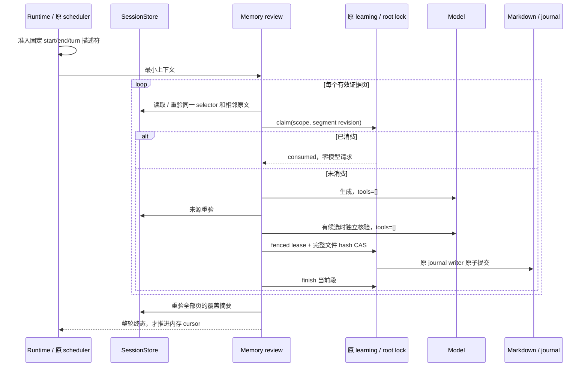

# 完成轮记忆分段提取：实施与验证

日期：2026-10-19。对应 [产品规则与验收矩阵](workspace-memory-completed-turn-evidence-plan.md)。

## 交付行为

P0-A：增加 `SessionStorePort.readMemoryReviewEvidence`。SQLite 在固定成功完成的 start/end、turn、workspace identity 和当前分支内投影用户/助手原文及可信 execution 元数据。普通工具输入输出、reasoning 和派生摘要不进入模型。消息与 part 两级游标、UTF-8/UTF-16 安全边界和相邻原文上下文共同覆盖长轮次；旧 transcript/window 的完整消息契约保留。

记忆正文、提案正文、文件数、语料、历史和学习消费记录不再受原业务总量配额阻断。每个请求、页和控制记录仍有工作集预算。长 Markdown 以完整原始 hash 做 CAS，只替换 core 冻结的字节范围，流式保留未见内容与完整前像；undo 能恢复原始字节。大提案分片存储，历史列表通过 `nextCursor` 读取摘要；原 learning owner 改为逐证据键分片，旧账本保留只读兼容。

P0-B：取得证据失败不再变成空 draft/no-change，也不推进消费游标。每段完成生成、独立核验、来源重验及 CAS 后，才由原 root lock/learning owner 消费。全部页重新验证一致后才能收口整轮。失败、来源变化、冲突、超时和显式取消均保留未完成范围；日志记录稳定阶段、原因、计数和耗时，不记录正文、工具命令、私有路径或供应商原始异常。

P1：前景只捕获 model、完成边界、scope、候选选择器和 trace。8 项待处理队列先准入轻量描述符，再串行读取；不复制前景 transcript、tools 和 read-file map。SQLite 将含大量 part 的消息单独读取，轻量消息小批读取，复用有界的已编译语句；控制证明在本连接写入或外部连接提交后失效，正文始终重读。

召回复用 8 文件并发工作池，以固定大小页遍历全语料，仅保留当前查询的一批候选正文。原生 `iterateContentPages` 将随机分页的重复全文 hash 改为顺序验证流，避免大文件扫描形成平方 IO。只有完整文件校验成功后才发布统计与候选，取消或损坏不能留下半文件索引。

## 所有者和恢复顺序



显式恢复入口为 `AgentRuntime.retryMemoryExtraction({startMessageId, boundaryMessageId, turnId})`。禁用、远程或缺少能力时，在存储 IO 前拒绝；通过后复用同一 scheduler、来源证明和消费键。冷启动只恢复前景会话，不自动追补历史付费请求。相同 selector/模型分页档位下重复恢复，不为已消费段再次调用模型。改变模型能力导致页粒度变化时会重新形成来源键，不承诺跨不同分页档位复用原请求。

没有新增数据库表或 migration，没有引入 Main/Renderer accepted queue，也没有新增 UI 重试按钮。跨重启进度由原 learning owner 持久保存，服务日志提供终态诊断；显式恢复通过上述 Core API 调用。

## 实际性能

Windows，Node **24.21.0**，3 次预热后各 **30 次**采样。SQLite 对照为“完整消息读取 + 可见文本投影”，两边都断言真实用户开头、完整正文和最终助手事实仍可覆盖。旧 256 KiB transcript window 在这些夹具中缺少证据，不能作为成功提取的速度对照。

每个样本先写入一次数据库，使控制证明失效；路径交替执行。编译语句允许像正常常驻服务一样复用。时间只包含本地读取和投影，不包含模型、网络或生成质量评测。

| 场景                            | 完整读取 P50 / P95 | 分页投影 P50 / P95   | 返回 JS 数据：完整 / 分页 |
| ------------------------------- | ------------------ | -------------------- | ------------------------- |
| 2,256 reasoning 分片 + 大 Read  | 16.50 / 18.77 ms   | 11.37 / **12.83 ms** | 3,184,441 / 40,886 B      |
| 10,000 reasoning 分片 + 大 Read | 64.72 / 68.75 ms   | 33.64 / **35.74 ms** | 11,937,422 / 40,891 B     |
| 50 个工具累计大输出             | 15.52 / 17.81 ms   | 11.28 / **13.28 ms** | 3,209,758 / 40,916 B      |
| 300 消息长轮次                  | 17.74 / 20.51 ms   | 17.26 / **18.84 ms** | 3,350,008 / 54,718 B      |

每页最多约 9 KiB 返回数据；以上四组单页调用 P95 分别为 6.06、21.30、6.30、6.94 ms。读取仍使用同步 SQLite，10,000 分片首次证明的单页最大实测占用约 22.56 ms，不能声称已经消除所有前台线程占用。scheduler 的准入阶段不读取 SQLite；数据库读取发生在描述符出队后。

真实文件系统的 **261 文件、5,324,325 字节**记忆库，在旧 4 MiB 边界之后放置检索目标。最终一轮完整采样的全量召回 P50 **1,819.67 ms**、P95 **2,037.15 ms**，返回 8,883 B，覆盖完整语料。这个结果衡量全库召回成本，不能当成模型端到端耗时或声称大库查询没有开销。

复现：

```powershell
node --import tsx scripts/benchmark-memory-evidence.mts
node --import tsx scripts/benchmark-memory-corpus.mts
```

脚本只创建合成数据与临时目录，结果写入被忽略的 `.artifacts/memory-evidence-performance-20261019/`。中途曾发现跨消息合并查询导致反复扫描大工具的回退，已改为轻量批与重消息分离，并在移动可见性检查、复用 SQL 编译后重新采样；上表采用最终实现的数据。

## 回归与边界

- 真实 SQLite：同轮大工具、2,256 分片、300 消息、长用户约束、最终助手事实、compact 原文与派生摘要、synthetic/hidden、前景复盘污染、直接记忆写入、rewind、外部连接写入失效、游标越界和 execution 元数据。
- 真实 Runtime + SQLite + 文件 CAS：冷启动、旧历史大窗口、分支切点不在旧窗口、本轮大 payload、独立核验与 Markdown 写入。8k 模型能力夹具验证中段失败后重启显式恢复，已消费段不重复请求，全部完成后再次恢复零请求。
- 文件系统：长 UTF-8/emoji/CRLF 全文分页、受控范围替换、完整前像与 undo、超大提案、超过旧历史配额、旧 learning 账本、重复 claim、租约 fencing、root 迁移、路径/链接防护、流式中途变更与取消。
- 调度与工具：先准入再 IO、队列 overflow、不捕获前景大对象、拒绝 Promise 的错误处理、禁用和远程零 IO、稳定错误码与脱敏终态、历史摘要分页及工具 continuation。
- 兼容链路：原 transcript/window、权限规则、Desktop continuous、手机 replayable、UI 设置、键盘/IME 与浏览器恢复用例。

统一验证入口：`node scripts/verify-agent-memory-and-composer-predictions.mjs`，包含 407 项 Agent/存储/Runtime、20 项 UI/协议、18 项浏览器回归。另有 21 项会话输入与持久化回归，合计 466 项。根与 CLI 的 typecheck/lint、架构检查、修改文件格式及发行输入检查另行执行。

| 检查                                            | 结果                                           |
| ----------------------------------------------- | ---------------------------------------------- |
| 根 `pnpm typecheck` / `pnpm lint`               | 通过                                           |
| CLI `typecheck` / `lint`                        | 27 / 14 个任务成功；Lint 零警告、零错误        |
| `pnpm architecture:check --changed`             | 0 违规、0 baseline、0 新违规                   |
| 修改文件 oxfmt 与 `git diff --check`            | 通过                                           |
| 会话输入/权限持久化/事务/上下文生命周期补充回归 | 21 项通过；覆盖本次按职责拆分的 store methods  |
| 发行输入检查 `--source=index`                   | 3,008 项验证通过；20 项既有 material gaps 保留 |

`pnpm verify:pre-push` 已通过。`pnpm test:release` 共 138 项，137 项通过、0 失败、1 项跳过；跳过项为 Chromium page-helper 检查，原因是未设置专用 `LCODE_TEST_BROWSER_PATH`。记忆相关的 18 项浏览器回归实际执行并通过。

Turbo 仍提示既有的 `packages/browser-use-plugin` 不在 lockfile 中；任务本身成功，这条工作区解析警告仍保留。

共享契约会进入内嵌 OAuth worker。提交前检查实际发现旧 worker 过期后，已执行 `node scripts/build-auth-plugin-worker.mjs` 与 `node scripts/licenses.mjs notices`，同步生成产物和库存 hash；许可证正文没有变化。worker 源码一致性 7 项回归通过。

影响模块为 CLI contracts、core、adapters、bootstrap，以及 provider-node 的生成产物与第三方库存；状态所有者与依赖方向不变。总变更约净增 4.5k 行，包含 spec、集成/回归测试和两套可复现性能脚本；没有新增依赖或变更数据库结构。

本次未调用真实计费供应商，也未恢复已经丢失的原会话日志。实现位于供应商无关的 Model/SessionStore/ProjectMemory 公共链路；不限定某一家 OAuth/API。旧 adapter 没有新能力时保持原有受限兼容路径，不伪装完整覆盖。原生长正文流式路径针对 UTF-8 Markdown；其他旧编码保留既有文本端口的兼容范围。macOS/Linux 的平台差异有代码与防护测试，但本次实际执行平台为 Windows。
