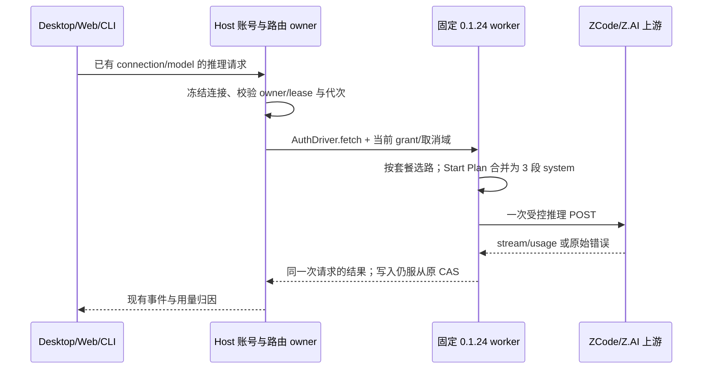

# ZCode 授权插件 0.1.24 与 Start Plan 请求兼容

## 问题与产品规则

2026-10-24：Z.AI OAuth 连接可读取模型和额度，但 GLM-5.3-Flash 推理返回 HTTP 405、厂商 code 3012。当前 JWT-only 连接走 ZCode Start Plan；内置插件 0.1.18 的 `dress()` 将 Agent system 追加为第 4 段，上游已在 0.1.21 修复。用户授权将此插件固定升级至 0.1.24。

- 仅更新 `@magpie-community/opencode-zcode-auth` 到 0.1.24，来源为 npm 发布记录的 Git commit `d1b65007ffd3e271fd1e4e95afc2b6965fc48538`；其他 14 个插件及已有兼容补丁保留原 pin。
- 原始 vendor 模块按上游字节复制，逐包 revision、版本、SHA-256、许可和生成 worker 可复现；同步脚本按 Git 对象读取，不依赖相邻 checkout 的工作区内容。登录时不下载或安装插件。
- Start Plan 推理始终发送 3 段 system；调用方的非空 system 文本按顺序合并进第 3 段，前两段与上游固定提示词一致。保留消息历史、工具、推理参数、缓存标记、流式响应及 usage。
- Start Plan 使用 0.1.24 的请求头白名单与来源字段，不携带调用方的 `anthropic-beta`、Stainless 或其他客户端身份请求头。普通 Coding Plan 与团队 Key 请求不套用 Start Plan 的 system 包装。
- 405/3012 保留厂商拒绝语义与可操作提示，不删除账号或改判凭据失效，不重放已经拒绝的推理请求。
- 升级新增团队浏览器授权方法时，保留既有方法 ID：Z.AI 浏览器 `0`、BigModel 浏览器 `1`、本机读取 `2`、API Key `3`；团队浏览器使用 `4`，站点仍由当前 channel 决定。列举方法不读取本机凭据。

## 所有者、接口与事件顺序

Host 的 ProviderAccountStorage 继续唯一持有持久 grant、connectionId 和代次；现有 ZCode 本机适配器负责同站同账号凭据跟随，固定插件 worker 只拥有本次调用的请求转换和传输。复用 AuthDriver，不新增公开接口、持久状态或凭据迁移。

Desktop 保持 `desktop-continuous`，手机保持同一 Host 的 `web-remote-replayable`；本轮不改变 stream/snapshot/queue、owner/lease、workspaceIdentity、remoteSessionId 或 stale run 边界。取消、重登、删除连接后的晚到结果仍由现有 owner 拒绝。

## 验收

1. 先用旧生成 worker 复现：有 system 的 Start Plan 请求发出超过 3 段；更新后通过相同正式 AuthDriver/生成 worker，字符串、数组、多段、空白、无 system 与 32 KiB system 均保持 3 段并保留有效指令。
2. 回环网关按 system 段数模拟 405/3012，验证 Z.AI GLM-5.3-Flash 能经授权 grant 发起请求并读取完整 SSE 文本和 usage；检查实际目标路径、请求头白名单、一次 POST、无凭据写入与 signin kept。
3. 覆盖 BigModel 共用 Start Plan 逻辑、个人 Coding Plan/团队 Key 请求原样、上游拒绝状态保留，以及既有登录方法 ID/本机读取/站点隔离测试。
4. 执行固定插件相关测试、生成产物同步检查、根 typecheck/lint、架构检查及许可声明生成/校验。fixture 与真实厂商验证分别记录。
5. 使用已保存的 Z.AI 连接，通过生产 AuthDriver 与新生成 worker 真实调用 GLM-5.3-Flash，只发送无个人数据的短提示并限制输出；不输出或落盘 token、用户身份与请求正文，不修改现有授权。记录 HTTP 状态、有效文本/流结束及模型；若上游仍拒绝，如实保留结果，不把离线测试当作联网成功。

## 2026-10-24 验证记录

- 新增生成 worker 回归先在 0.1.18 复现：Z.AI、BigModel 带 system 请求均返回模拟网关的 405/3012；升级后 9/9 通过，团队入口也验证实际 init 请求仍使用当前 channel。
- 完整固定插件及生成产物同步测试 308/308 通过；`pnpm test:provider-routing` 754/754 通过，覆盖真实 SDK、stdio、账号隔离、取消和桌面连续/手机恢复错误协议。
- 用既有已登录 Z.AI 连接，经公开 `createAuthDriver("zai")` 与新生成生产 worker 真实请求 GLM-5.3-Flash：HTTP 200、`text/event-stream`，上游模型为 `glm-5.3-flash`，输出 `OK`，收到 `message_stop` 和 `end_turn`，signin 为 `kept`。只读读取既有 grant，拒绝任何凭据写入；未重新打开浏览器执行一次新登录。
- 其他 14 个插件的版本、manifest 和源文件 SHA-256 与本轮 HEAD 基线逐项相同；0.1.24 Git commit 的 MIT 许可正文与保留的原有许可一致。
- 根 `pnpm typecheck`、`pnpm lint` 通过；架构检查 0 违规、0 基线、0 新增。许可声明已按 1203 个包版本、21 个复制组件与 18 个原生归档重新生成。
- `node scripts/build-desktop-agent-cli.mjs` 成功；win32-x64 内置 Agent 已重建并暂存，两份 bundle 的 SHA-256 同为 `1717bd4373c5c8f71b3f6c1da8484a679de91ab8e4fa7ac81bc9f0a7fb8286e5`，包含 0.1.24 来源记录。现有进程仍需重启开发应用后加载新 bundle。`readVerifiedNotices` 与改动文件格式检查通过；重新同步 vendor 未产生额外变化。
- 许可门禁通过：1703 个实装包、18 项构建依赖复核，19 项已登记材料债务保留原基线。变更模块为 provider-node 及维护脚本、规格和许可产物；补丁净增 661 行（含 vendor 原字节、测试与生成产物），新增架构违规为 0。
